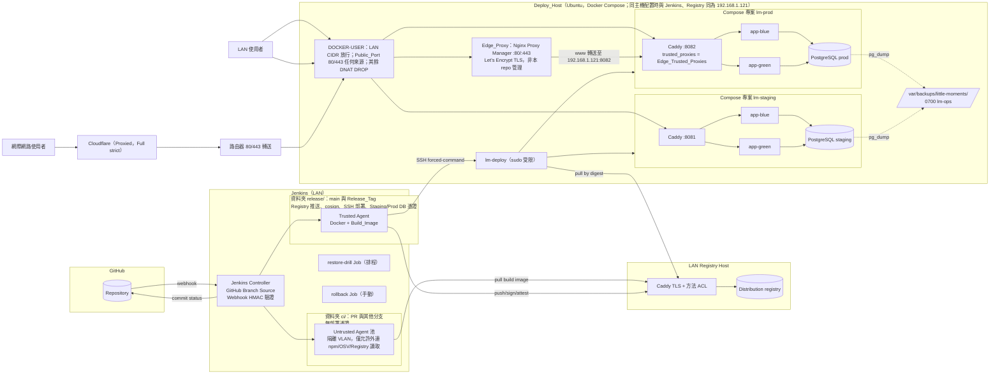
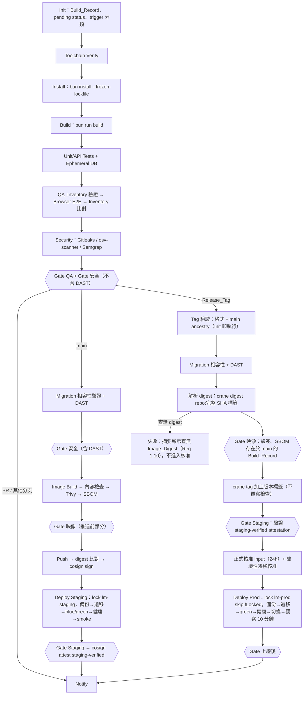
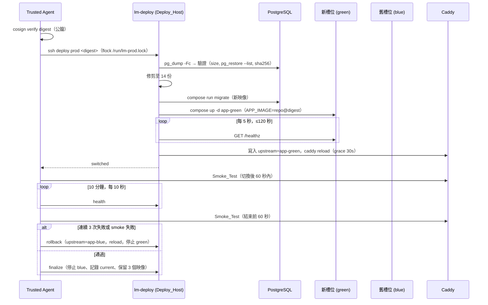
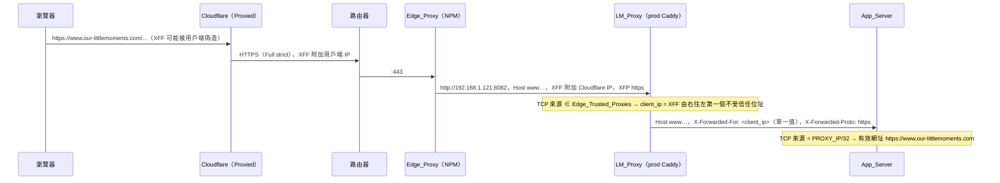
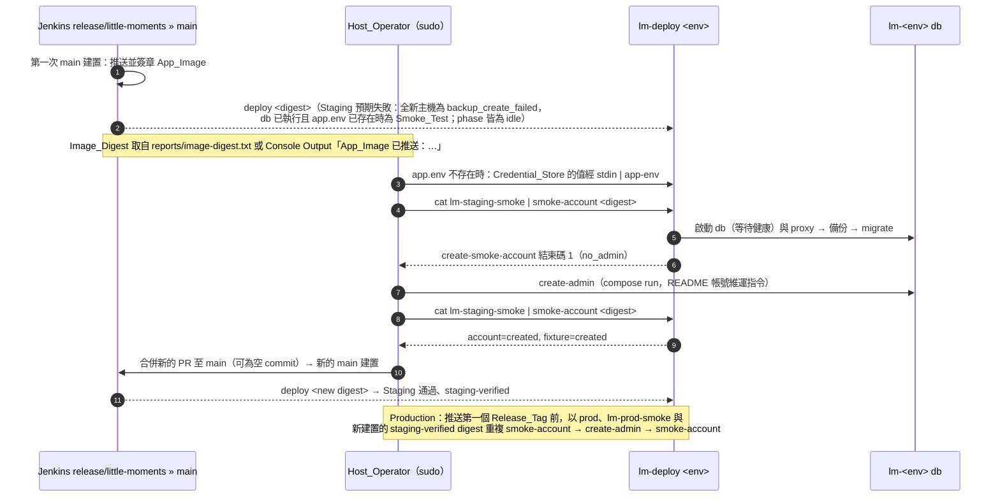
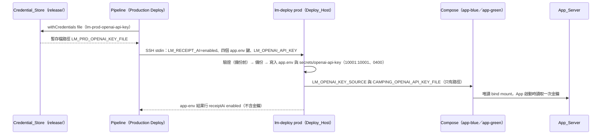
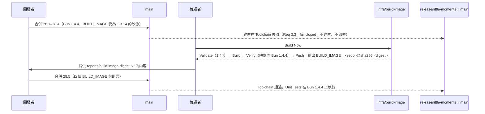

# Design Document：Jenkins CI/CD 與 LAN Docker 部署

## Overview

本設計為「日子拾光 · LITTLE MOMENTS」建立一條由 GitHub Webhook 觸發的 Jenkins Multibranch Pipeline，將通過品質與安全關卡的 App_Image 以 Docker Compose 部署到 LAN 內的 Ubuntu Deploy_Host，並將持久化由 `bun:sqlite` 改為 PostgreSQL。

設計分為四個部分：

1. **CI/CD 平台**：Jenkins controller、可信／不可信兩組 Build_Agent、LAN 私有 Registry、工具鏈 Build_Image，以及單一 `Jenkinsfile` 依觸發類型（PR、其他分支、`main`、Release_Tag）選擇階段。
2. **應用程式變更**：新增設定模組（Bind_Address、Allowed_Hosts、Setup_Token、Database 連線）、`http.js` Host 檢查、Setup_Token 首次管理員流程、`/healthz` 健康端點、資料層由同步 SQLite 改為非同步 PostgreSQL、Migration_Runner、SQLite_Importer。
3. **部署平台**：Deploy_Host 上 staging 與 production 兩套獨立 Compose 專案，每套包含 Caddy 反向代理、blue/green 兩個 App 容器槽位、PostgreSQL 與容器外備份目錄；部署由 SSH 受限金鑰觸發主機端部署腳本。
4. **追蹤與治理**：Build_Record（JSON + 封存報告 + 建置描述）、Release_Gate 評估器、Approved_Exception 政策檔、QA_Inventory 比對、通知階段。
5. **同主機 Edge_Proxy（Requirement 8.8–8.10、25）**：Deploy_Host、Jenkins 與 Registry 為同一台主機 `192.168.1.121`（LAN `192.168.1.0/24`）。主機上不由本 repository 管理的 Nginx Proxy Manager（Edge_Proxy）占用 80／443，路由器把網際網路 80／443 轉給它，Cloudflare 以 Proxied 記錄在前。Production_Environment 經 `https://www.our-littlemoments.com` 公開；LM_Proxy 只採信 Edge_Trusted_Proxies 的轉送標頭，DOCKER-USER 只對宣告的 Public_Port 接受任何來源。細節見 Components 第 18 節。
6. **公開註冊政策（Requirement 26）**：Registration_Policy 改為每個請求從 Settings_Store 讀取（管理員儲存值優先，其次 `CAMPING_REGISTRATION`，最後 `open`），管理員在 `/admin` 切換後下一個請求即生效；Deploy_Host 的 `compose.yaml` 未設定時傳入 `closed`。細節見 Components 第 19 節。
7. **Smoke_Account 佈建（Requirement 27）**：新增維運工具 `scripts/create-smoke-account.mjs`（映像內 `/app/tools/create-smoke-account.js`）與只限 Host_Operator 的 `lm-deploy <env> smoke-account <digest>`。子命令會啟動未執行的 `db`／`proxy`，接著備份、遷移，最後經 stdin 傳入密碼並建立 `smoke-bot` 與 `smoke-fixture`。第一次部署的順序為先建立管理員、再建立 Smoke_Account。部署憑證權限不變（Req 15.9）。細節見 Components 第 21 節。
8. **Jenkinsfile 方法大小**：根目錄 `Jenkinsfile` 的 `pipeline {}` 區塊超過 JVM 單一方法 64 KB 的限制，建置在任何階段前失敗。各階段內容移到區塊之後的頂層函式，行為不變，並以靜態測試限制區塊與函式的行數。細節見 Components 第 22 節。
9. **Production 收據 AI（Requirement 15.6–15.8）**：Release_Approver `jacklin` 決定只在 Production_Environment 啟用 OpenAI 收據辨識。金鑰是 `release/` 的 Secret file 憑證 `lm-prod-openai-api-key`，只在 Production Deploy 的 SSH 呼叫內綁定，經 forced command 的 stdin 交給 `lm-deploy prod deploy`，由它寫入只有 App 容器使用者可讀的金鑰檔並唯讀掛載到 `app-blue`／`app-green`。Staging、還原演練與所有 `ci/` 建置維持停用。細節見 Components 第 25 節。

### 現況盤點（已讀取的程式碼）

| 檔案 | 與本功能相關的現況 |
|---|---|
| `scripts/serve.mjs` | `Bun.serve({hostname:'127.0.0.1', port: PORT\|\|5173, maxRequestBodySize: 4 MiB})`；`CAMPING_DB` 預設 `data/accounts.sqlite`；`CAMPING_DIST` 預設 `dist`；SIGINT/SIGTERM 時 `server.stop(true)` 並關閉 DB。 |
| `server/http.js` | 先呼叫 `accounts.handle`，再以路由／資產 regex 提供靜態檔；`SECURITY_HEADERS` 套用於所有回應；資產回應 `Cache-Control: no-cache`。**目前沒有 Host 檢查**。 |
| `server/accounts.js` | `new Database(dbPath)`、`PRAGMA foreign_keys/busy_timeout/WAL`、`db.exec(SCHEMA + LEDGER_SCHEMA)`；約 50 個同步 `db.query(...)` prepared statement；`tx = fn => db.transaction(fn).immediate()`（單一寫入者語意）；記憶體 `RateLimiter`；`isLoopback(url, info)` 僅用於 `/api/setup`；非 GET 檢查 `Origin === url.origin`；Cookie `ggc_session; HttpOnly; SameSite=Strict; Path=/; Max-Age=…`，`https:` 時加 `Secure`；scrypt `N=16384,r=8,p=1,keylen=64`。 |
| `server/ledger.js` | `LEDGER_SCHEMA`（`trip_ledgers`）。 |
| `server/receipt-ai.js` | OpenAI 收據辨識（任務 18.5 取代 Bedrock）：只讀取 `CAMPING_OPENAI_API_KEY` 或 `CAMPING_OPENAI_API_KEY_FILE` 指定的金鑰檔，以及模型、圖片細節與回覆 token 上限（`CAMPING_OPENAI_*`）；金鑰或模型格式不符即停用。 |
| `scripts/build.mjs` | `Bun.build` 前端至 `dist/`，複製字型與 OCR 資產（`tesseract.js` 等需存在於 `node_modules`），產生 `sw.js`。 |
| `scripts/check-accounts.mjs` | 需要 `CAMPING_BUN`；以 `PORT=5181`、`CAMPING_DB=:memory:` 啟動伺服器；`CHROME_PATH` 缺省時改用 Windows Chrome 路徑；之後啟動 Playwright。 |
| `playwright.config.js` | `workers:2, retries:0`，`CHROME_PATH` 同樣有 Windows 預設，`reporter:'list'`，`outputDir: test-results`。 |
| `tests/*.test.js` | 以 `createAccountService({ dbPath: ':memory:', now })` 同步建立服務；部分測試（`ledger.test.js`、`trip-delete-upgrade.test.js`）直接以 `bun:sqlite` 開檔修改資料列。 |

### 重要設計決策摘要

| 決策 | 選擇 | 理由 |
|---|---|---|
| 憑證隔離 | 兩個 Multibranch Job 共用同一 `Jenkinsfile`：`ci/`（僅 PR 與非 `main` 分支）與 `release/`（僅 `main` 與 Release_Tag），憑證只存在 `release/` 資料夾範圍 | Jenkins 憑證以資料夾為範圍；PR 建置在物理上取不到部署憑證，請求時 `withCredentials` 直接失敗（Req 2.4、2.5）。 |
| PostgreSQL 用戶端 | Bun 內建 `Bun.SQL`（隨 Build_Image／App_Image 的 Bun 精確版本固定），備援為 `postgres@3.4.7`（API 幾乎相同） | 不新增相依套件、tagged template 自動參數化（Req 11.2）；Bun.SQL 的 API 仿照 `postgres` 套件，必要時可低成本切換。 |
| 交易語意 | 每個寫入交易開頭取得 `pg_advisory_xact_lock(<常數>)`，等同 SQLite `BEGIN IMMEDIATE` 的單一寫入者 | 保留現行所有「讀取→檢查→寫入」邏輯的正確性，避免逐一分析競態；LAN 小流量下序列化成本可忽略。 |
| 反向代理 | Caddy（digest 固定），upstream 以 include 檔切換並 `caddy reload`，`grace_period 30s` | 原生優雅重載與連線排空，設定簡潔（Req 20.2、20.3）。 |
| Registry | CNCF Distribution（`registry:3`，digest 固定）前置 Caddy：TLS（內部 CA）+ 每帳號 basic auth + 依 HTTP 方法限制（拉取帳號僅 GET/HEAD），關閉刪除 | 符合「拉取不可推送或刪除」（Req 15.9）；Harbor 為較重的替代方案（見 Open Risks）。 |
| 簽章 | cosign 金鑰模式，`--tlog-upload=false`（LAN 無 Rekor） | Requirement 17 的簽章與驗證；Staging 驗證以 cosign attestation 附在 digest 上。 |
| 掃描工具 | Gitleaks（秘密）、osv-scanner v2（`bun.lock`）、Semgrep CE + repo 內規則（SAST）、Trivy（映像）、Syft（SBOM）、OWASP ZAP + 自訂安全測試套件（DAST） | 皆可離線或固定版本執行並輸出 JSON／SARIF；細節見「工具選型」。 |
| PBT 函式庫 | `fast-check@4.3.0`（devDependency，精確版本） | 在 `bun test` 下可直接使用，具 shrinking。 |
| Edge 轉送標頭信任 | 在 LM_Proxy（Caddy）以 `servers { trusted_proxies static …; trusted_proxies_strict; client_ip_headers X-Forwarded-For }` 決定用戶端 IP，再以 `header_up X-Forwarded-For {client_ip}` 轉送單一值；App_Server 不變，仍只採信 `PROXY_IP/32` | 信任判斷集中在 Edge_Proxy 之後的第一跳；App 的 Trusted_Proxies 不必擴大到 Cloudflare 範圍或 Edge_Proxy 網段（Req 9.12、25.10）。 |
| 公開連接埠例外 | DOCKER-USER 以 `--ctorigdstport` 對宣告的 Public_Port 放行，位於 DNAT DROP 之前；未宣告時規則與原本相同 | 只放行 Edge_Proxy 的 80／443，LM_Proxy 連接埠維持 LAN 限制（Req 8.6、8.8–8.10）。 |
| Smoke_Account 佈建 | Host_Operator 在 Deploy_Host 上執行 `lm-deploy <env> smoke-account`（不在 SSH forced command 清單內），工具在沒有管理員時拒絕；不由 Pipeline 自動建立 | 部署憑證維持 Req 15.9 的權限、不能建立帳號；`needsSetup` 只看使用者數量，先建立 Smoke_Account 會讓該環境無法再建立管理員（Req 9.6）。 |
| 註冊政策來源 | 沿用收據 AI 政策的模式：Settings_Store 的 `registrationPolicy` 列優先，`CAMPING_REGISTRATION` 只是讀取時的後備值；本機預設 `open`，Compose 預設 `closed` | 不需重新部署即可切換（Req 26.5）；與既有 `resolveReceiptAiPolicy`、`/api/admin/settings` 同一套儲存、稽核與 UI；本機開發與既有測試維持 `open`。 |
| Production 收據 AI 金鑰的傳遞 | Pipeline 只在 Production Deploy 綁定 `lm-prod-openai-api-key`，把金鑰與明確的開關 `LM_RECEIPT_AI` 放在既有的 `--app-env-stdin` 串流；`lm-deploy` 寫入 `/srv/lm/prod/secrets/openai-api-key`（10001:10001、0400），Compose 以長語法唯讀掛載，停用時掛載 `/dev/null` | 不新增 SSH 子命令或部署憑證權限（Req 15.9）；金鑰不進入 app.env、指令列或 `docker inspect` 可見的環境變數；開關明確，停用會刪除金鑰檔；同一份 `compose.yaml` 涵蓋啟用與停用（Components 第 25 節）。 |

### 先前的設計假設與需求對齊狀態

以下五項原本是 Design 階段的解讀假設，需求文件更新後均已明確規範，本設計依需求實作：

1. **Release_Gate 順序（已對齊 Req 1.3、1.4、1.10、16.1、23.2）**：`main` 建置依序為「QA」→「安全」→ App_Image 建置 →「映像」→ 推送與簽章 → Staging 部署 →「Staging」。Release_Tag 建置對 Tag commit 重跑「QA」與「安全」，**不重新建置**，改以「Registry 中以完整 Commit SHA 為標籤的映像」解析 `main` 建置產生的 Image_Digest（見 Components 第 17 節），再評估「映像」（cosign 簽章驗證 + Build_Record 中的 SBOM）與「Staging」（`staging-verified` attestation），之後才進入正式核准。查無 Image_Digest 時依 Req 1.10 在等待核准前失敗並於建置摘要說明原因。
2. **最終映像不含 `src/`（已對齊 Req 16.2、16.4）**：`server/accounts.js` 匯入 `src/model.js`、`src/ingredients.js`、`src/expense-categories.js`、`src/receipt-ocr.js`。建置階段以 `bun build --target=bun` 將 `scripts/serve.mjs`、`server/` 與其匯入的 `src/` 模組打包為單一檔案；最終映像只含打包成品、Migration_Runner、遷移檔、`dist/` 與正式相依套件，非 root 使用者對打包成品、`dist/` 與遷移檔無寫入權限。
3. **秘密遮罩範圍（已對齊 Req 15.4）**：需求改為「完整原文、Base64 編碼形式與 URL 編碼形式皆不得出現」。`ci/scrub.mjs` 在封存前遮罩這三種形式，之後再以同一組形式掃描待封存檔案；仍偵測到任一形式時不存入該檔案的未遮罩版本，並將建置標記為失敗（見 Components 第 9 節）。
4. **Docker 發布連接埠的 LAN 限制（已對齊 Req 8.6）**：需求已明確要求限制在 Docker 轉送層生效；本設計以 `DOCKER-USER` iptables chain 實作（見 Components 第 12 節），不依賴 UFW。
5. **反向代理信任（已對齊 Req 9.12 與 Glossary 的 Trusted_Proxies）**：`CAMPING_TRUSTED_PROXIES` 接受 IP 或 CIDR。App 僅在 TCP 來源 IP 落在 Trusted_Proxies 內時採信 `X-Forwarded-For`／`X-Forwarded-Proto`，用以重建請求網址（Req 10.1、10.5）與限速鍵（Req 9.8）；其他來源一律忽略這兩個標頭。經代理轉送的請求永遠不視為 loopback 用戶端，LAN 上的首次設定一律須附帶 Setup_Token。

## Architecture

### 整體架構



### 信任邊界

| 邊界 | 控制 |
|---|---|
| GitHub → Jenkins | GitHub plugin 的 webhook shared secret（HMAC-SHA256，`X-Hub-Signature-256`，常數時間比較）；Jenkins 前置 Caddy 寫入拒絕日誌（時間、來源 IP、原因），不記錄 body。 |
| PR 程式碼 → 憑證 | `ci/` 資料夾無任何部署相關憑證；GitHub Branch Source 的 PR 信任策略設為「From users with Admin or Write permission」，fork／無寫入權限者使用 `main` 的 `Jenkinsfile`（Req 2.7）；非管理員移除 Replay 權限。 |
| Untrusted Agent → LAN | Agent 位於獨立 VLAN；防火牆拒絕連線至 Deploy_Host、Staging/Prod 連接埠與 DB；建置結束 `cleanWs()` 並 `docker rm -f` 該建置標籤的容器、網路與卷（Req 2.6）。 |
| Trusted Agent → Deploy_Host | 每環境一把 SSH 金鑰，`authorized_keys` 設定 `command="sudo /opt/lm/bin/lm-deploy staging",no-pty,no-port-forwarding,from="<agent IP>"`；部署帳號不在 `docker` 群組，sudoers 僅允許執行對應環境的固定腳本（Req 15.9；傳統 sudo 與 sudo-rs 相容性見 Components 第 20 節）。 |
| DAST 環境 | `docker network create --internal`，只含 Test_Environment、Ephemeral_Database 與 ZAP；啟動前執行隔離探測（Req 7.7、7.9）。 |
| LAN → App | `DOCKER-USER` 規則僅允許 `LAN_CIDR` 至代理連接埠；DB 不發布連接埠（Req 8.6、11.10）。 |
| 網際網路 → Edge_Proxy | Cloudflare（Proxied、Full strict）→ 路由器 80／443 → Edge_Proxy；DOCKER-USER 只對宣告的 Public_Port（80、443）接受任何來源，LM_Proxy 的 8081／8082、Registry 8443 仍只限 LAN CIDR（Req 8.6、8.8）。 |
| Edge_Proxy → LM_Proxy（prod） | Edge_Proxy 以 `http://192.168.1.121:8082` 轉送；LM_Proxy 只對 TCP 來源在 Edge_Trusted_Proxies 內的請求採信 `X-Forwarded-For`（strict 由右往左）與 `X-Forwarded-Proto`（僅 `http`／`https`），其他來源一律以 TCP 來源與自身協定覆寫（Req 25.1–25.6）。 |
| LM_Proxy → App | App 只採信 `PROXY_IP/32` 的轉送標頭，收到的 `X-Forwarded-For` 恰為一個位址（Req 9.12、25.3、25.10）。 |

### Jenkins Job 配置

| Job | 類型 | Discover | 憑證 | Build Discarder／Orphan 策略 |
|---|---|---|---|---|
| `ci/little-moments` | Multibranch | PR（merge 與 head）、非 `main` 分支 | 無（僅 GitHub 讀取 App 憑證） | PR：`daysToKeep 14`；orphaned item 保留 14 天（Req 21.5） |
| `release/little-moments` | Multibranch | 僅 `main` 分支與 Tag（`basic-branch-build-strategies` 的 Tag build strategy，正規式 `^v\d+\.\d+\.\d+$` 只作預篩，最終驗證在 Pipeline 內） | Registry push、cosign key、SSH staging/prod、Staging/Prod DB、smoke 帳號、Setup_Token | `main`：90 天；Tag：365 天（Req 21.3、21.4） |
| `release/rollback` | Pipeline（參數化） | — | SSH prod | 365 天 |
| `release/restore-drill` | Pipeline（cron `H 3 1,15 * *`，兩次間隔 ≤ 16 日） | — | SSH prod（唯讀備份讀取 + drill 專案） | 365 天 |
| `release/digest-lookup` | Pipeline（參數：digest） | — | Jenkins API 讀取 | 30 天 |
| `infra/build-image` | Pipeline | — | Registry push | 90 天 |

保留期間內的不可變性（Req 21.12）以 Matrix Authorization 實作：非管理員無 `Run/Delete`、`Run/Update`、`Job/Configure`、`Run/Replay`。正在 Production 執行或屬最近 3 個可回滾 digest 的建置，由部署腳本回呼 Jenkins API 設定 `keepLog=true`，移出保留集合時解除（Req 21.6）。

### Pipeline 階段配置



Release_Tag 的 Tag 驗證（Req 1.5）於 Init 階段最先執行，不通過時在任何推送／部署階段前失敗。Release_Tag 建置的 digest 解析、版本標籤與 Req 1.10 的失敗路徑見 Components 第 17 節。

| 觸發 | 執行的 Job | 階段 |
|---|---|---|
| PR 開啟／更新／重開 | `ci/` | Init → Toolchain → Install → Build → Unit → E2E → Security（無 DAST）→ Notify |
| 其他分支推送（無 PR） | `ci/` | 同上（Req 1.8） |
| `main` 推送 | `release/` | 上述 + Migration 相容性 + DAST → Image Build/Scan/SBOM → Push/Sign → Staging → Notify（Req 1.3） |
| Release_Tag 推送 | `release/` | Tag 驗證 → 上述品質安全階段（對 Tag commit 重跑，不重新建置）→ 以完整 SHA 標籤解析 `main` 產生的 digest（查無即失敗，Req 1.10）→「映像」關卡（驗簽 + SBOM）→ 加上版本標籤 →「Staging」關卡（attestation）→ 核准 → Production → Notify（Req 1.4） |

Pipeline 以 `checkout scm` 後執行 `git rev-parse HEAD` 取得確切 Commit SHA，所有後續階段使用該 SHA 與同一工作目錄（Req 1.6）。`options { skipDefaultCheckout(); timestamps(); disableResume() }`；失敗由 `error()` 終止，後續 stage 不執行（Req 1.7）。

### 部署流程（Production）



## Components and Interfaces

### 1. 應用程式設定模組 `server/config.js`（新增）

純函式，不讀檔、不連網，便於 PBT。

```js
/** @returns {{ok:true, config:AppConfig} | {ok:false, errors:{name:string, reason:string}[]}} */
export function parseConfig(env) {}
export function isLoopbackAddress(ip) {}           // 127.0.0.0/8、::1、::ffff:127.0.0.0/104
export function normalizeHost(hostHeader) {}        // 移除 :port、轉小寫、保留 IPv6 方括號；無效回傳 null
export function hostAllowed(hostHeader, allowedHosts) {}
export function redactedSummary(config) {}          // 啟動訊息：bind、port、allowedHosts（不含秘密）
export function parseCidrList(value) {}             // "10.0.0.5,172.18.0.0/16,fd00::/8" → [{family, network, prefix}]；無效回傳 null
export function ipInCidrs(ip, cidrs) {}             // 含 IPv4-mapped IPv6（::ffff:a.b.c.d）正規化
export function resolveClient(tcpIp, headers, url, trustedProxies) {}
// → { clientIp, protocol, viaProxy }；僅 tcpIp ∈ trustedProxies 時採信 X-Forwarded-*（Req 9.12）
```

| 環境變數 | 必填 | 預設 | 驗證 | 失敗行為 |
|---|---|---|---|---|
| `CAMPING_BIND_ADDRESS` | 否 | `127.0.0.1` | `net.isIP() !== 0` | 結束碼 2，訊息含變數名（Req 8.7） |
| `PORT` | 否 | `5173` | `/^\d+$/` 且 1..65535 | 同上 |
| `CAMPING_ALLOWED_HOSTS` | 非 loopback 時必填 | `127.0.0.1,localhost,[::1]` | 1..32 項、每項 1..253 字元、不得空項或含 `*`；項目為主機名（RFC 1123 標籤）、IPv4 或 `[IPv6]` | 非 loopback 且未設 → 結束碼 2（Req 8.4） |
| `CAMPING_SETUP_TOKEN` | 否 | 非 loopback 時自動產生 | 長度 ≥ 32 | 少於 32 → 結束碼 2，不輸出值（Req 9.3） |
| `CAMPING_TRUSTED_PROXIES` | 否 | 空（不採信任何轉送標頭） | 逗號分隔，每項為 IPv4／IPv6 位址或 CIDR（IPv4 前綴 0..32、IPv6 前綴 0..128）；不得空項、不得含 `*` | 無效 → 結束碼 2，訊息含變數名 |
| `CAMPING_DATABASE_HOST`／`_PORT`／`_NAME`／`_USER`／`_PASSWORD` | 是 | `_PORT`=5432 | 非空；port 1..65535 | 缺少任一 → 結束碼 2，列出缺少名稱（Req 11.8） |
| `CAMPING_DATABASE_SSLMODE` | 否 | `disable`（同一 Compose 網路） | `disable\|require\|verify-full` | 結束碼 2 |
| `CAMPING_OPENAI_*` | 否 | 空 | 沿用 `receipt-ai.js` | 停用 AI |

`CAMPING_DB` 不再讀取（Req 11.1）；若仍設定，啟動時輸出警告「已忽略」。

`scripts/serve.mjs` 改為：

```js
const result = parseConfig(process.env);
if (!result.ok) { for (const e of result.errors) console.error(`設定錯誤 ${e.name}: ${e.reason}`); process.exit(2); }
const { config } = result;
const db = await connectWithRetry(config.database, { attempts: 30s 內、間隔 1–5 秒 });   // Req 11.5
const setup = createSetupGuard(config);   // 必要時產生並一次性列印 Setup_Token
const accounts = await createAccountService({ db, receiptAi, setup, trustedProxies: config.trustedProxies });
const server = Bun.serve({ hostname: config.bindAddress, port: config.port, maxRequestBodySize: 4_194_304,
  fetch: createHttpHandler({ root, accounts, allowedHosts: config.allowedHosts, health: () => db.ping(2000) }) });
console.log(`Camping accounts ready: bind=${config.bindAddress} port=${server.port} allowedHosts=${config.allowedHosts.join(',')}`);
```

`check-accounts.mjs` 以 `Camping accounts ready:` 前綴等待，前綴保留以維持相容。

### 2. HTTP 處理器 `server/http.js`（修改）

處理順序：

1. `GET /healthz`（Host 仍須在 Allowed_Hosts 內）→ `health()` 2 秒逾時；成功 `200 {"status":"ok","database":"ok"}`，失敗 `503 {"status":"error","database":"unavailable"}`。Health_Check 的 5 秒上限由呼叫端控制（Req 11.6）。Caddy 對外部請求 `/healthz` 回應 404，部署腳本從容器網路內呼叫。
2. **Host 檢查**：`hostAllowed(req.headers.get('host'), allowedHosts)` 不通過 → `421 Misdirected Request` + `SECURITY_HEADERS`，不呼叫 `accounts.handle`、不讀檔（Req 8.3、10.6）。
3. 重建有效請求網址（`resolveClient`，Req 9.12）：TCP 來源 IP 取自 `server.requestIP(req)`。若該 IP 落在 `trustedProxies`（IP 或 CIDR）內，以 `X-Forwarded-Proto`（僅接受 `http`/`https`，其他值忽略）取代協定，客戶端 IP 取 `X-Forwarded-For` 由右往左第一個不在 Trusted_Proxies 內的位址；否則完全忽略這兩個標頭，客戶端 IP 即 TCP 來源 IP、協定為 Bun 回報的協定。只要 TCP 來源屬於 Trusted_Proxies，結果標記 `viaProxy=true`，`/api/setup` 的 loopback 條件（Req 9.1 (a)）一律不成立，即使轉送標頭聲稱來源為 `127.0.0.1`。
4. 其餘維持現狀（API → 靜態路由 → 404），所有錯誤分支皆附 `SECURITY_HEADERS`。

### 3. 首次管理員設定 `server/setup-guard.js`（新增）

```js
export function createSetupGuard({ bindAddress, setupToken, randomBytes, log }) {
  // 回傳 { required:boolean, verify(candidate):boolean, consume():void }
}
```

- 啟用條件：`!isLoopbackAddress(bindAddress)`。未提供 `CAMPING_SETUP_TOKEN` 時以 `crypto.randomBytes(32)` 產生 base64url（256 位元）並 `console.log` 一次（容器 stdout，僅本機 `docker logs` 可見）；不寫入 DB 或回應（Req 9.2）。
- `verify`：對雙方先做 SHA-256 再 `crypto.timingSafeEqual`，比較時間與內容無關（Req 9.7）。
- `consume`：建立管理員成功後設定記憶體旗標；另一層保證來自 DB（使用者數 ≥ 1 時一律 409，Req 9.5、9.6），所以 blue/green 兩容器共用同一 token 也不會被重用。

`POST /api/setup` 新流程：

```text
1. limiter.hit(`setup:client:${ip}`)；若已達 30/15 分 → 429（不驗證 token）            (Req 9.8, 9.9)
2. userCount ≥ 1 → 409                                                                   (Req 9.6)
3. 授權：(loopback Host 且 loopback TCP IP 且 !viaProxy) 或 guard.verify(body.setupToken)   (Req 9.12)
   不通過 → audit('setup-denied', reason ∈ {missing_token, token_mismatch, non_loopback}) → 403   (Req 9.1, 9.4)
4. 驗證 username/displayName/password → 400，token 保持有效                              (Req 9.10)
5. tx(async t => { advisory lock; if count≠0 → 409; insert admin; audit })               (Req 9.11)
6. guard.consume(); startSession
```

`GET /api/session` 新增 `setupTokenRequired: boolean`；`src/accounts-ui.js` 的設定表單在該值為 true 時顯示「設定碼」欄位。限速順序「先計數再判斷」使通過與未通過的請求都計入（Req 9.8）。

稽核寫入的 `target` 只放原因類別與來源 IP，不放 token。

### 4. 資料層 `server/db/`（重構）

```
server/db/
  connect.js        // createDatabase(config) → { sql, ping(ms), close() }；connectWithRetry
  tx.js             // withWriteTx(sql, fn)：BEGIN；SELECT pg_advisory_xact_lock(726361); fn(t)；COMMIT
  queries.js        // 將現行 q.* 改為 async 函式，接收 executor（sql 或 t）
server/accounts.js  // createAccountService 改為 async；路由改 await
```

**Bun.SQL 與 `postgres` 套件評估**

| 面向 | `Bun.SQL`（內建） | `postgres@3.4.7` |
|---|---|---|
| 相依性 | 無；版本隨 Bun 固定 | 新增一個 npm 套件與供應鏈面 |
| API | `sql\`...\``、`sql.begin(async t => …)`、連線池 | 相同風格（Bun.SQL 仿照此套件） |
| 成熟度 | 較新，需以整合測試覆蓋 BIGINT、交易回復、斷線重連 | 成熟、社群廣 |
| 決策 | **採用**；Requirement 11.9 的重連行為由測試驗證 | 備援：若 Bun.SQL 在斷線恢復或錯誤型別上不符需求，切換成本僅在 `connect.js` |

**轉換規則**

- `db.query(sql).get/all/run(...args)` → `await t\`...\`` tagged template；全部參數化，不使用字串拼接（`sql.unsafe` 禁用，Semgrep 自訂規則檢查）。
- `tx(fn)` → `withWriteTx(sql, async t => …)`：所有現行 `tx` 呼叫點保留同樣的「交易內重新檢查」結構，並以全域 advisory lock 序列化寫入者，語意等同 `BEGIN IMMEDIATE`。任何例外 → `ROLLBACK`（Req 11.3）。
- 不在交易內的讀取（`currentUser`、`needsSetup` 等）直接使用池連線；交易內的讀取一律使用 `t`。
- `INTEGER` 毫秒時間戳 → `BIGINT`；讀取時以 `Number()` 轉換並檢查 `Number.isSafeInteger`。`COUNT(*)` 同樣轉換。
- `state_json`、`ledger_json`、`requests_json` 保留 `TEXT`（不改 `jsonb`），維持位元組相同，`requestHash` 與損壞資料偵測（`ledger.test.js`）語意不變。
- `audit.id INTEGER PRIMARY KEY AUTOINCREMENT` → `BIGINT GENERATED BY DEFAULT AS IDENTITY`；匯入後 `setval`（Req 13.10）。
- `close()` 改為 `await sql.close({ timeout: 5 })`。

**限速器**維持記憶體 `RateLimiter`（不在本需求範圍內改動）。影響見 Open Risks。

### 5. Migration_Runner `scripts/migrate.mjs` 與 `server/db/migrations.js`（新增）

檔案配置：

```
migrations/
  0001_initial.sql          -- 由現行 SCHEMA + LEDGER_SCHEMA 轉換
  0002_xxx.sql
```

檔名規則 `^(\d{4,})_[a-z0-9_]+\.sql$`，版本為檔名數字（正整數）。檔頭可含 `-- lm:destructive` 標記。

核心邏輯以純函式與 I/O 分離：

```js
export function loadMigrations(files)            // [{version, name, sql, checksum, destructive}]；版本重複或非正整數 → throw（Req 12.7）
export function planMigrations(repo, applied)    // {toApply:[...], unknownApplied:[...], checksumMismatch:[...]}
export async function runMigrations(sql, repo)   // 見下
```

`runMigrations`：

1. `SELECT pg_advisory_lock(726362)`（session 級，避免 blue/green 或兩次部署同時遷移）。
2. `CREATE TABLE IF NOT EXISTS schema_migrations (...)`。
3. 讀取紀錄 → `planMigrations`；若有 `checksumMismatch` → 不修改任何東西，結束碼 3 並列出版本（Req 12.7）。`unknownApplied`（DB 有、repo 沒有的較新版本，回滾情境）保留不動（Req 12.2）。
4. 依版本遞增，每個遷移在獨立交易內執行 SQL 與寫入紀錄；失敗 → 該交易回復、輸出版本號、結束碼 4，先前成功者保留（Req 12.4）。
5. 輸出 `applied: [..] count: n`，結束碼 0。

PostgreSQL 的 DDL 具交易性，所以「回復 Schema 與資料變更」可直接由交易保證。遷移檔不得含 `CREATE INDEX CONCURRENTLY` 等無法在交易內執行的語句（lint 檢查）。

**破壞性遷移偵測** `scripts/lint-migrations.mjs`：移除 SQL 註解與字串常值後，以 token 掃描 `DROP TABLE`、`DROP COLUMN`、`ALTER TABLE … RENAME`、`ALTER TABLE … DROP`；偵測到但無 `-- lm:destructive` → 建置失敗（Req 12.9）。標記為破壞性者，Pipeline 在 Production 前另起一次 `input`，核准人須為 Release_Approver，且不得與 `git log --format=%ae -- migrations/<file>` 的作者電子郵件（透過 `ci/release-approvers.json` 對應 Jenkins ID 與 email）相同（Req 12.6）。

**相容性驗證**（Req 12.5、12.8）：以 `git describe --tags --abbrev=0 --match 'v*' <sha>^` 找最近 Release_Tag；在 Ephemeral_Database 上以該 Tag 的 App_Image 執行 migrate，再以本次 commit 的 Migration_Runner 套用新增遷移，最後以舊映像啟動並執行 Smoke_Test。無 Tag 時記錄略過原因。

### 6. SQLite_Importer `scripts/import-sqlite.mjs`（新增）

```
bun scripts/import-sqlite.mjs --source /path/accounts.sqlite   # 目標由 CAMPING_DATABASE_* 提供
```

1. 檢查來源存在、計算 SHA-256（含 `-wal` 若存在）。
2. 將來源檔（與 `-wal`、`-shm`）複製到 `os.tmpdir()` 下新建的 0700 目錄，於複本上 `new Database(copy, { readonly: false })` 執行 `PRAGMA wal_checkpoint(TRUNCATE)` 後以唯讀方式讀取；來源目錄不產生任何檔案（Req 13.2）。結束時刪除暫存目錄並再次比對來源雜湊。
3. 驗證 SQLite 標頭與所需資料表（`users, sessions, trips, trip_members, invites, trip_deletions, audit, trip_ledgers`）；不符 → 在連線目標前結束（Req 13.9）。
4. 連線目標，先 `runMigrations` 確保 Schema；在單一交易內 `SELECT count(*)` 每表，任一 > 0 → 回復並結束（Req 13.3）。
5. 依外鍵順序以參數化批次 `INSERT`（每批 500 列）寫入；欄位原樣，`password_hash` 原字串（Req 10.9、13.8）。
6. 提交前比對每表來源與目標筆數，不符 → 回復（Req 13.6）；`SELECT setval(pg_get_serial_sequence('audit','id'), max(id))`（Req 13.10）。
7. 提交後輸出 `table source target`，結束碼 0（Req 13.5）。

純函式部分 `server/db/import-plan.js`：`tableOrder()`、`convertRow(table, row)`（SQLite 值 → PG 參數：整數保持 `number`/`bigint`、NULL 保留、文字 UTF-8 原樣）、`compareCounts(source, target)`，供往返 PBT 使用。

### 7. 測試基礎設施

- `tests/support/pg.js`：讀取 `CAMPING_TEST_DATABASE_*`；每個測試檔建立獨立 schema `t_<random>`，設定 `search_path` 後執行遷移，`afterAll` `DROP SCHEMA … CASCADE`。同一 Ephemeral_Database 內以 schema 隔離測試檔，不同建置使用不同資料庫容器（Req 4.8）。
- `tests/*.test.js`：`createAccountService` 改為 `await`；直接以 `bun:sqlite` 修改資料列的測試改用 `t\`UPDATE ...\``；「拒絕公開資料庫路徑」的測試改為 `config.test.js` 的對應案例。
- `scripts/check-accounts.mjs`：`CHROME_PATH` 與 `CAMPING_BUN` 皆必填且需存在、可執行，否則丟出指出變數名的錯誤；改用 `CAMPING_DATABASE_*` 指向 Ephemeral_Database；移除 Windows 預設路徑。
- `playwright.config.js`：移除 Windows 預設；新增 projects `desktop`（1440×1000）與 `mobile`（390×844，僅 `grep: /@critical/`）；reporter `[['list'],['junit',{outputFile:'reports/e2e-junit.xml'}],['json',{outputFile:'reports/e2e.json'}]]`；`retries: 0`。
- 測試案例 ID 規範：測試標題以 `[TC-<area>-<nnn>]` 開頭，重要頁面加 `@critical` 標籤。
- `scripts/qa-inventory.mjs`：`validateInventory(doc)` 與 `compareInventory(inventory, results)` 純函式 + CLI。
- 本機開發以 `docker run --rm -d --name lm-pg -e POSTGRES_PASSWORD=<placeholder> -p 127.0.0.1:55432:5432 postgres:17.6@sha256:<digest>` 建立 Ephemeral_Database（README 說明，Req 24.8）。

### 8. 安全測試套件 `tests/security/*.sec.js`（新增）

以 `bun test` 對 Test_Environment 的 base URL 執行，覆蓋 Req 7.6 的九類：SQL injection、XSS（Playwright 確認 `<script>` 以文字呈現、`window.__xss` 未被設定）、未登入存取、跨使用者存取、角色越權、Session 失效、Origin 檢查、登入限速（同帳號 5 次失敗後正確密碼仍 429）、路徑穿越（`/../`、`%2e%2e%2f`、`..%5c` 等）。同一套件以 `CAMPING_BIND_ADDRESS=0.0.0.0`、非 loopback Host 名稱執行 Req 10 第 1–9 條的行為（Req 10.10）。輸出 JUnit 到 Build_Record。

### 9. CI 工具與政策評估器 `ci/`

```
ci/
  toolchain.json              # {"bun":"1.4.4","node":"22.x 精確版","chromium":"<build>"}（Bun 版本見 Components 第 26 節）
  build-image/Dockerfile      # FROM mcr.microsoft.com/playwright:v1.56.1-noble@sha256:… + 安裝精確 Bun
  verify-toolchain.mjs        # 比對實際版本與 toolchain.json（Req 3.2, 3.3）
  verify-env.mjs              # CHROME_PATH / CAMPING_BUN 存在且可執行（Req 3.9）
  policy/normalize.mjs        # 各掃描器輸出 → Finding[]
  policy/evaluate.mjs         # evaluateFindings(findings, exceptions, today) → {pass, unresolved, expired, invalidExceptions}
  policy/tag.mjs              # parseReleaseTag(name) → {major,minor,patch} | null
  record.mjs                  # Build_Record 讀寫、遮罩
  scrub.mjs                   # 封存前遮罩秘密原值、Base64、URL 編碼形式，再掃描確認（Req 15.4）
  resolve-digest.mjs          # Release_Tag：以完整 SHA 標籤解析 digest、加版本標籤（Req 1.4、1.10、16.6、16.10）
  retention.mjs               # pruneBackups(list, keep=14)、retainImages(history, keep=3)
  release-approvers.json      # Jenkins ID ↔ git email 對照
security/exceptions.json      # Approved_Exception 清單
qa/inventory.json             # QA_Inventory
```

這些 `.mjs` 都在 Build_Image 內以 Bun 執行，並納入 `bun test`。

**秘密遮罩與封存前掃描 `ci/scrub.mjs`**（Req 15.4、21.9）：

1. 秘密集合 S 由 Pipeline 在 `withCredentials` 區塊內以檔案（0600、建置結束刪除）交給 scrub，不經環境變數進入後續階段（Req 15.2）。
2. 對每個 s ∈ S 產生比對形式：原文、標準 Base64、Base64URL（含與不含 `=` 補齊），以及 `encodeURIComponent` 的 URL 編碼形式（大小寫十六進位兩種）。
3. `scrub(text, S)` 依長度由長到短取代為固定遮罩 `********`（不保留任何原文字元）。
4. `findLeaks(text, S)` 在遮罩後再以同一組形式掃描；回傳命中的「憑證 ID × 形式」清單，不回傳值本身。
5. 主控台日誌、JUnit／JSON 報告、掃描報告與 Build_Record 都先寫入暫存目錄，經步驟 3、4 後才 `archiveArtifacts`。任一檔案仍有命中 → 該檔案不封存（只封存一份記錄檔名與憑證 ID 的說明檔），建置標記為失敗。
6. Jenkins Mask Passwords／Credentials Binding 的即時遮罩仍啟用，作為主控台輸出的第一道防線；scrub 是封存前的強制檢查。

### 10. 工具選型

| 用途 | 工具（版本與 digest 固定） | 理由與注意事項 |
|---|---|---|
| 秘密掃描 | Gitleaks 8.x：`gitleaks dir`（工作樹）+ `gitleaks git --log-opts="<base>..<sha>"`；`--redact`（等同 `--redact=100`）、`--report-format json` | `--redact` 將秘密值完全以遮罩取代，報告只保留 `RuleID`、`File`、`StartLine` 與 `Commit`（Req 6.4）；`normalize` 另丟棄 `Match`／`Secret` 欄位，報告與日誌再經 `ci/scrub.mjs` 處理。Untrusted_PR 的 `<base>` 為 `git merge-base origin/<target> HEAD`；Trusted_Ref 的 `<base>` 取上次成功建置的 `GIT_PREVIOUS_SUCCESSFUL_COMMIT`，無則完整歷史（Req 6.1）。偵測到任何秘密即失敗，Approved_Exception 不適用。 |
| 相依套件漏洞 | **osv-scanner v2**（`--lockfile=bun.lock`、`--format json`） | osv-scanner v2 透過 OSV-Scalibr 支援文字格式 `bun.lock`（參見 [Supported Artifacts and Manifests](https://google.github.io/osv-scanner/supported-languages-and-lockfiles) 與 [release notes](https://github.com/google/osv-scanner/releases)）。Trivy 的文件列出 Bun 支援（[Trivy Node.js coverage](https://trivy.dev/docs/latest/guide/coverage/language/nodejs/)），但 `bun.lock` analyzer 曾是開放 issue（[#8840](https://github.com/aquasecurity/trivy/issues/8840)）。**注意**：兩者的 `bun.lock` 支援都較新，固定版本前必須以 `toolchain` 驗證工作確認能解析本 repo 的 `bun.lock` 且產生非零套件數；Pipeline 在解析出的套件數為 0 時視為掃描無法完成（Req 6.8）。另以 Trivy 掃描安裝後的 `node_modules`（讀取各套件 `package.json`）作交叉驗證。 |
| SAST | Semgrep CE（固定版本），規則 vendored 在 `ci/semgrep/`（JavaScript 安全規則 + 自訂：禁止 `sql.unsafe`、`eval`、`new Function`、`child_process` 動態參數） | 離線執行、不依賴雲端 registry；`ERROR`→High、`WARNING`→Medium、`INFO`→Low。 |
| 映像掃描 | Trivy（`image --scanners vuln,secret --format json`），DB 以 `trivy-db` mirror 在 LAN | OS 與 app 相依漏洞 + 秘密（Req 17.1）。 |
| SBOM | Syft（`-o cyclonedx-json`） | 列出 OS 與 npm 套件（Req 17.4）。 |
| 簽章 | cosign（key pair 存於 Credential_Store：`cosign.key` 檔案憑證 + 密碼） | `cosign sign --key --tlog-upload=false repo@digest`；Deploy_Host 以 `cosign.pub` 驗證（Req 17.5、17.7）。 |
| Registry 操作 | crane | `crane digest`、`crane tag`（不覆寫檢查）、`crane ls`。 |
| DAST | OWASP ZAP stable（automation framework YAML） | `env.contexts.urls` 與 `includePaths` 僅 Test_Environment；`connection.threadPerHost=5`、規則 `rateLimit` 20 rps；`maxDuration` 60 分鐘（Req 7.2、7.4）。 |
| 反向代理 | Caddy 2.x | 優雅 reload、`lb_policy` 單一 upstream、`grace_period`。 |
| 資料庫 | PostgreSQL 17（`postgres:17.x@sha256`） | 與 `pg_dump`／`pg_restore` 版本一致。 |
| Jenkins plugins | GitHub Branch Source、GitHub（webhook secret）、Basic Branch Build Strategies、Credentials Binding、Mask Passwords、Lockable Resources、Docker Pipeline、JUnit、Pipeline: Input Step、Timestamper、Workspace Cleanup、Matrix Authorization、Pipeline GitHub Notify Step、Skip Notifications Trait | 對應 Req 1、2、15、18.9、20.12、21、22。 |

### 11. Dockerfile 與 `.dockerignore`

```dockerfile
# syntax=docker/dockerfile:1.10@sha256:<digest>
FROM oven/bun:1.4.4@sha256:<digest> AS deps
WORKDIR /src
COPY package.json bun.lock ./
RUN bun install --frozen-lockfile

FROM deps AS build
COPY . .
RUN bun run build \
 && bun build scripts/serve.mjs --target=bun --outfile=/out/server/serve.js \
 && bun build scripts/migrate.mjs --target=bun --outfile=/out/server/migrate.js \
 && bun build scripts/import-sqlite.mjs --target=bun --outfile=/out/tools/import-sqlite.js \
 && cp -r dist /out/dist && cp -r migrations /out/migrations

FROM oven/bun:1.4.4@sha256:<digest> AS prod-deps
WORKDIR /src
COPY package.json bun.lock ./
RUN bun install --frozen-lockfile --production

FROM oven/bun:1.4.4-distroless@sha256:<digest> AS runtime
ARG REVISION VERSION CREATED
LABEL org.opencontainers.image.revision=$REVISION \
      org.opencontainers.image.version=$VERSION \
      org.opencontainers.image.created=$CREATED
WORKDIR /app
COPY --from=build --chown=0:0 --chmod=0444 /out/ /app/
COPY --from=prod-deps --chown=0:0 /src/node_modules /app/node_modules
COPY --chown=0:0 --chmod=0444 package.json /app/package.json
USER 10001:10001
ENV CAMPING_DIST=/app/dist NODE_ENV=production
EXPOSE 5173
ENTRYPOINT ["bun", "/app/server/serve.js"]
```

- 最終階段只有 Bun runtime、打包後的 `server/`、`migrations/`、`dist/`、`tools/import-sqlite.js`（維運工具，App_Server 程序不載入 `bun:sqlite`）、production `node_modules`（Req 16.2）。目錄 `0555`、檔案 `0444` 屬 root，UID 10001 無寫入權（Req 16.4）。
- `serve.js` 打包後 `root` 解析改用 `CAMPING_DIST`，不依賴原始碼目錄結構。
- `.dockerignore`：`data/ .env* tests/ node_modules/ .git/ *.log *.sqlite* test-results/ playwright-report/ previews/ reports/ .kiro/ *.pem *.key *.p12 *.pfx *.crt`（Req 16.7、15.5）。
- **映像內容檢查**（Req 16.9）：`docker create` → `docker export | tar -t` 取得檔案清單，交給 `ci/image-content-check.mjs`：禁止 `.env*`、`*.sqlite*`、`*.db`、憑證副檔名、`tests/`、`src/`、`data/`、`node_modules/` 中任何 `devDependencies` 名稱（`@playwright/test`、`playwright`、`playwright-core`）；`docker image inspect` 的 `Config.User` 解析 UID ≠ 0。

### 12. Deploy_Host 佈署

目錄：

```
/opt/lm/bin/lm-deploy             # root 擁有 0755；子命令 backup|migrate|start|health|switch|rollback|finalize|status|prune（另有 app-env、deploy、drill，以及只限 Host_Operator 的 smoke-account，第 21 節）
/srv/lm/<env>/compose.yaml        # root 擁有 0644
/srv/lm/<env>/app.env             # 0600 root；DB 密碼、Setup_Token（部署時由管線經 stdin 寫入）
/srv/lm/<env>/state/active.json   # {color, digest, previous:[...], history:[...]}
/srv/lm/<env>/caddy/upstream.caddy
/var/backups/little-moments/<env>/   # 0700 lm-ops，不屬於 Docker 卷、不在 repo（Req 14.4）
```

`compose.yaml`（每環境一份，以 `name: lm-<env>` 區隔）：

```yaml
name: lm-prod
services:
  proxy:
    image: caddy:2.x@sha256:<digest>
    ports: ["${LAN_IP}:80:8080"]
    volumes: ["./caddy:/etc/caddy:ro"]
    networks: [edge, app]
  app-blue:  &app
    image: ${APP_IMAGE_BLUE}
    env_file: [app.env]
    environment:
      CAMPING_BIND_ADDRESS: 0.0.0.0
      CAMPING_ALLOWED_HOSTS: ${ALLOWED_HOSTS}
      CAMPING_TRUSTED_PROXIES: ${PROXY_IP}
      CAMPING_DATABASE_HOST: db
      CAMPING_OPENAI_API_KEY: ""
      CAMPING_OPENAI_API_KEY_FILE: ""
      CAMPING_OPENAI_MODEL_ID: ""
      CAMPING_OPENAI_IMAGE_DETAIL: ""
      CAMPING_OPENAI_MAX_COMPLETION_TOKENS: ""
    read_only: true
    cap_drop: [ALL]
    security_opt: ["no-new-privileges:true"]
    networks: [app]
    profiles: [blue]
  app-green:
    <<: *app
    image: ${APP_IMAGE_GREEN}
    profiles: [green]
  migrate:
    image: ${APP_IMAGE_NEW}
    entrypoint: ["bun", "/app/server/migrate.js"]
    env_file: [app.env]
    networks: [app]
    profiles: [ops]
  db:
    image: postgres:17.x@sha256:<digest>
    volumes: ["pgdata:/var/lib/postgresql/data"]
    env_file: [db.env]
    networks: [app]          # 不宣告 ports（Req 11.10）
networks:
  edge: {}
  app: { internal: true }
volumes:
  pgdata: {}
```

Staging 使用 `lm-staging`、`${LAN_IP}:8081`、不同 `db.env`／`app.env`（Req 18.6）。同主機配置下 Production 的 proxy 改發布於 `${LAN_IP}:8082`（`LM_PUBLIC_PORT=8082`），主機 80／443 由 Edge_Proxy 使用（第 18 節）。

**LAN 網段限制**（Req 8.6、8.8–8.10）：`/etc/lm/docker-user.rules` 由 `deploy/host/install.sh` 以 `deploy/host/docker-user.rules` 樣板渲染，systemd unit 開機時以 `iptables-restore --noflush` 套用（`iptables -S` 正規化形式）：

```
-A DOCKER-USER -m conntrack --ctstate RELATED,ESTABLISHED -j RETURN
-A DOCKER-USER -s <每個 --lan-cidr 一行> -m conntrack --ctstate DNAT -j RETURN
-A DOCKER-USER -p tcp -m conntrack --ctstate DNAT --ctorigdstport <每個 --public-port 一行> -j RETURN
-A DOCKER-USER -m conntrack --ctstate DNAT -j DROP
-A DOCKER-USER -j RETURN
```

未指定 `--public-port` 時第三類規則為 0 行，結果與原本完全相同（Req 8.10）。Public_Port 的驗證與 verify-host 檢查見第 18 節。

**Blue/green 切換**：`upstream.caddy` 內容為 `reverse_proxy app-green:5173 { health_uri /healthz }`；`switch` 子命令以原子 rename 寫入後執行 `docker compose exec proxy caddy reload --config /etc/caddy/Caddyfile`，Caddyfile 設 `grace_period 30s`，既有連線在舊 upstream 上完成（Req 20.3）。

**健康檢查**：`lm-deploy health <color>` 以 `docker compose exec -T proxy wget -qO- --header "Host: <first allowed host>" -T 5 http://app-<color>:5173/healthz`，5 秒逾時。

**映像保留**：`finalize` 更新 `history`，保留最近 3 個成功完成觀察期的 digest，`docker image rm` 其餘（Req 20.7）；`retainImages` 為純函式。

**並行控制**：主機端 `flock -n /run/lm-<env>.lock`，Pipeline 端 `lock(resource: 'lm-prod', skipIfLocked: true)` 後以旗標判斷，跳過時以「已有部署進行中」失敗（Req 20.12）；Staging 使用一般 `lock('lm-staging')` 排隊等待（Req 18.9）。

### 13. 備份與還原演練

`lm-deploy backup <env>`：

1. `timeout 30m docker compose exec -T db pg_dump -Fc -U <user> <db> > <dir>/<env>-<UTC時間>-<sha7>.dump.partial`。`pg_dump` 預設在單一 repeatable-read 快照中匯出，涵蓋 schema、資料與序列值（Req 14.1）。
2. 驗證：檔案大小 > 0；`pg_restore --list` 結束碼 0 且至少一個 `TABLE DATA` 條目；`sha256sum` 寫入同名 `.sha256`（Req 14.2）。
3. 通過後 rename 去除 `.partial`，輸出 JSON `{id, env, createdAt(ISO 8601 +00:00), sizeBytes, sha256}`，由 Pipeline 寫入 Build_Record（Req 14.8）。
4. Production 且新備份已驗證 → `pruneBackups(list, 14)` 依建立時間刪除最舊者（Req 14.5）。任何失敗 → 刪除 `.partial`、結束碼非零，Pipeline 不執行遷移（Req 14.3）。

**還原演練**（`release/restore-drill`）：在 Deploy_Host 建立 `lm-drill-<build>` Compose 專案（獨立 `internal` 網路與匿名卷，不連接 prod 網路），`pg_restore` 最新已驗證備份，以目前 prod digest 啟動 App，執行 Smoke_Test，記錄備份 ID、還原秒數、結果，最後 `docker compose down -v`（Req 14.6、14.7）。Smoke 使用 drill 專用合成帳號：還原後先由 drill 腳本在 drill DB 內以 Migration_Runner 相同方式插入一個臨時合成管理員（僅存在於 drill DB），避免使用或輸出真實帳號資料。

### 14. Smoke_Test `scripts/smoke.mjs`（新增）

步驟：GET `/login`（200、含安全標頭）→ GET `/api/session` → POST `/api/login`（合成帳號 `smoke-bot`，憑證來自 Credential_Store）→ GET `/api/trips`，確認合成行程「smoke-fixture」存在 → POST `/api/logout`。每步逾時 10 秒；輸出 JSON 只含步驟名稱、狀態碼與耗時，不含回應內容（Req 21.10）。Staging 與 Production 各有自己的 `smoke-bot` 帳號與密碼（不同憑證），由 Host_Operator 以第 21 節的 `lm-deploy <env> smoke-account` 建立（Req 27）。

### 15. 正式核准與回滾 Job

- 核准：`timeout(time: 24, unit: 'HOURS') { while (true) { def r = input(message: …, parameters: […], submitterParameter: 'approver'); if (approvers.contains(r.approver)) break; record.unauthorizedAttempts << [r.approver, now()] } }`。核准畫面訊息包含 Tag、完整 SHA、完整 digest、Staging 健康與 smoke 結果與完成時間、安全報告連結（Req 19.2、19.3）。核准或拒絕均記錄帳號與含時區時間（Req 19.6、19.7）。核准後再以 `git ls-remote --tags origin refs/tags/<tag>^{}` 確認 Tag 仍指向同一 SHA（Req 19.8）。
- 手動回滾 `release/rollback`：參數 `digest`（選項由 `lm-deploy status prod` 的 `history` 產生）與 `reason`；以 `input submitter` 限定 Release_Approver，並在 Pipeline 內再次檢查清單；digest 不在保留集合 → 拒絕（Req 20.10）；流程同部署的 start/health/switch，但不執行 migrate（Req 20.8、20.9）。

### 16. 通知階段

`ci/notify.groovy`（以 `load` 載入）提供 `notifyAll(status, context)`，內部依序呼叫已註冊的 channel（目前 `githubStatus`、`jenkinsSummary`）；每個 channel 以 `retry(3)` 包裝，最終失敗只寫入建置摘要「通知失敗：<channel>」且不改 `currentBuild.result`（Req 22.6、22.7）。Init 階段呼叫 `pending`，`post { always }` 呼叫最終狀態。Multibranch 的預設 status 回報以 Skip Notifications Trait 關閉，避免重複。

### 17. Release_Tag 的 Image_Digest 解析與版本標籤 `ci/resolve-digest.mjs`（新增）

`main` 建置推送時以 40 字元完整 Commit SHA 作為標籤（Req 16.6），此標籤即為「commit → digest」的唯一索引；Release_Tag 建置不重新建置 App_Image（Req 1.4、16.1、20.1）。

```js
export function resolveReleaseDigest({ commit, shaTagDigest, signatureOk, sbomRecorded, stagingVerified }) {}
// → {ok:true, digest} | {ok:false, gate, reason}；純函式，I/O 由 CLI 包裝
export function versionTagDecision(existingDigest, digest) {}   // 'create' | 'noop' | 'conflict'
```

流程（皆在 `release/` 的 Trusted Agent 上執行）：

1. `crane digest <registry>/little-moments:<完整 SHA>`。標籤不存在（`MANIFEST_UNKNOWN`／404）→ 依 Req 1.10 `error()`：不進入 `input`、不執行任何 Production 階段，建置摘要顯示「commit `<SHA>` 查無由 `main` 建置產生的 Image_Digest」，Build_Record 的 `image.digest` 記為「不適用」、`firstFailedStage` 為「Resolve Digest」。Registry 無法連線或回應其他錯誤時同樣失敗，但原因標示為「Registry 查詢失敗」，不視為查無。
2. 「映像」關卡：`cosign verify --key cosign.pub --insecure-ignore-tlog <repo>@<digest>` 通過，且以 Jenkins fingerprint 找到產生該 digest 的 `main` Build_Record，其中 SBOM 已封存、`source.commit` 等於 Tag commit（Req 1.4、23.2）。
3. 版本標籤（Req 16.6、16.10）：`crane digest <repo>:<tag>` 取得既有值後交給 `versionTagDecision`：不存在 → `crane tag <repo>@<digest> <tag>`；已指向相同 digest → 不動作；指向不同 digest → 拒絕覆寫並失敗。完成後兩個標籤指向同一 Image_Digest。
4. 「Staging」關卡：`cosign verify-attestation --type <staging-verified URI>` 確認 predicate 的 `commit` 與 digest 相符（Req 1.4、19.5）；否則不進入核准並於摘要顯示缺少 Staging 驗證。
5. 核准畫面與其後的 Production 部署一律使用此 digest（`repo@sha256:…`），不使用標籤（Req 17.7、20.1）。

**OCI `version` 標籤的限制**：映像內容（含 OCI 標籤）在 `main` 建置時即固定，不重新建置就無法把 `org.opencontainers.image.version` 改成 Tag 名稱，否則 digest 會改變。因此沿用的映像其 `version` 標籤維持 `main-<短 SHA>`，Tag 名稱以 Registry 版本標籤（Req 16.6）與 Build_Record 的 `source.ref` 記錄。此做法已與 Req 16.5 對齊：`org.opencontainers.image.version` 一律為 `main-` 加 7 字元短 SHA，與 Req 1.4／16.1 的「不重新建置」一致。

### 18. 同主機 Edge_Proxy（Nginx Proxy Manager + Cloudflare）（新增；Req 2.6、8.6、8.8–8.10、24.3、25）

#### 18.1 主機配置與請求路徑

Deploy_Host、Jenkins controller、兩個 Build_Agent 與 LAN Registry 都在 `192.168.1.121`（LAN `192.168.1.0/24`）。

| 元件 | 位址 | 對網際網路公開 |
|---|---|---|
| Edge_Proxy（Nginx Proxy Manager 容器，非本 repository 管理） | 主機 `:80`、`:443`；路由器把網際網路 80／443 轉送至此 | 是（Public_Port 80、443） |
| Production LM_Proxy | `192.168.1.121:8082` → 容器 `:8080` | 只經 Edge_Proxy 的 `www.our-littlemoments.com` Proxy Host |
| Staging LM_Proxy | `192.168.1.121:8081` | 否（僅 LAN） |
| LAN Registry | `192.168.1.121:8443` | 否 |
| Jenkins controller | `192.168.1.121:<controller 連接埠>`（`deploy/jenkins/controller/compose.yaml` 綁定 `${LM_JENKINS_LAN_IP}:8080`，實際值待維運者以 `ss -ltnp` 確認）；Edge_Proxy 經 Docker 網路 `proxy` 轉送 `jenkins.our-littlemoments.com` | 只公開 `/github-webhook/`（POST） |
| Deploy_Host SSH | `192.168.1.121:22` | 否 |



Apex `our-littlemoments.com` 由 Edge_Proxy 的 Redirection Host 以 301 轉至 `https://www.our-littlemoments.com` 並保留路徑；TLS（Let's Encrypt）、Force SSL 與 HSTS 也在 Edge_Proxy 設定。這些是維運設定，不是 repository 內的程式碼，由第 18.6 節的文件說明（Req 25.13）。Staging 不建立任何 Edge_Proxy 主機。

#### 18.2 LM_Proxy 的轉送標頭處理（`deploy/caddy/Caddyfile`、`upstream.caddy.tmpl`）

現況的 `upstream.caddy.tmpl` 以 `header_up X-Forwarded-For {remote_host}` 與 `header_up X-Forwarded-Proto {scheme}` 覆寫轉送標頭。放在 Edge_Proxy 之後時會有兩個問題：App 看到的協定一律是 `http`，`https://www…` 的 Origin 檢查失敗（所有登入與 POST 被拒），`ggc_session` 也不會加上 `Secure`；所有訪客的 IP 都變成 Edge_Proxy 的位址，共用同一個登入限速。

改為由 Caddy 的 server 層決定用戶端 IP：

```caddyfile
{
	servers {
		# Edge_Trusted_Proxies（Req 25.7）；變數未設定時預設只信任容器 loopback，實際上沒有任何連線來自該位址，等同不信任任何來源。
		# 已設定但為空字串時不套用預設，展開為零個範圍，同樣不信任任何來源。
		trusted_proxies static {$LM_EDGE_TRUSTED_PROXIES:127.0.0.1/32}
		# 由右往左解析 X-Forwarded-For，跳過受信任位址（Req 25.3）。
		trusted_proxies_strict
		client_ip_headers X-Forwarded-For
		timeouts { … 現有設定不變 … }
	}
}

{$LM_SITE_ADDRESS:http://:8080} {
	…
	# 受信任來源送來的 X-Forwarded-Proto 只接受恰為 http 或 https（Req 25.4、25.5）；
	# 其他值與多個標頭行（以逗號合併後比對）一律移除，reverse_proxy 的預設行為會改以 {scheme} 設定。
	# 不使用 header_regexp：它只要任一標頭行符合就成立，而 reverse_proxy 沿用的是最後一行。
	@xfp_invalid {
		header X-Forwarded-Proto *
		not vars {http.request.header.X-Forwarded-Proto} http https
	}
	request_header @xfp_invalid -X-Forwarded-Proto
	…
	handle {
		import /etc/caddy/upstream.caddy
	}
}
```

```caddyfile
# upstream.caddy.tmpl
reverse_proxy app-__COLOR__:5173 {
	# 單一值：受信任來源為 strict 解析出的用戶端 IP，其他來源為 TCP 來源 IP（Req 25.2、25.3）。
	header_up X-Forwarded-For {client_ip}
	# X-Forwarded-Proto 不明確覆寫：Caddy 預設只在來源受信任且有值時沿用該值，否則設為本次連線的協定。
	…（health_uri、health_headers、transport 不變）
}
```

依 Caddy 2.10.2 的文件與原始碼確認的行為（實作任務必須再以釘選的 `caddy:2.10.2-alpine` 驗證）：

| 來源 | `{client_ip}` | 轉送的 `X-Forwarded-For` | 轉送的 `X-Forwarded-Proto` |
|---|---|---|---|
| TCP 來源 ∈ Edge_Trusted_Proxies | `strictUntrustedClientIp`：合併所有 `X-Forwarded-For` 值，由右往左跳過無法解析與受信任的項目，取第一個不受信任位址；沒有則為 TCP 來源 | `header_up` 覆寫為 `{client_ip}`（取代預設的「既有值 + 來源」串接） | `addForwardedHeaders`：最後一個標頭行非空時沿用，否則為 `http`／`https`（依 `req.TLS`）。`@xfp_invalid` 先執行：只要合併後的值不是恰為單一 `http` 或 `https`（例如 `ftp`、`https, ftp`、兩行 `https`）就移除整個標頭，因此沿用的值只可能是 `http` 或 `https` |
| 其他來源 | TCP 來源 | `{client_ip}` = TCP 來源 | 忽略傳入值，設為連線協定 |

**為何不用 `header_regexp`**：`header_regexp` 對每個標頭行分別比對，任一行符合即成立；`addForwardedHeaders` 沿用的卻是最後一行。受信任來源送出 `X-Forwarded-Proto: https` 後接 `X-Forwarded-Proto: ftp` 時，`not header_regexp X-Forwarded-Proto ^(http|https)$` 不成立、標頭不會被移除，轉送給 App 的會是 `ftp`，違反 Req 25.5。`{http.request.header.X-Forwarded-Proto}` 以 `,` 串接所有標頭行，`vars` 比對的是整個串接值，所以只有恰為一行且值為 `http` 或 `https` 的請求會保留標頭。

資料來源：[Caddy 全域選項 `trusted_proxies`、`trusted_proxies_strict`（v2.8 起）、`client_ip_headers`](https://caddyserver.com/docs/caddyfile/options)、[reverse_proxy 的 Defaults（X-Forwarded-* 只在受信任來源時沿用）](https://caddyserver.com/docs/caddyfile/directives/reverse_proxy)、Caddy v2.10.2 原始碼 [`modules/caddyhttp/server.go`](https://github.com/caddyserver/caddy/blob/v2.10.2/modules/caddyhttp/server.go)（`strictUntrustedClientIp`）與 [`reverseproxy/reverseproxy.go`](https://github.com/caddyserver/caddy/blob/v2.10.2/modules/caddyhttp/reverseproxy/reverseproxy.go)（`addForwardedHeaders`）。線上文件描述的是最新版，實作任務須以 2.10.2 映像實測確認。

**空值等同現況（Req 25.6）**：`compose.yaml` 傳入 `LM_EDGE_TRUSTED_PROXIES: ${LM_EDGE_TRUSTED_PROXIES:-127.0.0.1/32}`；Compose 的 `:-` 在變數未設定與為空字串時都會代入預設值，所以經 Compose 啟動的容器一定拿到至少一個範圍。Caddyfile 的 `{$LM_EDGE_TRUSTED_PROXIES:127.0.0.1/32}` 只在變數**未設定**時代入預設；變數已設定但為空字串時會展開為不帶任何範圍的 `trusted_proxies static`，結果同樣是不信任任何來源，但這不是靠預設值達成。容器內沒有任何請求從 loopback 連到 Caddy 的站台監聽埠（健康檢查由 `docker compose exec proxy wget` 直接連 `app-<color>:5173`，`caddy reload` 走 `localhost:2019` 的管理 API），因此所有請求都屬於「其他來源」，轉送給 App 的兩個標頭與現在的 `{remote_host}`／`{scheme}` 相同。實作任務必須以 `caddy adapt`／`caddy validate` 確認變數未設定、為空字串與為多個 CIDR 時都能解析（Req 25.9：無法解析時 Caddy 啟動或 reload 失敗，`caddy reload` 失敗時保留舊設定）。

**App 不變**：`CAMPING_TRUSTED_PROXIES` 仍為 `${PROXY_IP}/32`（Req 9.12、25.10）。App 收到的 `X-Forwarded-For` 只有一個位址，`resolveClient` 由右往左取第一個非代理位址即為該值；App 端對 `X-Forwarded-Proto` 只接受 `http`／`https` 的檢查保留，作為第二道防線。

#### 18.3 設定（`<env>.env`、`compose.yaml`）

| 變數 | Staging（`staging.env.example`） | Production（`prod.env.example`） | 驗證 |
|---|---|---|---|
| `LM_EDGE_TRUSTED_PROXIES` | 空（不經 Edge_Proxy） | `<npm-docker-subnet> <cloudflare-ipv4-ranges…> <cloudflare-ipv6-ranges…>`（佔位符；以空白分隔） | Deploy_Script（第 18.4 節）與 Caddy |
| `LM_LAN_CIDR` | 空 | `<lan-cidr>`（Deploy_Host 所在實體 LAN，主機上為 `192.168.1.0/24`；只用於 Edge_Trusted_Proxies 的範圍檢查，與 `--lan-cidr` 不同） | Deploy_Script |
| `LM_PUBLIC_PORT` | `8081` | `8082`（80／443 由 Edge_Proxy 使用） | 不得等於任何 Public_Port（第 18.5 節） |
| `ALLOWED_HOSTS` | `<lan-hostname>,<deploy-host-lan-ip>` | `<public-hostname>,<deploy-host-lan-ip>` | App `parseConfig` |
| `LM_HEALTH_HOST` | `<lan-hostname>` | `<public-hostname>`（LM_Proxy 主動健康檢查送出的 Host，須在 Allowed_Hosts 內） | Deploy_Script |

實際值（`www.our-littlemoments.com`、`192.168.1.121`、Cloudflare 範圍、Edge_Proxy 來源網段）只寫在主機的 `/srv/lm/<env>/<env>.env`，repository 只放佔位符。`compose.yaml` 的 proxy 服務 `environment` 新增 `LM_EDGE_TRUSTED_PROXIES`（預設見上節）。變更此值後必須重新建立 proxy 容器（`docker compose … up -d --no-deps proxy`，會短暫中斷該環境的連線）；`caddy reload` 在既有容器內執行，看不到新的環境變數。

**Edge_Proxy 來源位址**：Edge_Trusted_Proxies 中代表 Edge_Proxy 的項目必須是 LM_Proxy 實際看到的 TCP 來源。Edge_Proxy 容器連到 `192.168.1.121:8082` 時，封包經 Docker 的 DNAT 進入 lm-prod 的 `edge` 網路；視 Docker 版本與 `userland-proxy` 設定，Caddy 看到的可能是 Edge_Proxy 容器位址（落在其 Docker 網段內），也可能是 lm-prod `edge` 網路的閘道位址（MASQUERADE 或 docker-proxy）。維運者先以空的 `LM_EDGE_TRUSTED_PROXIES` 經公開網址送出一個請求，從 LM_Proxy 存取日誌的 `request.remote_ip` 取得實際位址，再填入該 /32 或 Edge_Proxy 的網段；不得填入涵蓋 LAN 或 Docker 預設 `bridge` 整個網段的範圍。

#### 18.4 Deploy_Script 的 Edge_Trusted_Proxies 驗證（`deploy/bin/lm-deploy`，Req 25.7、25.8）

在讀取設定的共用步驟（`load_config`，每個子命令都會執行、早於任何 `docker compose` 呼叫）加入：

1. 以 `env_get` 讀取 `LM_EDGE_TRUSTED_PROXIES` 與 `LM_LAN_CIDR`（從不 source 檔案）。值為空時跳過其餘檢查。
2. 以空白或 tab 分割為 1..64 個項目；任一項目必須是 IPv4 位址、IPv4 CIDR（前綴 1..32）、IPv6 位址或 IPv6 CIDR（前綴 1..128，語法以 `[0-9A-Fa-f:.]` 與單一 `::` 檢查）。前綴 0（`0.0.0.0/0`、`::/0`）與 IPv4-mapped IPv6（`::ffff:0:0/96` 範圍內）一律拒絕。
3. `LM_LAN_CIDR` 必須存在且為 1..8 個以逗號分隔的 IPv4 網路位址 CIDR（與 `install.sh --lan-cidr` 相同格式）。
4. 對每個 IPv4 項目 e（前綴 pe）與每個 LAN 網段 l（前綴 pl）：若 `pe <= pl` 且 `(l.network & mask(pe)) == (e.network & mask(pe))`，即 e 涵蓋整個 l，拒絕。
5. 任一失敗：結束碼 2（`config_invalid`），訊息指出項目位置與原因（值本身不是秘密，但只輸出無效項目），不執行任何 Docker 指令。

這部分以 bash 實作（Deploy_Host 不安裝 Bun），與 `install.sh` 的 `ipv4_to_int`／`cidr_ok` 相同寫法；以 `deploy/tests/lm-deploy.bats` 的表格式案例測試。Caddy 對語法的最終解析由第 18.2 節的 `caddy validate` 保證（Req 25.9）。

#### 18.5 DOCKER-USER 的 Public_Port 例外（`deploy/host/`，Req 8.6、8.8–8.10）

問題：現有規則對所有經 DNAT、來源不在 `--lan-cidr` 的連線 DROP。Edge_Proxy 發布的 80／443 也經 DNAT，套用規則後網際網路流量（含 GitHub webhook）全部被擋。

`docker-user.rules` 樣板在 LAN 規則之後、DROP 之前新增一行佔位符規則（與 `__LAN_CIDR__` 相同模式）：

```
-A DOCKER-USER -p tcp -m conntrack --ctstate DNAT --ctorigdstport __PUBLIC_PORT__ -j RETURN
```

`--ctorigdstport` 比對 DNAT 前的原始目的連接埠（主機上的發布連接埠），因此只放行連到 80／443 的連線，不影響 LM_Proxy 的 8081／8082 或 Registry 8443。

`install.sh`：

- 新增選用參數 `--public-port <port>[,<port>...]`：0..8 個項目，每項 `^[1-9][0-9]{0,4}$` 且 ≤ 65535，不得重複；格式錯誤在 root 檢查前以結束碼 2 結束。
- 在變更任何檔案前（root 檢查之後），讀取 `/srv/lm/staging/staging.env` 與 `/srv/lm/prod/prod.env` 的 `LM_PUBLIC_PORT`（存在者）；本次 `--envs` 包含、但主機上尚無 `<env>.env` 的環境，改讀 `deploy/compose/<env>.env.example`。任一 Public_Port 等於其中之一 → 結束碼 2，訊息指出衝突的連接埠與環境（Req 8.9）。
- 渲染時每個 Public_Port 複製一行，未指定時該行為 0 行；檔頭註解列出 Public_Port。既有的 `grep -qx` DROP 檢查與 `iptables-restore --test` 驗證保留。
- 為了讓 bats 不需 root 就能測試渲染與驗證，新增唯讀的 `--render-rules` 模式：執行相同的參數驗證、`LM_PUBLIC_PORT` 衝突檢查與渲染函式，把結果輸出到 stdout 後以結束碼 0 結束，不檢查 root、不寫入任何檔案、不呼叫 `iptables`／`systemctl`。只有此模式接受 `LM_SRV_ROOT`（預設 `/srv/lm`）覆寫 `LM_PUBLIC_PORT` 的讀取位置。

規則以 `iptables -S` 的正規化形式撰寫，verify-host 依此比對順序。實作任務必須以 `iptables-restore --test` 與套用後的 `iptables -S DOCKER-USER`（主機或 WSL）確認上述 Public_Port 規則的輸出形式與樣板逐字相同（例如是否需要 `-p tcp`、選項順序），不同時改樣板而不是改比對邏輯。

`verify-host.sh`：

- 解析規則檔中 `^-A DOCKER-USER -p tcp -m conntrack --ctstate DNAT --ctorigdstport ([0-9]+) -j RETURN$` 的連接埠；任一等於 `/srv/lm/<env>/<env>.env` 的 `LM_PUBLIC_PORT` → FAIL。既有的「規則已載入」與「DOCKER-USER 開頭依序為規則檔內容」檢查自動涵蓋新規則與其順序。
- 新增選用 `--public-port <port>[,...]|none`，與 `--lan-cidr` 相同方式比對集合；`none` 表示預期沒有 Public_Port。
- 新增 `proxy` 檢查群組：以第 18.4 節相同規則檢查每個環境 `<env>.env` 的 `LM_EDGE_TRUSTED_PROXIES` 與 `LM_LAN_CIDR`（違規 → FAIL）；staging 設有 Edge_Trusted_Proxies → WARN（Staging 不經 Edge_Proxy）；宣告了 Public_Port 但 prod 的 Edge_Trusted_Proxies 為空 → WARN（經 Edge_Proxy 的請求會被視為 http，Origin 檢查失敗）。

**`--lan-cidr` 在同主機配置下的內容**：DOCKER-USER 看到的是 DNAT 後、MASQUERADE 前的來源位址。下列連線都從 Docker bridge 網段經 DNAT 連到主機的發布連接埠，來源不在 `192.168.1.0/24`，必須把各自的網段加入 `--lan-cidr`，否則會被 DROP：

| 來源 | 目的 | 網段（由維運者以 `docker network inspect` 確認） |
|---|---|---|
| Edge_Proxy 容器 | `192.168.1.121:8082` | Edge_Proxy 所在 Docker 網路（例如 `proxy` 網路的子網） |
| Trusted Agent 的建置容器（`docker.image(...).inside` 的預設 bridge、`--network bridge` 的 crane／cosign） | Staging／Prod LM_Proxy（Smoke_Test）、Registry `:8443` | Docker 預設 `bridge`（通常為 `172.17.0.0/16`） |

替代方案：Edge_Proxy 改用 host 網路，其連線由本機產生、走 OUTPUT 而不經 FORWARD，不受 DOCKER-USER 影響；此時 Edge_Trusted_Proxies 的 Edge_Proxy 項目仍須依第 18.3 節以存取日誌確認。兩種方式都寫入文件（Req 25.13 (f)），建議沿用 Edge_Proxy 現有的容器網路並加入其網段。Untrusted Agent 使用 rootless daemon（slirp4netns），其流量是本機程序送出，不經 FORWARD，由任務 19.3 的 owner 防火牆限制，不受上述網段影響。

`--agent-from`（authorized_keys 的 `from=`）在同主機配置下是 Trusted Agent 容器連到主機 sshd 時的來源位址（`lm-jenkins-agent` Compose 網路的位址），同樣以 `docker inspect` 確認。

#### 18.6 Jenkins 的同主機部署值與文件

| 檔案 | 變數 | 值 |
|---|---|---|
| `Jenkinsfile`、`ci/jenkins/pipelines/rollback.Jenkinsfile`、`ci/jenkins/pipelines/restore-drill.Jenkinsfile` | `LM_DEPLOY_HOST`／`LM_DEPLOY_PORT` | `192.168.1.121`／`22`（known_hosts 憑證須含 `192.168.1.121` 的主機金鑰） |
| `Jenkinsfile` | `LM_STAGING_URL` | `http://192.168.1.121:8081` |
| `Jenkinsfile` | `LM_PROD_URL` | `http://192.168.1.121:8082` |
| `Jenkinsfile` | `LM_STAGING_DB_NAME`／`LM_PROD_DB_NAME` | `little_moments_staging`／`little_moments`（須與主機 `db.env` 的 `POSTGRES_DB` 相同） |
| `Jenkinsfile` | `LM_DAST_PROBE_TARGETS` | `192.168.1.121:22 192.168.1.121:80 192.168.1.121:443 192.168.1.121:8081 192.168.1.121:8082 192.168.1.121:8443 192.168.1.121:<jenkins-controller-port>`（Jenkins 連接埠由維運者確認後填入） |

Smoke_Test 由 Trusted Agent 經 LAN origin 執行（`192.168.1.121` 在兩個環境的 `ALLOWED_HOSTS` 內）；請求不經 Edge_Proxy，App 看到 `http:`，Origin 為 `http://192.168.1.121:808x`，與現有 Smoke_Test 行為一致。

文件（Req 24.3、25.12、25.13）：根目錄 `README.md` 的「LAN 部署」改寫「公開網際網路曝露不在支援範圍內」一段，並連結新的 Edge_Proxy runbook（放在 `ci/jenkins/README.md` 的新章節，或新增並連結 `deploy/README.md`）。Runbook 以編號步驟涵蓋：NPM Proxy Host（`www` → `http://192.168.1.121:8082`、Let's Encrypt、Force SSL、HSTS、不開 WebSocket）、Redirection Host（apex → `https://www…`、301、保留路徑）、Cloudflare Proxied 與 SSL/TLS Full (strict)、Staging 不建立 NPM 主機、Jenkins 只公開 `/github-webhook/`、`install.sh --lan-cidr 192.168.1.0/24,<npm-subnet>,<docker-bridge-subnet> --public-port 80,443`、Edge_Proxy 來源位址的確認方式、Cloudflare 範圍的更新（`https://www.cloudflare.com/ips-v4`、`https://www.cloudflare.com/ips-v6` → 比對 → 更新 `prod.env` → 重新建立 proxy 容器 → 以存取日誌確認真實用戶端 IP）。`ci/jenkins/README.md` 的「仍待填入」移除已填入的部署主機值，保留仍需維運者確認的 Jenkins 連接埠與網段。

### 19. 公開註冊政策：部署預設關閉、管理員可切換（新增；Req 26）

現況：`server/config.js` 的 `parseConfig` 把 `CAMPING_REGISTRATION` 解析為 `config.registrationPolicy`（未設定時 `open`）；`createAccountService({ registrationPolicy })` 在啟動時算出固定的 `registrationOpen`，`/api/register` 與 `GET /api/session` 都讀這個常數；`inviteRegister` 不檢查政策；`/api/admin/settings` 只處理 `receiptAiPolicy`。`compose.yaml` 沒有傳入 `CAMPING_REGISTRATION`，所以 Deploy_Host 目前是 `open`。不需要新的遷移：`settings` 資料表（`0002_security_harden.sql`）已有 `key`、`value`、`updated_at`、`updated_by`。

#### 19.1 決定順序（`server/settings.js`）

與 `resolveReceiptAiPolicy` 相同的純函式，供 PBT（Property 48）：

```js
export const REGISTRATION_POLICIES = Object.freeze(['open', 'closed']);
export const REGISTRATION_KEY = 'registrationPolicy';
const isRegistration = value => typeof value === 'string' && REGISTRATION_POLICIES.includes(value);

// stored：Settings_Store 的值（沒有該列時為 null／undefined）；seed：Registration_Seed（未設定時為 null）。
// 儲存值不在允許值內（手動修改 Database）時 fail closed 為 `closed`（Req 26.2）。
export function resolveRegistrationPolicy(stored, seed) {
  if (stored !== null && stored !== undefined) return { value: isRegistration(stored) ? stored : 'closed', source: 'stored' };
  if (isRegistration(seed)) return { value: seed, source: 'seed' };
  return { value: 'open', source: 'default' };
}
```

`server/config.js` 與 `server/accounts.js` 改為從 `settings.js` 匯入 `REGISTRATION_POLICIES`，不再各自定義；`config.js` 保留 `REGISTRATION_POLICIES` 與 `DEFAULT_REGISTRATION_POLICY` 的匯出（re-export）以免既有匯入失效。

#### 19.2 設定解析與啟動摘要（`server/config.js`、`scripts/serve.mjs`）

- `parseConfig`：`config.registrationPolicy` 改為 `config.registrationPolicySeed`，未設定或空字串時為 `null`（與 `receiptAiPolicySeed` 相同），否則為驗證過的 `open`／`closed`；無效值的錯誤維持只指出 `CAMPING_REGISTRATION` 與允許值（Req 26.3）。
- `policySummary(config, receiptAiPolicy, registrationPolicy)`：第三個參數為帳號服務回報的 `{value, source}`，未提供時以 `resolveRegistrationPolicy(null, config.registrationPolicySeed)` 推算。輸出改為 `registration=<value> (<source>) receiptAiPolicy=<value> (<source>)`，來源對照為 `stored` → `admin setting`、`seed` → `CAMPING_REGISTRATION`、`default` → `default`；不在允許值內的值顯示為 `closed`（Req 26.17）。摘要只由政策值與來源名稱組成。
- `scripts/serve.mjs`：以 `registrationPolicySeed: config.registrationPolicySeed` 建立帳號服務，摘要改為 `policySummary(config, await accounts.receiptAiPolicy?.(), await accounts.registrationPolicy?.())`；更新檔內的選項註解。

#### 19.3 帳號服務（`server/accounts.js`）

- 選項 `registrationPolicy` 改為 `registrationPolicySeed = null`；不是 `null`、`open` 或 `closed` 時於建構時丟出 `TypeError`（沿用既有檢查方式）。移除啟動時固定的 `registrationOpen` 常數。
- 新增與 `receiptAiPolicy()` 相同形狀的讀取函式，每次呼叫都讀 Settings_Store，使管理員的變更在下一個請求生效（Req 26.1、26.5）：

```js
async function registrationPolicy(e = sql) {
  const row = await q.settingByKey(e, REGISTRATION_KEY);
  const { value, source } = resolveRegistrationPolicy(row?.value ?? null, registrationPolicySeed);
  return { value, source, updatedAt: row ? new Date(row.updated_at).toISOString() : null, updatedBy: row?.updated_by ?? null };
}
```

- `GET /api/session`：`registrationOpen: (await registrationPolicy()).value === 'open'`，其他欄位不變（Req 26.13）。
- `POST /api/register`：處理器第一個動作改為 `if ((await registrationPolicy()).value !== 'open') fail(403, '目前不開放公開註冊，請使用旅行邀請連結建立帳號。')`，仍在限速器與讀取本文之前（Req 26.10）。`inviteRegister` 不變（Req 26.12）。
- `settingsBody()` 回傳 `{ receiptAiPolicy: {...receiptAiPolicy(), options: RECEIPT_AI_POLICIES}, registrationPolicy: {...registrationPolicy(), options: REGISTRATION_POLICIES} }`（Req 26.9）。
- `PATCH /api/admin/settings`：`requireJsonType` → `requireAdmin` → `readJson` 後先驗證、再寫入：
  1. 本文不是物件，或 `receiptAiPolicy` 與 `registrationPolicy` 兩個鍵都不存在 → 400「請至少提供一項設定。」。
  2. 有 `receiptAiPolicy` 但不在 `RECEIPT_AI_POLICIES` → 400（既有訊息）；有 `registrationPolicy` 但不在 `REGISTRATION_POLICIES` → 400「公開註冊政策必須是 open 或 closed。」。任一欄位無效時整個請求不寫入（Req 26.7）。
  3. `tx` 內再次 `requireAdmin(t)`，只對出現的鍵 `upsertSetting`；`receiptAiPolicy` 寫入 `settings.receipt-ai`（`receiptAiPolicy:<value>`，不變），`registrationPolicy` 寫入 `settings.registration`（`registrationPolicy:<value>`）。稽核的 `actor` 為管理員帳號（Req 26.4、26.8）。
  4. 回應 200 與新的 `settingsBody()`。
- 回傳的服務物件新增 `registrationPolicy`（供 `serve.mjs` 的啟動摘要與測試使用），並更新 JSDoc。

稽核內容只有設定鍵與值，不含其他資料。同時儲存的兩個管理員以最後寫入者為準，兩筆稽核都會保留。

#### 19.4 管理頁與註冊頁（`src/accounts-ui.js`）

- 「網站設定」表單（`data-form="admin-settings"`）在收據 AI 選單之後加入 `selectField({ id: 'setting-registration', label: '公開註冊', ... })`，選項 `[['open', '開放：任何人都能在 /register 建立帳號'], ['closed', '關閉：只能經旅行邀請連結建立帳號']]`（Req 26.14）。
- 說明文字 `registrationHelp(p)`：`stored` →「由 <帳號> 於 <時間> 設定。伺服器環境變數 CAMPING_REGISTRATION 不再生效。」；`seed` →「目前使用伺服器環境變數 CAMPING_REGISTRATION 的初始值。」；`default` →「目前使用預設值（open）。」。`selectField` 會跳脫說明文字，儲存者帳號與時間不會被當成 HTML。
- 送出時只把值與載入時不同的欄位放進本文（Req 26.15、26.8）。沒有任何變更時在表單顯示「沒有變更的設定。」且不送出請求；成功時的提示：只改公開註冊為「公開註冊設定已更新」、只改收據 AI 維持「收據 AI 設定已更新」、兩者都改為「網站設定已更新」，接著重新載入設定；失敗時沿用 `showFormError(form, '尚未儲存：…')` 並保留選取值。
- `/register` 的關閉頁與登入頁的「需要旅行邀請連結」說明不變：兩者讀 `GET /api/session` 的 `registrationOpen`，而該欄位已改為每個請求計算（Req 26.11、26.13）。

只送出變更欄位的取捨：管理員無法用「原值再存一次」把 `seed`／`default` 來源固定為 `stored`。這個情況可先切換到另一個值再切回來達成，好處是兩個設定彼此獨立：儲存其中一個不會連帶把另一個固定為 `stored`（Req 26.8）。

#### 19.5 部署設定（`deploy/compose/`、`deploy/bin/lm-deploy`）

- `compose.yaml` 的 `x-app.environment` 加入 `CAMPING_REGISTRATION: ${CAMPING_REGISTRATION:-closed}`（`:-` 讓未設定與空字串都變成 `closed`），`app-blue`、`app-green`、`migrate` 經 `<<: *app` 取得（Req 26.16）。註解說明這只是 Registration_Seed，管理員在 `/admin` 儲存的值優先。`CAMPING_REGISTRATION` 屬非秘密設定，放在 `<env>.env`，不加入 `app.env` 的 `APP_ENV_KEYS`。
- `staging.env.example`、`prod.env.example` 加入 `CAMPING_REGISTRATION=closed` 與相同說明。主機上既有、沒有這一行的 `<env>.env` 也會得到 `closed`。
- `lm-deploy`：把 `CAMPING_REGISTRATION` 加入現有的 `unset` 清單（與 `CAMPING_OPENAI_*` 同一行），讓呼叫端環境無法覆寫 `<env>.env` 的值。
- 不變更的部分：`drill.yaml`（還原演練使用合成管理員，還原後的 Settings_Store 列本來就隨備份還原）、Pipeline 的 Test_Environment 與 `ci/scripts/image-smoke.sh`（以 `docker run` 啟動、不經 `compose.yaml`，維持預設 `open`，`tests/security/support.js` 仍可經 `/api/register` 建立合成帳號）、`scripts/check-accounts.mjs`（已移除 `CAMPING_REGISTRATION`，E2E 以預設 `open` 啟動）。
- 上線影響：Production 的 Settings_Store 目前沒有 `registrationPolicy` 列，部署本變更後實際生效值為 `closed`（來源 `seed`）。系統擁有者要開放時由管理員在 `/admin` 切換。

#### 19.6 文件（`README.md`）

- 環境變數表的 `CAMPING_REGISTRATION` 列：用途改為 Registration_Seed；預設值維持 `open`（`parseConfig` 與 `tests/readme.test.js` 比對的是 App_Server 的預設）；「未設定時的行為」寫明 App_Server 使用 `open`、Deploy_Host 的 `compose.yaml` 傳入 `closed`、管理員儲存後此值不再生效（Req 26.18）。
- 改寫環境變數表後「`CAMPING_REGISTRATION`、`CAMPING_RECEIPT_AI_POLICY` 與 `CAMPING_RECEIPT_AI_*` 目前不由 `compose.yaml` 傳入……因此 Deploy_Host 使用預設值」一句：`CAMPING_REGISTRATION` 由 `compose.yaml` 自 `<env>.env` 傳入（預設 `closed`），其餘兩者維持原說明。
- 「Registration policy」兩處功能說明改為：本機預設開放、Deploy_Host 預設關閉、管理員可在 `/admin` 切換且下一個請求生效。
- 啟動摘要範例改為 `registration=… (<來源>) receiptAiPolicy=… (<來源>)`。
- 恢復以 `CAMPING_REGISTRATION` 控制：以編號步驟說明移除儲存值，例如 `docker compose -f compose.yaml --env-file <env>.env exec db psql -U <database-user> -d <database-name> -c "DELETE FROM settings WHERE key = 'registrationPolicy';"`（佔位符，不含實際值），移除後下一個請求即改用 `CAMPING_REGISTRATION`。

### 20. sudo-rs 相容性（新增；Req 15.9）

背景：192.168.1.121 的 `/usr/bin/sudo` 與 `visudo` 為 `sudo-rs 0.2.13-0ubuntu1.2`（Ubuntu 自 25.10 起預設使用 sudo-rs）。`deploy/host/install.sh` 在 sudoers 步驟以 `visudo -cf` 驗證暫存檔時失敗：`syntax error: unknown setting: 'requiretty'`。該步驟之前的帳號、`/opt/lm/bin/lm-deploy`、`/srv/lm/<env>`、備份目錄與 DOCKER-USER 規則已安裝；sudoers 與 `authorized_keys` 尚未安裝。`install.sh` 為冪等，修正後重新執行即可。

原則：Deploy_Host 可能使用傳統 sudo 或 sudo-rs，`deploy/host/sudoers.d/lm-deploy` 只能使用兩者都接受的語法與 Defaults。Req 15.9 的語意不變：每個部署帳號只能以 root、免密碼執行 `/opt/lm/bin/lm-deploy <自己的環境>` 這一個固定指令列，且只額外保留 `SSH_ORIGINAL_COMMAND`。

#### 20.1 sudoers 結構對照（依 sudo-rs v0.2.13）

以 [sudo-rs v0.2.13](https://github.com/trifectatechfoundation/sudo-rs/tree/v0.2.13) 的 `docs/man/sudoers.5.md`、`src/defaults/mod.rs`、`src/sudoers/`（parser 與 `entry.rs`）、`src/sudo/cli/`、`src/visudo/` 為準。下表「初步判讀」是撰寫設計時閱讀上述檔案的結果，任務 22.1 須逐項以原始碼確認並記錄於任務回報；與實測不符時以實測為準。

| 現有寫法 | 初步判讀（sudo-rs 0.2.13） | 處理 |
|---|---|---|
| `Defaults:<users> !requiretty` | `src/defaults/mod.rs` 的設定清單沒有 `requiretty`，`visudo` 回報 unknown setting。傳統 sudo 預設不啟用，Ubuntu 的 `/etc/sudoers` 也不設定 | 移除 |
| `Defaults:<users> !lecture` | `lecture` 列在設定清單中且標為 `#ignored`，可解析、可否定，在 sudo-rs 中沒有效果；傳統 sudo 中為抑制首次使用提示 | 保留（兩者皆接受）；確認不成立時移除，對授權沒有影響 |
| `Defaults!/opt/lm/bin/lm-deploy env_keep += "SSH_ORIGINAL_COMMAND"` | man page 的 `Default_Type` 含 `'Defaults' '!' Cmnd_List`（per-command entry 在第二輪處理），`env_keep` 為支援的 list 設定 | 保留；任務 22.1 須確認 sudo-rs 在執行時實際套用（不只是能解析）。不支援時改為 `Defaults:LM_DEPLOY_STAGING_USERS,LM_DEPLOY_PROD_USERS env_keep += "SSH_ORIGINAL_COMMAND"`：這兩個帳號本來就只能執行 lm-deploy，保留範圍相同 |
| `Cmnd_Alias … = /opt/lm/bin/lm-deploy staging`（完整比對參數） | 文法支援 `Cmnd_Alias`；`entry.rs` 的 `Args::Exact` 表示完整比對，`Args::Prefix` 只在結尾為 `*` 時使用 | 保留 |
| `User_Alias`、`(root) NOPASSWD:` | 文法支援 | 保留 |
| `authorized_keys` 的 `/usr/bin/sudo -n …`、verify-host 的 `sudo -n -l -U <user>` | 須在 `src/sudo/cli/` 確認 `-n`、`-l`、`-U` 及其組合 | 保留；不支援時改用兩者都接受的等效選項 |
| `visudo -c`、`visudo -cf <file>` | 須在 `src/visudo/cli.rs` 確認 `-c` 與 `-f` 可合併 | 保留 |
| `install.sh` 檢查 `/etc/sudoers` 含 `@includedir /etc/sudoers.d` | sudoers(5) 的 FILES 列出 `/etc/sudoers-rs`（與傳統 sudo 共存用）：存在時 sudo-rs 讀取它而非 `/etc/sudoers` | 任務 22.1 確認讀取順序；若成立，`install.sh` 與 `verify-host.sh` 在 `/etc/sudoers-rs` 存在時也要求它載入 `/etc/sudoers.d`，否則失敗並指出檔案 |

檔頭註解改為說明：此檔須同時通過傳統 sudo 與 sudo-rs 0.2.13 的 `visudo -cf`、不使用 `requiretty` 的原因、以及 `env_keep` 的範圍。

移除 `!requiretty` 的影響：只有在主機使用傳統 sudo、且全域 sudoers 另外設定 `Defaults requiretty` 時，`no-pty` 的 forced command 才會以 `sorry, you must have a tty to run sudo` 失敗。Ubuntu 與 Debian 不設定此項；遇到時由維運者移除該全域設定，repository 不再為此提供覆寫。

#### 20.2 verify-host 的 `sudo -l -U` 解析

`verify-host.sh` 不依 sudo 實作分支，以同一個解析器處理兩種輸出，並以 `LC_ALL=C` 執行 `sudo -n -l -U <user>`（sudo-rs 0.2.13 的訊息經 `xlat_println!` 翻譯，傳統 sudo 也會依語系翻譯）：

| | 傳統 sudo | sudo-rs 0.2.13（`src/sudo/pipeline/list.rs`、`src/sudoers/entry.rs`） |
|---|---|---|
| Defaults 區塊 | 先輸出 `Matching Defaults entries for <user> on <host>:` 與縮排的 Defaults 行，接著空行 | 不輸出 |
| 指令標題 | `User <user> may run the following commands on <host>:` | 相同 |
| 指令項目 | 每個 user spec 一行，4 個空白縮排，例如 `    (root) NOPASSWD: /opt/lm/bin/lm-deploy staging` | 每個 entry 一行，`"    ("` + runas + `") "` + 標籤（`NOPASSWD: `）+ 指令；`Cmnd_Alias` 展開為實際指令，同一 entry 的多個指令以 `, ` 分隔 |
| 沒有權限 | `User <user> is not allowed to run sudo on <host>.` | 相同 |

判定規則不變：只取指令標題之後的縮排行，必須恰好一行且等於 `(root) NOPASSWD: /opt/lm/bin/lm-deploy <env>`；Defaults 區塊不計入；多一行、同一行含 `, ` 的其他指令、標題缺少或為「not allowed」時 FAIL。`visudo -c` 檢查保留。實際的 sudo-rs 輸出格式由任務 22.1 依原始碼確認，與上表不同時以原始碼為準並更新 bats 固定樣本。

為了能以固定樣本測試，解析邏輯抽成函式；只有在現有的 `--check-rules` 模式無法擴充以餵入固定輸出時，才新增等效的唯讀解析模式（不檢查 root、不呼叫 `sudo`、不讀主機檔案）。

### 21. Smoke_Account 與 Smoke_Fixture 佈建（新增；Req 27）

現況（準備 192.168.1.121 的第一次部署時發現）：

- `scripts/smoke.mjs` 以 `CAMPING_SMOKE_USERNAME=smoke-bot`（Jenkinsfile 固定）與 `lm-<env>-smoke` 的密碼檔登入，要求 `GET /api/session` 的 `needsSetup === false`，並要求 `GET /api/trips` 中有 `title === 'smoke-fixture'` 的行程。repository 中沒有任何流程在 Staging 或 Production 建立這兩項資料；`scripts/drill.mjs` 只在 drill DB 內以 `hashPassword` + `insertUser` 建立臨時管理員，再經 HTTP API 建立行程。
- Deploy_Host 的公開註冊預設關閉（Req 26），`create-admin` 在已有任何帳號時拒絕執行，`needsSetup` 為 `userCount === 0`。Smoke_Account 若先於第一個管理員建立，`/api/setup` 永遠回應 409（Req 9.6）、`create-admin` 也拒絕，該環境就無法再建立管理員。因此流程固定為「先管理員、後 Smoke_Account」，Smoke_Provisioner 在沒有管理員時拒絕執行（Req 27.7）。
- 沒有任何指令在第一次 `lm-deploy <env> deploy` 前啟動 `db` 與 `proxy`：`do_backup` 用 `compose exec -T db pg_dump`，健康檢查用 `compose exec -T proxy wget`，`do_start` 用 `up -d --no-deps app-<color>`。`lm-deploy <env> deploy <digest> --app-env-stdin` 的順序為驗證 stdin 的 app.env → 備份 → 寫入 `app.env` → Migration_Runner → 啟動 → 健康檢查 → 切換。全新主機上第一次 `main` 建置的 Staging 部署因 `db` 未執行而在備份步驟以 `backup_create_failed` 失敗（不會建立 schema、不會寫入 `app.env`）；只有維運者事先手動啟動過 `db` 且 `app.env` 已存在時才會走到 Smoke_Test 並在登入時失敗。兩種情況結束後 `lm-deploy <env> status` 的 `phase` 皆為 `idle`。本節的 `smoke-account` 子命令負責在服務未執行時啟動 `db` 與 `proxy`，`lm-deploy deploy` 的行為不變。

#### 21.1 第一次部署順序



第一次失敗後不可對同一個 commit 在 `release/little-moments » main` 按 Build Now：該 commit 的 `<LM_IMAGE_REPO>:<完整 SHA>` 標籤已由第一次建置推送，`Jenkinsfile` 的 Image Push 階段拒絕覆寫（「拒絕覆寫」，結束碼 10），建置不會進入 Staging。因此必須以新的 commit 觸發新的 `main` 建置（`main` 需要 PR 與審查；沒有待合併的變更時用只含一個空 commit 的 PR），這次建置的 Image_Digest 才是 Production 使用的 staging-verified digest。

Setup_Token 仍由 Pipeline 寫入 `app.env`，但依此順序建立管理員後 `needsSetup` 為 `false`，`/setup` 不再使用；它只在 Database 沒有任何帳號時作為後備（Req 9 不變）。

#### 21.2 帳號服務 `provisionSmokeAccount`（`server/accounts.js`）

沿用 `createFirstAdmin` 與 `resetPassword` 的形式：驗證與雜湊在交易外，所有檢查與寫入在同一個 `tx`（`withWriteTx`：`BEGIN` → `pg_advisory_xact_lock` → `COMMIT`，例外即 `ROLLBACK`）內完成（Req 27.13）。

```js
export const SMOKE_DISPLAY_NAME = 'Smoke Bot';
// 與 POST /api/trips 的 mergeCard／validateTripText 相同的標題規則，另外要求沒有前後空白，
// 使儲存的標題與 smoke.mjs 比對的字串逐字元相同（Req 27.5）。
export function validateFixtureTitle(value) {}

async function provisionSmokeAccount({ username, password, fixture, dates }) {
  const name = validateUsername(username), title = validateFixtureTitle(fixture);
  const hash = await hashPassword(validatePassword(password));     // 帳號已存在時不使用（不改密碼，Req 27.9）
  const card = mergeCard({ title, ...dates }, NEW_TRIP_BASE, ['title', 'startDate', 'endDate']);
  return tx(async t => {
    if ((await q.activeAdmins(t)) === 0) refuse('no_admin');           // Req 27.7
    let user = await q.userByName(t, name), account = 'kept';
    if (user && user.deleted_at !== null) refuse('account_disabled');   // Req 27.10
    if (user?.role === 'admin') refuse('account_is_admin');
    if (!user) {                                                        // Req 27.8
      const id = randomUUID();
      await q.insertUser(t, id, name, SMOKE_DISPLAY_NAME, 'member', hash, clock());
      await audit(t, name, 'smoke.account.create', `user:${name}`);
      user = await q.userById(t, id); account = 'created';
    }
    let fixtureStatus = 'kept';
    if (!(await q.myTrips(t, user.id)).some(r => r.title === title)) {  // 與 GET /api/trips（member）相同的集合，Req 27.11、27.12
      const { state, person } = newTripState(card, user.display_name);
      const tripId = randomUUID();
      await insertNewTrip(t, { id: tripId, owner: user, card, state, personId: person.id, at: clock() });
      await audit(t, name, 'smoke.fixture.create', `trip:${tripId}`);
      fixtureStatus = 'created';
    }
    return { username: name, account, fixture: title, fixtureStatus };
  });
}
```

- **共用 `POST /api/trips` 的程式路徑**：把 `routes.createTrip` 中「建立初始 state → `applyCardToState` → `addUniqueParticipant(…, '這趟的召集人')` → `currentUser`、`revision = 1` → `runSync` → `pushEvent('建立了這本旅行手冊')` → `isValidState`」抽成 `newTripState(card, displayName, baseState = null)`，把 `insertTrip` + `insertMember` 抽成 `insertNewTrip(t, …)`；`NEW_TRIP_BASE` 為路由現有的 `{ destination: '', description: '', note: '', coverKind: 'camp', status: 'planning' }`。路由改呼叫這兩個函式（legacy 匯入傳入 `baseState`），回應、稽核（`trip.create`）與既有測試不變；Smoke_Fixture 的狀態因此與 App 建立的行程完全相同，不手寫 JSON。
- `refuse(reason)` 丟出 `HttpError(409, <訊息>)` 並附 `reason`（`no_admin`／`account_is_admin`／`account_disabled`），交易回復、不寫入任何資料列。訊息：沒有管理員時為「這個 Database 還沒有管理員。請先以 create-admin 建立第一個管理員，再建立 Smoke_Test 合成帳號。」；其餘指出帳號為管理員或已停用、不會修改。
- 帳號與行程都已存在時交易內沒有任何寫入（不寫稽核），第二次執行即為無寫入（Req 27.14）。
- 服務物件匯出 `provisionSmokeAccount`；`scripts/account-cli.mjs` 的 `openAccountService` 一併轉出。

#### 21.3 Smoke_Provisioner CLI（`scripts/create-smoke-account.mjs`）

```
Usage: bun run create-smoke-account [--username <name>] [--fixture <title>] [--password-file <path>]
       In the App_Image: bun /app/tools/create-smoke-account.js [options]
```

- 流程與 `create-admin` 相同並重用 `scripts/account-cli.mjs`：`parseArgs(argv, ['--username', '--fixture', '--password-file'])`（未定義選項、`--password`、`--x=y` 與任何位置參數皆為用法錯誤）→ 驗證帳號名稱（`validateUsername`，不 trim）與 fixture 標題（`validateFixtureTitle`）→ `databaseFromEnv`（只讀 `CAMPING_DATABASE_*`）→ `nonInteractivePassword`（`--password-file` 或非 TTY 的 stdin 一行；TTY 時 `askNewPassword` 詢問兩次）→ `openAccountService` → `provisionSmokeAccount`。用法與設定錯誤在連線 Database 前以結束碼 2 結束（Req 27.2、27.5）；密碼錯誤、Database 錯誤（`databaseError`：只含主機、連接埠與錯誤代碼）與 `refuse` 為結束碼 1（Req 27.4、27.6、27.7、27.10）。
- 預設值：帳號 `smoke-bot`、顯示名稱 `Smoke Bot`、fixture `smoke-fixture`；日期為 `SMOKE_FIXTURE_DATES = { startDate: '2030-01-01', endDate: '2030-01-02' }`，由 `scripts/smoke.mjs` 匯出，`scripts/drill.mjs` 的 `FIXTURE_DATES` 改為引用同一個常數（值不變）。
- 輸出（Req 27.15、27.23）：stdout 恰好一行 JSON；stderr 只有固定說明文字與 `HttpError` 訊息，不含密碼、雜湊或 Session。

```json
{"ok":true,"username":"smoke-bot","account":"created","fixture":"smoke-fixture","fixtureStatus":"created"}
{"ok":false,"reason":"no_admin"}
```

  `reason` 只會是 `usage`、`config_invalid`、`password_invalid`、`input_ended`、`database`、`no_admin`、`account_is_admin`、`account_disabled`。
- 打包：`scripts/build-server.mjs` 的 `ENTRIES` 加入 `{ entry: 'scripts/create-smoke-account.mjs', dir: 'tools', name: 'create-smoke-account.js' }`，更新檔頭與 `Dockerfile` build 階段註解中的產出清單；`Dockerfile` 指令不變（`/out/tools/` 整個目錄已複製）。`ci/image-content-check.mjs` 的規則不變：`tools/*.js` 不屬於禁止項目（Req 15.5、16.9）。`package.json` 新增 `"create-smoke-account": "bun scripts/create-smoke-account.mjs"`。

#### 21.4 `lm-deploy <env> smoke-account <digest> [--username <name>] [--fixture <title>]`（Host_Operator 限定）

Host_Operator 的用法（密碼由 Jenkins 的秘密檔經管線提供，不出現在指令列）：

```sh
sudo cat <controller-dir>/secrets/little-moments/release/lm-<env>-smoke \
  | sudo /opt/lm/bin/lm-deploy <env> smoke-account <LM_IMAGE_REPO>@sha256:<digest>
```

**只限 Host_Operator（Req 27.17、27.18；Req 15.9 不變）**：

- `parse_ssh_command` 改為只接受明列清單 `SSH_SUBCOMMANDS="backup migrate start health switch rollback finalize status prune app-env deploy drill"` 內的子命令（即現有的全部子命令；實作時以 grep 確認 `Jenkinsfile` 與 `ci/jenkins/pipelines/*.Jenkinsfile` 只使用清單內的子命令），其他值以 `usage`（結束碼 2）拒絕。`smoke-account` 不在清單內，所以部署帳號經 forced command 無法到達此子命令。
- `smoke-account` 分支第一個動作是 `require_operator`，在取鎖與任何 Docker 指令之前：`SSH_ORIGINAL_COMMAND` 已設定（不論值）→ 拒絕；`EUID` 不是 0 → 拒絕（唯一例外是非 sudo 執行（`LM_TRUST_ENV=1`）且設定 `LM_TEST_OPERATOR=1`，供 bats 使用；以 root 經 sudo 執行時一律忽略，與其他測試覆寫相同）；`SUDO_USER` 為 `lm-deploy-staging` 或 `lm-deploy-prod` → 拒絕。拒絕皆為 `die 2 operator_only "smoke-account 只限 Host_Operator 在 Deploy_Host 上以 sudo 執行"`。
- sudoers 不變：部署帳號只能以完整比對參數執行 `lm-deploy <自己的環境>`，無法在 argv 加上 `smoke-account`；Host_Operator 使用自己的 sudo 權限。

**步驟**（持有 `flock -n <LM_LOCK_DIR>/lm-<env>.lock`；任一步失敗即停止，Req 27.19–27.24）：

1. 參數：恰好一個 `<digest>`，選用 `--username <name>`（`^[a-z][a-z0-9-]{2,31}$`）與 `--fixture <title>`（`^[A-Za-z0-9][A-Za-z0-9._-]{0,99}$`；完整規則由 Smoke_Provisioner 驗證），其他參數 → `usage`。`[[ -t 0 ]]` → `die 2 password_stdin_required`。
2. `acquire_lock` → `load_state` → `require_phase idle`（結束碼 3）→ `load_env_config` → `parse_digest`；`app.env` 或 `db.env` 不存在 → `die 2 config_missing`。
3. `stage_smoke_password`：`head -c 4097` 讀入 `mktemp "$STATE_DIR/.smoke-pw.XXXXXX"`（0600，加入 `TMP_FILES`，任何結束路徑都刪除）；大小為 0、超過 4096 位元組或含 NUL → `die 2 password_invalid`。之後 `exec 0</dev/null`，後續的 `docker compose exec`（預設保留 stdin）不會讀到任何內容。
4. `ensure_services`：`build_compose "$digest"` 後以 `ps --status running -q <svc>` 判斷；`db` 未執行 → `timeout -k 10s "$DB_UP_TIMEOUT" … up -d --wait --no-deps db`（`LM_DB_UP_TIMEOUT` 預設 `5m`，失敗 `die 1 db_start_failed`）；`proxy` 未執行 → `up -d --no-deps proxy`（失敗 `die 1 proxy_start_failed`）。已執行中的服務不重新建立。輸出 `{"ok":true,"command":"services","env":…,"db":"started"|"running","proxy":"started"|"running"}`。
5. `do_backup`（與 `deploy` 相同；Database 尚無資料表時 `emptyDatabase: true` 仍是通過驗證的備份）。一律備份而不只在「已有資料列」時備份：`do_migrate` 本來就要求 `LM_BACKUP_MAX_AGE` 內的已驗證備份，空 Database 的備份成本可忽略。
6. `do_migrate "$digest"`（`--profile ops run --rm --no-deps -T migrate`）。
7. Smoke_Provisioner：

   ```bash
   timeout -k 10s "$SMOKE_TOOL_TIMEOUT" "${COMPOSE_CMD[@]}" --profile ops run --rm --no-deps -T \
     --entrypoint bun migrate /app/tools/create-smoke-account.js "${tool_args[@]}" <"$pwfile" >"$out"
   ```

   `tool_args` 只含步驟 1 驗證過的 `--username`／`--fixture`；`LM_SMOKE_TOOL_TIMEOUT` 預設 `5m`。`migrate` 服務已帶 `app.env` 的 Database 憑證與 `CAMPING_DATABASE_HOST=db`（與 README 的 create-admin 指令相同）。取 `$out` 最後一行，長度 ≤ 4096 且符合 `^\{[][{}"A-Za-z0-9_:,.-]*\}$` 才嵌入輸出，否則以 `null` 代替。
8. 成功：`{"ok":true,"command":"smoke-account","env":…,"digest":…,"tool":<工具 JSON>}`，結束碼 0。工具非零結束：`die 1 smoke_account_failed "Smoke_Provisioner 未完成（<reason>）" "\"tool\":<工具 JSON 或 null>"`，`<reason>` 取自工具 JSON 的 `"reason":"[a-z_]{1,32}"`。

不變的部分：不寫入 `lm.state` 的槽位欄位（`do_backup` 照常更新最後備份）、不啟動或停止 `app-blue`／`app-green`、不改 `upstream.caddy`（Req 27.22）。`usage()` 與檔頭的子命令清單加入 `smoke-account`，並註明它不在 SSH forced command 清單內。

#### 21.5 文件

- `deploy/README.md` 新增「首次部署與 smoke-bot」一節（Req 27.25），依第 21.1 節的順序寫成編號步驟，包含：前置條件（`install.sh`、`app.env`／`db.env` 已依 `deploy/compose/*.env.example` 建立且與 `lm-<env>-db` 一致、Image_Digest 來自包含 Smoke_Provisioner 的 commit）；第一次 `main` 建置的 Staging 失敗（全新主機為 `backup_create_failed`、不寫入 `app.env`；`db` 已執行且 `app.env` 已存在時為 Smoke_Test），兩者結束後 `phase` 為 `idle`；自該建置取得 Image_Digest（封存的 `reports/image-digest.txt`，內容為 `sha256:<hex>`，或 Console Output 中「App_Image 已推送：…」那一行 `@` 之後的部分；`lm-deploy` 接受 `sha256:<hex>` 或 `<LM_IMAGE_REPO>@sha256:<hex>`）；`app.env` 不存在時以 `lm-deploy <env> app-env`（stdin）從 Credential_Store 的值寫入；`smoke-account` 第一次執行預期以 `no_admin` 結束；以 README 的 compose 指令執行 `create-admin`（`-T`、密碼經 stdin）；再次 `smoke-account`；合併新的 PR 至 `main`（可為空 commit）觸發新的 `main` 建置，並註明不可對同一個 commit 按 Build Now（Image Push 拒絕覆寫既有標籤）；Production 在第一個 Release_Tag 前以這次新建置的 staging-verified digest 重複；Setup_Token 只是後備；Smoke_Account 在 Production 是真實 member、密碼只在 Credential_Store、以 `reset-password` 更換並同步更新 `lm-<env>-smoke`；Smoke_Fixture 只有 Smoke_Account 與管理員可見（管理員的行程清單列出全部行程）。全部只用佔位符。
- `README.md`「帳號維運指令：create-admin 與 reset-password」章節（標題與錨點不變，其他章節的連結仍有效）新增 `create-smoke-account` 說明（Req 27.26）：用途、選項與預設值、三種密碼來源、冪等行為、拒絕條件、結束碼，Deploy_Host 上只經 `lm-deploy <env> smoke-account`，並連結 `deploy/README.md` 的新章節；開頭一句改為「三個指令」。「LAN 部署」的首次管理員設定段落改為以 `create-admin` 為主、`/setup` 為後備，並連結新章節。`scripts/smoke.mjs` 檔頭「由維運者以 Credential_Store 中的 smoke 憑證建立一次」改為指向此指令。
- `ci/jenkins/README.md` 憑證表中 `lm-staging-smoke`、`lm-prod-smoke` 的「使用者」欄補上「帳號由 `lm-deploy <env> smoke-account` 建立，見 `deploy/README.md`」。

### 22. Jenkinsfile 方法大小限制（新增；Req 1.1、1.7、15.2、23.1）

現況（192.168.1.121 上第一次真實建置，commit `3c66555`）：`release/little-moments » main` 在任何階段執行前失敗：

```
org.codehaus.groovy.control.MultipleCompilationErrorsException: startup failed:
General error during class generation: Method too large: WorkflowScript.___cps___436 ()Lcom/cloudbees/groovy/cps/impl/CpsFunction;
groovyjarjarasm.asm.MethodTooLargeException ...
```

原因：Declarative Pipeline 把 `pipeline { … }` 內的全部程式碼編譯成同一個 JVM 方法，JVM 限制單一方法的 bytecode 不超過 64 KB（[JENKINS-37984](https://issues.jenkins.io/browse/JENKINS-37984)；[CloudBees KB：Method Code Too Large Error](https://docs.cloudbees.com/docs/cloudbees-ci-kb/latest/troubleshooting-guides/method-code-too-large-error)）。根目錄 `Jenkinsfile` 共 5462 行，`pipeline {}` 區塊自第 23 行起共 1677 行，因為各階段內有很長的內嵌 `sh` 腳本、`script {}` 邏輯與 `post` 區塊。區塊之後的頂層函式各自編譯成獨立的方法，不受這個限制影響；目前最大的是 `runDast`（178 行）。其他 Pipeline 的區塊都較小：`build-image.Jenkinsfile` 377 行（在 controller 上可執行），`rollback` 176 行，`restore-drill` 106 行，`digest-lookup` 118 行。

| 做法 | 結論 | 理由 |
|---|---|---|
| 把各階段內容移到 `pipeline {}` 之後的頂層函式 | 採用 | 只改程式碼位置，Jenkins 設定不變；CloudBees KB 列出的做法之一；現有的後半段階段（Staging Deploy 起）已是此形式 |
| controller JVM 參數 `org.jenkinsci.plugins.pipeline.modeldefinition.parser.RuntimeASTTransformer.SCRIPT_SPLITTING_TRANSFORMATION=true`（[JENKINS-56500](https://issues.jenkins.io/browse/JENKINS-56500)） | 不採用 | 預設關閉；會改變 controller 上每一條 Pipeline 的編譯與執行方式，並對 `pipeline {}` 內的區域變數有限制；問題只在本 repository 的一個檔案 |
| Shared Library 或把 `sh` 內容移到外部腳本檔 | 不採用 | Shared Library 需要新的 Jenkins 全域設定與另一個受信任來源；外部腳本檔會讓現有斷言 `sh` 內容的測試全部改寫，且不是解決大小問題所必需 |

#### 22.1 結構規則

```groovy
pipeline {
  // ... agent、options、environment 不變
  stages {
    // Unit Tests：Ephemeral_Database → Migration_Runner → bun test → JUnit（說明見 runUnitTestsStage）
    stage('Unit Tests') {
      steps {
        script { runUnitTestsStage() }
      }
      post {
        always {
          script { unitTestsPostAlways() }
        }
        cleanup {
          script { removeEphemeralDbSecrets() }
        }
      }
    }
    // ...
  }
  post {
    always {
      script { pipelinePostAlways() }
    }
    cleanup {
      script { pipelinePostCleanup() }
    }
  }
}

/** 原 stage('Unit Tests') 上方的完整註解移到這裡。 */
void runUnitTestsStage() {
  enterStage('Unit Tests')
  // 原 script {} 內容，逐行搬移
}
```

- **steps**：每個 stage 的 `steps` 只有一個 `script { run<階段名稱>Stage() }`（例如 `runInitStage`、`runTagVerifyStage`、`runMigrationCompatibilityStage`、`runProductionDeployStage`）。原 `script {}` 的內容逐行移入該函式，`enterStage('<階段名稱>')` 仍是第一個敘述。長的 `sh` 腳本文字留在函式內，或移到回傳 `String` 的頂層函式（例如 `String installScript()`）；腳本內容不變。
- **post**：本體只有一個呼叫的條件區塊維持原樣（例如現有的 `script { stagingStageFailed() }`）。超過一個敘述的條件區塊改為 `script { <階段>Post<條件>() }`（例如 `unitTestsPostAlways`、`dastPostAlways`），函式內呼叫的順序與 `catchError`／`postStep` 包裝不變。管線層級的 `post { always }`、`post { cleanup }` 改為 `pipelinePostAlways()`、`pipelinePostCleanup()`。
- **when**：維持 `expression { … }` 且內容逐字不變。條件超過一行時改為呼叫頂層的 `boolean` 函式（目前的條件都只有一行，預期不需要）。
- **函式位置**：階段函式依 stage 順序放在 `pipeline {}` 區塊之後、`// ---- 輔助函式` 分隔線之前，每個階段的 post 函式緊接在該階段函式之後。這樣原本依字串位置判斷先後的測試（例如 `notifyAll('pending'` 在 `bun install --frozen-lockfile` 之前、`enterStage` 名稱與 stage 名稱同序）仍然成立。
- **註解**：stage 上方的多行說明移到對應函式的文件註解，stage 上方只留一行摘要。`environment` 內解釋憑證 ID 的註解行可以移到 `pipeline {` 之前的註解區塊；鍵、值與順序不變。註解只搬移，內容不刪除。
- **函式大小**：任何頂層函式不超過 250 行。超過時拆成數個依序呼叫的子函式；原本在 `script {}` 中提早結束階段的 `return`（例如 Migration Compatibility 在沒有 Release_Tag 或沒有遷移變更時）必須仍讓整個階段函式結束，例如子函式回傳 `boolean` 由呼叫端 `return`。

#### 22.2 不變的部分

- `agent`、`options`、`environment` 的鍵與值、stage 名稱與順序、每個 `when` 條件，以及 `lock`、`timeout`、`withCredentials`、`catchError` 的巢狀範圍、`error()` 訊息、`sh` 的 `label` 與腳本內容、Build_Record 與通知的寫入順序。目前沒有 `parallel`、`matrix` 或 `failFast`，不新增。
- 憑證範圍（Req 15.2）：`withCredentials` 隨原本包住的指令一起移入同一個階段函式，不移到更外層、不跨階段共用。`credentialsId:` 與 `withCredentials([` 的數量不變。
- Script binding 變數（`lmNotifier`、`lmScanErrors`、`lmDastErrors`、`lmImageErrors`、`lmApprovalAttempts`、`lmDestructiveApprovals`、`lmDestructivePending`）維持不加 `def` 或型別的指定。加上 `def` 會讓它們變成函式區域變數，後續階段與 post 讀不到。原 `script {}` 內以 `String`／`int`／`Map` 宣告的區域變數成為階段函式的區域變數；跨階段的值仍經 `env` 或上述 binding 變數傳遞，與現在相同。
- Jenkins sandbox：Script 內定義的方法可直接呼叫，不需要 script approval；搬移不改變任何 step 或 Groovy／Java 方法呼叫，因此不會出現新的待核准簽章。現有的 `@NonCPS` 函式不變，不新增 `@NonCPS`（含 step 呼叫的函式不能標 `@NonCPS`）。
- 其他 Pipeline（`ci/jenkins/pipelines/*.Jenkinsfile`）不修改，只納入 22.3 的尺寸檢查。

#### 22.3 尺寸檢查（`tests/ci-jenkinsfile-size.test.js`，新增）

- 對根目錄 `Jenkinsfile` 與 `ci/jenkins/pipelines/*.Jenkinsfile` 每個檔案執行。以一個保留換行的 Groovy 掃描器（略過 `//`、`/* */` 註解，以及 `'…'`、`"…"`、`'''…'''`、`"""…"""` 字串的內容，處理 `\` 跳脫）計算註解與字串以外的 `{`／`}` 深度，找出深度 0 的區塊：`pipeline {` 與頂層函式宣告。不能只看第 0 欄的 `}`：目前 `Jenkinsfile` 第 2971–2978 行的 `sh` heredoc 有從第 0 欄開始的行。
- 掃描器找到的結束 `}` 必須單獨位於一行的第 0 欄，否則測試失敗並指出行號；字串或括號未結束也是失敗。掃描錯誤因此只會讓測試失敗，不會少算行數。
- 斷言：`pipeline {}` 區塊（含首尾兩行）≤ 400 行；每個頂層函式（含文件註解以外的宣告行到結束行）≤ 250 行。失敗訊息列出檔名、區塊名稱、起訖行號與行數。
- 只對根目錄 `Jenkinsfile` 另外斷言 22.1 的形式：每個 stage 的 `steps` 只含一個 `script { run…Stage() }`，被呼叫的函式存在；每個 post 條件區塊只有一個 `script { <一個呼叫> }`；每個 `when` 的 `expression { … }` 只有一行。
- 門檻的依據：bytecode 大小無法在本機量測，行數是代理指標。`build-image.Jenkinsfile` 的 377 行區塊在 controller 上可以編譯，400 行與它相近；250 行約為目前最大頂層函式的 1.4 倍，且頂層函式不會累加到 `pipeline {}` 的方法中。重構後的實際行數寫在任務回報。

#### 22.4 測試更新與驗證

- 既有測試改為到新函式中找原本在 stage 內的內容，斷言的意圖與強度不變：
  - `tests/ci-jenkinsfile.test.js`：以 `stageBlock(…)` 讀取 stage 內容的斷言（例如 Approval 的 `waitForApproval()`、Unit／Browser Tests 的 post、Security Scan 的 `--reports` 清單、Migration Compatibility 與 DAST 的 post `inOrder`、Image 與 Release 階段、Staging Deploy 的 `lock`）改為讀取 `stageBlock(…)` 加上對應的 `functionBody('void run…Stage()')` 或 post 函式；`when` 的斷言仍對 `stageBlock`。管線層級 post 的測試改為讀取 `pipelinePostAlways()`／`pipelinePostCleanup()`，並另外斷言 `post` 依序呼叫這兩個函式。`enterStage` 與 stage 名稱同序的斷言保留。
  - 其他讀取根目錄 `Jenkinsfile` 的測試（`tests/ci-lint.test.js`、`tests/ci-jenkins-config.test.js`、`tests/ci-build-image-pipeline.test.js` 中的共用映像斷言等）以 grep 找出，確認仍通過；只有在定位方式依賴 stage 區塊時才調整。
  - 不刪除任何斷言、不放寬比對（例如不把 `toEqual` 改成 `toContain`）；如需調整，任務回報逐項列出。
- 本機沒有 Groovy 或 Jenkins，無法執行真正的 CPS 編譯。repository 內的檢查是 22.3 的尺寸測試、既有的括號配對與結構測試，以及 `bun test tests/ci-*.test.js`（Windows 上明列檔名）。維運者的檢查：合併後對 `release/little-moments » main` 執行下一次 Build Now，確認建置進入 Init 階段且沒有 `MethodTooLargeException`。也可以先用 Jenkins 的 Declarative linter（`POST <jenkins>/pipeline-model-converter/validate`，`jenkinsfile=@Jenkinsfile`，需要登入與 CSRF crumb）檢查語法；它只驗證 Declarative 語法，不保證能發現方法大小問題。

### 23. CPS 序列化與 JSON 解析（新增；Req 1.1、1.7、15.4）

現況（192.168.1.121，`release/little-moments » main` 建置 #7，commit `8df0101`）：第 22 節的重構後 `Jenkinsfile` 可以編譯並進入 Init，但 Init 以 `ERROR: 觸發被拒絕：階段規劃輸出無效` 失敗。封存的 `reports/plan.json` 是有效的規劃（`kind: main_push`、`trusted: true`、`manual: false`、`gates: ["QA","安全","映像","Staging"]`、`reject: null`）。In-process Script Approval 沒有待核准的簽章，`new groovy.json.JsonSlurperClassic` 與 `method groovy.json.JsonSlurperClassic parseText java.lang.String` 都已核准。

推定原因：`readPlan` 寫成 `new JsonSlurperClassic().parseText(readFile(path))`。Groovy 先求值接收者、再求值引數，所以 `readFile` step 執行時，JsonSlurperClassic 實例已經在 CPS 的 continuation 中，等待之後的 `parseText` 呼叫。step 執行期間 Jenkins 會把程式狀態序列化存檔，而 JsonSlurperClassic 沒有實作 `Serializable`，存檔時丟出 `java.io.NotSerializableException`。`catch (Exception ignored)` 把它轉成固定訊息，日誌中沒有任何線索。CPS 要求跨 step 的物件可序列化，`@NonCPS` 方法內則可以使用不可序列化的物件（[What is the effect of @NonCPS](https://stackoverflow.com/questions/42295921/what-is-the-effect-of-noncps-in-a-jenkins-pipeline-script)；相同例外的案例：[NotSerializableException: groovy.json.JsonSlurperClassic](https://stackoverflow.com/questions/75761181/jenkins-error-java-io-notserializableexception-groovy-json-jsonslurperclassic)）。本機無法重現這個推定；23.3 加入的例外類別輸出會在下一次建置確認或推翻它。

JSON 解析位置盤點：

| 檔案 | 函式 | 現況 | 處理 |
|---|---|---|---|
| `Jenkinsfile` | `readPlan` | `new JsonSlurperClassic().parseText(readFile(path))`，step 執行期間 continuation 持有 JsonSlurperClassic | 先 `readFile` 存入 `String`，再呼叫 `parseJsonText`；catch 依 23.3 處理 |
| `Jenkinsfile` | `securityGate`、`smokeFailures`、`dastTargetProblems`、`isolationReachable`、`gatePassed`、`signatureCovers`、`recordImageFacts`、`parseJsonObject`（皆為 `@NonCPS`） | 在 `@NonCPS` 內建立 JsonSlurperClassic，沒有序列化問題 | `new JsonSlurperClassic().parseText(x)` 改為 `parseJsonText(x)`，其餘不變 |
| `Jenkinsfile` | `readJsonFile` | `parseJsonObject(readFile(path))`：step 執行時 continuation 只持有 script 本身，目前沒有問題 | 拆成兩個敘述（先存入 `String`），符合 23.1 的統一寫法 |
| `ci/jenkins/pipelines/build-image.Jenkinsfile` | `readJsonFile` | 與 `readPlan` 完全相同的寫法 | 同 `readPlan`。這個 Job 目前能通過不代表寫法安全：CPS 是否在該 step 期間存檔與時序、step 的執行位置有關，原因未確認 |
| `ci/jenkins/pipelines/rollback.Jenkinsfile`、`restore-drill.Jenkinsfile` | `readJsonFile` | 先 `readFile`，再在 CPS 中建立 JsonSlurperClassic 並立即解析，中間沒有 step，目前沒有問題 | 改用 `parseJsonText`；「取最後一個非空行」移到 `@NonCPS String lastNonEmptyLine(String text)`（同一個 `tokenize('\n').findAll { it.trim() }` 運算式，結果不變） |
| `ci/jenkins/pipelines/digest-lookup.Jenkinsfile`、`ci/notify.groovy` | — | 不解析 JSON | 不加 `parseJsonText`；`ci/notify.groovy` 的 catch 區塊依 23.3 處理 |

#### 23.1 解析輔助函式與 step 順序

```groovy
/** 唯一建立 JsonSlurperClassic 的地方（Components 第 23 節）。回傳 Map／List／String／Number／Boolean／null（皆可序列化）；
 *  null、空字串或無效 JSON 時丟出例外，由呼叫端處理。 */
@NonCPS
Object parseJsonText(String text) {
  return new JsonSlurperClassic().parseText(text)
}
```

- 每個解析 JSON 的檔案各有一份內容相同的 `parseJsonText`。每個 Jenkinsfile 是獨立的 script，沒有 Shared Library（第 22 節不採用 Shared Library）。`import groovy.json.JsonSlurperClassic` 只留在有 `parseJsonText` 的檔案。
- 結果不變：JsonSlurperClassic 對 null 與空字串丟出 `IllegalArgumentException`，對無效 JSON 丟出 `groovy.json.JsonException`，與現在直接呼叫 `parseText` 相同，所以各呼叫端原本的 fallback 結果不變。
- Step 先執行：CPS 函式（沒有 `@NonCPS` 的函式）中，`readFile`、`sh(returnStdout: true)` 等 step 的結果先指定給 `String` 區域變數，下一個敘述才呼叫 `parseJsonText` 或其他 `@NonCPS` 函式。不寫 `parseJsonText(readFile(…))`，即使引數位置的 step 目前沒有問題也一樣，讓 23.5 的靜態檢查可以用單純的規則判斷。
- `@NonCPS` 函式的參數與回傳值只用可序列化的型別（String、Map、List、數字、Boolean），內部可以使用不可序列化的物件。`@NonCPS` 函式不呼叫任何 step（[JENKINS-31314](https://issues.jenkins.io/browse/JENKINS-31314)）；這些檔案目前的 15 個 `@NonCPS` 函式都沒有 step 呼叫。

#### 23.2 CPS 區域變數規則

- CPS 函式的區域變數與運算式在 step 執行期間不得持有不可序列化的物件，例如 JsonSlurperClassic、JsonSlurper 與它回傳的 LazyMap、`=~` 產生的 `java.util.regex.Matcher`、`.iterator()` 取得的 Iterator、Reader 與 Scanner。需要這些物件時放進 `@NonCPS` 函式，只回傳 String、List 或 Map。
- 目前根目錄 `Jenkinsfile`、`ci/jenkins/pipelines/` 的四個 Jenkinsfile 與 `ci/notify.groovy` 只使用 `==~`（回傳 boolean），沒有 `=~`、`.matcher(` 或 `.iterator(`。所以 23.5 直接禁止這三種寫法出現在 CPS 函式中，不需要分析變數是否跨 step。
- 例外物件：`deployStaging`、`deployProduction` 的 `interrupted = err` 與 `waitForApproval` 的 `rethrow` 會把 Jenkins 的例外（例如 `FlowInterruptedException`）保留到之後重新拋出，寫法不變。

#### 23.3 catch 區塊輸出例外類別

`catch (Exception …)`、`catch (Throwable …)` 與不指定型別的 `catch (err)` 分為四類（只指定特定型別的 catch，例如 `FlowInterruptedException`、`MissingPropertyException`，不在範圍內）：

| 類別 | 判斷 | 處理 |
|---|---|---|
| 重新拋出 | catch 本體有 `throw <例外變數>`（`runStagingDeployStage`、`runProductionDeployStage`、`runScan`、`releaseApprovalLoop`、`destructiveApprovalLoop`、`postStep`、`rollback.Jenkinsfile` 的逾時／中止） | 不變；Jenkins 會印出例外類別與堆疊 |
| 延後重新拋出 | 把例外存入變數或 Map，之後由同一函式拋出（`deployStaging`、`deployProduction`、`waitForApproval`） | 不變；23.5 以明列的函式清單允許 |
| 吸收並改為固定結果 | 其他所有 catch（下表） | 記錄例外類別名稱 |
| `@NonCPS` 函式內 | 盤點表中的 8 個 `@NonCPS` 函式 | 不能呼叫 `echo`，不輸出。這些例外在 `@NonCPS` 內產生，不會是 CPS 序列化錯誤，且固定訊息已指出哪個輸入無法解析 |

吸收例外的 catch（固定結果不變）：

| 檔案 | 函式 | 固定結果 |
|---|---|---|
| `Jenkinsfile` | `readPlan` | `[reject: '階段規劃輸出無效']` |
| `Jenkinsfile` | `restoreStaging`、`restoreProduction` | 原本的 echo 訊息，之後寫入 `restore_unconfirmed` |
| `Jenkinsfile` | `runStagingSmoke`、`runProductionSmoke` | 原本的 echo 訊息與 `rc = 124` |
| `Jenkinsfile` | `stageScrubSecrets` | 把憑證 ID 加入 `missing` |
| `Jenkinsfile` | `keepProductionBuildLog` | `rc = 2` |
| `Jenkinsfile` | `notifyFinal`（兩處） | `gate = ''`；`echo '最終狀態通知失敗（不改變建置結果）'` |
| `build-image.Jenkinsfile`、`rollback.Jenkinsfile`、`restore-drill.Jenkinsfile` | `readJsonFile` | `[:]` |
| `rollback.Jenkinsfile`、`restore-drill.Jenkinsfile` | `writeRollbackRecord`、`writeDrillRecord` | `echo 'Build_Record 寫入失敗'` 與 `currentBuild.result = 'FAILURE'` |
| `ci/notify.groovy` | `notifyChannels`（三處） | `ok = false`；`echo "通知失敗：${name}"`；不還原結果 |

寫法（以 `readPlan` 為例）：

```groovy
/** 讀取 ci/stages.mjs 的規劃 JSON；讀取或解析失敗視為觸發被拒絕。失敗時只輸出例外類別（Components 第 23.3 節）。 */
Map readPlan(String path) {
  String failure = null
  Object parsed = null
  try {
    String text = readFile(path)
    parsed = parseJsonText(text)
  } catch (Exception e) {
    failure = e.getClass().getName()
  }
  if (failure != null) {
    echo "readPlan: ${failure}"
    return [reject: '階段規劃輸出無效']
  }
  if (!(parsed instanceof Map)) {
    echo "readPlan: 不是 JSON 物件（${parsed == null ? 'null' : parsed.getClass().getName()}）"
    return [reject: '階段規劃輸出無效']
  }
  return (Map) parsed
}
```

- catch 本體只做指定：記下 `<例外變數>.getClass().getName()` 與原本的固定結果（例如 `rc = 124`、`missing << …`、`currentBuild.result = 'FAILURE'`），不呼叫任何 step。`echo` 與原本寫在 catch 中的其他 step（包括原本的固定 echo 訊息）移到 try/catch 之後，以 `if (failure != null)` 判斷，原本的訊息文字與順序不變。原因：catch 本體執行時例外物件仍在 CPS 的 continuation 中，如果例外引用了不可序列化的物件（例如 Groovy 的 `MissingMethodException` 保存呼叫引數），在 catch 內呼叫 step 會讓存檔再次失敗。
- `try … finally` 中的 `finally` 區塊照舊執行 step（例如 `keepProductionBuildLog` 刪除 API token），因為那時例外變數已離開作用域。
- echo 格式為 `"<函式名稱>: <完整類別名稱>"`。同一函式有多個 catch 時加上固定標籤，例如 `notifyFinal/gate`、`notifyChannels/description`。可以附上已經會出現在日誌中的識別名稱（管道名稱、憑證 ID），不附其他值。`readPlan` 與 `readJsonFile` 在解析成功但不是 JSON 物件時，另外輸出結果的類別名稱。
- 不輸出 `e.message`、`e.getMessage()`、`e.toString()`、`"${e}"`、`e.cause`、堆疊或 `printStackTrace()`：例外訊息可能含權杖、回應內容或指令輸出（Req 15.4、22.8）。類別名稱是程式碼中固定的字串，不含執行期資料。
- 原有的固定訊息、`error()` 文字、回傳值、通知內容與建置結果都不變，只多一行 echo。`readPlan` 失敗時建置仍以 `觸發被拒絕：階段規劃輸出無效` 結束；`notifyChannels` 仍不改變建置結果（Req 22.7）。

例外類別的判讀（維運者參考，寫入 `ci/jenkins/README.md` 的 Script Security 一節）：

| echo 的類別 | 可能原因 | 處理 |
|---|---|---|
| `java.io.NotSerializableException` | step 執行期間 CPS 函式持有不可序列化的物件 | 依 23.1、23.2 修正該函式 |
| `org.jenkinsci.plugins.scriptsecurity.sandbox.RejectedAccessException` | sandbox 拒絕某個簽章（它是 `SecurityException`，會被 `catch (Exception …)` 吸收） | script-security 拒絕時仍會登記待核准簽章，到 In-process Script Approval 比對後核准 |
| `groovy.json.JsonException`、`java.lang.IllegalArgumentException` | 檔案內容不是 JSON 或為空 | 檢查封存的報告檔 |
| `org.jenkinsci.plugins.workflow.steps.FlowInterruptedException` | 逾時或使用者中止 | 依該階段的時間上限判斷 |
| 其他 `java.io.IOException` 的子類別 | `readFile` 讀不到檔案或 Agent 連線中斷 | 檢查產生該檔案的前一個步驟 |

#### 23.4 Sandbox 與 Script Approval

- `@NonCPS` 函式仍在 Groovy sandbox 中執行。把解析移到 `parseJsonText` 不改變呼叫的簽章，已核准的 `new groovy.json.JsonSlurperClassic` 與 `method groovy.json.JsonSlurperClassic parseText java.lang.String` 仍然適用。
- `e.getClass().getName()` 用到 `method java.lang.Object getClass` 與 `method java.lang.Class getName`。兩者都列在 script-security 的 [generic-whitelist](https://github.com/jenkinsci/script-security-plugin/blob/master/src/main/resources/org/jenkinsci/plugins/scriptsecurity/sandbox/whitelists/generic-whitelist)，不在 [blacklist](https://github.com/jenkinsci/script-security-plugin/blob/master/src/main/resources/org/jenkinsci/plugins/scriptsecurity/sandbox/whitelists/blacklist) 中。blacklist 對 `java.lang.Class` 只禁止反射用的方法（例如 `getMethods`、`getDeclaredField`、`getConstructor`、`newInstance`）。所以不需要核准。
- 決定：直接使用 `getClass().getName()`，不另寫 `instanceof` 對照表。對照表只能涵蓋預先列出的類別，而這次要找的正是未預期的類別。不採用 `e.toString()`，因為它含例外訊息。
- 若 192.168.1.121 上的 script-security 版本較舊、出現這兩個簽章的待核准項目：兩者都不在 blacklist，比對簽章後核准即可，不改用 `toString()`。
- 這次確認的其他簽章：`JsonOutput.toJson` 的 `java.lang.Object` 版本在 blacklist（SECURITY-538），但 `staticMethod groovy.json.JsonOutput toJson java.util.Map` 在 generic-whitelist。`Jenkinsfile` 的 12 處 `JsonOutput.toJson(…)` 都傳入 Map，在 23.5 加入斷言：`JsonOutput.toJson(` 的引數是 Map 字面值，或是在同一函式中宣告為 `Map` 的變數。

#### 23.5 靜態檢查（`tests/ci-jenkinsfile-cps.test.js`，新增）

- 共用掃描器：把 `tests/ci-jenkinsfile-size.test.js` 的 `scanGroovy` 移到 `tests/support/groovy-scan.js`，兩個測試都從這裡匯入；尺寸測試的斷言與固定樣本不變。
- 檢查的檔案：`Jenkinsfile`、`ci/jenkins/pipelines/*.Jenkinsfile` 與 `ci/notify.groovy`。如果掃描器無法處理 `ci/notify.groovy` 的頂層 `@Field` 宣告與 `return this`，擴充掃描器並加上固定樣本，不放寬對 Jenkinsfile 的檢查。
- 以 masked 文字（註解與字串內容換成空白）判斷程式結構，以原文判斷 echo 字串與 GString：
  1. `new JsonSlurperClassic` 只出現在名為 `parseJsonText`、前一行為 `@NonCPS` 的函式中，每個檔案最多一個；`parseText(` 只出現在 `parseJsonText` 中；沒有 `JsonSlurper`（非 Classic）。檔案有 `import groovy.json.JsonSlurperClassic` 若且唯若它有 `parseJsonText`。
  2. 呼叫任何 `@NonCPS` 函式時，引數不直接以 step 開頭：`<@NonCPS 函式名稱>(` 之後不得緊接 `readFile(` 或 `sh(`。這涵蓋 `parseText(readFile(`、`parseJsonText(sh(` 與 `parseJsonObject(readFile(`。
  3. CPS 函式中沒有 `=~`（不含 `==~`）、`.matcher(`、`.iterator(`。
  4. `@NonCPS` 函式中沒有 step 呼叫。step 名稱清單：`echo`、`sh`、`readFile`、`writeFile`、`fileExists`、`error`、`input`、`sleep`、`load`、`dir`、`withEnv`、`withCredentials`、`timeout`、`catchError`、`retry`、`archiveArtifacts`、`githubNotify`。
  5. CPS 函式中每個 `catch (Exception x)`、`catch (Throwable x)`、`catch (x)`：本體有 `throw x`；或函式在延後重新拋出的清單中（`Jenkinsfile` 的 `deployStaging`、`deployProduction`、`waitForApproval`），且函式本體有 `throw`；否則本體必須包含 `x.getClass().getName()`、不含第 4 點的 step 呼叫，且同一函式在該 catch 之後有以 `"<函式名稱>` 開頭的 echo 字串。
  6. 任何 catch 變數 `x` 都不以 `x.message`、`x.getMessage(`、`x.toString(`、`${x}`、`x.cause`、`x.getCause(` 的形式使用，檔案中沒有 `printStackTrace`。把例外傳給既有的輔助函式（例如 `inputRejecter(err)`）不受限制。
  7. `JsonOutput.toJson(` 的引數是 Map 字面值（`[` 開頭且含 `:`），或是同一函式中以 `Map` 宣告的變數（23.4）。
- 每條規則都有通過與失敗的固定 Groovy 樣本，至少包括：CPS 函式中的 `parseText(readFile(…))`、指定給區域變數的 `=~`、沒有輸出類別的吸收型 catch、在 catch 本體內呼叫 echo、echo 輸出 `e.message`、`@NonCPS` 函式呼叫 `echo`。
- 已知限制：檢查只認得上面列出的寫法。其他不可序列化的型別（例如 plugin API 回傳的物件）無法以文字判斷，列為程式碼審查項目；真正的確認是維運者下一次的 Build Now。

#### 23.6 測試更新與驗證

- 既有斷言中依賴 catch 寫法的部分改為新寫法，意圖與強度不變，例如 `tests/ci-jenkinsfile.test.js` 的 `stageScrubSecrets`（`catch (Exception ignored) { … missing << (s.id`）與 `notifyFinal`（`catch (Exception ignored) { echo '最終狀態通知失敗`）。以 grep 找出其他斷言 `readJsonFile`、`readPlan`、`JsonSlurperClassic` 或 catch 本體的測試（包括 `tests/ci-build-image-pipeline.test.js`、`tests/ci-rollback-pipeline.test.js`、`tests/ci-restore-drill.test.js`、`tests/ci-notify.test.js`、`tests/ci-lint.test.js`）。不刪除斷言、不放寬比對；有調整的斷言逐項記錄於任務回報。
- `tests/ci-jenkinsfile-size.test.js` 必須仍然通過（`pipeline {}` ≤ 400 行、每個頂層函式 ≤ 250 行）；新增的輔助函式放在 `// ---- 輔助函式` 分隔線之後。
- 本機沒有 Groovy 或 Jenkins。repository 內的檢查是 23.5 的靜態測試、既有的結構測試與 `bun test tests/ci-*.test.js`（Windows 上明列檔名）。維運者的檢查：合併後對 `release/little-moments » main` 按 Build Now，確認建置通過 Init。如果仍然失敗，主控台在 `ERROR` 之前會有 `readPlan: <類別>`，依 23.3 的判讀表處理。

### 24. 測試隔離與 Unit Tests 不中斷（新增；Req 4.2、4.4、4.7、4.8、11.3、23.1、23.3、23.5）

現況（192.168.1.121，`release/little-moments » main` 建置 #8，commit `b96a2ac`）：Init、Toolchain、Install、Build 通過。Unit Tests 在本建置的 Ephemeral_Database（`postgres:17.6` 容器，網路 `lm-edb-unit-<id>-net`，Build_Image 容器加入同一網路）上執行 `bun test`。主控台的測試檔順序為 `meal-order`、`ci-record`、`pg-reconnect`（4 通過、1 略過；blackhole 測試 6 秒、hard-close 測試、超過 10 秒的無回應測試 14 秒）、`receipt-parser`、`proxy-resolve`、`ci-jenkinsfile-cps`、`config-secrets`、`migrations-0002`。`migrations-0002` 的第一個測試通過，第二個（`upgrading a 0001 database keeps existing rows, backfills invite ids and keeps all cover kinds`）在 5000 ms 的預設逾時失敗。之後從 22:22:38 到 22:37:14 沒有任何輸出，直到 Req 4.7 的 15 分鐘上限以 `ERROR: bun test 超過 15 分鐘，已中止` 結束，沒有產生 JUnit 報告。同一 commit 在 Windows 本機（原生 PostgreSQL 17、不同的檔案順序）全部通過：1651 通過，約 603 秒。

同一建置的第二個缺陷：Unit Tests 的 post 執行 `Release_Gate QA` 時以 `LM_GATE_INVENTORY: parameter not set` 中止，「QA」關卡沒有寫入 Build_Record。建置仍因單元測試而失敗，但失敗原因與缺少的報告沒有記錄。

本節沒有新的 Correctness Property：要驗證的是測試基礎設施的隔離與 shell 腳本的寫法，以回歸測試、靜態檢查與腳本行為測試涵蓋（24.5）。

#### 24.1 bun test 卡住：事實與待驗證的假設

已知事實（已讀取的程式碼）：

- `migrations-0002` 的 `beforeAll` 以 `createTestDatabase({ migrationsDir: <只含 0001 的暫存目錄> })` 建立 schema；第二個測試在同一連線池上再呼叫 `runMigrations`。`runMigrations` 先 `reserve()` 一條連線，再執行 `SELECT pg_advisory_lock(726362)`（session 級，`server/db/migrations.js`）。寫入交易以 `pg_advisory_xact_lock(726361)` 序列化（`server/db/tx.js`）。advisory lock 以 database 為範圍，同一 Ephemeral_Database 中各測試檔的 `t_<random>` schema 不會隔離它們。
- 測試連線沒有設定 `lock_timeout`、`statement_timeout` 或 `idle_in_transaction_session_timeout`：`tests/support/pg.js` 的啟動參數只有 `search_path`。等待鎖的敘述會無限期等待。
- bun 的單一測試逾時（預設 5000 ms）只讓該測試失敗，不會取消已送出的查詢。被放棄的 `runMigrations` 仍持有 reserve 的連線、advisory lock 與交易中的 DDL 鎖，而 `afterAll` 的 `DROP SCHEMA … CASCADE` 需要該 schema 中物件的 AccessExclusiveLock。
- `pg-reconnect` 經測試內的 TCP proxy 連線；blackhole 期間 proxy 保留雙向位元組，伺服器端的 backend 在 proxy 關閉該連線前一直存在。

| 假設 | 內容 | 確認或排除的方式 |
|---|---|---|
| H1 | `pg-reconnect` 留下的 backend 持有 726362 或 726361，或留下未結束的交易，之後所有遷移與寫入都在等待 | `pg-reconnect` 結束後立即查詢 `pg_stat_activity` 與 `pg_locks`：有 `locktype = 'advisory'`、`objid` 為 726362 或 726361 的已授予鎖，且 pid 不屬於後續的測試檔 |
| H2 | 0002 升級在 CI 上本來就超過 5 秒；逾時後 `afterAll` 的 `DROP SCHEMA` 等待被放棄的遷移交易 | 單獨執行 `migrations-0002`，記錄第二個測試的耗時；在 `afterAll` 期間查詢 `granted = false` 的等待者與 `pg_blocking_pids` |
| H3 | 連線池耗盡（測試池 `max: 4`，或 `createDatabase` 的預設上限），查詢在用戶端排隊而不是等鎖 | 比對 `pg_stat_activity` 中的連線數與 `state`：等待者的 `wait_event_type` 是 `Lock`，或伺服器端根本沒有對應的 backend |
| H4 | 只有特定的檔案順序會發生 | 以主控台的順序與預設順序各執行一次完整套件 |
| H5 | Build_Image 中的 bun 1.3.x 沒有在 hook 逾時後結束 `beforeAll`／`afterAll`（`afterAll(fn, 30_000)` 本應在 30 秒後失敗並繼續），所以一個卡住的 hook 讓整個程序沒有輸出 | 以只含一個永不 resolve 的 `afterAll` 的固定測試檔確認 bun 的行為 |

15 分鐘完全沒有輸出，表示卡住的不只是一個測試：H1 或 H2 讓查詢等待，H5 讓等待擴大到整個程序，兩者可能同時成立。24.3 的必做項目對每個假設都有效；調查結論決定是否需要 24.3 的選用項目。

#### 24.2 調查步驟（任務 26.1 先做，結果寫入任務回報）

1. 以 CI 使用的映像（`Jenkinsfile` 中 `LM_POSTGRES_IMAGE` 的 `postgres:17.6-bookworm@sha256:…`）建立臨時 Ephemeral_Database，用完即刪。有 WSL 或 Linux 容器時在 Linux 上執行 bun（與 Build_Image 相同的作業系統）；只能在 Windows 執行時於回報中註明差異。
2. 對同一個資料庫依序執行：`bun test tests/pg-reconnect.test.js tests/migrations-0002.test.js`；主控台的順序 `bun test tests/meal-order.test.js tests/ci-record.test.js tests/pg-reconnect.test.js tests/receipt-parser.test.js tests/proxy-resolve.test.js tests/ci-jenkinsfile-cps.test.js tests/config-secrets.test.js tests/migrations-0002.test.js`；最後是完整套件。記錄 bun 實際執行的檔案順序（傳入的順序不一定是執行順序）。
3. 在 `pg-reconnect` 結束後與卡住期間，以另一條管理連線查詢：

   ```sql
   SELECT pid, application_name, state, wait_event_type, wait_event,
          now() - xact_start AS xact_age, now() - query_start AS query_age, left(query, 120) AS query
     FROM pg_stat_activity
    WHERE datname = current_database() AND pid <> pg_backend_pid();
   SELECT pid, mode, granted, classid, objid, objsubid
     FROM pg_locks
    WHERE locktype = 'advisory'
      AND database = (SELECT oid FROM pg_database WHERE datname = current_database());
   SELECT pid, pg_blocking_pids(pid) AS blocked_by
     FROM pg_stat_activity
    WHERE wait_event_type = 'Lock';
   ```

   單一 bigint key 的 advisory lock 在 `pg_locks` 中為 `classid = 0`、`objid = <key>`、`objsubid = 1`。查詢結果只含合成測試資料；寫入回報前移除主機、使用者與密碼等連線設定。
4. 單獨執行 `migrations-0002` 並記錄第二個測試的耗時；以 H5 的固定測試檔確認 hook 逾時行為。
5. 依結果判定 H1–H5 何者成立，在回報中附上證據（查詢輸出摘要與耗時）。本機無法重現時仍完成 24.3 的必做項目，並在回報中說明無法重現，以及下一次 Build Now 時要看的資訊。

#### 24.3 修正方向

必做（不論哪個假設成立）：

- **測試連線的 session 參數**（`tests/support/pg.js`）：新增並匯出 `testSessionParams(schema)`，回傳 `{ search_path, application_name: 'lm-test-<schema 的 hex 部分>', lock_timeout: '30s', statement_timeout: '60s', idle_in_transaction_session_timeout: '60s' }`。`createTestDatabase` 的連線池使用全部參數；`adminSql` 與管理連線使用逾時參數，不設 `search_path`。這些值與 `search_path` 一樣以 Bun.SQL 的 `connection` 啟動參數傳入，所以連線池中的每一條連線都會套用。建立後以 `SHOW lock_timeout` 等查詢驗證，與既有的 `current_schema()` 檢查相同，不符即失敗。`createTestDatabase` 的回傳值新增 `sessionParams`，測試檔自行建立的連線池（例如 `pg-reconnect` 的 `createDatabase(…, { connection: … })`）改為傳入它。以 grep 找出 `tests/` 中所有 `new SQL(` 與 `createDatabase(` 的呼叫並逐一處理。
  - 等待鎖的敘述在 30 秒後以 SQLSTATE `55P03`（lock_not_available）失敗（[PostgreSQL：lock_timeout](https://www.postgresql.org/docs/17/runtime-config-client.html#GUC-LOCK-TIMEOUT)）。`pg_advisory_lock` 經由同一個鎖管理器等待，也受 `lock_timeout` 限制；24.5 回歸測試的第 2 項確認這一點。被放棄的交易在閒置 60 秒後由伺服器結束，transaction 級鎖隨之釋放。
  - 數值的依據：本機最慢的單一敘述遠低於 30 秒；`statement_timeout` 大於 `lock_timeout`，所以等鎖時先得到明確的鎖逾時錯誤。實作時以 24.2 的量測確認，數值不同時在回報中說明。不設定 `idle_session_timeout`：它會結束連線池中閒置的正常連線。
- **測試檔結束時清除自己的 session**：`createTestDatabase` 的 `close()` 依序執行：關閉測試連線池（`sql.close({ timeout: 5 })`）→ 以一條新的管理連線執行 `SELECT pg_terminate_backend(pid) FROM pg_stat_activity WHERE application_name = $1 AND datname = current_database() AND pid <> pg_backend_pid()`，名稱以參數傳入 → 每 100 ms 檢查一次，最多 5 秒，直到這些 pid 從 `pg_stat_activity` 消失 → `DROP SCHEMA … CASCADE` → 關閉管理連線。先終止再刪除，`DROP SCHEMA` 就不會等待被放棄的交易，而且仍受 `lock_timeout` 限制。CI 的測試帳號是 Ephemeral_Database 的擁有者，可以終止同一角色的 backend。
- **`pg-reconnect` 的 teardown**：`afterAll` 維持 `proxy.resume()` → `svc.close()` → `appDb.close()` → `proxy.stop()` 的順序，之後由 `useTestDatabase` 的 `close()` 終止所有帶相同 `application_name` 的 backend。App 連線池經 proxy 連線，伺服器端看到的也是這個名稱。另外斷言 teardown 後沒有該名稱的 backend，且 `pg_locks` 中沒有屬於這些 pid 的 advisory lock。
- **執行真正遷移的測試給明確逾時**：在 `test()` 內呼叫 `runMigrations`、`createTestDatabase` 或大量寫入的測試加上明確的逾時（例如 `60_000`），至少包含 `migrations-0002` 的升級測試；以 grep 找出 `tests/migrations-*.test.js` 與其他類似的測試。逾時大於 `lock_timeout`，卡住的鎖因此以 `55P03` 呈現，而不是 bun 的通用逾時。bun 的全域預設 5 秒不變。

依調查結果選用：

- H1 成立，且清除無法涵蓋所有情況時：`pg-reconnect` 改用自己的 DATABASE（比照 `createE2eDatabase`／`dropE2eDatabase`，以 `DROP DATABASE … WITH (FORCE)` 刪除）。advisory lock 以 database 為範圍，因此可以完全隔離。
- H5 成立時：`tests/support/pg.js` 的 `close()` 與其他可能卡住的 hook 在內部以 `Promise.race` 加上自己的上限（例如 20 秒），逾時即丟出錯誤，不依賴 bun 的 hook 逾時。
- `Jenkinsfile` 的 `bun test` 是否加上 `--timeout <ms>`：預設不加。只有量測顯示 CI 上很多資料庫測試在正常情況下超過 5 秒、無法逐一給明確逾時時才加，並保留 `timeout --kill-after=30 900` 與既有的結構測試。任務 26.1 與 26.2 在同一波次執行，所以 26.1 不修改 `Jenkinsfile`；需要修改時，在回報中說明並於 26.2 完成後進行。

不變：`server/db/migrations.js`、`server/db/tx.js`、`server/db/connect.js` 與 `scripts/migrate.mjs` 的行為與鎖鍵（Req 11.3、12）；App 與 Migration_Runner 的連線不設定這些逾時；Req 4.7 的 15 分鐘上限與 Req 4.2 的 120 秒銷毀不變。

**時間預算**：本機完整套件約 603 秒，已是 15 分鐘（900 秒）上限的 67%。任務 26.3 在與 CI 相同的條件（Linux、`postgres:17.6` 容器）下量測總時間，並以 JUnit 的 `time` 列出最慢的 10 個測試檔。目標是 600 秒以下。超過時先在回報中列出最慢的檔案與可行的做法（減少重複建立 schema 與遷移、改用 `resetTables`、縮短等待），由使用者決定。不以拆成多次 `bun test` 或放寬上限的方式繞過 Req 4.7，除非先修改需求。任務 26.1 在 Linux、Bun 1.3.14 上量得 876 秒；之後的量測改在 Bun 1.4.4 上進行，由任務 28.4 執行（取代 26.3，見第 26 節）。

#### 24.4 QA 關卡腳本在缺少報告時不中斷

原因：Jenkins 的 `EnvVars` 會移除值為空字串的環境變數（[JENKINS-43632](https://issues.jenkins.io/browse/JENKINS-43632)；[Jenkins community：空值的環境變數不會傳給程序](https://community.jenkins.io/t/environment-variables-with-empty-values-are-not-passed-to-process-jenkins-exec/9949)）。`recordQa` 以 `withEnv(["LM_GATE_INVENTORY=${args.inventory ?: ''}"])` 傳入路徑，而 `unitTestsPostAlways` 固定傳 `inventory: ''`，所以 `sh` 中沒有這個變數，`set -eu` 在 `[ -n "$LM_GATE_INVENTORY" ]` 中止。Browser Tests 的 post 傳入 inventory 路徑，不會在這一行中止；但 Browser Tests 成功時 `stageError` 為空，`LM_GATE_STAGE_ERROR` 同樣不存在。`env.X = ''` 的效果相同，變數變成未設定。

同一類寫法的盤點（撰寫本節時以 grep 找到，任務 26.2 重新確認）：

| 函式 | 變數 | 何時未設定 | 目前的結果 |
|---|---|---|---|
| `recordQa`（Unit／Browser post） | `LM_GATE_INVENTORY`、`LM_GATE_STAGE_ERROR`、`LM_GATE_JUNIT` | Unit post 一律；Browser Tests 成功時 | 建置 #8 的錯誤；關卡沒有寫入 Build_Record |
| `prepareScanSources` | `LM_SCAN_FETCH_TARGET`、`LM_SCAN_BASE_REF` | 所有非 PR 建置，包括 `main` | Security Scan 在 Gitleaks 之前中止 |
| `runDast` | `LM_DAST_PROBE_ARGS` | 探測目標清單為空時 | 隔離探測以 shell 錯誤結束，沒有記錄原因 |
| `recordStagingGate` | `LM_STG_STAGE_ERROR` | Staging 成功時 | 通過的「Staging」關卡無法寫入 |
| `prepareApproval` | `LM_PRD_BASE_COMMIT` | 讀不到 Production 狀態時 | 「Production 目前版本的遷移檔」步驟中止 |
| `recordProductionGate` | `LM_PRD_STAGE_ERROR` | Production 成功時 | 通過的「上線後」關卡無法寫入 |
| `pullImages` | `LM_PULL_IMAGES` | refs 為空時（目前的呼叫端不傳空清單） | 步驟中止 |
| `finalizeBuildRecord` | `LM_POST_FAILED_STAGE` | 建置成功時 | 成功的建置無法 finalize Build_Record |

修正：

- 上表的腳本中，可能為空的變數一律以 `${X:-}` 展開，例如 `if [ -n "${LM_GATE_INVENTORY:-}" ]; then set -- "$@" --inventory "${LM_GATE_INVENTORY:-}"; fi`、`… "$@" ${LM_GATE_JUNIT:-}`、`for t in ${LM_DAST_PROBE_ARGS:-}; do`。`set -u` 保留，其他必要變數未設定時仍立即失敗。
- 檢查範圍是 `Jenkinsfile` 與 `ci/jenkins/pipelines/*.Jenkinsfile` 的所有 `sh` 腳本，不只 post 函式：上表多數位置不在 post 中。
- `ci/gates.mjs junit`：有 `--stage-error` 且 JUnit 摘要缺失或無法解析時，`unmet` 在階段錯誤之後再列出 `JUnit 報告缺失或無法解析`，狀態維持 `error`。建置 #8 這類情況會在 Build_Record 同時記錄「檢查階段執行錯誤：…」與缺少的報告（Req 23.1、23.3、23.5）。沒有 `--stage-error` 時的判定不變，Property 5 不受影響。
- `unitTestsPostAlways`、`browserTestsPostAlways` 對 `recordQa` 回傳值與 `LM_QA_GATE_RECORDED` 的處理不變。Unit Tests 失敗時建置仍為 FAILURE（Req 4.4），關卡結果為未通過；`ci/record.mjs gate` 失敗（例如沒有產生 gate 檔）時步驟仍然失敗，不會變成通過。

#### 24.5 測試

- **回歸測試**（新增 `tests/pg-isolation.test.js`，需要 Ephemeral_Database）：
  1. 把 `createTcpProxy` 移到 `tests/support/tcp-proxy.js`，由 `pg-reconnect` 與本測試共用。經 proxy 建立 App 連線池，在 blackhole 期間送出一個寫入交易與數個 ping，再 `refuse` 與 `stop`，執行與 `pg-reconnect` 相同的 teardown。接著在同一資料庫以新的 `createTestDatabase` 套用全部遷移並執行一次 `withWriteTx` 寫入，斷言 10 秒內完成。
  2. 以另一條連線持有 `pg_advisory_lock(726362)`，在以 `testSessionParams` 建立、`lock_timeout` 覆寫為較短值（例如 `1s`）的連線上呼叫 `runMigrations`：斷言以 `55P03` 失敗、結束碼不是 0、`schema_migrations` 沒有新的紀錄，且測試在 bun 的逾時前結束。
  3. `close()` 之後 `pg_stat_activity` 中沒有該測試檔 `application_name` 的 backend；一個被放棄的 `BEGIN` 交易不會讓 `close()` 超過 10 秒。
- **單元測試**（`tests/support` 的既有測試檔，或新增 `tests/test-db-session.test.js`）：`testSessionParams` 的鍵與值；`application_name` 只含 `[a-z0-9_-]` 且不超過 63 位元組；`pg_terminate_backend` 的查詢以參數傳入名稱。
- **靜態檢查**（新增 `tests/ci-jenkinsfile-shell-env.test.js`，沿用 `tests/support/groovy-scan.js`，需要時擴充以取得字串常值的原文與位置）：檢查 `Jenkinsfile` 與 `ci/jenkins/pipelines/*.Jenkinsfile` 中每個啟用 nounset（`set -u`、`set -eu`、`set -o nounset`）的單引號 `sh` 腳本。
  1. 可能為空的變數：`withEnv([...])` 中值含 `?:`、三元運算、`''` 或 `.join(` 的項目，以及檔案中任何 `env.X = ''` 或值含上述形式的 `env.X = …`。
  2. 由 `withEnv` 傳入的可能為空變數，在該 `withEnv` 範圍內的腳本中每次展開都使用 `${X:-…}`、`${X-…}` 或 `${X:+…}`。
  3. 屬於第 1 點的變數，其空值判斷（`[ -n "$X" ]`、`[ -z "$X" ]`、`test -n`／`test -z`）與 `for v in $X` 清單展開都使用上述預設值形式。`env.X = ''` 的變數在正常流程中於使用前已經設定（例如 `LM_EDB_DIR`），一般位置的 `"$X"` 不受限制，保留 `set -u` 的立即失敗。
  4. 每條規則都有通過與失敗的固定樣本，失敗樣本包含 `recordQa` 的舊寫法。
- **腳本行為測試**（有 POSIX `sh` 時執行，沒有時以明確的標題略過；Build_Image 中一定會執行）：從 `recordQa` 取出 `Release_Gate QA` 腳本，以 PATH 中的假 `bun`（記錄參數並回傳指定的結束碼）執行。`LM_GATE_INVENTORY` 與 `LM_GATE_STAGE_ERROR` 未設定時腳本不因 nounset 失敗，參數中沒有 `--inventory`；設定時參數含 `--inventory <路徑>`；假的 `bun ci/gates.mjs` 回傳 1 時腳本結束碼為 1。`finalizeBuildRecord` 的腳本在 `LM_POST_FAILED_STAGE` 未設定時執行一次。
- **`ci/gates.mjs`**（`tests/ci-junit-gate.test.js`）：`--stage-error` 加上不存在的 JUnit 檔 → 狀態 `error`，`unmet` 依序含階段錯誤與 `JUnit 報告缺失或無法解析`，結束碼 1；`--stage-error` 加上有效 JUnit 的結果不變。
- **既有測試**：`tests/ci-jenkinsfile.test.js` 中斷言 `--inventory "$LM_GATE_INVENTORY"`、`--stage-error "$LM_GATE_STAGE_ERROR"`、`git merge-base "$LM_SCAN_BASE_REF" "$head"`、`--first-failed-stage "$LM_POST_FAILED_STAGE"` 等字串的斷言改為新寫法，強度不變；不刪除斷言、不放寬比對，有調整的斷言逐項記錄於任務回報。`tests/ci-jenkinsfile-size.test.js` 與 `tests/ci-jenkinsfile-cps.test.js` 仍須通過。

### 25. Production 收據 AI（OpenAI）啟用（新增；Req 2.4、15.1、15.2、15.4、15.6–15.9）

Release_Approver `jacklin` 決定只在 Production_Environment 啟用雲端 AI 收據辨識（Req 15.7）。Staging_Environment、Test_Environment、還原演練與 Untrusted_PR 建置維持停用（Req 15.6、15.8）。金鑰是 `release/` 資料夾的 Secret file 憑證 `lm-prod-openai-api-key`，`ci/` 永遠不定義（Req 2.4、15.8）。

現況（已讀取的程式碼）：

- `server/receipt-ai.js` 在 `createReceiptAi` 建立時讀取一次金鑰：`CAMPING_OPENAI_API_KEY` 非空時使用它，否則讀 `CAMPING_OPENAI_API_KEY_FILE`（未設定或空字串時為專案根目錄的 `.secrets/openai_api_key`；`.dockerignore` 排除 `.secrets/`，所以映像內沒有這個檔案），並去除前後空白。檔案不存在（`ENOENT`）時停用；其他讀取錯誤（`EACCES`、`EISDIR` 等）直接拋出，App 啟動失敗。金鑰須符合 `^sk-[A-Za-z0-9_-]{20,}$`、模型須符合 `^gpt-[A-Za-z0-9._-]{1,80}$`，否則停用。只有 `scripts/serve.mjs` 呼叫 `createReceiptAi`；`/app/server/migrate.js` 與 `/app/tools/*` 不讀金鑰。
- `server/config.js` 的 `AI_COST_DEFAULTS`：模型 `gpt-6-luna`、圖片細節 `high`、回覆上限 6000 token、每位使用者每 15 分鐘 10 次、每 UTC 日 100 次、每 UTC 月 1000 次。App 不要求設定模型。金鑰不經 `parseConfig`，不出現在啟動摘要。
- `deploy/compose/compose.yaml` 的 `x-app` 把 `CAMPING_OPENAI_API_KEY` 固定為 `""`，其他 `CAMPING_OPENAI_*` 取自同名 Compose 變數、預設空字串；沒有掛載任何金鑰檔。`migrate` 以 `<<: *app` 繼承同一組設定。
- `deploy/bin/lm-deploy` 啟動時 `unset` 呼叫端的 `CAMPING_OPENAI_*`；`APP_ENV_KEYS` 只有 Database 與 Setup_Token 的四個鍵，`stage_app_env` 拒絕其他鍵。`deploy --app-env-stdin` 在 `do_backup` 之前驗證 stdin，備份之後才 `install_app_env`。App 容器以 `user: "10001:10001"`、`read_only: true`、`cap_drop: [ALL]` 執行。
- `Jenkinsfile` 的 `productionDeployCommand` 以四層 `withCredentials`（SSH、known_hosts、Database、Setup_Token）包住同一個 `sh`，app.env 以 shell 內建 `printf` 經 stdin 傳給 `lm_ssh deploy "$LM_IMAGE_DIGEST" --app-env-stdin`。`scrubCredentialSpecs` 依 `LM_STAGES_ENTERED` 列出封存前要重新取得並遮罩的憑證。
- `ci/jenkins/jobs.groovy` 的 `FOLDER_CREDENTIALS` 在任何秘密檔缺少、不可讀或為空時讓 seed 失敗（fail closed），不建立或更新任何 Job。
- `tests/ci-lint.test.js` 斷言所有 Pipeline、`jobs.groovy` 與 `casc.yaml` 完全不含 `openai`；`README.md` 寫明 `compose.yaml` 沒有掛載金鑰檔。這兩處描述的是啟用前的狀態，本節改寫它們。

本節沒有新的 Correctness Property：變更在 Groovy、bash 與 Compose 設定，App 程式不變；行為以靜態檢查、bats 與 Compose 設定測試涵蓋（25.8）。`ci/production.mjs` 與 `ci/staging.mjs` 只多一個列舉欄位，以範例測試涵蓋。需求文件不需修改：Req 15.6–15.8 已規定預設停用、由 Release_Approver 針對特定環境啟用且值只來自 Credential_Store。

#### 25.1 範圍與 Req 15.6／15.7 的對應

| 執行環境 | 收據 AI | `CAMPING_OPENAI_API_KEY_FILE` | 金鑰來源 |
|---|---|---|---|
| Untrusted_PR、`ci/` 的建置與 Test_Environment | 停用（維持現狀） | 維持現狀（Pipeline 不以非空值設定任何 `CAMPING_OPENAI_*`） | 無；`ci/` 沒有此憑證 |
| Staging_Environment | 停用（`LM_STAGING_RECEIPT_AI = 'disabled'`） | 空字串（`lm-deploy` 固定） | 無；`lm-deploy staging` 拒絕金鑰 |
| Production_Environment | 啟用（`LM_PROD_RECEIPT_AI = 'enabled'`） | `/run/secrets/openai-api-key`（`lm-deploy` 只在金鑰檔存在時設定） | `release/` 的 `lm-prod-openai-api-key` |
| 還原演練 `release/restore-drill` | 停用 | 空字串（`drill.yaml` 固定，不變） | 無 |
| 手動回滾 `release/rollback` | 不變更主機上的金鑰檔 | 依主機上的金鑰檔（同 Production） | 不使用此憑證 |

Req 15.7「僅從 Credential_Store 取得 `CAMPING_OPENAI_*` 值」在本設計的對應：唯一的秘密值（金鑰內容）只來自 `lm-prod-openai-api-key`。`CAMPING_OPENAI_API_KEY_FILE` 是 `lm-deploy` 內的固定常數（容器內路徑，不是秘密，`<env>.env` 不能改）。`CAMPING_OPENAI_API_KEY` 仍固定為空字串。`CAMPING_OPENAI_MODEL_ID`、`CAMPING_OPENAI_IMAGE_DETAIL`、`CAMPING_OPENAI_MAX_COMPLETION_TOKENS` 維持空字串，App 使用 `AI_COST_DEFAULTS`（`gpt-6-luna`、`high`、6000）；要改模型或上限時另立變更。Production 改回停用時，五個變數全部回到 Req 15.6 的空字串。

#### 25.2 資料流



#### 25.3 Jenkins 憑證與 Pipeline

**`ci/jenkins/jobs.groovy`**：`release` 清單在 `lm-prod-smoke` 之後加入 `[id: 'lm-prod-openai-api-key', type: 'file', fileName: 'openai-api-key', description: 'Production 收據 AI 的 OpenAI API 金鑰（只在 Production Deploy 使用）']`。秘密檔為主機上的 `<controller-dir>/secrets/little-moments/release/lm-prod-openai-api-key`（容器內 `/run/secrets/little-moments/release/lm-prod-openai-api-key`），以 `secretBytes` 讀取，與其他 `file` 憑證相同。`ci`、`infra` 清單不變。缺少任何秘密檔時 seed 失敗，所以維運者必須先放好秘密檔，再複製新的 `jobs.groovy` 並重新載入（25.7）。

**`Jenkinsfile` 的 `environment`**（說明註解放在 `pipeline {` 之前，與其他憑證 ID 相同）：

```groovy
LM_STAGING_RECEIPT_AI = 'disabled'
LM_PROD_RECEIPT_AI = 'enabled'
LM_PROD_OPENAI_CREDENTIALS = 'lm-prod-openai-api-key'
```

這三個是非秘密的開關與憑證 ID。修改它們就是 Req 15.7 的「於 Pipeline 設定中明確啟用」，須經一般的審查與 Release_Tag 流程。它們不是建置參數，Build Now 時不能覆寫（Req 23.4）。

**設定檢查**（連線 Deploy_Host 之前）：

- `assertStagingConfig()`：`LM_STAGING_RECEIPT_AI` 必須恰為 `disabled`，否則 `error('LM_STAGING_RECEIPT_AI 只能是 disabled（Staging 不啟用收據 AI）')`。要啟用 Staging 須另立變更，`lm-deploy staging` 同樣會拒絕。
- `assertProductionConfig()`：`LM_PROD_RECEIPT_AI` 必須是 `enabled` 或 `disabled`；為 `enabled` 時 `LM_PROD_OPENAI_CREDENTIALS` 必須恰為 `lm-prod-openai-api-key`。

**`productionDeployCommand()`**：

- `LM_PROD_RECEIPT_AI == 'enabled'` 時，在現有四層 `withCredentials` 的最內層加上 `withCredentials([file(credentialsId: env.LM_PROD_OPENAI_CREDENTIALS, variable: 'LM_PRD_OPENAI_KEY_FILE')])`，包住同一個 `sh(label: 'lm-deploy prod deploy', …)`；`disabled` 時不綁定此憑證，執行同一段腳本。綁定範圍只有這一次 SSH 呼叫（Req 15.2）。Approval、觀察期的 `health` 與 Smoke_Test、`rollback`、`finalize`、`keepProductionBuildLog` 都不綁定它。
- 腳本在建立管線之前檢查：`enabled` 時 `[ -s "${LM_PRD_OPENAI_KEY_FILE:-}" ]`，不成立就印出固定訊息並 `exit 2`，不連線 Deploy_Host。
- stdin 第一行是 `LM_RECEIPT_AI=enabled` 或 `LM_RECEIPT_AI=disabled`，接著是原本的四個 app.env 鍵；`enabled` 時最後一行為 `LM_OPENAI_API_KEY=<值>`。腳本以 `IFS= read -r k < "$LM_PRD_OPENAI_KEY_FILE" || [ -n "$k" ]` 把第一行讀入子 shell 的變數（去掉結尾換行），再以內建 `printf 'LM_OPENAI_API_KEY=%s\n' "$k"` 輸出。開關放在第一行，所以讀取在中途失敗時，`lm-deploy` 收到的是「enabled 但沒有金鑰」或缺少必要的 Database 鍵，兩者都會被拒絕，不會變成「未指定開關，不變更」（25.4）。
- 不以 `readFile`、`sh(returnStdout: true)` 或任何 Groovy 變數取得金鑰：CPS 會把區域變數序列化到建置目錄的 `program.dat`。Credentials Binding 的 `file` 綁定只遮罩暫存檔路徑，不遮罩檔案內容，所以腳本絕不輸出金鑰。腳本維持 `set +x`，`lm_ssh` 的 stdout 只寫入 `reports/production/deploy.jsonl`。
- 可能未設定的變數以 `${X:-}` 展開（第 24.4 節）；函式仍不超過 250 行（第 22 節），不新增 `@NonCPS`（第 23 節）。

**`stagingDeployCommand()`**：stdin 第一行加上 `LM_RECEIPT_AI=disabled`（`assertStagingConfig` 已確保 `LM_STAGING_RECEIPT_AI` 為 `disabled`），不綁定任何 OpenAI 憑證。

**其他 Job 不變**：`ci/jenkins/pipelines/rollback.Jenkinsfile` 的 `lm-deploy prod rollback` 不讀 stdin，主機上的金鑰檔維持原狀；回滾需要重新建立的槽位依當時的金鑰檔狀態掛載，所以回滾不需要這個憑證。`restore-drill.Jenkinsfile`（`drill.yaml` 固定空字串，演練不掛載金鑰）、`build-image.Jenkinsfile`、`digest-lookup.Jenkinsfile` 都不引用此憑證或開關。

**遮罩（Req 15.4）**：`scrubCredentialSpecs()` 加入 `[id: env.LM_PROD_OPENAI_CREDENTIALS, kind: 'file', trusted: true, stages: ['Production Deploy']]`，只在 `env.LM_PROD_RECEIPT_AI == 'enabled'` 時列入（停用時從未綁定，也不要求 Credential_Store 有此憑證）。進入 Production Deploy 的建置在封存前重新取得金鑰，遮罩原文、Base64 與 URL 編碼形式；`rawSecretEntries` 已去除結尾換行，所以與 stdin 中的值相同。取不到時依既有規則不封存任何報告並使建置失敗。

**Build_Record 與摘要**：`lm-deploy` 在 `deploy` 的 `app-env` 結果行加上 `"receiptAi":"enabled"` 或 `"disabled"`（25.4）。`ci/production.mjs` 的 `classifyDeploy` 只接受這兩個值，`productionRecord` 把它寫入 `deployments[].receiptAi`；沒有 `app-env` 結果行（例如備份前就失敗）或值不是這兩者時為「未執行」。`ci/staging.mjs` 的 `classifyDeploy`／`stagingRecord` 同樣記錄，Staging 必定為 `disabled`。Production Deploy 的建置摘要加一行 `收據 AI（Production）：enabled` 或 `disabled`。紀錄與摘要只有這個列舉值，不含金鑰、金鑰長度或前綴。

#### 25.4 lm-deploy：stdin 中的金鑰與金鑰檔

新常數：

```bash
readonly OPENAI_KEY_RE='^sk-[A-Za-z0-9_-]{20,500}$'   # 與 server/receipt-ai.js 相同，另加長度上限
readonly OPENAI_KEY_TARGET=/run/secrets/openai-api-key  # 容器內路徑
# 主機路徑：$ENV_DIR/secrets/openai-api-key（Production 為 /srv/lm/prod/secrets/openai-api-key）
```

`deploy <digest> --app-env-stdin` 的 stdin 除了 `APP_ENV_KEYS`，另外接受兩個不寫入 app.env 的控制鍵：

| 環境 | `LM_RECEIPT_AI` | `LM_OPENAI_API_KEY` | 結果 |
|---|---|---|---|
| prod | `enabled` | 恰一行且符合 `OPENAI_KEY_RE` | 備份後以原子方式寫入金鑰檔；`receiptAi` 為 `enabled` |
| prod | `enabled` | 缺少、重複或格式不符 | 結束碼 2（`app_env_invalid`），在備份與任何 docker 指令之前 |
| prod | `disabled` | 不存在 | 備份後刪除既有金鑰檔；`receiptAi` 為 `disabled` |
| prod | `disabled` 或未提供 | 存在 | 結束碼 2（`app_env_invalid`） |
| prod | 未提供 | 不存在 | 金鑰檔不變（相容尚未更新的 Release_Tag Jenkinsfile）；`receiptAi` 依金鑰檔是否存在 |
| staging | 未提供或 `disabled` | 不存在 | 不建立金鑰檔；`receiptAi` 為 `disabled` |
| staging | `enabled`，或有任何 `LM_OPENAI_API_KEY` | — | 結束碼 2（`receipt_ai_forbidden`），在備份與任何 docker 指令之前 |
| 任一 | 其他值或重複的 `LM_RECEIPT_AI` | — | 結束碼 2（`app_env_invalid`） |

- `app-env` 子命令（只寫入 app.env）不接受這兩個鍵，維持「不允許的鍵」：金鑰只在建立新容器時生效，單獨寫入不會改變執行中的 App。`deploy` 沒有 `--app-env-stdin` 時金鑰檔不變。
- 驗證與 app.env 在 `stage_app_env` 的同一次讀取中完成。控制鍵不寫入暫存的 app.env：以 bash 迴圈逐行寫入暫存檔，不經外部程式處理含金鑰的行。金鑰以內建 `printf '%s\n'` 寫入 `secrets/.openai-api-key.XXXXXX`（列入 `TMP_FILES`，任何結束路徑都刪除）。錯誤訊息只含固定文字與鍵名，不含值；`log`、`die`、`emit` 都不輸出金鑰，金鑰不放入任何 `export` 的變數、指令列參數或狀態檔。
- `secrets/` 目錄：不存在時以 `mkdir -m 0700` 建立；必須不是符號連結，以 root 執行時必須由 root 擁有且權限為 0700，否則 `config_invalid`。主機上的 uid 10001 無法進入 `/srv/lm/prod`（root 0750）或 `secrets/`（root 0700）。bind mount 的來源路徑由 dockerd（root）解析，容器內的程序只需要能讀檔案本身，所以目錄不必開放給 10001。
- 寫入（新函式 `install_receipt_ai`，在 `do_deploy` 中緊接 `install_app_env`，位於備份之後、Migration_Runner 之前）：暫存檔 → `chown 10001:10001` → `chmod 0400` → `mv -f` 到 `secrets/openai-api-key`。非 root 執行（bats）時 `chown` 失敗可容忍，比照 `own_like_dir`；以 root 執行時失敗即 `die`。`disabled` 時 `rm -f -- secrets/openai-api-key`。
- 失敗語意與 app.env 相同：金鑰檔在備份後、遷移與啟動前寫入；之後的步驟失敗時金鑰檔維持新狀態。作用中的舊槽位不受影響：它的單檔 bind mount 仍指向舊 inode，直到該容器被移除。
- `build_compose`：每次組出 `COMPOSE_CMD` 時依主機狀態決定兩個 Compose 變數，並以 `env` 明確傳入（Compose 以呼叫端環境優先於 `--env-file`）：

  | 條件 | `LM_OPENAI_KEY_SOURCE` | `CAMPING_OPENAI_API_KEY_FILE` |
  |---|---|---|
  | prod，`secrets/openai-api-key` 是一般檔案（不是符號連結）、大小 1–512 位元組，以 root 執行時擁有者為 10001 且權限 0400 | `$ENV_DIR/secrets/openai-api-key` | `/run/secrets/openai-api-key` |
  | prod，金鑰檔不存在 | `/dev/null` | 空字串 |
  | prod，路徑存在但不符第一列 | — | 結束碼 2（`config_invalid`），不呼叫 docker |
  | staging，金鑰檔不存在 | `/dev/null` | 空字串 |
  | staging，金鑰檔存在 | — | 結束碼 2（`config_invalid`：Staging 不得有 OpenAI 金鑰檔） |

  `rollback`、`finalize`、`health`、`smoke-account` 等其他子命令因此依同一狀態組出 Compose 設定，不需要 Pipeline 再傳金鑰。`migrate` 容器會收到同一個 `CAMPING_OPENAI_API_KEY_FILE`，但沒有掛載，也不讀金鑰。
- `load_env_config`：`<env>.env` 中任何 `CAMPING_OPENAI_*` 或 `LM_OPENAI_KEY_SOURCE` 為非空值時 `config_invalid`，訊息只指出變數名稱。這些值只由 `lm-deploy` 決定，範本保持空白（Req 15.6）。
- 啟動時的 `unset` 清單加入 `LM_OPENAI_KEY_SOURCE`。
- `app-env` 結果行：`deploy` 時加上 `"receiptAi":"enabled"|"disabled"`，表示寫入後的實際狀態；`keys` 只列 app.env 的鍵，不列控制鍵。`app-env` 子命令的輸出不變。
- `drill` 使用 `drill.yaml` 與自己的 `DRILL_CMD`，不加入這兩個變數，演練中的 App 停用收據 AI。`status` 的輸出不變。

#### 25.5 Compose

```yaml
# 只掛載到 app-blue／app-green（不含 migrate、proxy、db）。來源由 lm-deploy 決定：
# 金鑰檔存在時為 /srv/lm/prod/secrets/openai-api-key，否則為 /dev/null。
x-openai-key: &openai_key
  type: bind
  source: ${LM_OPENAI_KEY_SOURCE:-/dev/null}
  target: /run/secrets/openai-api-key
  read_only: true
  bind:
    create_host_path: false

services:
  app-blue:
    <<: *app
    image: ${APP_IMAGE_BLUE:?…}
    profiles: [blue]
    volumes: [*openai_key]
  app-green:
    <<: *app
    image: ${APP_IMAGE_GREEN:?…}
    profiles: [green]
    volumes: [*openai_key]
```

- 一律掛載的原因：Compose 沒有依變數決定是否掛載的語法。停用時以 `/dev/null` 佔位，`CAMPING_OPENAI_API_KEY_FILE` 為空字串，App 讀取映像內不存在的預設路徑而停用；即使讀到 `/dev/null`，也只得到空字串而停用。
- 使用長語法並設 `create_host_path: false` 的原因：短語法在來源不存在時由 Docker 建立一個目錄，App 讀取時得到 `EISDIR` 而啟動失敗，之後 `lm-deploy` 的 `mv` 也會把檔案移進該目錄。`create_host_path: false` 讓來源不存在時 `up` 直接失敗；`lm-deploy` 只在檔案存在時傳入真實路徑，這是第二道保護。
- 不使用 Compose 頂層的 `secrets:`：它同樣需要來源檔存在，無法用同一份設定涵蓋 Staging 與停用狀態。
- 單一檔案的 bind mount 停留在建立容器時的 inode（`upstream.caddy` 改用目錄掛載就是這個原因）。App 只在啟動時讀一次金鑰，所以輪替在下一次部署建立的新槽位生效，舊槽位在移除前繼續使用舊金鑰。
- `x-app.environment` 的鍵與值不變（`CAMPING_OPENAI_API_KEY: ""`、`CAMPING_OPENAI_API_KEY_FILE: ${CAMPING_OPENAI_API_KEY_FILE:-}` 等），只更新註解，說明值由 `lm-deploy` 傳入。
- `staging.env.example`、`prod.env.example`：四行 `CAMPING_OPENAI_*` 維持空白，註解改為「由 lm-deploy 決定，非空值會被拒絕」；Production 範本另說明金鑰檔的主機路徑與 `deploy/README.md` 的啟用步驟。
- 以 `docker compose config` 確認展開結果（有 Docker 時執行）：提供必要的 `LM_ENV`、`APP_IMAGE_*` 等變數，`LM_OPENAI_KEY_SOURCE` 未設定時 `app-blue`／`app-green` 各有一個來源為 `/dev/null`、目標為 `/run/secrets/openai-api-key` 的唯讀 bind mount；設定為暫存檔時來源為該檔；`migrate`、`proxy`、`db` 沒有此掛載。

#### 25.6 App 與管理員政策

App 程式不變。

- 啟用後，收據 AI 仍受 Settings_Store 的收據 AI 政策限制：`all`（可編輯該旅行的成員）、`admins`、`off`；沒有儲存值、也沒有 `CAMPING_RECEIPT_AI_POLICY` 時為 `all`。Production 對網際網路公開（第 18 節），建議第一次部署前由管理員在 `/admin` 先設為 `admins`，確認可用後再改為 `all`。
- 管理員在 `/admin` 改為 `off` 後，下一個請求即生效，不需重新部署；Pipeline 與主機上的金鑰維持原狀。
- 用量上限沿用 `AI_COST_DEFAULTS`（每位使用者 15 分鐘 10 次、每日 100 次、每月 1000 次）。另建議在 OpenAI 後台為該專案設定每月預算。
- 確認啟用：管理員在 `/admin` 看到收據 AI 可用，或以已登入帳號查詢收據 AI 狀態 API 得到 `enabled: true`。狀態只檢查金鑰與模型的格式，不呼叫 OpenAI。Smoke_Test 不呼叫 OpenAI，避免每次部署產生費用。

#### 25.7 維運步驟（寫入 `deploy/README.md` 與 `ci/jenkins/README.md`）

第一次啟用（順序重要）：

1. 在 Jenkins controller 主機以隱藏輸入寫入秘密檔，沿用 `ci/jenkins/README.md` 的 `put` 函式（`read -rs` 後經 `install -o 1000 -g 1000 -m 600 /dev/stdin` 寫入，值不出現在終端機、shell 歷史或程序列表）：`put little-moments/release/lm-prod-openai-api-key`。
2. 在 Deploy_Host 以新版 repository 重新執行 `deploy/host/install.sh`，安裝新的 `lm-deploy` 與 `compose.yaml`。這一步必須在第 4 步之前：舊版 `lm-deploy` 會以「不允許的鍵：LM_RECEIPT_AI」拒絕新 Pipeline 的 Staging 部署（在備份前，Staging 不變）。
3. 把新的 `jobs.groovy` 複製到 casc 目錄，依「以假秘密測試設定變更」測試，再執行 Reload existing configuration；確認 `release/` 資料夾有 `lm-prod-openai-api-key`。秘密檔缺少時 seed 失敗，不建立或更新任何 Job。
4. 合併到 `main`：Staging 部署送出 `LM_RECEIPT_AI=disabled`，Staging 維持停用。
5. 管理員在 `/admin` 把收據 AI 政策設為 `admins`（25.6）。
6. 以新的 Release_Tag 部署 Production：核准後 Production Deploy 傳送金鑰，`lm-deploy` 寫入金鑰檔，新槽位啟用收據 AI；Build_Record 的 Production 項目 `receiptAi` 為 `enabled`。確認可用後，管理員視需要改為 `all`。

輪替：在 OpenAI 建立新金鑰 → 以同一個 `put` 覆寫秘密檔 → Reload existing configuration → 下一次 Production 部署寫入新金鑰，新槽位使用新金鑰 → finalize 並移除舊槽位後，在 OpenAI 撤銷舊金鑰。

金鑰外洩：先在 OpenAI 撤銷金鑰（App 之後對辨識請求回應 502，其他功能不受影響），管理員在 `/admin` 設為 `off`，再依輪替步驟更換。

停用：

- 暫時停用：管理員在 `/admin` 設為 `off`，立即生效，不需部署。
- 停止提供金鑰：把 `LM_PROD_RECEIPT_AI` 改為 `'disabled'`，合併後以下一個 Release_Tag 部署。`lm-deploy` 刪除金鑰檔，新槽位的 `CAMPING_OPENAI_API_KEY_FILE` 為空字串（回到 Req 15.6）。憑證可以留在 `release/`；要移除時，先從 `jobs.groovy` 與 `ci/jenkins/README.md` 移除並重新載入，再刪除秘密檔（順序相反時 seed 會失敗）。

#### 25.8 測試

- **`tests/ci-lint.test.js`**：「Jenkins 不定義任何 OpenAI 憑證」改為：
  - `jobs.groovy` 的 `ci` 與 `infra` 區塊（`// BEGIN credentials <資料夾>` 到 `// END`）不含 `openai`；`release` 區塊恰有一個 `lm-prod-openai-api-key`，類型為 `file`。
  - `casc.yaml` 與 `ci/jenkins/pipelines/*.Jenkinsfile`（略過註解）不含 `openai`，不區分大小寫。
  - 根目錄 `Jenkinsfile`：`credentialsId: env.LM_PROD_OPENAI_CREDENTIALS` 恰出現一次，位於 `productionDeployCommand`，且與 `lm_ssh deploy` 在同一個 `withCredentials` 範圍內；`LM_PROD_OPENAI_CREDENTIALS` 只出現在 `environment`、`assertProductionConfig`、`productionDeployCommand` 與 `scrubCredentialSpecs`；`stagingDeployCommand`、Approval、觀察期、回滾與 keepLog 相關函式都不含它。
  - `environment` 有 `LM_STAGING_RECEIPT_AI = 'disabled'`，`LM_PROD_RECEIPT_AI` 為 `'enabled'` 或 `'disabled'`。`stagingDeployCommand` 的 stdin 含 `LM_RECEIPT_AI=disabled` 且不含 `LM_OPENAI_API_KEY`。`productionDeployCommand` 的 stdin 第一行為 `LM_RECEIPT_AI=`，金鑰只以內建 `read` 與 `printf` 處理，沒有 `readFile`、`returnStdout`、`cat`，也沒有 `echo` 金鑰變數。
  - 「CAMPING_OPENAI_* 預設為空字串」的 Compose 與範本斷言維持；「Pipeline 不以非空值設定 CAMPING_OPENAI_*」維持（Pipeline 只傳 `LM_` 開頭的控制鍵）。
- **`tests/ci-jenkinsfile.test.js`**：`scrubCredentialSpecs` 的 OpenAI 項目為 `kind: 'file'`、`stages: ['Production Deploy']`，且只在 `LM_PROD_RECEIPT_AI == 'enabled'` 時列入；`assertStagingConfig`／`assertProductionConfig` 的新檢查與錯誤訊息；建置摘要的 `收據 AI（Production）`。`tests/ci-jenkinsfile-size.test.js`、`tests/ci-jenkinsfile-cps.test.js`、`tests/ci-jenkinsfile-shell-env.test.js` 仍通過。
- **`tests/ci-jenkins-config.test.js`**：既有的「README 列出每個資料夾憑證 ID」自動涵蓋新 ID，`ci/jenkins/README.md` 的憑證表須與 `jobs.groovy` 同一個任務更新。
- **`tests/ci-production.test.js`、`tests/ci-staging.test.js`**：`classifyDeploy` 解析 `receiptAi`（`enabled`、`disabled`、缺少、其他值為「未執行」）；`productionRecord`／`stagingRecord` 的部署項目含 `receiptAi`，且通過 `validateRecord`。
- **bats（`deploy/tests/lm-deploy.bats`）**：測試用的假金鑰在執行時產生（`sk-test-` 加隨機十六進位），repository 中不留下符合金鑰格式的字串。
  - prod `enabled`：金鑰檔內容等於輸入加一個換行、權限 0400，假 `chown`（PATH 中）記錄 `10001:10001`；`app.env` 不含 `LM_` 控制鍵與金鑰；lm-deploy 的 stdout／stderr、fake docker 的參數與環境紀錄、`state/` 下的檔案都不含金鑰；compose 呼叫的環境含 `LM_OPENAI_KEY_SOURCE=<env 目錄>/secrets/openai-api-key` 與 `CAMPING_OPENAI_API_KEY_FILE=/run/secrets/openai-api-key`；`app-env` 結果行的 `receiptAi` 為 `enabled`，`keys` 不含控制鍵。
  - prod `disabled`：既有金鑰檔被刪除，`LM_OPENAI_KEY_SOURCE=/dev/null`、`CAMPING_OPENAI_API_KEY_FILE` 為空，`receiptAi` 為 `disabled`。prod 未提供開關：金鑰檔不變。
  - 拒絕（結束碼 2、fake docker 未被呼叫、沒有備份、金鑰檔不變、沒有殘留暫存檔）：`enabled` 沒有金鑰、兩行金鑰、金鑰含空白、不是 `sk-` 開頭、`sk-` 之後只有 19 個字元或有 501 個字元，`disabled` 加金鑰、未提供開關卻有金鑰、開關值 `on`、重複的開關；staging 的 `enabled` 或任何金鑰為 `receipt_ai_forbidden`；`app-env` 子命令遇到 `LM_RECEIPT_AI` 為 `app_env_invalid`。
  - `build_compose` 的檢查：prod 的金鑰路徑為符號連結、目錄或空檔，staging 有金鑰檔，`<env>.env` 有 `CAMPING_OPENAI_MODEL_ID=gpt-x` 或 `LM_OPENAI_KEY_SOURCE=/x`，皆為 `config_invalid` 且未呼叫 docker；呼叫端環境中的 `LM_OPENAI_KEY_SOURCE` 被忽略。
  - 沒有 stdin 的 `rollback` 不改變金鑰檔，compose 環境依金鑰檔；備份失敗時金鑰檔不變。
- **Compose 設定**（新增 `tests/compose-receipt-ai.test.js`，與 `tests/ci-lint.test.js` 分開以便和 Pipeline 的任務並行）：以 YAML 解析 `compose.yaml`，`app-blue`、`app-green` 的 `volumes` 恰含一個 `type: bind`、`source: ${LM_OPENAI_KEY_SOURCE:-/dev/null}`、`target: /run/secrets/openai-api-key`、`read_only: true`、`bind.create_host_path: false` 的項目；`migrate`、`proxy`、`db` 沒有此目標；`x-app.environment.CAMPING_OPENAI_API_KEY` 仍為 `""`。`lm-deploy` 的 `unset` 清單含 `LM_OPENAI_KEY_SOURCE`，`APP_ENV_KEYS` 不含 `LM_RECEIPT_AI` 與 `LM_OPENAI_API_KEY`。有 Docker 時另以 `docker compose config` 檢查兩種 `LM_OPENAI_KEY_SOURCE` 的展開結果；沒有 Docker 時以明確的標題略過。
- **還原演練**：`tests/ci-restore-drill.test.js` 對 `drill.yaml` 的斷言不變（仍為空字串、沒有掛載）。
- **文件（`tests/readme.test.js`）**：`ci/jenkins/README.md` 的憑證表有 `lm-prod-openai-api-key`（`release/`、Secret file、只在 Production Deploy），規則一節不再寫「預設不定義任何憑證」；`deploy/README.md` 有「Production 收據 AI（OpenAI）」一節，依序出現 `lm-prod-openai-api-key`、`install.sh`、`Reload existing configuration`、`/admin`、Release_Tag，並含輪替與停用；`README.md` 不再寫「沒有掛載金鑰檔」，並寫明 Staging 停用、Production 啟用；三份文件不含符合 OpenAI 金鑰格式的字串（沿用秘密掃描）。
- **秘密掃描**：`bun scripts/scan-secrets.mjs` 沒有發現。

### 26. Bun 1.4.4 升級（新增；Req 3.1、3.2、3.3、3.4、3.5、4.4、4.7、9.11、12.4、16.2、16.3）

使用者決定所有位置的 Bun 都升級到 1.4.4：App_Image 的 `Dockerfile`、Build_Image、`ci/toolchain.json`、Jenkins Pipeline 引用的 `BUILD_IMAGE`，以及本機與文件。Req 3.2、16.2 與 Glossary 的 Build_Image 已改為 Bun 1.4.x（精確版本 1.4.4）。

本節沒有新的 Correctness Property：變更是版本與 digest 的固定值，以既有的靜態檢查涵蓋；Property 20 與 Property 29 的內容不變，只在 Bun 1.4.4 上重新執行（26.5）。

#### 26.1 原因：Bun 1.3.14 上的發現

以下發現來自任務 26.1 的調查與之後在 Linux、Bun 1.3.14、PostgreSQL 17 上的執行：

| 發現 | 影響 | 1.3.14 上的處置 |
|---|---|---|
| `expect(<Bun.SQL 查詢的 promise>).rejects`／`.resolves` 不會送出查詢；測試逾時後 `afterAll` 卡住，整個程序沒有輸出 | 建置 #8 的 Unit Tests 15 分鐘沒有輸出，直到 Req 4.7 的上限中止，沒有 JUnit 報告（Req 4.4、4.7） | 任務 26.1 以 `tests/support/pg.js` 的 `rejectionOf()`、`tests/test-db-session.test.js` 的靜態檢查、`TEARDOWN_LIMIT_MS` 與 `pg-isolation` 的 teardown 順序繞過 |
| Property 29（`tests/migrations-failure.test.js`）失敗：`reserved.begin()` 內出現 unhandled rejection | 這是正式 Migration_Runner（`server/db/migrations.js`）的路徑，Production 的遷移失敗時可能無法保證 Req 12.4（回復失敗的遷移、輸出版本號、非零結束） | 沒有可靠的繞過方式 |
| Property 20（`tests/setup-concurrency.test.js`）間歇回應 401 | 「QA」關卡的結果不穩定（Req 9.11、23.1） | 沒有 |
| Linux 上完整 `bun test` 876 秒 | 目標 600 秒，Req 4.7 的上限 900 秒，只剩 24 秒餘裕 | 沒有 |

`docs/security-review.md` 記錄 1.3.14 是 1.3 系列最後一個 patch，1.3 不會再有修正。

#### 26.2 研究：Bun 1.4 的相關變更

來源：[Bun v1.4 release notes](https://bun.com/blog/bun-v1.4)（1.4.0 修正超過 2,900 個 issue）與 [Bun v1.4.4 release](https://github.com/oven-sh/bun/discussions/46493)。Release notes 沒有逐條列出 26.1 的三個 Bun.SQL／bun test 行為，因此修正與否由任務 28.3 實測判定。可能影響本 repository 的變更：

| 變更（版本） | 對本 repository 的影響 | 處理 |
|---|---|---|
| 新的 lockfile 寫成 `lockfileVersion: 2`；v0／v1 的 lockfile 仍可載入（1.4.0） | `bun.lock` 目前為 `lockfileVersion: 1`、`configVersion: 1`。改成 v2 時，osv-scanner 與 Trivy 是否能解析未經確認（Req 6.2、6.8；Open Risk 4） | 保留 v1。28.3 確認 Bun 1.4.4 的 `bun install --frozen-lockfile` 通過且 `bun.lock` 沒有差異；只有失敗時才重新產生，且不改變任何相依套件版本，並確認 osv-scanner 解析出的套件數不為 0 |
| `net.Server`／`tls.Server` 不再自動 resume 接受的 socket（1.4.0） | `tests/support/tcp-proxy.js` 使用 `Bun.listen`／`Bun.connect`，不受影響 | 28.3 以 grep 確認沒有其他 `node:net`／`node:tls` 伺服器 |
| `toContain()` 改用 `===` 比較（1.4.0） | 只影響 `NaN` 與 `-0` | 28.3 以 grep 確認 |
| Bun 以 `node` 身分執行時不再載入 `.env`（1.4.0） | Pipeline 與 Compose 不依賴 `.env`，也不以 `bun --bun` 執行 | 不需處理 |
| `Bun.TOML` 與 `bunfig.toml` 的解析更嚴格（1.4.0） | repository 沒有 `bunfig.toml` | 不需處理 |
| `beforeAll`／`afterAll` 接受逾時參數（1.3.2、1.4.0） | 既有的 `afterAll(fn, 30_000)` 寫法照常運作 | 不需處理 |

#### 26.3 固定值的變更

| 位置 | 目前 | 改為 | 任務 |
|---|---|---|---|
| `Dockerfile` 的 `deps`、`prod-deps` | `oven/bun:1.3.14@sha256:e10577f0db68676a7024391c6e5cb4b879ebd17188ab750cf10024a6d700e5c4` | `oven/bun:1.4.4@sha256:<multi-arch index digest>` | 28.1 |
| `Dockerfile` 的 `runtime` | `oven/bun:1.3.14-distroless@sha256:c28c51287af70bab8e0b66fc4b6a30cfb92a727ebc88045223adc9f4c9d09307` | `oven/bun:1.4.4-distroless@sha256:<multi-arch index digest>` | 28.1 |
| `ci/build-image/Dockerfile` | `BUN_VERSION=1.3.14`、`BUN_SHA256=951ee2aee855f08595aeec6225226a298d3fea83a3dcd6465c09cbccdf7e848f` | `BUN_VERSION=1.4.4`、`bun-v1.4.4` 的 `SHASUMS256.txt` 中 `bun-linux-x64.zip` 的值 | 28.2 |
| `ci/toolchain.json` | `"bun": "1.3.14"` | `"bun": "1.4.4"` | 28.2 |
| `ci/jenkins/pipelines/build-image.Jenkinsfile` 的 Validate | `1.3.*) ;;`，錯誤訊息「必須屬於 1.3.x」 | `1.4.*) ;;`，「必須屬於 1.4.x」 | 28.2 |
| 斷言這些值的測試 | `tests/ci-lint.test.js` 的 `^1\.3\.\d+$`；`tests/ci-build-image-pipeline.test.js` 的 `1\.3\.\*\) ;;` | 1.4 | 28.2 |
| 文件 | `README.md`、`ci/jenkins/README.md` 的「Bun 1.3.14」 | 「Bun 1.4.4」 | 28.2 |
| `BUILD_IMAGE`（`Jenkinsfile`、`rollback.Jenkinsfile`、`restore-drill.Jenkinsfile`、`digest-lookup.Jenkinsfile`）與斷言它的測試 | `registry.our-littlemoments.com:8443/little-moments/build-image@sha256:5d06fdee80abcbf8780a92d7cb33bf1d94d099b3d7917aa15125d6ececc2c72f`（`infra/build-image`，commit `5e809e4`） | 維運者以 1.4.4 重建後的 digest | 28.5 |

**App_Image 基底映像的 digest**：沿用目前的取得方式，固定 multi-arch index（`application/vnd.oci.image.index.v1+json`）的 digest，不固定單一平台的 manifest。本機沒有 Docker，以 registry API 取得：

1. Docker Hub API `https://hub.docker.com/v2/repositories/oven/bun/tags/<tag>` 回應頂層的 `digest` 與 `media_type`。以同樣方式查詢 `1.3.14` 得到 `sha256:e10577f0…`，與目前 `Dockerfile` 的固定值相同，表示方法一致。
2. Registry API：向 `https://auth.docker.io/token?service=registry.docker.io&scope=repository:oven/bun:pull` 取得匿名 token，再以 `HEAD https://registry-1.docker.io/v2/oven/bun/manifests/<tag>`（`Accept: application/vnd.oci.image.index.v1+json, application/vnd.docker.distribution.manifest.list.v2+json`）讀取 `Docker-Content-Digest`。token 只存在該次指令中，不寫入檔案或回報。
3. 兩者必須相同，且 index 內含 `linux/amd64`。不同時停止並回報，不自行選擇其中一個。

2026-11-12 以第 1 種方式查得的值（任務 28.1 須以兩種方式重新確認）：`oven/bun:1.4.4` 為 `sha256:1d22548f177f4ff38e0c15baa3c2c46c6c2060ba2d1bc573bb4720b407548f1d`，`oven/bun:1.4.4-distroless` 為 `sha256:153a951ae40106e125898103e6e990ee0f38e6aee7f561029e26cf9fbed23470`，兩者的 index 都含 `linux/amd64` 與 `linux/arm64`。

**Build_Image 的 Bun 校驗值**：取自 `https://github.com/oven-sh/bun/releases/download/bun-v1.4.4/SHASUMS256.txt` 中 `bun-linux-x64.zip` 的一行，並另外下載 `bun-linux-x64.zip` 自行計算 SHA-256 比對；兩者不同時停止並回報。`ci/build-image/Dockerfile` 的註解改為 `bun-v1.4.4` 的網址。

不變：`# syntax=docker/dockerfile:1.10@sha256:…`、Playwright 基底映像、Node.js 22.20.0 與其校驗值、Chromium 版本、`LM_POSTGRES_IMAGE`、App 程式的行為、Req 4.7 的 15 分鐘與 Req 4.2 的 120 秒。`docs/security-review.md` 是當時的審查紀錄，不修改。

#### 26.4 BUILD_IMAGE 的重新固定順序

`infra/build-image` 只建置 `main`（`jobs.groovy` 的 `mainScript`），且 Validate 要求 `ARG BUN_VERSION` 與 `ci/toolchain.json` 相同。所以 1.4.4 的 Build_Image 只能在 28.1–28.4 合併到 `main` 之後建置，`BUILD_IMAGE` 的新 digest 也只能在那之後寫入：



1. 28.1–28.4 完成並合併到 `main`。
2. 合併之後到 28.5 合併之前（窗口期間），`Jenkinsfile` 仍引用 1.3.14 的 Build_Image，`ci/toolchain.json` 卻是 1.4.4，`ci/` 與 `release/` 的建置都在 Toolchain 階段以版本不一致失敗（Req 3.3）。這是預期的 fail closed 行為：不建置 App_Image，也不部署。這個 PR 本身的 `ci/` 建置同樣在 Toolchain 失敗，所以 PR 的驗證以 28.3、28.4 在本機的結果為準；本設計不新增略過關卡的方式（Req 23.4）。窗口期間不推送 Release_Tag。`rollback`、`restore-drill`、`digest-lookup` 不執行 verify-toolchain，繼續使用 1.3.14 的 Build_Image。
3. 維運者在 Jenkins 對 `infra/build-image` 按 Build Now。Validate 確認 `1.4.*` 與校驗值格式，Verify 在剛建置的映像內確認 Bun 為 1.4.4，Push 輸出 `reports/build-image-digest.txt` 與建置描述 `BUILD_IMAGE = <repo>@sha256:<digest>`。
4. 維運者把該值交給開發者。值必須符合 `registry.our-littlemoments.com:8443/little-moments/build-image@sha256:<64 個小寫十六進位字元>`，並附上 `infra/build-image` 的建置編號與 commit。
5. 任務 28.5 在同一個 commit 取代四個檔案的 `BUILD_IMAGE` 與斷言（`tests/ci-lint.test.js` 的 `BUILD_IMAGE_REF`、`tests/ci-rollback-pipeline.test.js`、`tests/ci-restore-drill.test.js`、`tests/ci-digest-lookup.test.js`），並更新 `ci/jenkins/README.md` 中 `BUILD_IMAGE` 來源的 commit。合併後 `main` 的建置應通過 Toolchain。
6. repository 以外：preview-deploy Job 引用的 `oven/bun` digest 由維運者改為任務 28.1 固定的 1.4.4 digest（第 26.3 節）。

回復方式：3 失敗（例如 Verify 不一致）或 1.4.4 在 CI 上出現 28.3 沒有發現的問題時，revert 28.1–28.4 的 commit。Registry 關閉刪除，1.3.14 的 Build_Image 仍在，`BUILD_IMAGE` 不需要改動。

#### 26.5 相容性確認（任務 28.3）

- **環境**：可行時在 WSL／Linux 執行 Bun 1.4.4（與 Build_Image 相同的作業系統，使用 28.2 校驗過的 `bun-linux-x64.zip`）；只能在 Windows 執行時在回報中註明。臨時 PostgreSQL 17 Ephemeral_Database（優先使用 `LM_POSTGRES_IMAGE` 的 17.6，或本機原生 PostgreSQL 17），用完即刪；連線設定只經 `CAMPING_TEST_DATABASE_*`，不寫入回報。
- **`bun.lock`**：以 Bun 1.4.4 在乾淨的 `node_modules` 上執行 `bun install --frozen-lockfile`，結束碼 0 且 `git diff --exit-code bun.lock` 沒有差異（Req 3.4、3.5）。失敗時才以 1.4.4 重新產生，並比對前後每個套件的解析版本完全相同；`lockfileVersion` 改變時，另以 osv-scanner 確認解析出的套件數不為 0，結果寫入回報。
- **1.4 的行為變更**：依 26.2 的表以 grep 檢查 `node:net`／`node:tls` 伺服器、`toContain(` 與 `NaN`／`-0`、`.simple()`、`bun --bun`；有影響時修正並在回報說明。
- **Property 29**：執行 `bun test tests/migrations-failure.test.js` 三次，皆通過且沒有 unhandled rejection。仍失敗時視為 Migration_Runner 的缺陷：修正 `server/db/migrations.js`，讓失敗遷移的例外在交易內被捕捉、回復、輸出版本號並以非零結束（Req 12.4）；advisory lock 鍵 726361／726362 與其語意不變，並加上重現該情況的回歸測試。
- **Property 20**：連續執行 `bun test tests/setup-concurrency.test.js` 十次，沒有任何 401。仍出現 401 時找出原因並修正程式或測試；不以重試、放寬斷言或減少並行數處理。
- **完整套件**：依 CI 主控台的檔案順序與預設順序各執行一次，記錄總時間與 JUnit `time` 最慢的 10 個測試檔，並與 1.3.14 的 876 秒比較。目標 600 秒以下；超過時依第 24.3 節的時間預算處理；超過 900 秒時停止並回報，不修改 Req 4.7。
- **28.3 的結果：Property 6（任務 28.6）**：Property 6（`tests/qa-inventory-validate.test.js`）在兩次完整套件都失敗（seed `-296340450`、`405161941`），單獨執行約每 10 次失敗 1 次。原因在測試：產生器先把被破壞的項目標為不合格，之後的重複 ID 步驟把合法的 `id` 複製到該項目，使預期結果與最終資料不符；`validateInventory` 的回報正確，與 Bun 無關。修正只在測試：先產生重複 ID 再套用破壞，並以兩個 seed 與縮減反例作為回歸案例；Property 6 的內容、斷言與 `numRuns` 不變。
- **28.3 的結果：完整套件時間**：WSL1 上兩次為 665 秒與 647 秒（1.3.14 為 876 秒），高於 600 秒目標、低於 900 秒上限。使用者決定本次不調整測試速度，600 秒目標以 28.5 合併後第一次 Jenkins 建置的 Unit Tests 實際時間確認；Req 4.7 不變。
- **1.3.14 的繞過方式**：`rejectionOf()`、`tests/test-db-session.test.js`、`TEARDOWN_LIMIT_MS` 與 teardown 順序保留，成本低且能防止回歸。註解改寫為「Bun 1.3.14 時發現」並註明 1.4.4 上的結果；移除它們是另外的變更。

#### 26.6 不採用的方案：維持 Bun 1.3.14 並加上繞過方式

- 繞過方式只能處理測試端。Property 29 的 unhandled rejection 在正式 Migration_Runner 的路徑上，要在 1.3.14 上處理，就得在正式程式碼中繞過 runtime 的問題，而 1.3 系列不會再有上游修正。
- 876 秒只比 Req 4.7 的上限少 24 秒，CI 稍慢就會中止 Unit Tests。
- Property 20 的間歇 401 讓「QA」關卡結果不穩定。
- 升級的成本是一次 Build_Image 重建與一段可預期的 fail closed 窗口（26.4），且可以 revert。

#### 26.7 測試

- **靜態檢查**：`tests/ci-lint.test.js` 的 Bun 版本一致性測試改為 `^1\.4\.\d+$`，`ci/toolchain.json`、`ARG BUN_VERSION` 與 `Dockerfile` 的三個 `oven/bun` 標籤（`1.4.4`、`1.4.4`、`1.4.4-distroless`）一致，且每個 `FROM` 仍以 `@sha256:` 固定；`tests/ci-build-image-pipeline.test.js` 斷言 `1.4.*) ;;`。28.5 之後，四個 `BUILD_IMAGE` 相同且等於 `BUILD_IMAGE_REF`。
- **實測**：26.5 的 `bun.lock`、Property 29、Property 20 與完整套件。
- **維運者檢查**：`infra/build-image` 的 Verify 通過；28.5 合併後 `release/little-moments » main` 的 Build_Record `toolchain.bun` 為 `1.4.4`，Unit Tests 在 15 分鐘內結束並產生 JUnit 報告。

### 27. 安全掃描的測試假值、Gitleaks 歷史起點與 Semgrep 排除路徑（新增；Req 6.1、6.3、6.4、6.5、6.7、6.8、6.10、23.4）

`release/little-moments » main` 建置 #11（commit `c08447436cb3db000b577a3de28f8be8acbee540`）第一次通過 Toolchain、Install、Build、Unit Tests 與 Browser Tests，在 Security Scan 失敗。`reports/security/evaluation.json` 有 9 筆未處理的阻擋結果，全部是測試假值或已審查的程式碼，沒有真實秘密，也沒有新的漏洞。本節讓這些結果不再出現，而且不放寬任何規則：秘密（`kind: secret`）仍永遠不可豁免（`security/exceptions.json` 的政策與 Req 6.4 不變），Critical_High_Finding 仍使建置失敗（Req 6.5），掃描未完成仍使建置失敗（Req 6.8）。

使用者的決定：Git 歷史掃描採用「固定的歷史起點」（Secret_History_Baseline）。不採用「逐筆允許歷史上的秘密結果」：那需要 repo 內的 Gitleaks 設定或 baseline 檔，而 `prepareScanSources` 會把 repo 內的掃描器設定從掃描輸入刪除（第 9 節），PR 也可能藉同一機制隱藏新的秘密。

本節沒有新的 Correctness Property：變更是測試字串、Groovy／sh 的範圍決定與 Semgrep 規則的路徑設定，以靜態檢查、固定樣本與實際掃描器的本機執行驗證。

#### 27.1 建置 #11 的結果

| 掃描 | 規則 | 位置 | 性質 |
|---|---|---|---|
| Gitleaks 8.30.1 `dir` | `private-key` | `tests/ci-scrub-dir.test.js:32` | 假的 PEM（OpenSSH 私鑰的 BEGIN／END 標記包住只有 header 的 base64 行），測試多行秘密的遮罩 |
| Gitleaks 8.30.1 `dir` | `generic-api-key` | `tests/config.test.js:269` | 假的 `sk-test` 值（`SECRET` 加 16 個字元的尾段），測試設定摘要不輸出秘密 |
| Gitleaks 8.30.1 `git` | `private-key` | `tests/ci-scrub-dir.test.js:32` @ `139d8ac76a44966028b1cafb013c5bf469e8a00c` | 同上一個 PEM 的加入 commit |
| Gitleaks 8.30.1 `git` | `generic-api-key` | `tests/deploy-config.test.js:207` @ `ffdbef22323fa98232cdff7db496f6b34979604d` | 測試假值；檔案之後已刪除 |
| Gitleaks 8.30.1 `git` | `generic-api-key` | `tests/assignment-motion.e2e.js:3` @ `cd06606a4e75bc119c3a439e282832c5f31cd9de` | 當時的測試 fixture |
| Gitleaks 8.30.1 `git` | `generic-api-key` | `tests/gear-presets.e2e.js:49` @ `cd06606a4e75bc119c3a439e282832c5f31cd9de` | 當時的測試 fixture |
| Semgrep 1.185.0 | `ci.semgrep.rules.lm-js-tls-verify-disabled`（high） | `server/db/connect.js:18` | 已審查的例外：`sslmode=require` 的語意（`js-security-vendored.yaml` 的 `paths.exclude`） |
| Semgrep 1.185.0 | `ci.semgrep.rules.lm-sql-unsafe`（high） | `server/db/migrations.js:163` | 已審查的例外：Migration_Runner 執行受版本控制的 SQL（`lm-sql-unsafe.yaml` 的 `paths.exclude`） |
| Semgrep 1.185.0 | `ci.semgrep.rules.lm-sql-unsafe`（high） | `server/db/migrations.js:181` | 同上 |

Git 歷史掃描的範圍是完整歷史：`main` 第一次有成功的建置之前 `GIT_PREVIOUS_SUCCESSFUL_COMMIT` 為空，`--log-opts` 只是建置 commit 的 SHA。之後只要 Security Scan 失敗，`GIT_PREVIOUS_SUCCESSFUL_COMMIT` 就一直為空，每次建置都會重新掃描完整歷史並得到同樣的 4 筆結果；只改目前的檔案無法讓建置通過。

另外，`scannerVersions` 的 Semgrep 步驟（`semgrep --version`）被 60 秒的 `timeout` 以 `Killed` 結束，但版本 `1.185.0` 已寫入 `semgrep.version`（`grep … | head -n 1` 在輸出第一行後就取得版本）。這不影響本次的判定，但每次建置多等 70 秒，且版本輸出在逾時前完成只是時序上的巧合。

#### 27.2 測試假值改寫（任務 29.1）

改寫原則：測試在執行時得到的值與現在完全相同，只有原始碼中的寫法改變，讓 Gitleaks 的預設規則在原始碼中找不到相符的字串。

| 檔案 | 現在 | 改寫方式 |
|---|---|---|
| `tests/ci-scrub-dir.test.js:32` | 單一字串常值內含 OpenSSH 私鑰完整的 BEGIN 與 END 標記行（本文件不照抄，以免符合秘密掃描規則） | 標記在執行時組合，例如 `const marker = ['PRIVATE', 'KEY'].join(' ')`，`` `-----BEGIN OPENSSH ${marker}-----` ``；`pem` 的值、`rawSecretEntries` 的輸入與兩個 `expect` 不變 |
| `tests/config.test.js:269` | `CAMPING_OPENAI_API_KEY` 的值是單一字串常值：假的 `sk-test` 值（`SECRET` 加 16 個字元的尾段）（鍵名含 `KEY`，值的熵足以符合 `generic-api-key`） | 值在執行時組合，例如以四段（`sk`、`test`、`SECRET` 與獨立變數中的 16 字元尾段）以 `-` 串接，或先存入沒有 `key`／`secret`／`token`／`password` 字樣的變數再放入物件；`not.toContain(value)` 與 `not.toContain('sk-')` 不變 |

- 不使用 `gitleaks:allow` 註解，也不新增 repo 的 `.gitleaks.toml`／`.gitleaksignore`：Pipeline 會刪除 repo 內的掃描器設定，且行內允許註解會讓任何 PR 作者都能略過秘密掃描。
- 測試的意圖與強度不變：多行 PEM 仍包含 BEGIN／END 標頭、header 行與短行，遮罩測試仍斷言標頭行不列入、長行列入；設定摘要測試仍以符合 OpenAI 金鑰前綴的值斷言不輸出。
- 同類寫法的盤點（2026-11-13 以 `git grep` 查得）：`tests/ci-record.test.js:206–207`（RSA 私鑰的 BEGIN 標記行接 `${t}`，沒有 END 標記，目前不符合 `private-key`）與 `tests/receipt-ai.test.js:11`（假的 `sk-test` 值，以 `only-not-a-real-openai-api-key` 為尾段，目前未被回報）。建置 #11 的 `dir` 掃描沒有回報它們；任務 29.4 以真實的 Gitleaks 確認，回報時才以相同方式改寫。另以 grep 檢查 `deploy/tests/`、`ci/semgrep/rules/*.js` 與 `docs/`。

#### 27.3 Gitleaks 歷史起點（任務 29.2）

`Jenkinsfile` 的 `environment` 新增常數（說明註解放在 `pipeline {` 之前，與其他常數相同）：

```groovy
LM_GITLEAKS_HISTORY_BASE = 'c08447436cb3db000b577a3de28f8be8acbee540'
```

**審查紀錄**：`c08447436cb3db000b577a3de28f8be8acbee540`（2026-11-13，「Add Modern Web Guidance steering for frontend work」，19 個 commit）是建置 #11 的 commit。Gitleaks 8.30.1 以預設規則掃描其完整歷史，結果是第 27.1 節表中的 4 筆 `git` 結果：`139d8ac`、`ffdbef2`、`cd06606`（兩筆），都是 `c084474` 的祖先，都是測試假值。本機秘密掃描（`bun scripts/scan-secrets.mjs`）掃描所有 commit，沒有真實秘密。結論：`c084474` 與其所有祖先不含真實秘密，歷史掃描可以從它之後開始。

**範圍決定**（`prepareScanSources` 的 `Gitleaks history range` 腳本；Untrusted_PR 的分支不變）：

| 情況 | `LM_GITLEAKS_LOG_OPTS` |
|---|---|
| Untrusted_PR | `<merge-base origin/$CHANGE_TARGET HEAD>..<sha>`（不變；取不到 merge base 時歷史掃描未完成） |
| 非 PR，`LM_GITLEAKS_HISTORY_BASE` 不是 40 個小寫十六進位字元、不存在，或不是 `<sha>` 的祖先 | 空（歷史掃描未完成，「安全」關卡未通過；Req 6.8、6.10） |
| 非 PR，`GIT_PREVIOUS_SUCCESSFUL_COMMIT` 為 40 個十六進位字元、存在、是 `<sha>` 的祖先，且 `LM_GITLEAKS_HISTORY_BASE` 是它的祖先（含相同） | `$GIT_PREVIOUS_SUCCESSFUL_COMMIT..<sha>` |
| 非 PR，其他情況（`GIT_PREVIOUS_SUCCESSFUL_COMMIT` 為空、無效、不是 `<sha>` 的祖先，或比起點舊） | `<LM_GITLEAKS_HISTORY_BASE>..<sha>` |

```sh
set -u
head="$GIT_COMMIT_FULL"
if [ -n "${LM_SCAN_BASE_REF:-}" ]; then
  base="$(git merge-base "${LM_SCAN_BASE_REF:-}" "$head" 2>/dev/null)" || exit 0
  printf '%s..%s\n' "$base" "$head"
  exit 0
fi
# Secret_History_Baseline（Req 6.1、6.10）：無效或不是建置 commit 的祖先時不輸出 → 歷史掃描未完成。
floor="${LM_GITLEAKS_HISTORY_BASE:-}"
printf '%s\n' "$floor" | grep -Eqx '[0-9a-f]{40}' || exit 0
git cat-file -e "$floor^{commit}" 2>/dev/null || exit 0
git merge-base --is-ancestor "$floor" "$head" 2>/dev/null || exit 0
start="$floor"
prev="${GIT_PREVIOUS_SUCCESSFUL_COMMIT:-}"
if printf '%s\n' "$prev" | grep -Eqx '[0-9a-f]{40}' \
  && git cat-file -e "$prev^{commit}" 2>/dev/null \
  && git merge-base --is-ancestor "$prev" "$head" 2>/dev/null \
  && git merge-base --is-ancestor "$floor" "$prev" 2>/dev/null; then
  start="$prev"
fi
printf '%s..%s\n' "$start" "$head"
```

- 不再有「完整歷史」的分支：非 PR 的腳本只輸出 `<40 hex>..<sha>` 或什麼都不輸出。沒有任何情況會略過歷史掃描。
- Groovy 端的驗證不變：PR 為 `^[0-9a-f]{40}\.\.[0-9a-f]{40}$`，其他為 `^([0-9a-f]{40}\.\.)?[0-9a-f]{40}$`，且 `range.endsWith(sha)`；不符時 `LM_GITLEAKS_LOG_OPTS = ''` 並在 `lmScanErrors` 記錄固定訊息。非 PR 的訊息改為 `Gitleaks（Git 歷史）無法決定掃描範圍（LM_GITLEAKS_HISTORY_BASE 無效或不是建置 commit 的祖先），歷史掃描未完成`，不含任何 SHA 或其他值。
- `LM_GITLEAKS_HISTORY_BASE` 只在 `environment` 定義，是經 code review 修改的常數，不是 `parameters`，也不從任何建置參數、`params.*` 或 Job 設定讀取（Req 23.4）。PR 修改它不會影響自己的掃描範圍，因為 PR 使用 merge base 分支。
- 起點等於建置 commit 時（例如重建 `c084474`），範圍是 `c084474..c084474`，沒有任何 commit。任務 29.4 確認 Gitleaks 8.30.1 對空範圍輸出 `[]` 且結束碼為 0；結果不同時（例如結束碼非 0 或沒有報告）停止並回報，不自行改為略過。
- 建置 commit 的所有受版本控制檔案仍每次以 `gitleaks dir` 完整掃描（Req 6.1）；起點只限制 Git 歷史的範圍。
- `history.git` 只含建置 commit 可達的物件；起點是建置 commit 的祖先，因此一定在其中。工作區先 `git fetch --unshallow`，`git cat-file` 與 `git merge-base --is-ancestor` 才能判斷。
- 影響：Release_Tag 若指向 `c084474` 之前的 commit，或非 PR 的分支沒有包含 `c084474`，歷史掃描會未完成（fail closed）；處理方式是以包含起點的 commit 建置。
- 移動起點：只有在以 Gitleaks 掃描新起點的完整歷史、確認每筆結果都不是真實秘密並在本節記錄之後，才以經審查的 commit 修改常數。這段說明也寫入 `ci/jenkins/README.md`。

#### 27.4 Semgrep 的排除路徑（任務 29.3）

`js-security-vendored.yaml` 的 `lm-js-tls-verify-disabled` 以 `paths.exclude: [server/db/connect.js]`、`lm-sql-unsafe.yaml` 以 `paths.exclude: [server/db/migrations.js, tests/support/pg.js]` 排除已審查的檔案，但 Semgrep 1.185.0 在 CI 沒有套用。主控台另有警告：`Rule ... contains an exclude pattern 'server/db/connect.js' that will soon be interpreted as '/server/db/connect.js' to comply with the Semgrepignore v2 ... To make this pattern permanently unanchored ... change it to '**/server/db/connect.js'`。

研究（[Semgrepignore v2 reference](https://docs.semgrep.dev/semgrepignore-v2-reference)、[Semgrep release notes July 2025](https://docs.semgrep.dev/release-notes/july-2025)；內容經改寫）：

- Semgrepignore v2 的樣式語法遵循 Gitignore：開頭有 `/` 或中間有 `/` 的樣式是 anchored，只以 `/` 結尾的樣式（例如 `src/`）是 floating。Semgrep 對中間有 `/` 而沒有開頭 `/` 的樣式印出上述警告，請使用者改為 `/…`（anchored）或 `**/…`（floating）。
- 規則的 `paths.exclude`／`paths.include` 比對的是相對於 **project root** 的正規化路徑。Semgrep 從每個 scan root 往上找 `.git` 等版本控制目錄來決定 project root；找不到時，project root 就是 scan root 本身（資料夾）。

推論（任務 29.3 實測確認）：CI 的掃描輸入是 `git checkout-index` 匯出的 `tree/`，沒有 `.git`，且 `ci/semgrep/run.sh` 以 `src server scripts` 三個 scan root 掃描。若 project root 因此變成各 scan root，`server/db/connect.js` 比對時的路徑是 `db/connect.js`，`server/db/connect.js`、`/server/db/connect.js` 與 `**/server/db/connect.js` 都不會相符。在開發者的 checkout 中（有 `.git`）路徑是 `server/db/connect.js`，排除會生效，這可以解釋為何先前的本機掃描沒有這 3 筆結果。另一種可能是 1.185.0 已改以 anchored 方式解讀而有其他差異。兩者都由實測判定。

調查方式：

1. 在 WSL 的臨時目錄建立 Python venv，安裝 `semgrep==1.185.0`，設定 `PYTHON_CPU_COUNT=1`（與先前的本機執行相同），先以 `semgrep --version` 確認版本。用完刪除 venv 與所有暫存檔。
2. 重現 CI 的輸入：以暫存 index 執行 `git read-tree <commit>` 與 `git checkout-index --all --prefix=<tmp>/tree/`（與 `prepareScanSources` 相同），刪除相同的掃描器設定檔，然後在 `<tmp>/tree` 內執行 `sh ci/semgrep/run.sh scan <tmp>/out.json`。確認結果與建置 #11 相同：3 筆 high 加 51 筆非阻擋結果（medium／low，不需要例外）。也在 repository checkout 內執行一次比較。
3. 以 `--x-ls-long`（實驗性選項，只用於調查）與 `--verbose` 的輸出確認比對時使用的路徑與 project root。
4. 逐一嘗試樣式：`/server/db/connect.js`、`**/server/db/connect.js`，以及實測顯示的其他寫法。採用的樣式必須同時符合：在 CI 形式的匯出與 checkout 中都只排除列出的檔案；沒有上述警告；不排除 `src`、`server`、`scripts` 下的其他任何檔案（掃描結果等於原結果減去這 3 筆）。`tests/support/pg.js` 使用相同寫法。
5. 若沒有任何規則層級的樣式能在 CI 形式的匯出中生效（例如 project root 確實是各 scan root），停止並把實測結果與選項交給使用者決定，不自行修改 `ci/semgrep/run.sh` 的 scan root、`Jenkinsfile` 的匯出方式或 `security/exceptions.json`。可提出的選項：讓匯出的 `tree/` 成為 project root（Semgrep 1.185.0 若有指定 project root 的選項）、改為單一 scan root 並以 anchored 的 include 限定 Req 6.3 的範圍（須證明目標檔案清單與現在完全相同），或其他實測可行的方式。

範圍限制：

- 只修改上述三個排除項目的寫法與相關註解。`lm-js-timing-unsafe-compare` 的 `paths.exclude: [src/]` 不修改；在回報中記錄它在 CI 形式的匯出中是否生效。
- 51 筆非阻擋結果必須維持不變（規則、檔案、行號相同）。修正後非阻擋結果有任何差異時，列出差異並停止詢問使用者。
- 規則內容、嚴重度、`run.sh` 的 `--include`、scan root 與 `--metrics=off`／`--disable-version-check` 不變。

**實測結果與使用者決定（任務 29.3，取代上列範圍限制中關於 `run.sh`、`src/` 與 51 筆的部分）**：

- 原因確認：CI 形式的匯出沒有 `.git`，三個 scan root 各自成為 project root，`server/db/connect.js` 比對時的路徑是 `/db/connect.js`，沒有任何規則層級的寫法能在匯出與 checkout 中都生效（步驟 5）。同一原因也使 `lm-js-timing-unsafe-compare` 的 `src/` 在 CI 沒有生效。
- 決定（使用者選擇步驟 5 的第一個選項）：`ci/semgrep/run.sh` 的 `semgrep scan` 加上 `--project-root .`（1.185.0 的 `semgrep scan --help` 有此選項；它也讓 Semgrep 以 novcs 處理，不讀取 `.gitignore`）。scan root `src server scripts`、`--include`、`--metrics=off`、`--disable-version-check` 不變。四個排除項目都改為 anchored：`/server/db/connect.js`、`/server/db/migrations.js`、`/tests/support/pg.js`、`/src/`。
- 結果（Semgrep 1.185.0，`PYTHON_CPU_COUNT=1`）：修正前的 CI 形式匯出為 3 筆阻擋、51 筆非阻擋（與建置 #11 相同）。修正後在 CI 形式匯出（工作樹的受版本控制檔案，刪除相同的掃描器設定檔）與 checkout 都是 0 筆阻擋、38 筆非阻擋，沒有 Semgrepignore 警告，掃描的檔案清單都是相同的 56 個檔案。38 筆與修正前 51 筆比較（規則、檔案、行號、欄位，含重複）恰好少了 `lm-js-timing-unsafe-compare` 在 `src/accounts-ui.js`、`src/expenses-ui.js` 的 13 筆，這是規則原本就要排除的結果；其餘 38 筆都是 `lm-js-dom-html-sink`（Low），與修正前相同。使用者接受 51 → 38。`sh ci/semgrep/run.sh test` 通過。
- 檢查：`tests/ci-semgrep-rules.test.js` 斷言所有 `paths.exclude`／`paths.include` 都以 `/` 開頭、排除清單恰為上述四項、每項都指向存在且受版本控制的檔案或目錄，以及 `run.sh` 的 scan 指令含 `--project-root .`。

**`semgrep --version` 的逾時**：`scannerVersions` 的指令沒有 `--disable-version-check`，推定 Semgrep 在 `--network none` 下嘗試檢查新版本而等到逾時。任務 29.3 量測 `semgrep --version` 的耗時（有與沒有 `SEMGREP_ENABLE_VERSION_CHECK=0`）：版本檢查是原因時，只對 Semgrep 的版本步驟加上 `-e SEMGREP_ENABLE_VERSION_CHECK=0`（經 `v()` 的 `"$@"` 傳給 `docker run`）；不是時，只把 Semgrep 版本步驟的逾時提高到 180 秒。其他工具的版本步驟、`|| true`、版本取不到時 `toolVersion` 為 `null` 的處理，以及掃描未完成的判定（Req 6.8）不變。

#### 27.5 本機驗證（任務 29.4）

- **Gitleaks 執行檔**：從 `https://github.com/gitleaks/gitleaks/releases/tag/v8.30.1` 下載 `gitleaks_8.30.1_linux_x64.tar.gz`（WSL）或 `gitleaks_8.30.1_windows_x64.zip`，以及同一 release 的 `gitleaks_8.30.1_checksums.txt`，自行計算 SHA-256 並與 checksums 中相同檔名的一行比對；不同時停止並回報。放在 repository 以外的臨時目錄，驗證完成後刪除。執行時不指定 `--config`，掃描的目錄中沒有 `.gitleaks.toml`，且不設定 `GITLEAKS_CONFIG`，與 CI 使用的預設規則相同。
- **dir 掃描**：以暫存 index 對驗證的 commit 執行 `git read-tree` 與 `git checkout-index --all --prefix=<tmp>/tree/`，刪除與 CI 相同的掃描器設定檔，執行 `gitleaks dir --redact --no-banner --exit-code 0 --report-format json --report-path <tmp>/dir.json <tmp>/tree`，報告必須為 `[]`。
- **git 掃描**：比照 CI 建立只含該 commit 可達物件的 bare repository，執行 `gitleaks git --redact --no-banner --exit-code 0 --report-format json --report-path <tmp>/git.json --log-opts="c08447436cb3db000b577a3de28f8be8acbee540..<sha>" <tmp>/history.git`，報告必須為 `[]`。另以 `--log-opts="c08447436cb3db000b577a3de28f8be8acbee540"`（完整歷史）重現第 27.1 節的 4 筆結果（規則、檔案、行號、commit 相同），以及以 `c08447436cb3db000b577a3de28f8be8acbee540..c08447436cb3db000b577a3de28f8be8acbee540` 確認空範圍的行為（第 27.3 節）。
- **未提交的變更**：Gitleaks 的 `git` 模式只掃描 commit。29.1–29.3 完成後，先詢問使用者是否在本機建立 commit（不 push；合併與推送由使用者決定）。同意時以該 commit 執行上述 dir 與 git 掃描。不同意時，以 `git ls-files` 的工作樹內容匯出到臨時目錄執行 dir 掃描，並在回報中說明推論：`c084474..HEAD` 合併後只含這次修正的 commit，Gitleaks 的 `git` 模式只檢查加入的行，而加入的行都在工作樹中，dir 掃描為 `[]` 表示 git 掃描也為 `[]`；合併後的建置是最後的確認。
- **Semgrep**：第 27.4 節的 CI 形式匯出（`run.sh` 已含 `--project-root .`），結果與 29.3 相同：0 筆阻擋、38 筆非阻擋（全部為 `lm-js-dom-html-sink`），掃描 56 個檔案，沒有 Semgrepignore 警告；`sh ci/semgrep/run.sh test` 通過。

#### 27.6 測試

- **`tests/ci-jenkinsfile.test.js`**（`prepareScanSources`）：`environment` 恰有一個 `LM_GITLEAKS_HISTORY_BASE = '<40 個小寫十六進位字元>'`，值等於 `c08447436cb3db000b577a3de28f8be8acbee540`；`parameters` 與任何 `params.` 都不含它。腳本含 `"${LM_GITLEAKS_HISTORY_BASE:-}"`、`git merge-base --is-ancestor "$floor" "$head"`、`git merge-base --is-ancestor "$floor" "$prev"`，且不再含只輸出 `$head` 的完整歷史分支（`printf '%s\\n' "$head"`）。既有斷言（`grep -Eqx '[0-9a-f]{40}'`、`git merge-base --is-ancestor "$prev" "$head"`、`${GIT_PREVIOUS_SUCCESSFUL_COMMIT:-}`、兩個範圍正規表示式、`range.endsWith(sha)`、`LM_GITLEAKS_LOG_OPTS = ''` 之後接 `lmScanErrors <<`）不變；測試標題改為描述起點。
- **腳本行為**：有 POSIX `sh` 與 `git` 時，在臨時 repository 建立線性歷史 A–B–C–D 與一個分岔的 commit X，取出 `Gitleaks history range` 腳本執行：`base=B`、`prev` 為空 → `B..D`；`prev=C` → `C..D`；`prev=A`（比起點舊）→ `B..D`；`prev=X`（不是 D 的祖先）→ `B..D`；`prev` 不是 40 hex → `B..D`；`base` 不是 40 hex、不存在或 `base=X` → 沒有輸出；`base=D=head` → `D..D`；PR 分支的輸出不變。沒有 `sh` 時以明確的標題略過。
- **`tests/ci-jenkinsfile-shell-env.test.js`、`tests/ci-jenkinsfile-cps.test.js`、`tests/ci-jenkinsfile-size.test.js`**：斷言不變且通過（`${X:-}` 規則、CPS 規則、`pipeline {}` ≤ 400 行與函式 ≤ 250 行）。
- **Semgrep 規則**（`tests/ci-semgrep-rules.test.js`，29.3 新增，7 個測試）：以 `Bun.YAML.parse` 解析 `ci/semgrep/rules/*.yaml`（不新增相依套件）；規則檔可解析且每條規則都有 `id`；`paths.exclude` 恰為已審查的四個 anchored 項目：`lm-js-tls-verify-disabled` 為 `/server/db/connect.js`，`lm-sql-unsafe` 為 `/server/db/migrations.js`、`/tests/support/pg.js`，`lm-js-timing-unsafe-compare` 為 `/src/`；所有規則的 `paths.exclude`／`paths.include` 都以 `/` 開頭；每個項目都指向存在的檔案或目錄（以 `/` 結尾者為目錄）；在 git checkout 中每個項目都受版本控制（沒有 `.git` 時以明確的標題略過）；`run.sh` 的 scan 指令含 `--project-root .`，scan root `src server scripts`、`--include`、`--metrics=off`、`--disable-version-check` 不變；`run.sh` 維持 LF 行尾。
- **假值**：`tests/ci-scrub-dir.test.js` 與 `tests/config.test.js` 的斷言不變並通過。不另加「原始碼不含 PEM 標記」之類的靜態測試，因為它只能重新實作 Gitleaks 的部分規則；驗證方式是以真實的 Gitleaks 8.30.1 掃描（第 27.5 節）與 `bun scripts/scan-secrets.mjs`。
- **維運者檢查**：合併後對 `release/little-moments » main` 按 Build Now，主控台顯示 `Gitleaks Git 歷史範圍：c08447436cb3db000b577a3de28f8be8acbee540..<sha>`，Security Scan 通過，建置進入之後的階段；Semgrep 版本步驟沒有 `Killed`。

#### 27.7 維運者的下一步

1. 合併 29.1–29.3 的變更到 `main`。
2. 對 `release/little-moments » main` 按 Build Now。預期 Security Scan 通過，建置進入 Security Scan 之後的階段。之後的階段若失敗，把失敗的階段與主控台訊息交給開發者。
3. 把 Unit Tests 的實際時間（JUnit 報告的總時間）交給開發者，確認 28.4 的 600 秒目標。
4. 這次建置成功後，`GIT_PREVIOUS_SUCCESSFUL_COMMIT` 會有值，之後的建置從上一次成功建置的 commit 開始掃描。

### 28. SBOM 階段的 Syft 暫存目錄（新增；Req 17.4、17.9）

`release/little-moments » main` 建置 #14（commit `8da08682efa830160671066d288cfa3f0b2a38bc`）通過 Image Scan，在 SBOM 以 `Syft 無法產生 SBOM（結束碼 1），不推送 App_Image` 失敗。`runSbomStage()` 以 `--quiet` 執行 Syft，錯誤輸出被隱藏，主控台只有結束碼。本節修正原因，並讓之後的 Syft 失敗可以從主控台診斷（Req 17.9）。行為以外的部分不變：SBOM 的格式、檢查（`ci/sbom-check.mjs`）、Build_Record 的 `reports.sbom` 與「映像」關卡的評估都不修改。

本節沒有新的 Correctness Property：變更是 `docker run` 的參數與 shell 的錯誤輸出處理，以靜態檢查與 Trusted Agent 上的實測驗證。

**原因**：維運者在 Trusted Agent 上以與 `runSbomStage()` 相同的參數（`--user "$(id -u):$(id -g)" --read-only --tmpfs /tmp:rw,nosuid,nodev,size=4g -e HOME=/tmp -e TMPDIR=/tmp`，映像為 `LM_SYFT_IMAGE`，即 LAN Registry 鏡像的 `docker.io/anchore/syft:v1.57.1`）手動執行 Syft，但不加 `--quiet`。Syft 輸出：

- `WARN unable to get filesystem cache at /tmp/.cache/syft: ... mkdir /tmp/.cache: permission denied`
- `ERROR could not determine source: ... docker-archive: mkdir /tmp/stereoscope-…: permission denied`

改用 `oci-archive:` 結果相同，所以原因不是映像封存的格式。

原因：Docker 的 `--tmpfs` 會把映像本身 `/tmp` 的權限模式複製到掛載點（tmpcopyup）。Syft 映像的 `/tmp` 對非 root 的 uid 不可寫入，所以 Syft 無法在 `/tmp` 建立 stereoscope 的解壓目錄。Trivy 映像的 `/tmp` 是所有人可寫入（1777），所以 Trivy 以相同的參數可以執行。

確認的修正：Syft 的 tmpfs 加上 `mode=1777`（`--tmpfs /tmp:rw,nosuid,nodev,size=4g,mode=1777`）後結束碼為 0，產生 348 KB 的 CycloneDX SBOM。

#### 28.1 Syft 的 tmpfs 加上 `mode=1777`

只修改 Syft 的 `docker run`。Trivy、crane 與 cosign 的 tmpfs 不變，因為它們目前可以執行。Syft 的其他隔離參數不變：仍以 Trusted Agent 的非 root uid／gid 執行、`--read-only` 根檔案系統、`--cap-drop ALL`、`--security-opt no-new-privileges:true`、`--network none`、tmpfs 大小 4g 且 `nosuid,nodev`、掃描輸入 `/scan` 唯讀掛載。`1777` 含 sticky bit，容器內只有 Syft 一個非 root 程序，tmpfs 隨容器結束而消失，不影響主機。

#### 28.2 Syft 的錯誤輸出寫入檔案，失敗時印出最後 20 行

- 移除 `--quiet`。`--quiet` 會連錯誤訊息一起隱藏，建置 #14 因此只看得到結束碼。SBOM 寫入 `--output cyclonedx-json=/out/sbom.cdx.json`，stdout 沒有內容。
- `docker run` 的 stderr 導向 `"$LM_IMG_DIR/syft.log"`。這個檔案不在 `reports/` 下，不封存，也不寫入 Build_Record。
- Syft 結束碼非 0，或結束碼為 0 但沒有輸出 SBOM（`rc=3`）時，先印出一行說明，再以 `tail -n 20` 印出 `syft.log` 的最後 20 行。不論成功或失敗，印出後都刪除 `syft.log`。
- 輸出內容：Syft 與 docker CLI 關於這個 App_Image 的日誌訊息與路徑。App_Image 在 Image Scan 已通過秘密掃描（Req 17.1、17.2）；Syft 執行時沒有任何憑證（沒有 `DOCKER_CONFIG`、沒有 Registry 登入、`--network none`），所以輸出不含憑證。主控台日誌仍經 Req 2.4 的遮罩與掃描。

修改後的腳本（只列 Syft 的部分；`docker run` 的其他參數與現在相同）：

```sh
set -u
rm -f "$LM_IMG_DIR/out/sbom.cdx.json" reports/sbom.cdx.json reports/sbom-summary.json "$LM_IMG_DIR/syft.log"
rc=0
timeout --kill-after=30 900 docker run --rm --name "$LM_IMG_RUN-syft" \
  ... \
  --user "$(id -u):$(id -g)" --read-only --tmpfs /tmp:rw,nosuid,nodev,size=4g,mode=1777 -e HOME=/tmp -e TMPDIR=/tmp \
  ... \
  "$LM_SYFT_IMAGE" \
  scan docker-archive:/scan/image.tar --output cyclonedx-json=/out/sbom.cdx.json 2> "$LM_IMG_DIR/syft.log" || rc=$?
if [ "$rc" -eq 0 ] && [ -s "$LM_IMG_DIR/out/sbom.cdx.json" ]; then
  cp "$LM_IMG_DIR/out/sbom.cdx.json" reports/sbom.cdx.json
elif [ "$rc" -eq 0 ]; then
  rc=3
fi
if [ "$rc" -ne 0 ]; then
  echo 'Syft 錯誤輸出（最後 20 行）：'
  tail -n 20 "$LM_IMG_DIR/syft.log" 2>/dev/null || true
fi
rm -f "$LM_IMG_DIR/syft.log"
exit "$rc"
```

Groovy 端不變：`syftRc != 0` 時 `lmImageErrors` 的訊息與 `error(...)` 的文字相同，不推送 App_Image（Req 17.3、17.9）。

#### 28.3 不採用的做法

- `--tmpfs /tmp:...,uid=<uid>,gid=<gid>`：tmpfs 的 `uid`／`gid` 選項是否可用取決於核心與 Docker 版本，`mode=1777` 在所有版本都可用且已實測。
- 以 root 執行 Syft：違反映像工具容器以非 root 執行的規則，只為了一個暫存目錄而擴大權限。
- 移除 `--read-only`：讓整個根檔案系統可寫入，範圍大於所需。

#### 28.4 測試

- **`tests/ci-jenkinsfile.test.js`**：Syft 的 `docker run` 的 tmpfs 含 `mode=1777`；stderr 導向 `"$LM_IMG_DIR/syft.log"`（不在 `reports/` 下）；Syft 的指令不含 `--quiet`；失敗路徑含 `tail -n 20 "$LM_IMG_DIR/syft.log"`，之後有 `rm -f "$LM_IMG_DIR/syft.log"`。既有的 SBOM `inOrder` 測試（第一個字串 `scan docker-archive:/scan/image.tar --output cyclonedx-json=/out/sbom.cdx.json`）不修改並通過；Trivy、crane 與 cosign 的 tmpfs 不含 `mode=1777`。
- **`tests/ci-jenkinsfile-size.test.js`、`tests/ci-jenkinsfile-cps.test.js`、`tests/ci-jenkinsfile-shell-env.test.js`** 與映像工具容器規則的既有斷言不變且通過（函式 ≤ 250 行、CPS 規則、`${X:-}` 規則、非 root、`--read-only`、`--cap-drop ALL`、`no-new-privileges`）。
- **維運者檢查**：合併後對 `release/little-moments » main` 按 Build Now，SBOM 階段通過，`reports/sbom.cdx.json` 與 `reports/sbom-summary.json` 已封存；之後的 Syft 失敗會在主控台顯示 `Syft 錯誤輸出（最後 20 行）：` 與 Syft 的錯誤訊息。

## Data Models

### PostgreSQL Schema（`migrations/0001_initial.sql`）

```sql
CREATE TABLE users (
  id TEXT PRIMARY KEY, username TEXT NOT NULL UNIQUE, display_name TEXT NOT NULL,
  role TEXT NOT NULL CHECK (role IN ('admin','member')), password_hash TEXT NOT NULL,
  created_at BIGINT NOT NULL, deleted_at BIGINT
);
CREATE TABLE sessions (
  token_hash TEXT PRIMARY KEY, user_id TEXT NOT NULL REFERENCES users(id),
  created_at BIGINT NOT NULL, expires_at BIGINT NOT NULL
);
CREATE INDEX sessions_user ON sessions(user_id);
CREATE TABLE trips (
  id TEXT PRIMARY KEY, owner_id TEXT NOT NULL REFERENCES users(id),
  title TEXT NOT NULL, destination TEXT NOT NULL, start_date TEXT NOT NULL, end_date TEXT NOT NULL,
  description TEXT NOT NULL, note TEXT NOT NULL,
  cover_kind TEXT NOT NULL CHECK (cover_kind IN ('camp','mountain','lake','night','forest','beach','sunrise')),
  status TEXT NOT NULL CHECK (status IN ('planning','completed')),
  revision INTEGER NOT NULL, people_count INTEGER NOT NULL, state_json TEXT NOT NULL,
  created_at BIGINT NOT NULL, updated_at BIGINT NOT NULL
);
CREATE TABLE trip_members (
  trip_id TEXT NOT NULL REFERENCES trips(id), user_id TEXT NOT NULL REFERENCES users(id),
  person_id TEXT NOT NULL, joined_at BIGINT NOT NULL,
  PRIMARY KEY (trip_id, user_id), UNIQUE (trip_id, person_id)
);
CREATE INDEX trip_members_user ON trip_members(user_id);
CREATE TABLE invites (
  token_hash TEXT PRIMARY KEY, trip_id TEXT NOT NULL REFERENCES trips(id), created_by TEXT NOT NULL REFERENCES users(id),
  created_at BIGINT NOT NULL, expires_at BIGINT NOT NULL, revoked_at BIGINT
);
CREATE INDEX invites_trip ON invites(trip_id);
CREATE TABLE trip_deletions (
  trip_id TEXT PRIMARY KEY REFERENCES trips(id), deleted_by TEXT NOT NULL REFERENCES users(id), deleted_at BIGINT NOT NULL
);
CREATE TABLE audit (
  id BIGINT GENERATED BY DEFAULT AS IDENTITY PRIMARY KEY,
  at BIGINT NOT NULL, actor TEXT NOT NULL, action TEXT NOT NULL, target TEXT NOT NULL
);
-- trip_ledgers：依 server/ledger.js 的 LEDGER_SCHEMA 欄位轉換，時間欄位改 BIGINT
```

SQLite 的 `INTEGER` 可存 64 位元；PG 的 `revision`、`people_count` 實際值很小，維持 `INTEGER`；匯入器在值超出 int4 範圍時報錯（不靜默截斷）。

### `schema_migrations`

```sql
CREATE TABLE IF NOT EXISTS schema_migrations (
  version     INTEGER PRIMARY KEY CHECK (version > 0),
  name        TEXT NOT NULL,
  checksum    TEXT NOT NULL,          -- 遷移檔位元組的 SHA-256 hex
  destructive BOOLEAN NOT NULL,
  applied_at  TIMESTAMPTZ NOT NULL DEFAULT now()
);
```

### AppConfig

```ts
type AppConfig = {
  bindAddress: string; port: number; allowedHosts: string[];    // 已正規化為小寫
  setupTokenMode: 'disabled' | 'provided' | 'generated';
  trustedProxies: { family: 4 | 6; network: string; prefix: number }[];   // 單一 IP 以 /32 或 /128 表示
  database: { host: string; port: number; name: string; user: string; password: string; sslmode: string };
};
```

### Finding 與 Approved_Exception

```ts
type Finding = {
  scanner: 'gitleaks' | 'osv-scanner' | 'semgrep' | 'trivy' | 'zap' | 'security-suite';
  kind: 'secret' | 'vulnerability' | 'sast' | 'dast';
  id: string;              // CVE/GHSA/規則 ID
  location: string;        // 套件名稱或檔案路徑
  version?: string; line?: number;
  severity: 'critical' | 'high' | 'medium' | 'low' | 'unknown';   // unknown 視為 high（fail closed）
  redactedSnippet?: string;
};
type ApprovedException = {
  id: string; location: string; reason: string; approver: string;
  expires: string;         // YYYY-MM-DD，當日仍有效
};
type GateResult = { gate: string; pass: boolean; evaluatedAt: string; commit: string; unmet: string[]; reports: string[] };
```

osv-scanner 的嚴重度由 CVSS 分數換算（≥9.0 critical、≥7.0 high、≥4.0 medium、其餘 low），無分數時為 `unknown`。

### QA_Inventory（`qa/inventory.json`）

```json
{
  "version": 1,
  "items": [
    {
      "id": "QA-ADMIN-001",
      "page": "/admin",
      "control": "admin-users-list",
      "role": "admin",
      "scenario": "管理員檢視使用者列表",
      "expected": "列出所有使用者與行程數",
      "testCases": ["TC-ADMIN-001"],
      "critical": true,
      "unauthorized": false
    }
  ]
}
```

`role ∈ {anonymous, member, admin}`（對應「未登入、member、admin」）。比對結果：

```ts
type InventoryResult = { id: string; status: 'pass' | 'fail' | 'missing'; detail: { testCase: string; viewport: 'desktop' | 'mobile'; outcome: 'passed' | 'failed' | 'skipped' | 'absent' }[] };
```

### Build_Record（`build-record.json`，封存為 Jenkins artifact 並 fingerprint）

```json
{
  "schema": 1,
  "build": { "job": "release/little-moments/main", "number": 128, "url": "…", "startedAt": "2026-…+08:00", "endedAt": "…" },
  "source": { "commit": "<40 hex>", "trigger": "pull_request|main_push|branch_push|release_tag", "ref": "main|v1.2.3|PR-12" },
  "toolchain": { "buildImageDigest": "sha256:…", "bun": "1.4.4", "node": "…", "chromium": "…" },
  "gates": [ { "gate": "QA", "pass": true, "evaluatedAt": "…", "commit": "…", "unmet": [] } ],
  "reports": { "unitJunit": "reports/unit-junit.xml", "e2eJunit": "…", "qaInventory": "…", "gitleaks": "…", "osv": "…", "semgrep": "…", "zap": "…", "trivy": "…", "sbom": "…" },
  "image": { "digest": "sha256:…|不適用", "tags": ["<sha>", "v1.2.3"], "signature": "verified|未執行" },
  "backup": { "id": "…", "env": "prod", "createdAt": "…", "sizeBytes": 0, "sha256": "…" },
  "deployments": [ { "env": "staging|production", "digest": "…", "at": "…", "result": "…", "receiptAi": "enabled|disabled|未執行" } ],
  "approval": { "approver": "…|不適用", "at": "…", "digest": "…", "unauthorizedAttempts": [] },
  "rollback": { "trigger": "auto|manual|不適用", "by": "…", "from": "…", "to": "…", "reason": "…", "at": "…" },
  "result": { "status": "SUCCESS|FAILURE|ABORTED", "firstFailedStage": "…|不適用" }
}
```

未產生的欄位填入「不適用」或「未執行」而非空值（Req 21.2）。`deployments[].receiptAi` 是 `lm-deploy` 回報的收據 AI 實際狀態，只有列舉值，不含金鑰（Components 第 25.3 節）。`image-digest.txt`（內容僅 digest 一行）同樣封存並 fingerprint；`release/digest-lookup` 以 MD5(`<digest>\n`) 查詢 Jenkins fingerprint API，回傳對應建置，查無時明確回報（Req 21.7、21.8）。Release_Tag 建置也以同一 fingerprint 找回產生該 digest 的 `main` Build_Record 以確認 SBOM（Components 第 17 節）。封存前所有檔案經 `ci/scrub.mjs` 遮罩並掃描，偵測到秘密任一形式即不封存未遮罩檔案並使建置失敗（Req 15.4、21.9）。

### Deploy 狀態 `state/active.json`

```json
{ "color": "blue", "digest": "sha256:…", "since": "…",
  "history": [ { "digest": "sha256:…", "finalizedAt": "…", "build": "release/little-moments/v1.2.3#4" } ] }
```

### Staging 驗證 attestation

`cosign attest --type https://little-moments.lan/attestations/staging-verified/v1 --predicate pred.json repo@digest`，predicate：`{commit, verifiedAt, build, healthChecks: 3, smoke: "pass"}`。Release_Tag 建置以 `cosign verify-attestation` 確認 digest 已通過 Staging（Req 19.5）。

### Edge 設定與 Public_Port（非秘密）

- `<env>.env`：`LM_EDGE_TRUSTED_PROXIES`（以空白分隔的 1..64 個 IP／CIDR，空值表示不採信任何 Edge 轉送標頭）、`LM_LAN_CIDR`（以逗號分隔的 1..8 個 IPv4 網路位址 CIDR；Edge_Trusted_Proxies 非空時必填）。欄位語意與各環境的值見 Components 第 18.3 節。
- `/etc/lm/docker-user.rules`：檔頭註解列出允許的 LAN 網段與 Public_Port；每個 Public_Port 一行 `--ctorigdstport` RETURN 規則，位於 LAN RETURN 規則之後、DNAT DROP 之前（Components 第 18.5 節）。

### Settings_Store 與註冊政策（Req 26）

`settings` 資料表沿用 `0002_security_harden.sql`，不新增遷移。本需求新增一個鍵：

| `key` | `value` | `updated_at` | `updated_by` |
|---|---|---|---|
| `receiptAiPolicy`（既有） | `all`／`admins`／`off` | 儲存時間（毫秒） | 管理員帳號 |
| `registrationPolicy`（新增） | `open`／`closed`；其他值讀取時視為 `closed` | 儲存時間（毫秒） | 管理員帳號 |

```ts
type PolicySource = 'stored' | 'seed' | 'default';
type RegistrationPolicyView = {
  value: 'open' | 'closed'; source: PolicySource;
  updatedAt: string | null;   // ISO 8601；source 不是 stored 時為 null
  updatedBy: string | null;
  options: ['open', 'closed'];
};
// GET／PATCH /api/admin/settings 的回應
type SettingsBody = { receiptAiPolicy: { /* 既有欄位不變 */ }; registrationPolicy: RegistrationPolicyView };
// PATCH 本文：至少一個鍵
type SettingsPatch = { receiptAiPolicy?: 'all' | 'admins' | 'off'; registrationPolicy?: 'open' | 'closed' };
```

`parseConfig` 的 config 以 `registrationPolicySeed: 'open' | 'closed' | null` 取代 `registrationPolicy`。

### Smoke_Account、Smoke_Fixture 與佈建輸出（Req 27）

不新增遷移，沿用既有資料表：

| 資料 | 資料表與欄位 |
|---|---|
| Smoke_Account | `users`：`username = smoke-bot`（或 `--username`）、`display_name = 'Smoke Bot'`、`role = 'member'`、scrypt `password_hash`、`deleted_at IS NULL` |
| Smoke_Fixture | `trips`：`owner_id` = Smoke_Account、`title = smoke-fixture`（或 `--fixture`）、`start_date = 2030-01-01`、`end_date = 2030-01-02`、`cover_kind = camp`、`status = planning`、`revision = 1`、`state_json` 由 `newTripState` 產生；`trip_members`：Smoke_Account 與召集人 person |
| 稽核 | `audit`：`smoke.account.create`（`user:<username>`）、`smoke.fixture.create`（`trip:<id>`），actor 為 Smoke_Account 帳號名稱；不含密碼或雜湊 |

```ts
// create-smoke-account 的 stdout（恰好一行）
type ProvisionOk = { ok: true; username: string; account: 'created' | 'kept'; fixture: string; fixtureStatus: 'created' | 'kept' };
type ProvisionFail = { ok: false; reason: 'usage' | 'config_invalid' | 'password_invalid' | 'input_ended' | 'database'
  | 'no_admin' | 'account_is_admin' | 'account_disabled' };
// lm-deploy <env> smoke-account 的 stdout（每步一行；失敗行沿用 die 的格式）
type ServicesLine = { ok: true; command: 'services'; env: 'staging' | 'prod'; db: 'started' | 'running'; proxy: 'started' | 'running' };
// 之後依序為 backup（Req 14.8 欄位）、migrate 的既有輸出行，最後：
type SmokeAccountLine = { ok: true; command: 'smoke-account'; env: 'staging' | 'prod'; digest: string; tool: ProvisionOk };
```

## Correctness Properties

*A property is a characteristic or behavior that should hold true across all valid executions of a system-essentially, a formal statement about what the system should do. Properties serve as the bridge between human-readable specifications and machine-verifiable correctness guarantees.*

本功能同時包含可做 PBT 的純邏輯（設定解析、Host 比對、Tag 驗證、政策評估、遷移規劃、匯入轉換、保留策略、Gate 排序）與不適合 PBT 的基礎設施（Jenkins 設定、Docker Compose、防火牆、cosign、Registry）。以下屬性只涵蓋前者；後者在 Testing Strategy 以整合、冒煙測試處理。

Requirement 8 第 8–10 條與 Requirement 25 不新增屬性：用戶端 IP 與協定的決定由第三方的 Caddy 執行（不測試第三方函式庫本身的邏輯），Public_Port 與 Edge_Trusted_Proxies 的驗證以 bash 實作於 Deploy_Host 上的 `install.sh`、`verify-host.sh` 與 `lm-deploy`（主機不安裝 Bun，沒有可供 fast-check 呼叫的 JavaScript 函式）。這些行為改以 bats 表格式案例、設定內容檢查與以釘選 Caddy 映像執行的整合測試驗證（見 Testing Strategy）；App 端既有的 Property 46 仍涵蓋 App 只採信 `PROXY_IP/32` 的部分（Req 25.10）。

經 Property Reflection 合併的項目：Pipeline 階段規劃（Req 1.2、1.3、1.4、1.8、2.8、7.1）合併為單一屬性；Approved_Exception 的到期、欄位缺漏、比對不符與秘密不可豁免合併為政策評估屬性；健康檢查連續成功與連續失敗的判定（Req 18、20）合併為一個偵測器屬性；匯入的密碼雜湊保留與可登入性由匯入往返屬性加上密碼往返屬性涵蓋；秘密遮罩與封存前偵測（Req 15.4）及 Gitleaks 結果遮罩（Req 6.4）合併為 Property 10；Release_Tag 的 digest 解析、Req 1.10 查無失敗與版本標籤不覆寫合併為 Property 47。

Requirement 26 只新增 Property 48：第 1 條（決定順序）與第 2 條（無效儲存值 fail closed）是同一個純函式 `resolveRegistrationPolicy`，合併為一個屬性。其餘條文是 API、UI 或設定檔行為，輸入只有兩個政策值與三種來源，以範例、E2E 與設定內容檢查驗證（見 Testing Strategy）；第 3 條的無效 `CAMPING_REGISTRATION` 仍由 Property 12、13 涵蓋。

Requirement 27 不新增屬性，原因如下。`provisionSmokeAccount` 的決策只有三個有限維度：是否有管理員、Smoke_Account 的狀態（不存在、member、admin、已刪除）、Smoke_Fixture 是否存在。輸入空間是可完全列舉的 16 種組合，以窮舉的範例測試在 Ephemeral_Database 上逐一驗證（含第 14 條的「執行兩次等於一次」），隨機產生 100 組不會比窮舉找到更多錯誤。帳號名稱與密碼長度的驗證重用既有的 `validateUsername`、`validatePassword`（已由既有測試與 Property 23 的雜湊往返涵蓋），fixture 標題驗證是 `validateTripText` 的子集。`lm-deploy smoke-account` 以 bash 實作，以 bats 驗證。

### Property 1: 階段規劃只對 Trusted_Ref 包含推送與部署

*For any* 觸發描述（事件類型、ref 名稱、是否為 PR、是否 fork、是否手動重跑），`planStages(trigger)` 回傳的階段序列：當 ref 不是 Trusted_Ref 時不含 Image Push、Sign、Staging、Approval、Production、DAST 中任何一項；當為 `main` 時含 DAST、Image、Push、Staging 且不含 Approval／Production；當為有效 Release_Tag 時含 Approval 且 Production 位於 Approval 之後；所有計畫中 Install 先於 Build、Build 先於任何測試。

**Validates: Requirements 1.2, 1.3, 1.4, 1.8, 2.8, 3.6, 7.1**

### Property 2: Release_Tag 格式判定與往返

*For any* 字串 s，`parseReleaseTag(s)` 不為 null 若且唯若 s 完全符合 `v<major>.<minor>.<patch>`（每段為 0..999999 的十進位、除 `0` 外無前導零、無前後綴）；且對任何被接受的 s，`formatReleaseTag(parseReleaseTag(s)) === s`。

**Validates: Requirements 1.5**

### Property 3: 工具鏈版本不一致的回報完整且精確

*For any* 預期版本表與實際版本表（Bun、Node.js、Chromium），`compareToolchain(expected, actual)` 回報的不一致清單恰好等於兩表值不同的工具集合，每筆含工具名、預期與實際版本；清單為空若且唯若三者皆相同。

**Validates: Requirements 3.3**

### Property 4: 測試環境變數驗證只指出有問題的變數

*For any* `CHROME_PATH`／`CAMPING_BUN` 組合（未設定、空字串、指向不存在路徑、指向不可執行檔、指向有效可執行檔）與模擬檔案系統，`verifyEnv(env, fs)` 失敗若且唯若至少一個變數無效，且回報的名稱集合恰為無效變數集合；結果中不會出現 Windows Chrome 預設路徑。

**Validates: Requirements 3.9**

### Property 5: 測試結果關卡

*For any* JUnit 摘要（tests、failures、errors、skipped 為非負整數），`junitGate(summary)` 通過若且唯若 `tests > 0 && failures === 0 && errors === 0`。

**Validates: Requirements 4.4, 23.2**

### Property 6: QA_Inventory 驗證

*For any* 產生的 inventory 文件（含隨機刪除欄位、空字串、重複 ID、非法角色、缺少某角色或越權項目），`validateInventory(doc)` 接受若且唯若所有項目欄位完整非空、ID 唯一、角色 ∈ {anonymous, member, admin}、三種角色皆至少一項、且存在 anonymous→需登入與 member→admin-only 的越權項目；被拒絕時回報的項目 ID 集合恰為不合格項目集合。

**Validates: Requirements 5.1, 5.2, 5.8**

### Property 7: QA_Inventory 與測試結果比對

*For any* 合法 inventory 與任意測試結果集合（每筆為 testCaseId × viewport × outcome），`compareInventory` 對每個項目給出：所需視窗（critical 為 desktop 與 mobile，否則 desktop）下所有對應案例皆 passed → `pass`；任一對應案例 failed → `fail`；否則任一案例在所需視窗缺少 → `missing`。關卡通過若且唯若所有項目為 `pass`，且回報的非通過 ID 集合等於狀態非 `pass` 的項目集合。

**Validates: Requirements 5.4, 5.5, 5.7**

### Property 8: 安全政策評估

*For any* Finding 集合、Approved_Exception 集合與評估日期，`evaluateFindings(findings, exceptions, today)`：(a) 只要存在 `kind === 'secret'` 的 finding 即失敗，不論是否有例外；(b) 一筆 critical/high/unknown 的 finding 被視為已處理，若且唯若存在一筆欄位完整（reason、approver、expires 皆非空）、`id` 與 `location` 完全相符、且 `today <= expires` 的例外；(c) medium/low finding 永不使結果失敗；(d) 結果失敗若且唯若 (a) 成立或存在未處理的 critical/high/unknown；過期例外在報告中標示為 expired。

**Validates: Requirements 6.4, 6.5, 6.6, 6.9, 7.8, 17.2, 23.2**

### Property 9: 掃描報告正規化保留必要欄位

*For any* 符合 osv-scanner、Semgrep、Gitleaks、Trivy 輸出結構的產生資料，`normalize(scanner, raw)` 產生的 Finding 數量等於原始結果數，且每筆保留套件名稱與版本、漏洞 ID（相依掃描）或規則 ID、檔案路徑與行號（SAST），嚴重度依對照表換算，無分數者為 `unknown`。

**Validates: Requirements 6.2, 6.3**

### Property 10: 秘密遮罩

*For any* 文字 t 與秘密集合 S（每個長度 ≥ 8，t 中以任意位置嵌入 S 中元素的原文、Base64、Base64URL 或 URL 編碼形式），`scrub(t, S)` 的輸出不含任何 s ∈ S 的上述任一形式，且 `findLeaks(scrub(t, S), S)` 回傳空集合；反之 *for any* 未經 scrub、含有至少一個上述形式的 t，`findLeaks(t, S)` 回傳的（憑證、形式）集合恰為 t 中實際出現者，使封存判定（不封存並失敗）成立。另外，*for any* Gitleaks 結果，`normalize('gitleaks', raw)` 產生的 Finding 與報告不含原始秘密值的任何字元片段（僅保留規則 ID、路徑、行號與 commit SHA）。

**Validates: Requirements 6.4, 15.4, 21.9, 22.8**

### Property 11: DAST 目標限定

*For any* ZAP 設定（起始 URL、include 路徑、context URL）與 Target_Allowlist，`validateDastTargets(config, allowlist)` 通過若且唯若 allowlist 非空且每個目標的 origin 都在 allowlist 內；失敗時回報的位址集合恰為不在 allowlist 內的目標。

**Validates: Requirements 7.2, 7.3**

### Property 12: 應用程式設定解析

*For any* 環境變數組合，`parseConfig(env)`：未設定 Bind_Address 時為 `127.0.0.1`、未設定 `PORT` 時為 5173；`PORT` 被接受若且唯若為 1..65535 的十進位整數；Allowed_Hosts 被接受若且唯若有 1..32 項、無空項、無 `*`、每項 1..253 字元；未設定時為 `127.0.0.1, localhost, [::1]`；非 loopback Bind_Address 且未設定 Allowed_Hosts 時失敗；啟用 Setup_Token 且提供值長度 < 32 時失敗；缺少任一 `CAMPING_DATABASE_*` 必填變數時失敗且錯誤列出所缺名稱。

**Validates: Requirements 8.1, 8.2, 8.4, 8.7, 9.3, 11.8**

### Property 13: 設定錯誤與啟動訊息不洩漏秘密

*For any* 含隨機秘密值（Setup_Token、DB 密碼、`CAMPING_OPENAI_API_KEY`）的環境，`parseConfig` 的錯誤訊息與 `redactedSummary(config)` 皆不包含任何秘密值，且 summary 包含實際 bind、port 與完整 Allowed_Hosts。

**Validates: Requirements 8.5, 8.7, 9.3**

### Property 14: Host 檢查

*For any* Host 標頭字串（含大小寫變化、`:port`、IPv6 方括號、空值）與 Allowed_Hosts，`hostAllowed(h, list)` 為真若且唯若 `normalizeHost(h)` 不為 null 且與清單某項不分大小寫完全相符；且對任何不通過的請求，HTTP 處理器回應 421、附上全部 `SECURITY_HEADERS`，並且不呼叫 `accounts.handle`、不讀取檔案。

**Validates: Requirements 8.3**

### Property 15: 所有回應皆帶安全標頭

*For any* 請求（方法、路徑含路徑穿越編碼、Host 是否允許、是否觸發 API 錯誤或伺服器例外），處理器回應包含 `SECURITY_HEADERS` 的每一個標頭；除靜態資源的 `Cache-Control: no-cache` 外，值與定義完全相同。

**Validates: Requirements 10.6**

### Property 16: 首次管理員設定授權

*For any* 使用者數為 0 的狀態與請求組合（Host 是否 loopback、TCP IP 是否 loopback、TCP IP 是否屬於 Trusted_Proxies、Setup_Token 是否啟用、提交的 token 是否相符、缺少），設定請求建立管理員若且唯若 `(loopbackHost && loopbackIp && !viaProxy) || tokenMatches`；不通過時回應 403、使用者數維持 0，且寫入的稽核事件不包含提交的 token 值。

**Validates: Requirements 9.1, 9.4, 9.12**

### Property 17: Setup_Token 單次有效

*For any* 成功的首次設定之後的任意設定請求序列（任意 token、任意來源），每個請求都回應 409，使用者集合不變。

**Validates: Requirements 9.5, 9.6**

### Property 18: 首次設定限速

*For any* 時間戳記遞增的設定請求序列（同一用戶端、混合成功與失敗），在任一 15 分鐘時間窗內第 31 個起的請求回應 429，且不進行 token 驗證或建立使用者；時間窗結束後計數重置。

**Validates: Requirements 9.8, 9.9**

### Property 19: 輸入驗證失敗不消耗 Setup_Token

*For any* 通過授權但帳號名稱、顯示名稱或密碼無效的設定請求，回應 400 且不建立使用者；之後以同一 token 送出有效請求會成功。

**Validates: Requirements 9.10**

### Property 20: 並行首次設定只建立一個管理員

*For any* 2..8 個同時送出、皆通過授權的有效設定請求，恰有一個回應 200，其餘回應 409，Database 中恰有一個 admin 使用者。

**Validates: Requirements 9.11**

### Property 21: Origin 檢查

*For any* 非 GET 的 API 請求與 Origin 值（缺少、不同協定、不同主機、不同連接埠、其他 Allowed_Hosts 項目、完全相同），請求被處理若且唯若 Origin 與重建後請求網址的 origin 逐字元相同；否則回應 403、無資料變更且無 `Set-Cookie`。

**Validates: Requirements 10.1, 10.2**

### Property 22: Session Cookie 屬性

*For any* session token 與請求網址協定，`cookieHeader(url, token, maxAge)` 包含 `HttpOnly`、`SameSite=Strict`、`Path=/` 與指定 `Max-Age`（登入為 604800、登出為 0），且包含 `Secure` 若且唯若協定為 `https:`。

**Validates: Requirements 10.3, 10.4, 10.5**

### Property 23: 密碼雜湊往返與損壞格式拒絕

*For any* 有效密碼 p，`verifyPassword(p, await hashPassword(p))` 為真、對任何 q ≠ p 為假，且儲存值不含 p；*for any* 格式不符或參數非安全整數的儲存字串，`verifyPassword` 為假。

**Validates: Requirements 10.7, 10.8**

### Property 24: SQL 特殊字元原文往返

*For any* 包含 `'`、`;`、`--`、`\`、NUL 以外的 Unicode 字元的有效行程標題、目的地、備註與顯示名稱，經 API 寫入後讀回的值與原文完全相同，且其他使用者與行程的資料不變。

**Validates: Requirements 11.2**

### Property 25: 寫入交易原子性

*For any* 會在交易內第 k 步（k 為隨機）注入例外的寫入操作，交易結束後 Database 所有資料表內容與操作前相同，並回應錯誤。

**Validates: Requirements 11.3**

### Property 26: 啟動重連排程

*For any* 連線失敗序列，`retrySchedule()` 產生的每次間隔在 1..5 秒內，累計等待不超過 30 秒，且在第一次成功時停止重試。

**Validates: Requirements 11.5**

### Property 27: 遷移規劃

*For any* repo 遷移集合（版本為唯一正整數）與已套用紀錄（repo 的子集合加上隨機較新的未知版本），`planMigrations(repo, applied)` 的 `toApply` 恰為 repo 中未出現在紀錄的版本並依版本遞增排序，`unknownApplied` 恰為紀錄中不存在於 repo 的版本，且這些紀錄不被修改。

**Validates: Requirements 12.1, 12.2**

### Property 28: 遷移冪等

*For any* 遷移集合，對同一 Database 連續執行 Migration_Runner 兩次，第二次套用 0 個遷移、結束碼 0，且 Schema 描述（`information_schema` 快照）與版本紀錄和第一次後完全相同。

**Validates: Requirements 12.3**

### Property 29: 遷移失敗隔離

*For any* 遷移序列與其中隨機一個會失敗的遷移 m，執行後 m 之前的遷移與紀錄皆存在，m 及之後的遷移的 Schema 變更與紀錄皆不存在，結束碼非零且輸出 m 的版本號。

**Validates: Requirements 12.4**

### Property 30: 遷移集合驗證

*For any* 遷移檔名集合與已套用紀錄，若存在重複版本、非正整數版本，或已套用版本的 checksum 與 repo 檔案不同，`loadMigrations`／`planMigrations` 在套用任何遷移前失敗，回報的版本號集合恰為有問題的版本，Database 不被修改。

**Validates: Requirements 12.7**

### Property 31: 破壞性遷移偵測

*For any* 由安全語句與破壞性語句（`DROP TABLE`、`DROP COLUMN`、`ALTER TABLE … RENAME`、`ALTER TABLE … DROP`）隨機組成、並夾雜註解與字串常值（字串或註解內含這些關鍵字）的 SQL，`detectDestructive(sql)` 為真若且唯若註解與字串以外存在破壞性語句；lint 失敗若且唯若偵測為真且檔頭沒有 `-- lm:destructive`。

**Validates: Requirements 12.6, 12.9**

### Property 32: 破壞性遷移核准人限制

*For any* 核准人、Release_Approver 清單與遷移作者集合，`destructiveApprovalAllowed(approver, approvers, authors)` 為真若且唯若核准人屬於清單且不屬於該遷移的作者集合。

**Validates: Requirements 12.6**

### Property 33: SQLite 匯入往返

*For any* 合成的有效 SQLite 資料集（每表 0..1,000 列，含 NULL、非 ASCII UTF-8 文字、64 位元整數時間戳記，並滿足外鍵），匯入 PostgreSQL 後再匯出，得到的資料列集合與來源相同：每列主鍵與每個欄位值（含 NULL、`password_hash` 原字串）皆相等。

**Validates: Requirements 13.1, 13.7, 13.8, 10.9**

### Property 34: 匯入不改變來源

*For any* 合成來源 SQLite 檔（含或不含 WAL 檔），執行 SQLite_Importer 後來源檔與其 `-wal` 的 SHA-256 不變，且來源目錄的檔案清單不變。

**Validates: Requirements 13.2**

### Property 35: 匯入失敗時目標不變

*For any* 目標狀態與失敗情境（目標任一表非空、任一表寫入時注入錯誤、提交前筆數不符），SQLite_Importer 以非零結束碼結束，且目標每個資料表的筆數等於執行前的值；`compareCounts(source, target)` 回報的不符表集合恰為筆數不同的表。

**Validates: Requirements 13.3, 13.4, 13.6**

### Property 36: 匯入後自動遞增主鍵不衝突

*For any* 匯入的 `audit` id 集合，匯入後新增一筆 audit 取得的 id 大於已匯入 id 的最大值，且不產生主鍵衝突。

**Validates: Requirements 13.10**

### Property 37: 備份保留修剪

*For any* 既有已驗證備份清單（建立時間互異）與一筆新備份及其驗證結果，`pruneBackups(existing, newBackup, verified, keep=14)`：若新備份未通過驗證，刪除集合為空；若通過，保留集合為依建立時間最新的 min(14, n+1) 份且包含新備份，刪除集合恰為其餘最舊者。

**Validates: Requirements 14.5, 14.7**

### Property 38: 映像內容檢查

*For any* 映像檔案清單與 `Config.User`，`imageContentCheck(files, user, devDeps)` 通過若且唯若清單不含 `.env*`、`*.pem|key|p12|pfx|crt`、`data/`、`tests/`、`src/`、`*.db|sqlite|sqlite3*`、任一 devDependency 套件目錄，且使用者 UID 解析後不為 0；失敗時回報所有違規路徑。

**Validates: Requirements 15.5, 16.2, 16.4, 16.9**

### Property 39: OCI 標籤格式

*For any* 40 字元 hex commit 與建置時間，`imageLabels(...)` 產生的 `revision` 等於完整 commit、`version` 等於 `main-` 加該 commit 的 7 字元短 SHA，`created` 為以 `Z` 結尾的 RFC 3339 UTC 時間且可解析回同一時間點。

**Validates: Requirements 16.5**

### Property 40: 健康檢查判定器

*For any* 帶時間戳記的健康檢查結果序列與參數（視窗 120 秒、需要連續 3 次），`healthyWithin(results, window, n)` 為真若且唯若視窗內存在連續 n 次成功；`shouldRollback(observations)` 為真若且唯若觀察期內出現連續 3 次失敗或任一 Smoke_Test 失敗，且回報的觸發點為第一個滿足條件的位置。

**Validates: Requirements 18.3, 18.5, 20.3, 20.4, 20.6, 20.11**

### Property 41: 可回滾映像保留

*For any* 成功完成觀察期的 digest 歷史序列，`retainImages(history, 3)` 保留最新 3 個相異 digest（含目前版本），移除集合恰為其餘 digest；手動回滾的目標驗證 `rollbackAllowed(digest, retained)` 為真若且唯若 digest 屬於保留集合。

**Validates: Requirements 20.7, 20.10**

### Property 42: Build_Record 完整性

*For any* 部分填寫的 Build_Record（隨機缺少欄位），`finalizeRecord(record)` 的每個必要欄位都有值，缺少的欄位為「不適用」或「未執行」，且已存在的值不被改變。

**Validates: Requirements 21.2, 21.11**

### Property 43: Digest 查詢只回傳相符紀錄

*For any* Build_Record 集合與查詢 digest，`lookupByDigest(records, d)` 回傳的每筆紀錄的 `image.digest` 都等於 d；集合中沒有相符紀錄時回傳明確的「查無」結果。

**Validates: Requirements 21.7, 21.8**

### Property 44: 通知重試不影響建置結果

*For any* 通知管道的成功／失敗序列，`notifyWithRetry` 對每個管道最多嘗試 4 次（初次 + 3 次重試），並在仍失敗時只把管道名稱加入摘要；回傳的建置結果與輸入的建置結果相同。

**Validates: Requirements 22.7**

### Property 45: Release_Gate 依序評估並在第一個失敗處停止

*For any* 各關卡的結果序列（通過、未通過、錯誤、逾時、缺少報告），`runGates(gates)` 評估的關卡恰為依 Req 23.2 順序直到第一個非通過（含錯誤、逾時、缺報告）為止的前綴；第一個非通過關卡之後的關卡不被評估，最終結果為通過若且唯若所有關卡通過。

**Validates: Requirements 1.3, 1.4, 16.1, 23.1, 23.2, 23.3**

### Property 46: 轉送標頭只採信 Trusted_Proxies

*For any* TCP 來源 IP（IPv4、IPv6、IPv4-mapped IPv6）、Trusted_Proxies 清單（IP 與 CIDR 混合，含 /0、/32、/128 邊界）與任意 `X-Forwarded-For`／`X-Forwarded-Proto` 標頭（含偽造的 `127.0.0.1`、多段清單、非法協定值），`resolveClient(tcpIp, headers, url, proxies)`：若 `ipInCidrs(tcpIp, proxies)` 為假，回傳的 clientIp 等於 tcpIp、protocol 等於原協定、`viaProxy` 為假，與轉送標頭內容無關；若為真，`viaProxy` 為真、protocol 僅在標頭值為 `http` 或 `https` 時被取代，clientIp 為 `X-Forwarded-For` 由右往左第一個不在 proxies 內的位址。且 *for any* 合法 CIDR 字串清單，`parseCidrList` 接受並使 `ipInCidrs` 的結果與逐位元前綴比對的參考實作一致；含空項、`*` 或前綴超界者被拒絕。

**Validates: Requirements 9.8, 9.12, 10.1, 10.5**

### Property 47: Release_Tag 的 digest 解析與版本標籤

*For any* commit、Registry 標籤對照表（完整 SHA 標籤是否存在、版本標籤是否存在及其指向）、簽章與 SBOM 狀態及 Staging attestation 狀態，`resolveReleaseDigest` 成功若且唯若完整 SHA 標籤存在、簽章驗證通過、SBOM 已記錄且 Staging 已驗證，成功時回傳的 digest 恰為完整 SHA 標籤所指向者；完整 SHA 標籤不存在時結果為失敗且原因為「查無 Image_Digest」、關卡位於核准之前；`versionTagDecision(existing, digest)` 在 existing 不存在時為 `create`、等於 digest 時為 `noop`、不同時為 `conflict`（絕不覆寫）。

**Validates: Requirements 1.4, 1.10, 16.6, 16.10, 19.5**

### Property 48: Registration_Policy 決定順序

*For any* 儲存值 `stored`（`null`、`undefined`、`open`、`closed`、任意字串含大小寫變體與前後空白如 `Open`、` closed`、`closed `，以及數字、布林、陣列等非字串）與 Registration_Seed `seed`（`null`、`open`、`closed`），`resolveRegistrationPolicy(stored, seed)` 回傳的 `value` 恆為 `open` 或 `closed`；`stored` 為 `null` 或 `undefined` 時，`seed` 為 `open`／`closed` 則結果為 `{ value: seed, source: 'seed' }`，否則為 `{ value: 'open', source: 'default' }`；`stored` 為其他任何值時 `source` 為 `stored`，且 `value` 在 `stored` 恰為 `open` 或 `closed` 時等於 `stored`、否則為 `closed`，與 `seed` 無關。

**Validates: Requirements 26.1, 26.2**

## Error Handling

### 應用程式

| 情境 | 行為 | 需求 |
|---|---|---|
| 設定無效（bind、port、hosts、token 長度、DB 變數） | 列出變數名與原因（不含值），`exit(2)`，不呼叫 `Bun.serve` | 8.4、8.7、9.3、11.8 |
| 啟動時 DB 無法連線 | 每 1–5 秒重試，30 秒後 `exit(3)`，訊息只含主機與連接埠 | 11.5 |
| 執行中 DB 斷線 | 請求回應 500（既有錯誤訊息）；`/healthz` 503；Bun.SQL 連線池自動重連，30 秒內恢復 | 11.6、11.9 |
| Host 不允許 | 421 + 安全標頭 | 8.3 |
| 交易內例外 | `ROLLBACK`；`HttpError`／`LedgerError` 回應原狀態碼，其餘 500 | 11.3 |
| 首次設定拒絕 | 403／409／429／400，稽核只記原因類別 | 9.4、9.6、9.9、9.10 |
| Migration 失敗 | 該遷移回復，輸出版本號，非零結束；部署腳本收到後不啟動新容器 | 12.4、18.7 |
| Checksum 不符 | 不修改 DB，結束碼 3 | 12.7 |
| Importer 錯誤 | 交易回復，輸出表名與原因（不含資料列內容），非零結束 | 13.3、13.4、13.6、13.9 |
| `CAMPING_REGISTRATION` 不是 `open`／`closed`（非空） | 只列出變數名與允許值，`exit(2)`，不連線 Database | 26.3 |
| Settings_Store 的 `registrationPolicy` 值無效（手動修改） | 視為 `closed`（來源 `stored`），不改寫該列；`/admin` 顯示關閉與儲存者 | 26.2 |
| `PATCH /api/admin/settings` 兩個鍵都沒有、任一值無效 | 400，所有設定與稽核不變 | 26.7 |
| 非管理員讀寫設定 | 403（未登入 401），不寫入 | 26.6 |
| 關閉時 `POST /api/register` | 讀取本文與限速前回應 403；邀請註冊照常 | 26.10、26.12 |
| `create-smoke-account` 用法錯誤（未定義選項、`--password`、位置參數、帳號名稱或 fixture 標題無效）或 `CAMPING_DATABASE_*` 無效 | 連線前結束碼 2，只列出用法或變數名稱；stdout `{"ok":false,"reason":"usage"\|"config_invalid"}` | 27.2、27.5 |
| `create-smoke-account` 密碼長度不符、輸入超過 4096 位元組或多行、終端機輸入中斷 | 結束碼 1，不連線寫入；`password_invalid`／`input_ended` | 27.3、27.4 |
| `create-smoke-account` Database 無法連線或遷移未套用 | 結束碼 1，訊息只含主機、連接埠與錯誤代碼；`database` | 27.6 |
| 沒有管理員、Smoke_Account 為管理員或已刪除 | 交易回復、不寫入，結束碼 1；`no_admin`（提示先執行 `create-admin`）／`account_is_admin`／`account_disabled` | 27.7、27.10 |
| `provisionSmokeAccount` 交易內例外 | `ROLLBACK`，帳號、行程與稽核都不留下，結束碼 1 | 27.13 |

錯誤訊息一律不含連線字串、密碼、token；`console.error` 只輸出錯誤名稱（沿用 `http.js` 的做法）。

### Pipeline

| 情境 | 行為 | 需求 |
|---|---|---|
| Tag 格式錯誤或不在 `main` 歷史 | Init 階段 `error()`，Production 不變 | 1.5 |
| Tag commit 查無 `main` 產生的 Image_Digest | 「Resolve Digest」階段 `error()`，不進入核准、不執行 Production 階段，摘要顯示查無原因 | 1.10 |
| 封存前掃描仍偵測到秘密（原文／Base64／URL 編碼） | 不封存該檔案的未遮罩版本，建置失敗，摘要只列檔名與憑證 ID | 15.4 |
| 轉送標頭來自非 Trusted_Proxies 來源 | 忽略標頭，以 TCP 來源 IP 與原協定處理 | 9.12 |
| 工具版本不一致、`CHROME_PATH`／`CAMPING_BUN` 無效 | 在安裝或瀏覽器測試前失敗，記錄名稱與版本 | 3.3、3.9 |
| Ephemeral DB 120 秒內未就緒 | 不執行測試，失敗；`post { always }` 以建置標籤清除容器 | 4.6、4.2 |
| 掃描工具錯誤、逾時、DB 無法取得、解析套件數為 0 | 視為未通過 | 6.8、17.3、23.3 |
| DAST 目標越界、隔離探測失敗、ZAP 異常結束 | 不發請求或中止，失敗並記錄位址 | 7.3、7.9、7.10 |
| 映像內容檢查或掃描失敗 | 不推送 | 16.9、17.2 |
| Tag 已存在且指向不同 digest | 拒絕覆寫並失敗 | 16.10 |
| 推送後 digest 不符或簽章失敗 | 不部署 | 17.6 |
| 備份失敗／驗證失敗／逾時 | 不遷移、不換容器，記錄原因 | 14.3 |
| Staging 健康或 smoke 失敗 | 5 分鐘內回到前一個 staging-verified digest；無可還原者則停止新容器並記錄 | 18.5、18.8 |
| Production 啟動未健康 | 移除新容器，不改代理 | 20.4 |
| 觀察期失敗 | 60 秒內切回舊容器，標記失敗並寫回滾原因 | 20.6、22.5 |
| 回滾後仍不健康 | 停止自動動作，標記「需人工介入」 | 20.11 |
| 核准逾時／拒絕 | 標記 ABORTED，不變更 Production | 19.4、19.7 |
| Prod 鎖已被占用 | 立即失敗「已有部署進行中」 | 20.12 |
| 憑證不存在 | `withCredentials` 失敗，訊息只含憑證 ID | 15.3 |
| 通知失敗 | 重試 3 次，摘要記錄管道名稱，不改結果 | 22.7 |
| `Jenkinsfile` 編譯失敗（例如 `MethodTooLargeException`） | 建置在 Init 之前失敗，沒有 Build_Record、沒有 pending 通知，也不執行任何部署；合併前由 `tests/ci-jenkinsfile-size.test.js` 限制區塊與函式行數（Components 第 22 節） | 1.1、1.7 |
| JSON 讀取或解析失敗，或其他例外被 catch 吸收並改為固定結果（例如 `readPlan` 的 `觸發被拒絕：階段規劃輸出無效`） | 固定訊息、回傳值與建置結果不變；另以 echo 輸出 `<函式名稱>: <例外類別>`，不含例外訊息或任何值（Components 第 23 節） | 1.7、15.4 |
| `bun test` 中的測試等待資料庫鎖（例如前一個測試檔留下的 advisory lock 或被放棄的交易） | 測試連線的 `lock_timeout` 使該敘述在 30 秒後以 `55P03` 失敗，該測試失敗、套件繼續；測試檔結束時終止自己 `application_name` 的 backend；整體仍受 15 分鐘上限（Components 第 24 節） | 4.4、4.7、4.8 |
| `withEnv` 或 `env.X = ''` 傳入空值（Jenkins 視為未設定），`set -u` 腳本讀取該變數 | 腳本以 `${X:-}` 讀取，不因 nounset 中止；「QA」等關卡照常寫入 Build_Record，缺少的報告記為未通過的條件，建置結果不變（Components 第 24.4 節） | 23.1、23.3、23.5 |
| `LM_STAGING_RECEIPT_AI` 不是 `disabled`、`LM_PROD_RECEIPT_AI` 不是 `enabled`／`disabled`，或啟用時憑證 ID 不是 `lm-prod-openai-api-key` | `assertStagingConfig`／`assertProductionConfig` 以 `error()` 結束，不連線 Deploy_Host（Components 第 25.3 節） | 15.6、15.7 |
| 啟用時 `release/` 沒有 `lm-prod-openai-api-key`，或綁定的檔案為空 | `withCredentials` 失敗或腳本在建立管線前以結束碼 2 結束，不連線 Deploy_Host，Production 不變；封存前遮罩取不到該憑證時依既有規則不封存報告、建置失敗 | 15.4、15.7 |
| `lm-deploy` 拒絕 stdin 中的收據 AI 鍵（結束碼 2） | Production Deploy 在備份前失敗，Production 不變；Build_Record 的 `receiptAi` 為「未執行」 | 15.7 |

### Deploy_Host 與 Edge_Proxy

| 情境 | 行為 | 需求 |
|---|---|---|
| `--public-port` 格式錯誤、重複或超過 8 個 | `install.sh` 在 root 檢查前結束碼 2，不變更任何檔案或規則 | 8.9 |
| Public_Port 等於任一環境的 `LM_PUBLIC_PORT` | `install.sh` 在變更任何檔案前結束碼 2，訊息指出連接埠與環境 | 8.9 |
| 渲染後的規則缺少 DROP、仍含佔位符或 `iptables-restore --test` 失敗 | 不安裝，結束碼 1（沿用現有檢查） | 8.6 |
| 規則檔含等於 `LM_PUBLIC_PORT` 的 Public_Port、Public_Port 集合與 `--public-port` 預期不同 | `verify-host.sh` FAIL | 8.8、8.9 |
| `LM_EDGE_TRUSTED_PROXIES` 無效、超過 64 項、含 `/0` 或 IPv4-mapped IPv6、涵蓋整個 `LM_LAN_CIDR` 網段，或非空時 `LM_LAN_CIDR` 缺少／無效 | `lm-deploy` 在任何 `docker compose` 呼叫前結束碼 2（`config_invalid`），只輸出無效項目；`verify-host.sh` 的 `proxy` 群組 FAIL | 25.8 |
| Caddy 無法解析 Edge_Trusted_Proxies | proxy 容器啟動失敗；`caddy reload` 失敗時 Caddy 保留舊設定，`lm-deploy switch` 回報失敗 | 25.9 |
| 受信任來源送來非 `http`／`https` 的 `X-Forwarded-Proto` | Caddyfile 移除該標頭，轉送值改為連線協定；App 端另有相同檢查 | 25.5 |
| 受信任來源的 `X-Forwarded-For` 缺少、無法解析或全部受信任 | `{client_ip}` 為 TCP 來源（Edge_Proxy 位址），App 照常處理 | 25.3 |
| `visudo -cf` 拒絕 `sudoers.d/lm-deploy`（例如 sudo-rs 不支援的設定） | `install.sh` 不安裝 sudoers 與 `authorized_keys`，結束碼 1；修正檔案後重新執行（冪等） | 15.9 |
| sudo-rs 讀取 `/etc/sudoers-rs` 但該檔未載入 `/etc/sudoers.d`（任務 22.1 確認讀取順序後適用） | `install.sh` 結束碼 1 並指出檔案；`verify-host.sh` FAIL | 15.9 |
| 傳統 sudo 的全域 sudoers 設定 `Defaults requiretty` | 部署 SSH 以 `sorry, you must have a tty to run sudo` 失敗；由維運者移除該全域設定（Components 第 20.1 節） | 15.9 |
| `sudo -l -U` 輸出不是預期格式、多於一個指令或為 not allowed | `verify-host.sh` 的 `account` 群組 FAIL 並列出解析到的項目 | 15.9 |
| SSH forced command 的子命令不在 `SSH_SUBCOMMANDS`（含 `smoke-account`） | `usage`，結束碼 2，不取鎖、不呼叫 docker | 27.18、15.9 |
| `smoke-account` 由部署帳號、經 forced command（`SSH_ORIGINAL_COMMAND` 已設定）或非 root 呼叫 | `operator_only`，結束碼 2，不取鎖、不呼叫 docker | 27.17 |
| `smoke-account` 的 digest、`--username`／`--fixture` 無效，stdin 為終端機、為空、超過 4096 位元組或含 NUL，`app.env`／`db.env` 不存在 | 結束碼 2（`usage`／`invalid_digest`／`password_stdin_required`／`password_invalid`／`config_missing`），不呼叫 docker | 27.19 |
| `smoke-account` 時部署鎖被持有／狀態不是 idle | 結束碼 4（`deploy_in_progress`）／3（`invalid_phase`），不呼叫 docker | 27.20 |
| `db` 5 分鐘內未健康、`proxy` 無法啟動、備份或 Migration_Runner 失敗 | 結束碼 1（`db_start_failed`／`proxy_start_failed`／備份與遷移的既有 reason），不執行 Smoke_Provisioner；已啟動的 `db`／`proxy` 保持執行 | 27.21、27.23 |
| Smoke_Provisioner 非零結束或逾時 | `smoke_account_failed`，結束碼 1，附上只含安全字元的工具 JSON（否則 `null`）；密碼暫存檔已刪除 | 27.22、27.23 |
| `deploy --app-env-stdin` 的 `LM_RECEIPT_AI`／`LM_OPENAI_API_KEY` 不符 Components 第 25.4 節的表 | 結束碼 2（`app_env_invalid`），訊息只含鍵名；不備份、不呼叫 docker、金鑰檔不變、暫存檔已刪除 | 15.7 |
| Staging 收到 `LM_RECEIPT_AI=enabled` 或任何金鑰 | 結束碼 2（`receipt_ai_forbidden`），不備份、不呼叫 docker | 15.6 |
| Staging 有金鑰檔；Production 的金鑰路徑不是一般檔案、為空、超過 512 位元組或擁有者與權限不符；`<env>.env` 設定非空的 `CAMPING_OPENAI_*` 或 `LM_OPENAI_KEY_SOURCE` | 結束碼 2（`config_invalid`），只指出路徑或變數名稱，不呼叫 docker | 15.6、15.7 |
| App 無法讀取金鑰檔（例如擁有者錯誤而得到 `EACCES`） | App 啟動失敗，啟動健康檢查未通過，`lm-deploy` 移除新槽位、不切換（既有流程） | 15.7、20.4 |
| OpenAI 拒絕金鑰（已撤銷或錯誤） | 辨識請求回應 502 與「請管理員檢查 API key 與模型設定」，不重試；其他功能不受影響 | 15.7 |

所有 `post { always }` 區塊執行：封存並 scrub 報告、寫入 Build_Record 的 `result` 與 `firstFailedStage`、清除該建置的容器／網路／卷、`cleanWs()`、通知。

## Testing Strategy

### 為何混用 PBT 與其他測試

本功能的應用程式邏輯與 CI 政策腳本是有明確輸入輸出的純函式，適合 PBT；Jenkins、Docker、Caddy、防火牆、cosign 等屬於基礎設施設定，無法寫出有意義的「for all」陳述，改用冒煙、整合與設定 lint 測試。

### Property-based tests

- 函式庫：`fast-check@4.3.0`（devDependency，精確版本，納入 `bun.lock`），在 `bun test` 下執行。不自行實作 PBT 框架。
- 每個屬性以**單一** property test 實作，`fc.assert(..., { numRuns: 100 })` 起跳；需要 PostgreSQL 的屬性（20、24、25、28、29、33、35、36）同樣至少 100 次，但以較小資料規模（每表 ≤ 50 列）執行，往返屬性另以 `numRuns: 20`、每表 ≤ 1,000 列的大型案例補充，加總仍 ≥ 100 次迭代。
- 每個測試加上標記註解：

```js
// Feature: jenkins-cicd-deploy, Property 12: 應用程式設定解析
test('config parsing', () => { fc.assert(fc.property(envArb, env => { /* ... */ }), { numRuns: 100 }); });
```

- 檔案配置：`tests/config.test.js`（P12–P14）、`tests/http-security.test.js`（P15、P21、P22、P46）、`tests/setup-guard.test.js`（P16–P20）、`tests/password.test.js`（P23）、`tests/pg-behavior.test.js`（P24–P26）、`tests/migrations.test.js`（P27–P31）、`tests/import-sqlite.test.js`（P33–P36）、`tests/ci-policy.test.js`（P1–P11、P32、P37–P45、P47）、`tests/settings.test.js`（P48，與既有的收據 AI 政策測試同檔）。
- 產生器重點：Host 標頭含大小寫、port、IPv6；Tag 字串含前導零、超出範圍、後綴；Finding 嚴重度含 `unknown`；例外日期以評估日為中心 ±3 天以涵蓋當日邊界；SQL 產生器把破壞性關鍵字放進註解與字串；SQLite 資料集含 NULL、emoji、`Number.MAX_SAFE_INTEGER` 附近時間戳記。

### 單元與範例測試

- 既有 `tests/*.test.js` 全數移植到 PostgreSQL，作為 Req 11.7「行為與 SQLite 版相同」的回歸基準；回應比對排除 ID、時間與 token。
- Setup_Token 自動產生只列印一次、長度 ≥ 128 位元（Req 9.2）；`timingSafeEqual` 使用（Req 9.7，程式審查 + 單元測試確認呼叫）。
- 映像標籤不覆寫決策（Req 16.10）、Dockerfile `FROM` 皆含 `@sha256:`（Req 3.1、16.3）、`.dockerignore` 項目（Req 16.7）、Jenkinsfile 無略過關卡參數（Req 23.4）、Compose 檔 `db` 無 `ports`（Req 11.10）：以 `tests/ci-lint.test.js` 讀檔檢查。
- README 檢查（Req 24.2、24.9）：預設值與 `parseConfig` 一致、無符合秘密模式的字串。

### 整合測試

- Ephemeral PostgreSQL：`docker run` 每建置一個、標籤 `lm.build=<tag>`；`post` 清除。斷線恢復（Req 11.9）以 `docker pause/unpause` 模擬。
- 瀏覽器 E2E：`check-accounts.mjs` + Playwright desktop／mobile projects，對 Test_Environment；QA_Inventory 比對。
- 安全套件 `tests/security/*.sec.js` 與 ZAP（Req 7.6、10.10）在 `--internal` 網路執行。
- 遷移相容性：最近 Release_Tag 映像 + 新遷移 + Smoke_Test（Req 12.5）。
- 部署腳本：在專用 staging Deploy_Host 上以 `bats` 測 `lm-deploy` 子命令（備份驗證、切換、回滾、鎖），並故意以會失敗健康檢查的測試映像驗證自動回滾（Req 18.5、20.4、20.6）。
- 還原演練 Job 本身即為 Req 14.6 的定期整合測試。

### 冒煙與設定檢查

- Jenkins：webhook 簽章錯誤請求被拒（Req 2.1、2.2）、fork PR 使用 `main` 的 Jenkinsfile（Req 2.7）、`ci/` 資料夾請求部署憑證失敗（Req 2.5）、Untrusted Agent 無法連線 Deploy_Host（Req 2.6）。
- Deploy_Host：LAN 外來源無法連線（Req 8.6）、備份目錄權限（Req 14.4）、部署帳號無法操作另一環境（Req 15.9）。
- sudo 相容性（Req 15.9，Components 第 20 節）：`tests/deploy-host-config.test.js` 靜態斷言 sudoers 檔不含 `requiretty`、仍為完整比對參數的 `Cmnd_Alias` 與只保留 `SSH_ORIGINAL_COMMAND`；bats 以傳統 sudo 與 sudo-rs 0.2.13 的固定 `sudo -l -U` 樣本測試 verify-host 的解析（兩種格式的正確單一項目 PASS，傳統 sudo 樣本含 Defaults 區塊；多一個指令、同行多指令、其他 runas 或缺少 NOPASSWD、not allowed、缺少標題 FAIL）。可取得時在 WSL 或測試容器以傳統 `visudo -cf` 與 sudo-rs（apt 套件 `sudo-rs`）的 `visudo -cf` 驗證檔案；取不到時列為維運者手動檢查：`sudo visudo -cf deploy/host/sudoers.d/lm-deploy`、重新執行 `install.sh`、`sudo -l -U lm-deploy-staging`。

### 同主機 Edge_Proxy（Req 8.8–8.10、25）

不適用 PBT 的原因見 Correctness Properties 開頭；改用下列測試：

- **設定內容檢查**（`bun test`，更新 `tests/security-config.test.js` 等斷言 `{remote_host}`／`{scheme}` 的測試）：Caddyfile 的 `servers` 含 `trusted_proxies static {$LM_EDGE_TRUSTED_PROXIES:127.0.0.1/32}`、`trusted_proxies_strict`、`client_ip_headers X-Forwarded-For` 與 `@xfp_invalid` 處理；`upstream.caddy.tmpl` 含 `header_up X-Forwarded-For {client_ip}` 且不再含 `{remote_host}`；`compose.yaml` 的 proxy 傳入 `LM_EDGE_TRUSTED_PROXIES` 且預設為 `127.0.0.1/32`、App 的 `CAMPING_TRUSTED_PROXIES` 仍為 `${PROXY_IP…}/32`；`staging.env.example` 的 Edge 值為空、`prod.env.example` 只含佔位符且 `LM_PUBLIC_PORT=8082`。
- **Caddy 解析檢查**：在釘選的 `caddy:2.10.2-alpine` 映像中對 Caddyfile 執行 `caddy adapt`／`caddy validate`，涵蓋 `LM_EDGE_TRUSTED_PROXIES` 未設定、為空字串、為多個 IPv4／IPv6 CIDR，以及含無效 CIDR（必須失敗）。沒有 Docker 時列為手動檢查並記錄指令。
- **Caddy 轉送標頭整合測試**（選用，需要 Docker）：以 Caddyfile 與一個回傳收到標頭的測試 upstream 啟動 Caddy，分別以受信任與不受信任的來源送出含偽造最左側 `X-Forwarded-For`、多個 `X-Forwarded-For` 標頭、`X-Forwarded-Proto: https`／`ftp`／多值的請求，確認轉送的 `X-Forwarded-For` 恰為一個預期位址、`X-Forwarded-Proto` 依 Req 25.2–25.5。
- **bats**：`deploy/tests/lm-deploy.bats` 新增 Edge_Trusted_Proxies 的接受與拒絕案例（空值、Cloudflare 形式的清單、`0.0.0.0/0`、`::/0`、`::ffff:0:0/96`、`192.168.0.0/16` 涵蓋 `192.168.1.0/24`、`192.168.1.0/24` 本身、65 個項目、無效語法、非空但缺少 `LM_LAN_CIDR`），確認拒絕時沒有呼叫 fake docker。新增 `deploy/tests/install-host.bats`，以 `--render-rules` 與 `LM_SRV_ROOT` 測試：無 `--public-port` 時輸出與現有規則相同、Public_Port 規則位於 LAN RETURN 之後與 DROP 之前、無效連接埠（`0`、`65536`、`08`、`abc`、重複、9 個）與等於 `LM_PUBLIC_PORT` 的連接埠以結束碼 2 拒絕。`verify-host.sh` 的規則解析以抽出的函式或固定規則檔案例測試。bats 沿用先前在 WSL 執行的方式。
- **主機冒煙（維運者執行，不在 repository 自動化）**：`verify-host.sh --lan-cidr … --public-port 80,443`；從 LAN 外連 8081／8082／8443 失敗、連 80／443 成功；經 `https://www.our-littlemoments.com` 登入成功且 `ggc_session` 帶 `Secure`；LM_Proxy 存取日誌記錄真實用戶端 IP。

### 公開註冊政策（Req 26）

- **Property 48**（`tests/settings.test.js`）：`fc.assert(..., { numRuns: 100 })`，產生器涵蓋 Property 48 列出的儲存值與 Registration_Seed，並以決策表參考實作比對；保留既有的窮舉表測試寫法。
- **設定解析與摘要**（`tests/config.test.js`）：`registrationPolicySeed` 未設定／空字串為 `null`、`open`／`closed` 原樣保留；`policySummary` 的三種來源與無效值顯示 `closed`；同步更新斷言 `config.registrationPolicy` 的既有測試與 `tests/readme.test.js`（README 預設值與 `resolveRegistrationPolicy(null, null).value` 一致）。
- **API 測試**（`tests/publish.test.js` 的 `registration policy` 區塊，以 Ephemeral_Database 執行）：
  - 同一個帳號服務實例內管理員依序儲存 `closed`、`open`：每次儲存後的下一個 `POST /api/register` 分別為 403／200、`GET /api/session` 的 `registrationOpen` 分別為 `false`／`true`，Settings_Store 列與 `settings.registration` 稽核（actor、`registrationPolicy:<value>`）正確（Req 26.4、26.5、26.13）。
  - `registrationPolicySeed: 'closed'` 且無儲存值 → `closed`／`seed`；管理員儲存 `open` 後 → `open`／`stored`，seed 不再生效（Req 26.1、26.9）。
  - 以 SQL 把儲存值改為 `Open` → 實際值 `closed`、來源 `stored`，列內容不變（Req 26.2）。
  - member 的 GET／PATCH → 403；`{}`、`{registrationPolicy: 'Open'}`、`null`、`1`、`['open']`、`{receiptAiPolicy: 'all', registrationPolicy: 'maybe'}` → 400，且兩個設定列與稽核都不變（Req 26.6、26.7）。
  - 只含 `receiptAiPolicy`、只含 `registrationPolicy`、兩者都含的 PATCH 只寫入出現的鍵（Req 26.8）。
  - Registration_Policy 為 `closed` 與 `open` 時 `POST /api/invites/<token>/register` 皆成功並加入旅行（Req 26.12）；關閉時 21 次以上被拒的 `/api/register` 不消耗 `register` 限速（Req 26.10，延伸既有測試至 `stored` 來源）。
  - 更新以 `registrationPolicy:` 建立服務的既有測試（`tests/accounts.test.js`、`tests/publish.test.js`、`tests/security-headers.test.js`）改用 `registrationPolicySeed`，並更新 `tests/security-access.test.js`、`tests/security-auth.test.js` 中 PATCH 本文的預期。
- **設定內容檢查**（`tests/security-config.test.js` 或 `tests/ci-lint.test.js`）：`compose['x-app'].environment.CAMPING_REGISTRATION === '${CAMPING_REGISTRATION:-closed}'`；兩個 env 範本含 `CAMPING_REGISTRATION=closed`；`lm-deploy` 的 `unset` 清單含 `CAMPING_REGISTRATION`；`APP_ENV_KEYS` 不含它（Req 26.16）。
- **E2E**（`tests/admin-settings.e2e.js`，`[TC-ADMIN-004]`）：管理員開啟 `/admin`，確認公開註冊選單為 `open` 且說明為預設值 → 改為關閉並儲存，確認送出的本文只有 `registrationPolicy`、提示文字與說明中的儲存者 → 未登入的新 context 開啟 `/register` 看到邀請連結說明且沒有註冊表單、`POST /api/register` 為 403 → 改回開放並儲存 → `/register` 顯示表單。`finally` 一律以 API 把政策存回 `open`。
- **E2E 並行**：`playwright.config.js` 為 `fullyParallel: true, workers: 2`，所有 E2E 共用同一個 App_Server 與 Database。為避免 TC-ADMIN-004 關閉註冊的期間 TC-AUTH-001（經 `/register` 註冊）與 TC-BRAND-001（開啟 `/register`）失敗，新增 `tests/support/registration-lock.js`：以 `fs.openSync(<Playwright outputDir>/registration.lock, 'wx')` 取得跨 worker 的互斥鎖（逾時 60 秒、間隔 100 ms 重試，`finally` 刪除）。這三個測試在使用 `/register` 的區段持有該鎖。替代方案是把 TC-ADMIN-004 移到另一個依賴 `desktop`／`mobile` 的 Playwright project 最後執行，但 `scripts/qa-inventory.mjs` 以 project 名稱判斷視窗（只認 `desktop`／`mobile`），因此不採用。
- **QA_Inventory**：新增 `QA-ADMIN-004`（`/admin`、`setting-registration`、admin、`critical: false`、`testCases: ["TC-ADMIN-004"]`），並在 `qa/tc-map.md` 加入 TC-ADMIN-004；以 `scripts/qa-inventory.mjs` validate／compare 確認對應到已執行的案例（Req 26.20、5.1、5.4）。

### Smoke_Account 佈建（Req 27）

不新增 property test（原因見 Correctness Properties 開頭）。測試如下：

- **CLI 與服務**（新增 `tests/create-smoke-account.test.js`，比照 `tests/create-admin.test.js` 注入 `argv`、`env`、`isTTY`、`readInput`、`out`、`err` 與 `poolOptions`；需要 PostgreSQL 的案例使用 Ephemeral_Database）：
  - 用法與設定：`--password x`、`--password=x`、未知選項、位置參數、無效 `--username`（大寫、保留字 `admin`、過短）、`--fixture` 含前後空白／空字串／101 個字元／U+0000、缺少 `CAMPING_DATABASE_*` → 結束碼 2 且未連線（`openService` 未被呼叫）；錯誤輸出不含任何設定值（Req 27.2、27.5）。
  - 密碼來源：`--password-file`、非 TTY stdin 一行、TTY 隱藏輸入兩次（不一致時重問）；11 與 129 個字元、多行、超過 4096 位元組 → 結束碼 1 且 Database 不變；`env` 中放入 `CAMPING_SMOKE_PASSWORD` 等變數不會被讀取（Req 27.3、27.4）。
  - 決策表窮舉（Req 27.7–27.12、27.14）：對「有／沒有管理員」×「Smoke_Account 不存在／member／admin／已刪除」×「Smoke_Fixture 不存在／存在」每一種初始狀態執行一次。斷言結束碼與 JSON。斷言 `users`、`trips`、`trip_members`、`audit` 的變化：只有預期的列與 `smoke.account.create`／`smoke.fixture.create` 稽核，拒絕時完全不變。成功的組合再以相同參數執行第二次，斷言四個資料表逐列相同且輸出為 `kept`／`kept`。既有 member 的密碼雜湊、顯示名稱、角色與 Session 不變。
  - 新建的行程：`state_json` 通過 `isValidState`、只有一個 person 且綁定 Smoke_Account、`revision = 1`、日期為 `SMOKE_FIXTURE_DATES`；與以相同 title／日期經 `POST /api/trips` 建立的行程比對，`state_json` 除 id 與時間戳記外相同（共用程式路徑，Req 27.11）。
  - 交易回復：以會在 `insertNewTrip` 時失敗的注入（例如測試用的 `insertMember` 失敗）確認帳號列也被回復（Req 27.13）。
  - 輸出：stdout 恰好一行 JSON；stdout／stderr 不含密碼、`scrypt$` 雜湊或 Session（Req 27.15）。
  - Smoke_Test 往返（Req 27.16）：在同一 Ephemeral_Database 以 `createAccountService` + `createHttpHandler` 啟動 App（比照 `tests/drill-tool.test.js`），先以 `createFirstAdmin` 建立管理員、執行 `runCreateSmokeAccount`，再以 `scripts/smoke.mjs` 的 `runSmoke` 與相同帳號、密碼、fixture 執行，所有步驟為 `pass`；另以 `--fixture smoke-other` 建立後以預設 fixture 執行 `runSmoke`，`trips` 步驟為 `fixture-missing`。
  - 回歸：`tests/accounts.test.js` 等既有 `POST /api/trips` 測試不變即可證明 `newTripState`／`insertNewTrip` 抽出後行為相同。
- **打包與映像內容**（`tests/ci-restore-drill.test.js` 的「安裝與打包」區塊或 `tests/ci-image-content.test.js`）：`scripts/build-server.mjs` 含 `{ entry: 'scripts/create-smoke-account.mjs', dir: 'tools', name: 'create-smoke-account.js' }`；以含 `app/tools/create-smoke-account.js` 的檔案清單呼叫 `ci/image-content-check.mjs` 的檢查函式仍通過；`package.json` 有 `create-smoke-account` 指令。
- **bats**（`deploy/tests/lm-deploy.bats`，比照既有 fake docker；必要時擴充 `deploy/tests/helpers/fake-docker`：`ps --status running -q <svc>` 依 `FAKE_DB_RUNNING`／`FAKE_PROXY_RUNNING` 回應；`run … create-smoke-account.js` 把收到的 stdin 寫到 `$FAKE_STDIN_DIR`、輸出 `FAKE_SMOKE_TOOL_OUT` 並以 `FAKE_SMOKE_TOOL_RC` 結束）：
  - `SSH_ORIGINAL_COMMAND='smoke-account <digest>' lm-deploy staging` → 結束碼 2（`usage`），fake docker 未被呼叫；既有 forced command 子命令仍可執行（Req 27.18）。
  - 已設定 `SSH_ORIGINAL_COMMAND` 時 `lm-deploy staging smoke-account <digest>` → `operator_only`；未設定 `LM_TEST_OPERATOR=1` 的非 root 呼叫 → `operator_only`；兩者皆未取鎖、未呼叫 docker（Req 27.17）。`SUDO_USER` 為部署帳號的分支需要 root，改以 `tests/deploy-host-config.test.js` 的靜態斷言（`require_operator` 含兩個部署帳號名稱、`SSH_SUBCOMMANDS` 不含 `smoke-account`）與主機手動檢查涵蓋。
  - 參數：無效 digest、repo 與 `LM_IMAGE_REPO` 不符、多個 digest、未知參數、無效 `--username`／`--fixture`、stdin 為空、4097 位元組、含 NUL、缺少 `app.env`／`db.env` → 結束碼 2 且 fake docker 未被呼叫（Req 27.19）。stdin 為終端機的分支以 `script` 或靜態斷言 `[[ -t 0 ]]` 檢查。
  - 鎖已被持有 → 4；狀態為 `started` → 3；皆未呼叫 docker（Req 27.20）。
  - 順序（Req 27.21）：`FAKE_DB_RUNNING=0` 時呼叫紀錄依序為 `up -d --wait --no-deps db`、`up -d --no-deps proxy`、`exec -T db pg_dump`、`run --rm --no-deps -T migrate`、`run … --entrypoint bun migrate /app/tools/create-smoke-account.js`；`FAKE_DB_RUNNING=1 FAKE_PROXY_RUNNING=1` 時沒有任何 `up -d`；沒有 `up -d --no-deps app-`、`caddy reload` 或 `rm -s -f app-`；Smoke_Provisioner 的 `APP_IMAGE_NEW` 為指定 digest。
  - 密碼（Req 27.22）：以含特殊字元的固定密碼執行，fake docker 的參數與環境紀錄、lm-deploy 的 stdout／stderr 與 `state/` 下的檔案都不含該密碼；Smoke_Provisioner 收到的 stdin 與輸入逐位元組相同；`pg_dump` 與 migrate 收到的 stdin 為空；結束後沒有殘留 `.smoke-pw.*`（成功與失敗路徑都檢查）。
  - 失敗（Req 27.23、27.24）：db 未健康（`FAKE_UP_FAIL`）、備份失敗、migrate 失敗時不呼叫 Smoke_Provisioner；工具以 1 結束並輸出 `{"ok":false,"reason":"no_admin"}` 時 lm-deploy 結束碼 1、`reason` 為 `smoke_account_failed` 且附上工具 JSON；工具輸出含空白或反斜線時 `tool` 為 `null`；成功時最後一行為 `command":"smoke-account"` 且含工具 JSON。
- **文件**（`tests/readme.test.js`）：`deploy/README.md` 有「首次部署與 smoke-bot」一節且 Staging 步驟依序出現 `backup_create_failed`、`reports/image-digest.txt`、`smoke-account`、`no_admin`、`create-admin`、`smoke-account`、新的 `main` 建置、staging-verified，並含不可對同一個 commit 按 Build Now 的警告（`Jenkinsfile` 含「拒絕覆寫」），Production 步驟出現在 Release_Tag 之前；README 帳號維運章節提到 `create-smoke-account` 與 `lm-deploy <env> smoke-account` 並連結該節；兩份文件不含秘密樣式的字串（沿用既有掃描）。

### Jenkinsfile 方法大小（Components 第 22 節）

不適用 PBT：這是 Groovy 原始碼的配置，沒有可產生輸入的函式。測試如下：

- **尺寸與形式**（新增 `tests/ci-jenkinsfile-size.test.js`）：對 `Jenkinsfile` 與 `ci/jenkins/pipelines/*.Jenkinsfile` 斷言 `pipeline {}` 區塊 ≤ 400 行、每個頂層函式 ≤ 250 行；掃描器遇到未結束的字串、括號，或結束 `}` 不在第 0 欄時失敗。另以固定的小型 Groovy 文字測試掃描器本身：字串內的 `{`／`}`、`'''` heredoc 中第 0 欄的行、`//` 與 `/* */` 註解中的括號都不影響結果，超過門檻的範例會失敗。只對根目錄 `Jenkinsfile` 斷言 `steps` 只呼叫一個 `run…Stage()`、post 條件區塊只有一個呼叫、`when` 只有一行。
- **既有結構測試**：`tests/ci-jenkinsfile.test.js` 等改為到階段函式與 post 函式中斷言原本的內容（第 22.4 節），意圖與強度不變。
- **維運者檢查**：下一次在 `release/little-moments » main` 按 Build Now，確認進入 Init 階段且沒有 `MethodTooLargeException`。

### CPS 序列化與 JSON 解析（Components 第 23 節）

不適用 PBT：要驗證的是 Groovy 原始碼的寫法與 Jenkins CPS 的執行期行為，本機沒有可產生輸入的函式，也無法執行 CPS。測試如下：

- **靜態檢查**（新增 `tests/ci-jenkinsfile-cps.test.js`，第 23.5 節）：JSON 只經 `@NonCPS parseJsonText` 解析、`@NonCPS` 函式的引數不直接是 step、CPS 函式中沒有 `=~`／`.matcher(`／`.iterator(`、`@NonCPS` 函式中沒有 step、吸收型 catch 輸出例外類別且 catch 本體不呼叫 step、不使用例外訊息、`JsonOutput.toJson` 只傳入 Map。每條規則以固定的小型 Groovy 樣本測試通過與失敗兩種情況。掃描器與 `tests/ci-jenkinsfile-size.test.js` 共用（`tests/support/groovy-scan.js`）。
- **既有結構測試**：斷言 catch 本體的測試改為新寫法，意圖與強度不變（第 23.6 節）；尺寸測試仍須通過。
- **維運者檢查**：下一次在 `release/little-moments » main` 按 Build Now，確認建置通過 Init；仍失敗時，依主控台中 `readPlan: <類別>` 與第 23.3 節的判讀表處理。

### 測試隔離與關卡腳本（Components 第 24 節）

不適用 PBT：要驗證的是測試基礎設施在特定故障順序下不會卡住，以及 Groovy 原始碼中 shell 腳本的寫法，輸入不是可隨機產生的資料。測試如下（細節見第 24.5 節）：

- **回歸測試**（新增 `tests/pg-isolation.test.js`，使用 Ephemeral_Database）：斷線情境之後在同一資料庫遷移與寫入可在 10 秒內完成；被另一條連線持有的遷移鎖使 `runMigrations` 以 `55P03` 快速失敗；`close()` 後沒有殘留的 backend。
- **靜態檢查**（新增 `tests/ci-jenkinsfile-shell-env.test.js`）：nounset 腳本中可能為空的變數使用 `${X:-}`；每條規則有通過與失敗的固定樣本。
- **腳本行為測試**：有 POSIX `sh` 時以假的 `bun` 執行 `Release_Gate QA` 與 Build_Record finalize 腳本，變數未設定時不中止，關卡結束碼照常傳回。
- **完整套件**：以臨時 Ephemeral_Database 依 CI 主控台的檔案順序與預設順序各執行一次，記錄總時間與最慢的 10 個測試檔（目標 600 秒以下，Req 4.7 的上限為 900 秒）。
- **維運者檢查**：合併後在 `release/little-moments » main` 按 Build Now，確認 Unit Tests 在 15 分鐘內結束且產生 JUnit 報告；若仍有測試失敗，Build_Record 的「QA」關卡會列出未符合的條件，主控台沒有 `parameter not set`。

### Production 收據 AI（Components 第 25 節）

不適用 PBT：變更在 Groovy、bash 與 Compose 設定，App 的金鑰讀取與停用邏輯不變（既有 `tests/receipt-ai.test.js` 已涵蓋）。`classifyDeploy` 只多一個列舉欄位，以範例測試涵蓋。測試如下（細節見第 25.8 節）：

- **靜態檢查**（`tests/ci-lint.test.js`、`tests/ci-jenkinsfile.test.js`）：只有 `release/` 定義 `lm-prod-openai-api-key`；只有 `productionDeployCommand` 在 SSH 呼叫的範圍內綁定它；Staging 的開關固定為 `disabled` 且 stdin 不含金鑰；遮罩清單在啟用時包含它；其他 Pipeline 不引用它。原本「所有 Pipeline 都不含 openai」的斷言改為上述較精確的斷言，`ci/`、`infra/`、`casc.yaml` 與 `ci/jenkins/pipelines/*.Jenkinsfile` 仍完全不含。
- **bats**：Production 接受金鑰並以 10001:10001、0400 原子寫入，`disabled` 刪除金鑰檔，Staging 拒絕；金鑰不出現在 app.env、輸出、fake docker 的參數與環境或狀態檔；不符規則的輸入在備份與 docker 之前被拒絕。
- **Compose 設定**（新增 `tests/compose-receipt-ai.test.js`）：只有 `app-blue`／`app-green` 掛載 `/run/secrets/openai-api-key`，長語法、唯讀、`create_host_path: false`、預設 `/dev/null`；有 Docker 時以 `docker compose config` 確認展開結果。
- **Build_Record**（`tests/ci-production.test.js`、`tests/ci-staging.test.js`）：`receiptAi` 只有 `enabled`、`disabled` 或「未執行」。
- **文件**（`tests/readme.test.js`）：憑證表、啟用、輪替與停用步驟，以及 Staging 停用、Production 啟用的說明；不含金鑰樣式的字串。
- **維運者檢查**：依第 25.7 節的順序啟用後，Production 的 Build_Record 為 `receiptAi: enabled`，管理員在 `/admin` 看到收據 AI 可用；Staging 的 Build_Record 為 `disabled`；在 Deploy_Host 上 `sudo stat -c '%u:%g %a' /srv/lm/prod/secrets/openai-api-key` 為 `10001:10001 400`，`/srv/lm/staging/secrets/openai-api-key` 不存在。

### Bun 1.4.4 升級（Components 第 26 節）

不新增 PBT：變更是固定的版本與 digest，沒有可隨機產生的輸入。既有的 Property 20 與 Property 29 在 Bun 1.4.4 上重新執行，判定 1.3.14 的問題是否消失。測試如下（細節見第 26.5、26.7 節）：

- **靜態檢查**（`tests/ci-lint.test.js`、`tests/ci-build-image-pipeline.test.js`）：三處 Bun 版本一致且屬於 1.4.x，每個 `FROM` 以 digest 固定，Build_Image 的 Validate 只接受 1.4.x；28.5 之後四個 `BUILD_IMAGE` 一致。
- **實測**：Bun 1.4.4 的 `bun install --frozen-lockfile` 不修改 `bun.lock`；Property 29 執行三次、Property 20 連續十次皆通過；完整套件依兩種檔案順序各執行一次，目標 600 秒以下。
- **維運者檢查**：`infra/build-image` 的 Verify 通過；28.5 合併後 Build_Record 的 `toolchain.bun` 為 `1.4.4`，Unit Tests 在 15 分鐘內結束。

### 安全掃描的測試假值、歷史起點與 Semgrep 排除路徑（Components 第 27 節）

不新增 PBT：範圍決定的輸入只有三個 commit 之間的祖先關係，以臨時 Git repository 的窮舉範例涵蓋；假值與排除路徑是固定的字串。測試如下（細節見第 27.6 節）：

- **靜態檢查**（`tests/ci-jenkinsfile.test.js`、新增的 `tests/ci-semgrep-rules.test.js`）：`LM_GITLEAKS_HISTORY_BASE` 是 `environment` 的常數而不是參數；範圍腳本沒有完整歷史的分支；Semgrep 的 `paths.exclude` 恰為四個 anchored 項目（`/server/db/connect.js`、`/server/db/migrations.js`、`/tests/support/pg.js`、`/src/`），所有 `paths` 樣式都以 `/` 開頭，`run.sh` 的 scan 指令含 `--project-root .`。
- **腳本行為**：以臨時 Git repository 執行範圍腳本，涵蓋起點有效／無效、`GIT_PREVIOUS_SUCCESSFUL_COMMIT` 為空、較新、較舊、分岔與等於建置 commit 的情況。
- **實際掃描器**：Gitleaks 8.30.1 的 dir 與 git 掃描為 0 筆；Semgrep 1.185.0 在 CI 形式的匯出與 checkout 上都為 0 筆阻擋、38 筆非阻擋結果，掃描 56 個檔案，沒有警告；`ci/semgrep/run.sh test` 通過。
- **維運者檢查**：合併後的建置通過 Security Scan，主控台的 Gitleaks 範圍以 `c08447436cb3db000b577a3de28f8be8acbee540..` 開頭。

### SBOM 階段的 Syft 暫存目錄（Components 第 28 節）

不新增 PBT：變更是固定的 `docker run` 參數與錯誤輸出處理，沒有可隨機產生的輸入。測試如下（細節見第 28.4 節）：

- **靜態檢查**（`tests/ci-jenkinsfile.test.js`）：Syft 的 tmpfs 含 `mode=1777`、沒有 `--quiet`、stderr 導向 `"$LM_IMG_DIR/syft.log"`，失敗時印出 `tail -n 20` 後刪除檔案；其他映像工具的 tmpfs 不變。
- **實測**：Trusted Agent 上以相同參數加 `mode=1777` 執行 Syft，結束碼為 0，產生 348 KB 的 CycloneDX SBOM。
- **維運者檢查**：合併後的建置通過 SBOM 階段。

## Open Risks

1. **資料層重寫工作量**：`server/accounts.js` 約 50 個同步 prepared statement、所有路由與 `tx` 呼叫點都要改為 async，測試檔也要全面改寫。這是本功能最大的工作項目，也最容易引入行為差異。緩解：先建立 `queries.js` 一對一轉換、以既有測試作回歸基準、用全域 advisory lock 保留單一寫入者語意；Bun.SQL 若在 BIGINT 型別、錯誤型別或重連上有問題，切換到 `postgres@3.4.7`。
2. **單一主機的 blue/green 資源**：切換期間 staging 與 production 共四個 App 容器、兩個 PostgreSQL、兩個 Caddy 同時在一台主機上，觀察期 10 分鐘內新舊容器並存。需確認主機記憶體（建議 ≥ 8 GB）；單主機也是單點故障，staging 與 production 共用主機會讓 staging 的資源壓力影響 production。若條件允許，建議 staging 使用另一台主機。
3. **記憶體限速器在部署時重置**：`RateLimiter` 存在各容器記憶體內，每次切換或回滾後登入（每帳號 5 次／15 分）與首次設定（每用戶端 30 次／15 分）的計數歸零，攻擊者每次部署可多得一輪嘗試。LAN 內風險較低，但若要消除，可在後續需求把限速狀態移到 PostgreSQL 表（`rate_limits(key, count, reset_at)`）。
4. **`bun.lock` 掃描支援**：osv-scanner 與 Trivy 對 `bun.lock` 的支援都較新。固定版本前須以本 repo 驗證；Pipeline 以「解析套件數為 0 視為掃描失敗」與 `node_modules` 交叉掃描降低漏報風險。
5. **Distribution registry 無原生標籤不可變與細緻權限**：以 Caddy 方法 ACL 與 Pipeline 端 `crane digest` 檢查補足，檢查與推送之間存在極短競態。若需要更強保證，可改用 Harbor（robot account、tag immutability rule）。
6. **反向代理信任設定**：`CAMPING_TRUSTED_PROXIES` 設定過寬（例如整個 LAN CIDR）會讓 LAN 用戶端偽造 `X-Forwarded-For` 繞過限速，設定錯誤則可能讓 Origin 檢查因協定不符而拒絕所有寫入。部署腳本把 Compose `app` 網路固定子網中代理容器的固定 IP（/32）寫入設定，並以安全套件驗證；README 註明不得設為 LAN 網段。
7. **Release_Tag digest 解析依賴 SHA 標籤**：若有人手動刪除或改寫 Registry 中的完整 SHA 標籤，Release_Tag 會依 Req 1.10 失敗或取到錯誤映像。緩解：Registry 關閉刪除、推送帳號只限 `release/`，且「映像」關卡另以 `main` Build_Record 的 fingerprint 與 attestation 的 commit 交叉比對。
8. **伺服器打包**：為了讓最終映像不含 `src/`，伺服器以 `Bun.build --target=bun` 打包。打包行為（動態 import、`import.meta.url` 路徑解析）須以映像層級的 Smoke_Test 驗證。
9. **Production 對網際網路公開後的攻擊面**：原設計假設只有 LAN 用戶端。Requirement 26 讓 Deploy_Host 的公開註冊預設為 `closed`；管理員在 `/admin` 開放後，任何網際網路使用者都能註冊帳號，直到再次關閉。首次管理員設定若尚未完成，任何人都能嘗試（仍需 Setup_Token）；記憶體限速器在每次部署後重置（Open Risk 3）的影響也變大。上線前應確認 Production 已建立管理員。另外，管理員儲存設定後 `<env>.env` 的 `CAMPING_REGISTRATION` 不再生效，維運者若只改 `prod.env` 會以為已關閉；README 須說明這一點與移除儲存值的方式（Components 第 19.6 節）。
10. **Edge_Proxy 來源位址不固定**：LM_Proxy 看到的 Edge_Proxy 位址取決於 Docker 的 DNAT／MASQUERADE 與 `userland-proxy` 設定，Docker 升級或 Edge_Proxy 重建後可能改變。位址改變時 Edge_Trusted_Proxies 不再涵蓋 Edge_Proxy，App 會把公開請求視為 `http` 而拒絕所有 POST（fail closed，不會放寬信任）。若 Caddy 看到的是 lm-prod `edge` 網路的閘道位址，同主機其他容器經發布連接埠連入時也會被視為受信任來源；這些都是維運者控制的容器，風險可接受，但應優先讓 Edge_Proxy 以穩定的容器位址出現。
11. **Cloudflare 範圍為靜態清單**：Cloudflare 新增範圍而清單未更新時，經新範圍送達的請求會以 Cloudflare 位址作為用戶端 IP（多個訪客共用限速），不會造成偽造。Runbook 要求定期比對。
12. **IPv6 發布連接埠**：DOCKER-USER 規則只涵蓋 iptables（IPv4）。LM_Proxy 只綁定 IPv4 的 `LAN_IP`；Edge_Proxy 若以 `[::]:80/443` 發布，IPv6 流量不受這些規則限制，但 Edge_Proxy 本來就是公開的。
13. **同主機的 Docker bridge 網段放行**：為了讓 Edge_Proxy 與 Trusted Agent 的建置容器經發布連接埠連到 LM_Proxy 與 Registry，`--lan-cidr` 須包含它們的 Docker 網段（Components 第 18.5 節）。這些網段上的任何容器都能連到 8081／8082／8443；DAST 的 Test_Environment 使用 `--internal` 網路、Untrusted Agent 使用 rootless daemon，不在這些網段內。
14. **Smoke_Account 是 Production 的真實帳號**：Production 對網際網路公開，任何人都能嘗試以 `smoke-bot` 登入（仍受每帳號 15 分鐘 5 次的限速）。密碼只存在 `lm-prod-smoke`，長度至少 12 字元；建議以至少 32 字元的隨機值建立。Smoke_Account 為 member，只能看到自己的行程。管理員的行程清單會列出 `smoke-fixture`，管理員刪除該行程或帳號後，下一次 Production 觀察期的 Smoke_Test 會失敗並觸發回滾。`deploy/README.md` 須寫明這一點，並說明以 `smoke-account` 重新建立的方式。已刪除的 Smoke_Account 會被拒絕（Req 27.10），此時須以 `--username` 另取帳號名稱，並同步更新 Jenkinsfile 兩處固定的 `CAMPING_SMOKE_USERNAME=smoke-bot`。
15. **第一次部署需要人工步驟**：`lm-deploy deploy` 不會啟動 `db`／`proxy`（第 21 節現況），全新主機的第一次 `main` 建置一定在 Staging 失敗，須依 `deploy/README.md` 的順序由 Host_Operator 寫入 `app.env`（不存在時）並完成 `smoke-account` → `create-admin` → `smoke-account`，再以新的 commit 觸發新的 `main` 建置（同一個 commit 按 Build Now 會在 Image Push 拒絕覆寫標籤而失敗）。若之後要讓第一次建置直接通過，可另立需求讓 `deploy` 在服務未執行時啟動它們。
16. **行數只是 bytecode 大小的代理指標**：本機無法執行 Jenkins 的 CPS 編譯，400／250 行的門檻是依 `build-image.Jenkinsfile` 的 377 行區塊可以編譯而訂。`environment` 項目或 `when` 條件增加時，區塊可能在行數內仍超過 64 KB。發生時建置會在 Init 之前失敗，不會部署任何東西；處理方式是降低門檻並再搬移程式碼。重構後真正的確認是維運者下一次的 Build Now。
17. **CPS 序列化只能在 Jenkins 上確認**：第 23 節的原因是推定的，本機無法重現；靜態檢查只認得 JsonSlurperClassic、`=~`、`.matcher(`、`.iterator(` 等已知寫法，plugin API 回傳的其他不可序列化物件無法以文字判斷。緩解：吸收型 catch 一律輸出例外類別，下一次失敗時可以從主控台判斷原因，不必再猜。`build-image.Jenkinsfile` 的 `readJsonFile` 與 `readPlan` 寫法相同卻能通過，原因未確認，因此不能把「某個 Job 能通過」當作寫法安全的證據。
18. **bun test 卡住的原因尚未證實**：第 24 節的 H1–H5 要在任務 26.1 以 CI 相同的映像重現後才能判定，本機可能無法重現 Linux 上的時序。測試連線的逾時與結束時終止 backend 讓任何一種原因都只會使個別測試失敗，不會讓整個套件等到 15 分鐘上限；殘留的風險是 `lock_timeout` 在極少數情況下回報逾時但鎖已取得（PostgreSQL 郵件清單有此報告），此時 `close()` 終止 backend 仍會釋放它。另一個風險是套件總時間：本機約 603 秒，Linux 上的 Bun 1.3.14 為 876 秒，接近 900 秒上限；改在 Bun 1.4.4 上量測，由任務 28.4 決定是否需要另外處理（Components 第 26 節）。
19. **Production 收據 AI 的金鑰與費用**：金鑰以明文存在同一台主機 `192.168.1.121` 的兩個位置：Jenkins controller 的秘密目錄（1000:1000、0600）與 `/srv/lm/prod/secrets/openai-api-key`（root 0700 目錄內、10001:10001、0400）。取得該主機 root 的人都能讀到。Credentials Binding 不遮罩 `file` 憑證的內容，主控台的安全只靠腳本不輸出金鑰與封存前的 scrub。Production 對網際網路公開，政策為 `all` 時每個可編輯旅行的成員都能使用，費用上限只有每位使用者、每日與每月的次數上限，以及 OpenAI 後台的預算。輪替只在下一次部署生效，舊槽位在觀察期內仍使用舊金鑰；金鑰外洩時先在 OpenAI 撤銷，再輪替（Components 第 25.7 節）。照片會送到 OpenAI，README 已提醒使用者確認 OpenAI 的 API 資料政策。
20. **Bun 1.4.4 升級**：1.4 是 minor 版本升級，release notes 沒有逐條確認 Components 第 26.1 節的三個問題已修正，修正與否只能由任務 28.3 實測判定；本機（WSL 或 Windows）的時序與 CI 的 Build_Image 不同，本機通過不保證 CI 通過。28.1–28.4 合併到 28.5 合併之間，所有 `ci/` 與 `release/` 建置都在 Toolchain 失敗（第 26.4 節，fail closed）；維運者延遲重建 Build_Image 時，這段期間無法發布。`bun.lock` 若被 1.4.4 改為 `lockfileVersion: 2`，osv-scanner 與 Trivy 可能無法解析（Open Risk 4），所以預設保留 v1。preview-deploy Job 不在本 repository，其 `oven/bun` digest 由維運者另外更新，忘記時該 Job 仍以 1.3.14 執行。
21. **Secret_History_Baseline 之前的歷史不再掃描**：`c084474` 與其祖先的歷史只在 2026-11-13 審查過一次（Components 第 27.3 節）。之後 Gitleaks 新增的規則若會在舊 commit 找到真實秘密，Pipeline 不會發現。這段歷史只有 19 個 commit，且當時的 4 筆結果都是測試假值；需要時可在本機以新版 Gitleaks 掃描完整歷史。另一個影響是指向 `c084474` 之前 commit 的 Release_Tag 會在 Security Scan 失敗（fail closed）。Semgrep 的排除路徑若依賴 project root 的判定，Semgrep 升級後可能再次改變；`tests/ci-semgrep-rules.test.js` 只檢查寫法，真正的確認是每次升級後在 CI 形式的匯出上執行掃描。
