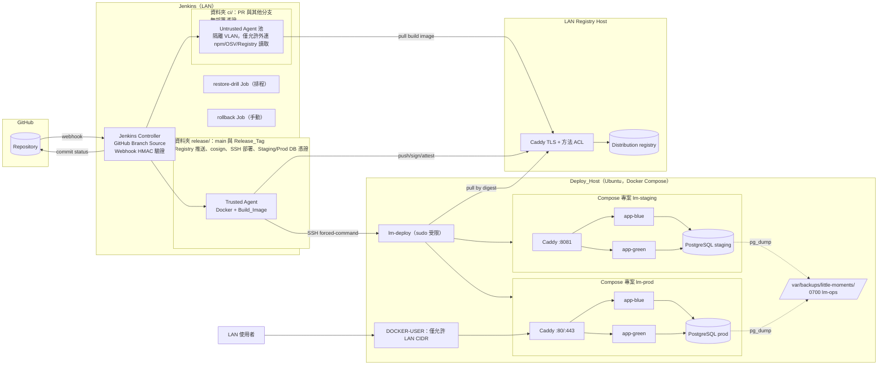
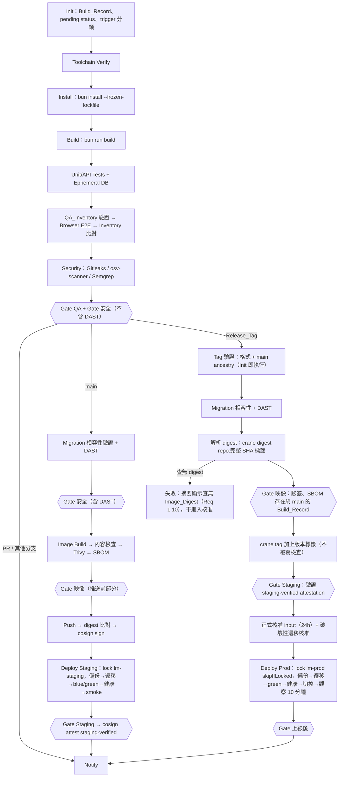
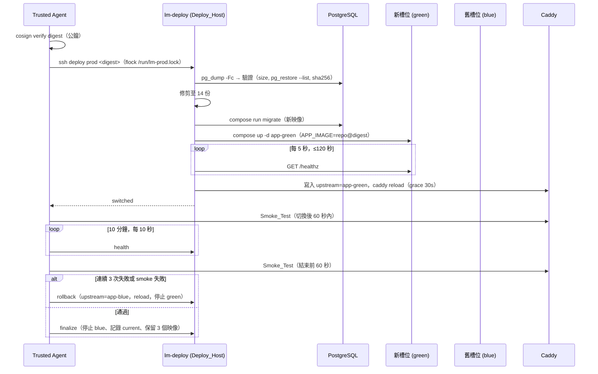

# Design Document：Jenkins CI/CD 與 LAN Docker 部署

## Overview

本設計為「日子拾光 · LITTLE MOMENTS」建立一條由 GitHub Webhook 觸發的 Jenkins Multibranch Pipeline，將通過品質與安全關卡的 App_Image 以 Docker Compose 部署到 LAN 內的 Ubuntu Deploy_Host，並將持久化由 `bun:sqlite` 改為 PostgreSQL。

設計分為四個部分：

1. **CI/CD 平台**：Jenkins controller、可信／不可信兩組 Build_Agent、LAN 私有 Registry、工具鏈 Build_Image，以及單一 `Jenkinsfile` 依觸發類型（PR、其他分支、`main`、Release_Tag）選擇階段。
2. **應用程式變更**：新增設定模組（Bind_Address、Allowed_Hosts、Setup_Token、Database 連線）、`http.js` Host 檢查、Setup_Token 首次管理員流程、`/healthz` 健康端點、資料層由同步 SQLite 改為非同步 PostgreSQL、Migration_Runner、SQLite_Importer。
3. **部署平台**：Deploy_Host 上 staging 與 production 兩套獨立 Compose 專案，每套包含 Caddy 反向代理、blue/green 兩個 App 容器槽位、PostgreSQL 與容器外備份目錄；部署由 SSH 受限金鑰觸發主機端部署腳本。
4. **追蹤與治理**：Build_Record（JSON + 封存報告 + 建置描述）、Release_Gate 評估器、Approved_Exception 政策檔、QA_Inventory 比對、通知階段。

### 現況盤點（已讀取的程式碼）

| 檔案 | 與本功能相關的現況 |
|---|---|
| `scripts/serve.mjs` | `Bun.serve({hostname:'127.0.0.1', port: PORT\|\|5173, maxRequestBodySize: 4 MiB})`；`CAMPING_DB` 預設 `data/accounts.sqlite`；`CAMPING_DIST` 預設 `dist`；SIGINT/SIGTERM 時 `server.stop(true)` 並關閉 DB。 |
| `server/http.js` | 先呼叫 `accounts.handle`，再以路由／資產 regex 提供靜態檔；`SECURITY_HEADERS` 套用於所有回應；資產回應 `Cache-Control: no-cache`。**目前沒有 Host 檢查**。 |
| `server/accounts.js` | `new Database(dbPath)`、`PRAGMA foreign_keys/busy_timeout/WAL`、`db.exec(SCHEMA + LEDGER_SCHEMA)`；約 50 個同步 `db.query(...)` prepared statement；`tx = fn => db.transaction(fn).immediate()`（單一寫入者語意）；記憶體 `RateLimiter`；`isLoopback(url, info)` 僅用於 `/api/setup`；非 GET 檢查 `Origin === url.origin`；Cookie `ggc_session; HttpOnly; SameSite=Strict; Path=/; Max-Age=…`，`https:` 時加 `Secure`；scrypt `N=16384,r=8,p=1,keylen=64`。 |
| `server/ledger.js` | `LEDGER_SCHEMA`（`trip_ledgers`）。 |
| `server/receipt-ai.js` | 僅讀取 `CAMPING_BEDROCK_REGION/MODEL_ID/API_KEY`，格式不符即停用。 |
| `scripts/build.mjs` | `Bun.build` 前端至 `dist/`，複製字型與 OCR 資產（`tesseract.js` 等需存在於 `node_modules`），產生 `sw.js`。 |
| `scripts/check-accounts.mjs` | 需要 `CAMPING_BUN`；以 `PORT=5181`、`CAMPING_DB=:memory:` 啟動伺服器；`CHROME_PATH` 缺省時改用 Windows Chrome 路徑；之後啟動 Playwright。 |
| `playwright.config.js` | `workers:2, retries:0`，`CHROME_PATH` 同樣有 Windows 預設，`reporter:'list'`，`outputDir: test-results`。 |
| `tests/*.test.js` | 以 `createAccountService({ dbPath: ':memory:', now })` 同步建立服務；部分測試（`ledger.test.js`、`trip-delete-upgrade.test.js`）直接以 `bun:sqlite` 開檔修改資料列。 |

### 重要設計決策摘要

| 決策 | 選擇 | 理由 |
|---|---|---|
| 憑證隔離 | 兩個 Multibranch Job 共用同一 `Jenkinsfile`：`ci/`（僅 PR 與非 `main` 分支）與 `release/`（僅 `main` 與 Release_Tag），憑證只存在 `release/` 資料夾範圍 | Jenkins 憑證以資料夾為範圍；PR 建置在物理上取不到部署憑證，請求時 `withCredentials` 直接失敗（Req 2.4、2.5）。 |
| PostgreSQL 用戶端 | Bun 內建 `Bun.SQL`（隨 Build_Image／App_Image 的 Bun 精確版本固定），備援為 `postgres@3.4.7`（API 幾乎相同） | 不新增相依套件、tagged template 自動參數化（Req 11.2）；Bun.SQL 的 API 仿照 `postgres` 套件，必要時可低成本切換。 |
| 交易語意 | 每個寫入交易開頭取得 `pg_advisory_xact_lock(<常數>)`，等同 SQLite `BEGIN IMMEDIATE` 的單一寫入者 | 保留現行所有「讀取→檢查→寫入」邏輯的正確性，避免逐一分析競態；LAN 小流量下序列化成本可忽略。 |
| 反向代理 | Caddy（digest 固定），upstream 以 include 檔切換並 `caddy reload`，`grace_period 30s` | 原生優雅重載與連線排空，設定簡潔（Req 20.2、20.3）。 |
| Registry | CNCF Distribution（`registry:3`，digest 固定）前置 Caddy：TLS（內部 CA）+ 每帳號 basic auth + 依 HTTP 方法限制（拉取帳號僅 GET/HEAD），關閉刪除 | 符合「拉取不可推送或刪除」（Req 15.9）；Harbor 為較重的替代方案（見 Open Risks）。 |
| 簽章 | cosign 金鑰模式，`--tlog-upload=false`（LAN 無 Rekor） | Requirement 17 的簽章與驗證；Staging 驗證以 cosign attestation 附在 digest 上。 |
| 掃描工具 | Gitleaks（秘密）、osv-scanner v2（`bun.lock`）、Semgrep CE + repo 內規則（SAST）、Trivy（映像）、Syft（SBOM）、OWASP ZAP + 自訂安全測試套件（DAST） | 皆可離線或固定版本執行並輸出 JSON／SARIF；細節見「工具選型」。 |
| PBT 函式庫 | `fast-check@4.3.0`（devDependency，精確版本） | 在 `bun test` 下可直接使用，具 shrinking。 |

### 先前的設計假設與需求對齊狀態

以下五項原本是 Design 階段的解讀假設，需求文件更新後均已明確規範，本設計依需求實作：

1. **Release_Gate 順序（已對齊 Req 1.3、1.4、1.10、16.1、23.2）**：`main` 建置依序為「QA」→「安全」→ App_Image 建置 →「映像」→ 推送與簽章 → Staging 部署 →「Staging」。Release_Tag 建置對 Tag commit 重跑「QA」與「安全」，**不重新建置**，改以「Registry 中以完整 Commit SHA 為標籤的映像」解析 `main` 建置產生的 Image_Digest（見 Components 第 17 節），再評估「映像」（cosign 簽章驗證 + Build_Record 中的 SBOM）與「Staging」（`staging-verified` attestation），之後才進入正式核准。查無 Image_Digest 時依 Req 1.10 在等待核准前失敗並於建置摘要說明原因。
2. **最終映像不含 `src/`（已對齊 Req 16.2、16.4）**：`server/accounts.js` 匯入 `src/model.js`、`src/ingredients.js`、`src/expense-categories.js`、`src/receipt-ocr.js`。建置階段以 `bun build --target=bun` 將 `scripts/serve.mjs`、`server/` 與其匯入的 `src/` 模組打包為單一檔案；最終映像只含打包成品、Migration_Runner、遷移檔、`dist/` 與正式相依套件，非 root 使用者對打包成品、`dist/` 與遷移檔無寫入權限。
3. **秘密遮罩範圍（已對齊 Req 15.4）**：需求改為「完整原文、Base64 編碼形式與 URL 編碼形式皆不得出現」。`ci/scrub.mjs` 在封存前遮罩這三種形式，之後再以同一組形式掃描待封存檔案；仍偵測到任一形式時不存入該檔案的未遮罩版本，並將建置標記為失敗（見 Components 第 9 節）。
4. **Docker 發布連接埠的 LAN 限制（已對齊 Req 8.6）**：需求已明確要求限制在 Docker 轉送層生效；本設計以 `DOCKER-USER` iptables chain 實作（見 Components 第 12 節），不依賴 UFW。
5. **反向代理信任（已對齊 Req 9.12 與 Glossary 的 Trusted_Proxies）**：`CAMPING_TRUSTED_PROXIES` 接受 IP 或 CIDR。App 僅在 TCP 來源 IP 落在 Trusted_Proxies 內時採信 `X-Forwarded-For`／`X-Forwarded-Proto`，用以重建請求網址（Req 10.1、10.5）與限速鍵（Req 9.8）；其他來源一律忽略這兩個標頭。經代理轉送的請求永遠不視為 loopback 用戶端，LAN 上的首次設定一律須附帶 Setup_Token。

## Architecture

### 整體架構



### 信任邊界

| 邊界 | 控制 |
|---|---|
| GitHub → Jenkins | GitHub plugin 的 webhook shared secret（HMAC-SHA256，`X-Hub-Signature-256`，常數時間比較）；Jenkins 前置 Caddy 寫入拒絕日誌（時間、來源 IP、原因），不記錄 body。 |
| PR 程式碼 → 憑證 | `ci/` 資料夾無任何部署相關憑證；GitHub Branch Source 的 PR 信任策略設為「From users with Admin or Write permission」，fork／無寫入權限者使用 `main` 的 `Jenkinsfile`（Req 2.7）；非管理員移除 Replay 權限。 |
| Untrusted Agent → LAN | Agent 位於獨立 VLAN；防火牆拒絕連線至 Deploy_Host、Staging/Prod 連接埠與 DB；建置結束 `cleanWs()` 並 `docker rm -f` 該建置標籤的容器、網路與卷（Req 2.6）。 |
| Trusted Agent → Deploy_Host | 每環境一把 SSH 金鑰，`authorized_keys` 設定 `command="sudo /opt/lm/bin/lm-deploy staging",no-pty,no-port-forwarding,from="<agent IP>"`；部署帳號不在 `docker` 群組，sudoers 僅允許執行對應環境的固定腳本（Req 15.9）。 |
| DAST 環境 | `docker network create --internal`，只含 Test_Environment、Ephemeral_Database 與 ZAP；啟動前執行隔離探測（Req 7.7、7.9）。 |
| LAN → App | `DOCKER-USER` 規則僅允許 `LAN_CIDR` 至代理連接埠；DB 不發布連接埠（Req 8.6、11.10）。 |

### Jenkins Job 配置

| Job | 類型 | Discover | 憑證 | Build Discarder／Orphan 策略 |
|---|---|---|---|---|
| `ci/little-moments` | Multibranch | PR（merge 與 head）、非 `main` 分支 | 無（僅 GitHub 讀取 App 憑證） | PR：`daysToKeep 14`；orphaned item 保留 14 天（Req 21.5） |
| `release/little-moments` | Multibranch | 僅 `main` 分支與 Tag（`basic-branch-build-strategies` 的 Tag build strategy，正規式 `^v\d+\.\d+\.\d+$` 只作預篩，最終驗證在 Pipeline 內） | Registry push、cosign key、SSH staging/prod、Staging/Prod DB、smoke 帳號、Setup_Token | `main`：90 天；Tag：365 天（Req 21.3、21.4） |
| `release/rollback` | Pipeline（參數化） | — | SSH prod | 365 天 |
| `release/restore-drill` | Pipeline（cron `H 3 1,15 * *`，兩次間隔 ≤ 16 日） | — | SSH prod（唯讀備份讀取 + drill 專案） | 365 天 |
| `release/digest-lookup` | Pipeline（參數：digest） | — | Jenkins API 讀取 | 30 天 |
| `infra/build-image` | Pipeline | — | Registry push | 90 天 |

保留期間內的不可變性（Req 21.12）以 Matrix Authorization 實作：非管理員無 `Run/Delete`、`Run/Update`、`Job/Configure`、`Run/Replay`。正在 Production 執行或屬最近 3 個可回滾 digest 的建置，由部署腳本回呼 Jenkins API 設定 `keepLog=true`，移出保留集合時解除（Req 21.6）。

### Pipeline 階段配置



Release_Tag 的 Tag 驗證（Req 1.5）於 Init 階段最先執行，不通過時在任何推送／部署階段前失敗。Release_Tag 建置的 digest 解析、版本標籤與 Req 1.10 的失敗路徑見 Components 第 17 節。

| 觸發 | 執行的 Job | 階段 |
|---|---|---|
| PR 開啟／更新／重開 | `ci/` | Init → Toolchain → Install → Build → Unit → E2E → Security（無 DAST）→ Notify |
| 其他分支推送（無 PR） | `ci/` | 同上（Req 1.8） |
| `main` 推送 | `release/` | 上述 + Migration 相容性 + DAST → Image Build/Scan/SBOM → Push/Sign → Staging → Notify（Req 1.3） |
| Release_Tag 推送 | `release/` | Tag 驗證 → 上述品質安全階段（對 Tag commit 重跑，不重新建置）→ 以完整 SHA 標籤解析 `main` 產生的 digest（查無即失敗，Req 1.10）→「映像」關卡（驗簽 + SBOM）→ 加上版本標籤 →「Staging」關卡（attestation）→ 核准 → Production → Notify（Req 1.4） |

Pipeline 以 `checkout scm` 後執行 `git rev-parse HEAD` 取得確切 Commit SHA，所有後續階段使用該 SHA 與同一工作目錄（Req 1.6）。`options { skipDefaultCheckout(); timestamps(); disableResume() }`；失敗由 `error()` 終止，後續 stage 不執行（Req 1.7）。

### 部署流程（Production）



## Components and Interfaces

### 1. 應用程式設定模組 `server/config.js`（新增）

純函式，不讀檔、不連網，便於 PBT。

```js
/** @returns {{ok:true, config:AppConfig} | {ok:false, errors:{name:string, reason:string}[]}} */
export function parseConfig(env) {}
export function isLoopbackAddress(ip) {}           // 127.0.0.0/8、::1、::ffff:127.0.0.0/104
export function normalizeHost(hostHeader) {}        // 移除 :port、轉小寫、保留 IPv6 方括號；無效回傳 null
export function hostAllowed(hostHeader, allowedHosts) {}
export function redactedSummary(config) {}          // 啟動訊息：bind、port、allowedHosts（不含秘密）
export function parseCidrList(value) {}             // "10.0.0.5,172.18.0.0/16,fd00::/8" → [{family, network, prefix}]；無效回傳 null
export function ipInCidrs(ip, cidrs) {}             // 含 IPv4-mapped IPv6（::ffff:a.b.c.d）正規化
export function resolveClient(tcpIp, headers, url, trustedProxies) {}
// → { clientIp, protocol, viaProxy }；僅 tcpIp ∈ trustedProxies 時採信 X-Forwarded-*（Req 9.12）
```

| 環境變數 | 必填 | 預設 | 驗證 | 失敗行為 |
|---|---|---|---|---|
| `CAMPING_BIND_ADDRESS` | 否 | `127.0.0.1` | `net.isIP() !== 0` | 結束碼 2，訊息含變數名（Req 8.7） |
| `PORT` | 否 | `5173` | `/^\d+$/` 且 1..65535 | 同上 |
| `CAMPING_ALLOWED_HOSTS` | 非 loopback 時必填 | `127.0.0.1,localhost,[::1]` | 1..32 項、每項 1..253 字元、不得空項或含 `*`；項目為主機名（RFC 1123 標籤）、IPv4 或 `[IPv6]` | 非 loopback 且未設 → 結束碼 2（Req 8.4） |
| `CAMPING_SETUP_TOKEN` | 否 | 非 loopback 時自動產生 | 長度 ≥ 32 | 少於 32 → 結束碼 2，不輸出值（Req 9.3） |
| `CAMPING_TRUSTED_PROXIES` | 否 | 空（不採信任何轉送標頭） | 逗號分隔，每項為 IPv4／IPv6 位址或 CIDR（IPv4 前綴 0..32、IPv6 前綴 0..128）；不得空項、不得含 `*` | 無效 → 結束碼 2，訊息含變數名 |
| `CAMPING_DATABASE_HOST`／`_PORT`／`_NAME`／`_USER`／`_PASSWORD` | 是 | `_PORT`=5432 | 非空；port 1..65535 | 缺少任一 → 結束碼 2，列出缺少名稱（Req 11.8） |
| `CAMPING_DATABASE_SSLMODE` | 否 | `disable`（同一 Compose 網路） | `disable\|require\|verify-full` | 結束碼 2 |
| `CAMPING_BEDROCK_*` | 否 | 空 | 沿用 `receipt-ai.js` | 停用 AI |

`CAMPING_DB` 不再讀取（Req 11.1）；若仍設定，啟動時輸出警告「已忽略」。

`scripts/serve.mjs` 改為：

```js
const result = parseConfig(process.env);
if (!result.ok) { for (const e of result.errors) console.error(`設定錯誤 ${e.name}: ${e.reason}`); process.exit(2); }
const { config } = result;
const db = await connectWithRetry(config.database, { attempts: 30s 內、間隔 1–5 秒 });   // Req 11.5
const setup = createSetupGuard(config);   // 必要時產生並一次性列印 Setup_Token
const accounts = await createAccountService({ db, receiptAi, setup, trustedProxies: config.trustedProxies });
const server = Bun.serve({ hostname: config.bindAddress, port: config.port, maxRequestBodySize: 4_194_304,
  fetch: createHttpHandler({ root, accounts, allowedHosts: config.allowedHosts, health: () => db.ping(2000) }) });
console.log(`Camping accounts ready: bind=${config.bindAddress} port=${server.port} allowedHosts=${config.allowedHosts.join(',')}`);
```

`check-accounts.mjs` 以 `Camping accounts ready:` 前綴等待，前綴保留以維持相容。

### 2. HTTP 處理器 `server/http.js`（修改）

處理順序：

1. `GET /healthz`（Host 仍須在 Allowed_Hosts 內）→ `health()` 2 秒逾時；成功 `200 {"status":"ok","database":"ok"}`，失敗 `503 {"status":"error","database":"unavailable"}`。Health_Check 的 5 秒上限由呼叫端控制（Req 11.6）。Caddy 對外部請求 `/healthz` 回應 404，部署腳本從容器網路內呼叫。
2. **Host 檢查**：`hostAllowed(req.headers.get('host'), allowedHosts)` 不通過 → `421 Misdirected Request` + `SECURITY_HEADERS`，不呼叫 `accounts.handle`、不讀檔（Req 8.3、10.6）。
3. 重建有效請求網址（`resolveClient`，Req 9.12）：TCP 來源 IP 取自 `server.requestIP(req)`。若該 IP 落在 `trustedProxies`（IP 或 CIDR）內，以 `X-Forwarded-Proto`（僅接受 `http`/`https`，其他值忽略）取代協定，客戶端 IP 取 `X-Forwarded-For` 由右往左第一個不在 Trusted_Proxies 內的位址；否則完全忽略這兩個標頭，客戶端 IP 即 TCP 來源 IP、協定為 Bun 回報的協定。只要 TCP 來源屬於 Trusted_Proxies，結果標記 `viaProxy=true`，`/api/setup` 的 loopback 條件（Req 9.1 (a)）一律不成立，即使轉送標頭聲稱來源為 `127.0.0.1`。
4. 其餘維持現狀（API → 靜態路由 → 404），所有錯誤分支皆附 `SECURITY_HEADERS`。

### 3. 首次管理員設定 `server/setup-guard.js`（新增）

```js
export function createSetupGuard({ bindAddress, setupToken, randomBytes, log }) {
  // 回傳 { required:boolean, verify(candidate):boolean, consume():void }
}
```

- 啟用條件：`!isLoopbackAddress(bindAddress)`。未提供 `CAMPING_SETUP_TOKEN` 時以 `crypto.randomBytes(32)` 產生 base64url（256 位元）並 `console.log` 一次（容器 stdout，僅本機 `docker logs` 可見）；不寫入 DB 或回應（Req 9.2）。
- `verify`：對雙方先做 SHA-256 再 `crypto.timingSafeEqual`，比較時間與內容無關（Req 9.7）。
- `consume`：建立管理員成功後設定記憶體旗標；另一層保證來自 DB（使用者數 ≥ 1 時一律 409，Req 9.5、9.6），所以 blue/green 兩容器共用同一 token 也不會被重用。

`POST /api/setup` 新流程：

```text
1. limiter.hit(`setup:client:${ip}`)；若已達 30/15 分 → 429（不驗證 token）            (Req 9.8, 9.9)
2. userCount ≥ 1 → 409                                                                   (Req 9.6)
3. 授權：(loopback Host 且 loopback TCP IP 且 !viaProxy) 或 guard.verify(body.setupToken)   (Req 9.12)
   不通過 → audit('setup-denied', reason ∈ {missing_token, token_mismatch, non_loopback}) → 403   (Req 9.1, 9.4)
4. 驗證 username/displayName/password → 400，token 保持有效                              (Req 9.10)
5. tx(async t => { advisory lock; if count≠0 → 409; insert admin; audit })               (Req 9.11)
6. guard.consume(); startSession
```

`GET /api/session` 新增 `setupTokenRequired: boolean`；`src/accounts-ui.js` 的設定表單在該值為 true 時顯示「設定碼」欄位。限速順序「先計數再判斷」使通過與未通過的請求都計入（Req 9.8）。

稽核寫入的 `target` 只放原因類別與來源 IP，不放 token。

### 4. 資料層 `server/db/`（重構）

```
server/db/
  connect.js        // createDatabase(config) → { sql, ping(ms), close() }；connectWithRetry
  tx.js             // withWriteTx(sql, fn)：BEGIN；SELECT pg_advisory_xact_lock(726361); fn(t)；COMMIT
  queries.js        // 將現行 q.* 改為 async 函式，接收 executor（sql 或 t）
server/accounts.js  // createAccountService 改為 async；路由改 await
```

**Bun.SQL 與 `postgres` 套件評估**

| 面向 | `Bun.SQL`（內建） | `postgres@3.4.7` |
|---|---|---|
| 相依性 | 無；版本隨 Bun 固定 | 新增一個 npm 套件與供應鏈面 |
| API | `sql\`...\``、`sql.begin(async t => …)`、連線池 | 相同風格（Bun.SQL 仿照此套件） |
| 成熟度 | 較新，需以整合測試覆蓋 BIGINT、交易回復、斷線重連 | 成熟、社群廣 |
| 決策 | **採用**；Requirement 11.9 的重連行為由測試驗證 | 備援：若 Bun.SQL 在斷線恢復或錯誤型別上不符需求，切換成本僅在 `connect.js` |

**轉換規則**

- `db.query(sql).get/all/run(...args)` → `await t\`...\`` tagged template；全部參數化，不使用字串拼接（`sql.unsafe` 禁用，Semgrep 自訂規則檢查）。
- `tx(fn)` → `withWriteTx(sql, async t => …)`：所有現行 `tx` 呼叫點保留同樣的「交易內重新檢查」結構，並以全域 advisory lock 序列化寫入者，語意等同 `BEGIN IMMEDIATE`。任何例外 → `ROLLBACK`（Req 11.3）。
- 不在交易內的讀取（`currentUser`、`needsSetup` 等）直接使用池連線；交易內的讀取一律使用 `t`。
- `INTEGER` 毫秒時間戳 → `BIGINT`；讀取時以 `Number()` 轉換並檢查 `Number.isSafeInteger`。`COUNT(*)` 同樣轉換。
- `state_json`、`ledger_json`、`requests_json` 保留 `TEXT`（不改 `jsonb`），維持位元組相同，`requestHash` 與損壞資料偵測（`ledger.test.js`）語意不變。
- `audit.id INTEGER PRIMARY KEY AUTOINCREMENT` → `BIGINT GENERATED BY DEFAULT AS IDENTITY`；匯入後 `setval`（Req 13.10）。
- `close()` 改為 `await sql.close({ timeout: 5 })`。

**限速器**維持記憶體 `RateLimiter`（不在本需求範圍內改動）。影響見 Open Risks。

### 5. Migration_Runner `scripts/migrate.mjs` 與 `server/db/migrations.js`（新增）

檔案配置：

```
migrations/
  0001_initial.sql          -- 由現行 SCHEMA + LEDGER_SCHEMA 轉換
  0002_xxx.sql
```

檔名規則 `^(\d{4,})_[a-z0-9_]+\.sql$`，版本為檔名數字（正整數）。檔頭可含 `-- lm:destructive` 標記。

核心邏輯以純函式與 I/O 分離：

```js
export function loadMigrations(files)            // [{version, name, sql, checksum, destructive}]；版本重複或非正整數 → throw（Req 12.7）
export function planMigrations(repo, applied)    // {toApply:[...], unknownApplied:[...], checksumMismatch:[...]}
export async function runMigrations(sql, repo)   // 見下
```

`runMigrations`：

1. `SELECT pg_advisory_lock(726362)`（session 級，避免 blue/green 或兩次部署同時遷移）。
2. `CREATE TABLE IF NOT EXISTS schema_migrations (...)`。
3. 讀取紀錄 → `planMigrations`；若有 `checksumMismatch` → 不修改任何東西，結束碼 3 並列出版本（Req 12.7）。`unknownApplied`（DB 有、repo 沒有的較新版本，回滾情境）保留不動（Req 12.2）。
4. 依版本遞增，每個遷移在獨立交易內執行 SQL 與寫入紀錄；失敗 → 該交易回復、輸出版本號、結束碼 4，先前成功者保留（Req 12.4）。
5. 輸出 `applied: [..] count: n`，結束碼 0。

PostgreSQL 的 DDL 具交易性，所以「回復 Schema 與資料變更」可直接由交易保證。遷移檔不得含 `CREATE INDEX CONCURRENTLY` 等無法在交易內執行的語句（lint 檢查）。

**破壞性遷移偵測** `scripts/lint-migrations.mjs`：移除 SQL 註解與字串常值後，以 token 掃描 `DROP TABLE`、`DROP COLUMN`、`ALTER TABLE … RENAME`、`ALTER TABLE … DROP`；偵測到但無 `-- lm:destructive` → 建置失敗（Req 12.9）。標記為破壞性者，Pipeline 在 Production 前另起一次 `input`，核准人須為 Release_Approver，且不得與 `git log --format=%ae -- migrations/<file>` 的作者電子郵件（透過 `ci/release-approvers.json` 對應 Jenkins ID 與 email）相同（Req 12.6）。

**相容性驗證**（Req 12.5、12.8）：以 `git describe --tags --abbrev=0 --match 'v*' <sha>^` 找最近 Release_Tag；在 Ephemeral_Database 上以該 Tag 的 App_Image 執行 migrate，再以本次 commit 的 Migration_Runner 套用新增遷移，最後以舊映像啟動並執行 Smoke_Test。無 Tag 時記錄略過原因。

### 6. SQLite_Importer `scripts/import-sqlite.mjs`（新增）

```
bun scripts/import-sqlite.mjs --source /path/accounts.sqlite   # 目標由 CAMPING_DATABASE_* 提供
```

1. 檢查來源存在、計算 SHA-256（含 `-wal` 若存在）。
2. 將來源檔（與 `-wal`、`-shm`）複製到 `os.tmpdir()` 下新建的 0700 目錄，於複本上 `new Database(copy, { readonly: false })` 執行 `PRAGMA wal_checkpoint(TRUNCATE)` 後以唯讀方式讀取；來源目錄不產生任何檔案（Req 13.2）。結束時刪除暫存目錄並再次比對來源雜湊。
3. 驗證 SQLite 標頭與所需資料表（`users, sessions, trips, trip_members, invites, trip_deletions, audit, trip_ledgers`）；不符 → 在連線目標前結束（Req 13.9）。
4. 連線目標，先 `runMigrations` 確保 Schema；在單一交易內 `SELECT count(*)` 每表，任一 > 0 → 回復並結束（Req 13.3）。
5. 依外鍵順序以參數化批次 `INSERT`（每批 500 列）寫入；欄位原樣，`password_hash` 原字串（Req 10.9、13.8）。
6. 提交前比對每表來源與目標筆數，不符 → 回復（Req 13.6）；`SELECT setval(pg_get_serial_sequence('audit','id'), max(id))`（Req 13.10）。
7. 提交後輸出 `table source target`，結束碼 0（Req 13.5）。

純函式部分 `server/db/import-plan.js`：`tableOrder()`、`convertRow(table, row)`（SQLite 值 → PG 參數：整數保持 `number`/`bigint`、NULL 保留、文字 UTF-8 原樣）、`compareCounts(source, target)`，供往返 PBT 使用。

### 7. 測試基礎設施

- `tests/support/pg.js`：讀取 `CAMPING_TEST_DATABASE_*`；每個測試檔建立獨立 schema `t_<random>`，設定 `search_path` 後執行遷移，`afterAll` `DROP SCHEMA … CASCADE`。同一 Ephemeral_Database 內以 schema 隔離測試檔，不同建置使用不同資料庫容器（Req 4.8）。
- `tests/*.test.js`：`createAccountService` 改為 `await`；直接以 `bun:sqlite` 修改資料列的測試改用 `t\`UPDATE ...\``；「拒絕公開資料庫路徑」的測試改為 `config.test.js` 的對應案例。
- `scripts/check-accounts.mjs`：`CHROME_PATH` 與 `CAMPING_BUN` 皆必填且需存在、可執行，否則丟出指出變數名的錯誤；改用 `CAMPING_DATABASE_*` 指向 Ephemeral_Database；移除 Windows 預設路徑。
- `playwright.config.js`：移除 Windows 預設；新增 projects `desktop`（1440×1000）與 `mobile`（390×844，僅 `grep: /@critical/`）；reporter `[['list'],['junit',{outputFile:'reports/e2e-junit.xml'}],['json',{outputFile:'reports/e2e.json'}]]`；`retries: 0`。
- 測試案例 ID 規範：測試標題以 `[TC-<area>-<nnn>]` 開頭，重要頁面加 `@critical` 標籤。
- `scripts/qa-inventory.mjs`：`validateInventory(doc)` 與 `compareInventory(inventory, results)` 純函式 + CLI。
- 本機開發以 `docker run --rm -d --name lm-pg -e POSTGRES_PASSWORD=<placeholder> -p 127.0.0.1:55432:5432 postgres:17.6@sha256:<digest>` 建立 Ephemeral_Database（README 說明，Req 24.8）。

### 8. 安全測試套件 `tests/security/*.sec.js`（新增）

以 `bun test` 對 Test_Environment 的 base URL 執行，覆蓋 Req 7.6 的九類：SQL injection、XSS（Playwright 確認 `<script>` 以文字呈現、`window.__xss` 未被設定）、未登入存取、跨使用者存取、角色越權、Session 失效、Origin 檢查、登入限速（同帳號 5 次失敗後正確密碼仍 429）、路徑穿越（`/../`、`%2e%2e%2f`、`..%5c` 等）。同一套件以 `CAMPING_BIND_ADDRESS=0.0.0.0`、非 loopback Host 名稱執行 Req 10 第 1–9 條的行為（Req 10.10）。輸出 JUnit 到 Build_Record。

### 9. CI 工具與政策評估器 `ci/`

```
ci/
  toolchain.json              # {"bun":"1.3.x 精確版","node":"22.x 精確版","chromium":"<build>"}
  build-image/Dockerfile      # FROM mcr.microsoft.com/playwright:v1.56.1-noble@sha256:… + 安裝精確 Bun
  verify-toolchain.mjs        # 比對實際版本與 toolchain.json（Req 3.2, 3.3）
  verify-env.mjs              # CHROME_PATH / CAMPING_BUN 存在且可執行（Req 3.9）
  policy/normalize.mjs        # 各掃描器輸出 → Finding[]
  policy/evaluate.mjs         # evaluateFindings(findings, exceptions, today) → {pass, unresolved, expired, invalidExceptions}
  policy/tag.mjs              # parseReleaseTag(name) → {major,minor,patch} | null
  record.mjs                  # Build_Record 讀寫、遮罩
  scrub.mjs                   # 封存前遮罩秘密原值、Base64、URL 編碼形式，再掃描確認（Req 15.4）
  resolve-digest.mjs          # Release_Tag：以完整 SHA 標籤解析 digest、加版本標籤（Req 1.4、1.10、16.6、16.10）
  retention.mjs               # pruneBackups(list, keep=14)、retainImages(history, keep=3)
  release-approvers.json      # Jenkins ID ↔ git email 對照
security/exceptions.json      # Approved_Exception 清單
qa/inventory.json             # QA_Inventory
```

這些 `.mjs` 都在 Build_Image 內以 Bun 執行，並納入 `bun test`。

**秘密遮罩與封存前掃描 `ci/scrub.mjs`**（Req 15.4、21.9）：

1. 秘密集合 S 由 Pipeline 在 `withCredentials` 區塊內以檔案（0600、建置結束刪除）交給 scrub，不經環境變數進入後續階段（Req 15.2）。
2. 對每個 s ∈ S 產生比對形式：原文、標準 Base64、Base64URL（含與不含 `=` 補齊），以及 `encodeURIComponent` 的 URL 編碼形式（大小寫十六進位兩種）。
3. `scrub(text, S)` 依長度由長到短取代為固定遮罩 `********`（不保留任何原文字元）。
4. `findLeaks(text, S)` 在遮罩後再以同一組形式掃描；回傳命中的「憑證 ID × 形式」清單，不回傳值本身。
5. 主控台日誌、JUnit／JSON 報告、掃描報告與 Build_Record 都先寫入暫存目錄，經步驟 3、4 後才 `archiveArtifacts`。任一檔案仍有命中 → 該檔案不封存（只封存一份記錄檔名與憑證 ID 的說明檔），建置標記為失敗。
6. Jenkins Mask Passwords／Credentials Binding 的即時遮罩仍啟用，作為主控台輸出的第一道防線；scrub 是封存前的強制檢查。

### 10. 工具選型

| 用途 | 工具（版本與 digest 固定） | 理由與注意事項 |
|---|---|---|
| 秘密掃描 | Gitleaks 8.x：`gitleaks dir`（工作樹）+ `gitleaks git --log-opts="<base>..<sha>"`；`--redact`（等同 `--redact=100`）、`--report-format json` | `--redact` 將秘密值完全以遮罩取代，報告只保留 `RuleID`、`File`、`StartLine` 與 `Commit`（Req 6.4）；`normalize` 另丟棄 `Match`／`Secret` 欄位，報告與日誌再經 `ci/scrub.mjs` 處理。Untrusted_PR 的 `<base>` 為 `git merge-base origin/<target> HEAD`；Trusted_Ref 的 `<base>` 取上次成功建置的 `GIT_PREVIOUS_SUCCESSFUL_COMMIT`，無則完整歷史（Req 6.1）。偵測到任何秘密即失敗，Approved_Exception 不適用。 |
| 相依套件漏洞 | **osv-scanner v2**（`--lockfile=bun.lock`、`--format json`） | osv-scanner v2 透過 OSV-Scalibr 支援文字格式 `bun.lock`（參見 [Supported Artifacts and Manifests](https://google.github.io/osv-scanner/supported-languages-and-lockfiles) 與 [release notes](https://github.com/google/osv-scanner/releases)）。Trivy 的文件列出 Bun 支援（[Trivy Node.js coverage](https://trivy.dev/docs/latest/guide/coverage/language/nodejs/)），但 `bun.lock` analyzer 曾是開放 issue（[#8840](https://github.com/aquasecurity/trivy/issues/8840)）。**注意**：兩者的 `bun.lock` 支援都較新，固定版本前必須以 `toolchain` 驗證工作確認能解析本 repo 的 `bun.lock` 且產生非零套件數；Pipeline 在解析出的套件數為 0 時視為掃描無法完成（Req 6.8）。另以 Trivy 掃描安裝後的 `node_modules`（讀取各套件 `package.json`）作交叉驗證。 |
| SAST | Semgrep CE（固定版本），規則 vendored 在 `ci/semgrep/`（JavaScript 安全規則 + 自訂：禁止 `sql.unsafe`、`eval`、`new Function`、`child_process` 動態參數） | 離線執行、不依賴雲端 registry；`ERROR`→High、`WARNING`→Medium、`INFO`→Low。 |
| 映像掃描 | Trivy（`image --scanners vuln,secret --format json`），DB 以 `trivy-db` mirror 在 LAN | OS 與 app 相依漏洞 + 秘密（Req 17.1）。 |
| SBOM | Syft（`-o cyclonedx-json`） | 列出 OS 與 npm 套件（Req 17.4）。 |
| 簽章 | cosign（key pair 存於 Credential_Store：`cosign.key` 檔案憑證 + 密碼） | `cosign sign --key --tlog-upload=false repo@digest`；Deploy_Host 以 `cosign.pub` 驗證（Req 17.5、17.7）。 |
| Registry 操作 | crane | `crane digest`、`crane tag`（不覆寫檢查）、`crane ls`。 |
| DAST | OWASP ZAP stable（automation framework YAML） | `env.contexts.urls` 與 `includePaths` 僅 Test_Environment；`connection.threadPerHost=5`、規則 `rateLimit` 20 rps；`maxDuration` 60 分鐘（Req 7.2、7.4）。 |
| 反向代理 | Caddy 2.x | 優雅 reload、`lb_policy` 單一 upstream、`grace_period`。 |
| 資料庫 | PostgreSQL 17（`postgres:17.x@sha256`） | 與 `pg_dump`／`pg_restore` 版本一致。 |
| Jenkins plugins | GitHub Branch Source、GitHub（webhook secret）、Basic Branch Build Strategies、Credentials Binding、Mask Passwords、Lockable Resources、Docker Pipeline、JUnit、Pipeline: Input Step、Timestamper、Workspace Cleanup、Matrix Authorization、Pipeline GitHub Notify Step、Skip Notifications Trait | 對應 Req 1、2、15、18.9、20.12、21、22。 |

### 11. Dockerfile 與 `.dockerignore`

```dockerfile
# syntax=docker/dockerfile:1.10@sha256:<digest>
FROM oven/bun:1.3.<patch>@sha256:<digest> AS deps
WORKDIR /src
COPY package.json bun.lock ./
RUN bun install --frozen-lockfile

FROM deps AS build
COPY . .
RUN bun run build \
 && bun build scripts/serve.mjs --target=bun --outfile=/out/server/serve.js \
 && bun build scripts/migrate.mjs --target=bun --outfile=/out/server/migrate.js \
 && bun build scripts/import-sqlite.mjs --target=bun --outfile=/out/tools/import-sqlite.js \
 && cp -r dist /out/dist && cp -r migrations /out/migrations

FROM oven/bun:1.3.<patch>@sha256:<digest> AS prod-deps
WORKDIR /src
COPY package.json bun.lock ./
RUN bun install --frozen-lockfile --production

FROM oven/bun:1.3.<patch>-distroless@sha256:<digest> AS runtime
ARG REVISION VERSION CREATED
LABEL org.opencontainers.image.revision=$REVISION \
      org.opencontainers.image.version=$VERSION \
      org.opencontainers.image.created=$CREATED
WORKDIR /app
COPY --from=build --chown=0:0 --chmod=0444 /out/ /app/
COPY --from=prod-deps --chown=0:0 /src/node_modules /app/node_modules
COPY --chown=0:0 --chmod=0444 package.json /app/package.json
USER 10001:10001
ENV CAMPING_DIST=/app/dist NODE_ENV=production
EXPOSE 5173
ENTRYPOINT ["bun", "/app/server/serve.js"]
```

- 最終階段只有 Bun runtime、打包後的 `server/`、`migrations/`、`dist/`、`tools/import-sqlite.js`（維運工具，App_Server 程序不載入 `bun:sqlite`）、production `node_modules`（Req 16.2）。目錄 `0555`、檔案 `0444` 屬 root，UID 10001 無寫入權（Req 16.4）。
- `serve.js` 打包後 `root` 解析改用 `CAMPING_DIST`，不依賴原始碼目錄結構。
- `.dockerignore`：`data/ .env* tests/ node_modules/ .git/ *.log *.sqlite* test-results/ playwright-report/ previews/ reports/ .kiro/ *.pem *.key *.p12 *.pfx *.crt`（Req 16.7、15.5）。
- **映像內容檢查**（Req 16.9）：`docker create` → `docker export | tar -t` 取得檔案清單，交給 `ci/image-content-check.mjs`：禁止 `.env*`、`*.sqlite*`、`*.db`、憑證副檔名、`tests/`、`src/`、`data/`、`node_modules/` 中任何 `devDependencies` 名稱（`@playwright/test`、`playwright`、`playwright-core`）；`docker image inspect` 的 `Config.User` 解析 UID ≠ 0。

### 12. Deploy_Host 佈署

目錄：

```
/opt/lm/bin/lm-deploy             # root 擁有 0755；子命令 backup|migrate|start|health|switch|rollback|finalize|status|prune
/srv/lm/<env>/compose.yaml        # root 擁有 0644
/srv/lm/<env>/app.env             # 0600 root；DB 密碼、Setup_Token（部署時由管線經 stdin 寫入）
/srv/lm/<env>/state/active.json   # {color, digest, previous:[...], history:[...]}
/srv/lm/<env>/caddy/upstream.caddy
/var/backups/little-moments/<env>/   # 0700 lm-ops，不屬於 Docker 卷、不在 repo（Req 14.4）
```

`compose.yaml`（每環境一份，以 `name: lm-<env>` 區隔）：

```yaml
name: lm-prod
services:
  proxy:
    image: caddy:2.x@sha256:<digest>
    ports: ["${LAN_IP}:80:8080"]
    volumes: ["./caddy:/etc/caddy:ro"]
    networks: [edge, app]
  app-blue:  &app
    image: ${APP_IMAGE_BLUE}
    env_file: [app.env]
    environment:
      CAMPING_BIND_ADDRESS: 0.0.0.0
      CAMPING_ALLOWED_HOSTS: ${ALLOWED_HOSTS}
      CAMPING_TRUSTED_PROXIES: ${PROXY_IP}
      CAMPING_DATABASE_HOST: db
      CAMPING_BEDROCK_REGION: ""
      CAMPING_BEDROCK_MODEL_ID: ""
      CAMPING_BEDROCK_API_KEY: ""
    read_only: true
    cap_drop: [ALL]
    security_opt: ["no-new-privileges:true"]
    networks: [app]
    profiles: [blue]
  app-green:
    <<: *app
    image: ${APP_IMAGE_GREEN}
    profiles: [green]
  migrate:
    image: ${APP_IMAGE_NEW}
    entrypoint: ["bun", "/app/server/migrate.js"]
    env_file: [app.env]
    networks: [app]
    profiles: [ops]
  db:
    image: postgres:17.x@sha256:<digest>
    volumes: ["pgdata:/var/lib/postgresql/data"]
    env_file: [db.env]
    networks: [app]          # 不宣告 ports（Req 11.10）
networks:
  edge: {}
  app: { internal: true }
volumes:
  pgdata: {}
```

Staging 使用 `lm-staging`、`${LAN_IP}:8081`、不同 `db.env`／`app.env`（Req 18.6）。

**LAN 網段限制**（Req 8.6）：`/etc/lm/docker-user.rules` 由 systemd unit 開機套用：

```
-A DOCKER-USER -i <lan-if> -p tcp -m conntrack --ctorigdstport 80,443,8081 ! -s ${LAN_CIDR} -j DROP
```

**Blue/green 切換**：`upstream.caddy` 內容為 `reverse_proxy app-green:5173 { health_uri /healthz }`；`switch` 子命令以原子 rename 寫入後執行 `docker compose exec proxy caddy reload --config /etc/caddy/Caddyfile`，Caddyfile 設 `grace_period 30s`，既有連線在舊 upstream 上完成（Req 20.3）。

**健康檢查**：`lm-deploy health <color>` 以 `docker compose exec -T proxy wget -qO- --header "Host: <first allowed host>" -T 5 http://app-<color>:5173/healthz`，5 秒逾時。

**映像保留**：`finalize` 更新 `history`，保留最近 3 個成功完成觀察期的 digest，`docker image rm` 其餘（Req 20.7）；`retainImages` 為純函式。

**並行控制**：主機端 `flock -n /run/lm-<env>.lock`，Pipeline 端 `lock(resource: 'lm-prod', skipIfLocked: true)` 後以旗標判斷，跳過時以「已有部署進行中」失敗（Req 20.12）；Staging 使用一般 `lock('lm-staging')` 排隊等待（Req 18.9）。

### 13. 備份與還原演練

`lm-deploy backup <env>`：

1. `timeout 30m docker compose exec -T db pg_dump -Fc -U <user> <db> > <dir>/<env>-<UTC時間>-<sha7>.dump.partial`。`pg_dump` 預設在單一 repeatable-read 快照中匯出，涵蓋 schema、資料與序列值（Req 14.1）。
2. 驗證：檔案大小 > 0；`pg_restore --list` 結束碼 0 且至少一個 `TABLE DATA` 條目；`sha256sum` 寫入同名 `.sha256`（Req 14.2）。
3. 通過後 rename 去除 `.partial`，輸出 JSON `{id, env, createdAt(ISO 8601 +00:00), sizeBytes, sha256}`，由 Pipeline 寫入 Build_Record（Req 14.8）。
4. Production 且新備份已驗證 → `pruneBackups(list, 14)` 依建立時間刪除最舊者（Req 14.5）。任何失敗 → 刪除 `.partial`、結束碼非零，Pipeline 不執行遷移（Req 14.3）。

**還原演練**（`release/restore-drill`）：在 Deploy_Host 建立 `lm-drill-<build>` Compose 專案（獨立 `internal` 網路與匿名卷，不連接 prod 網路），`pg_restore` 最新已驗證備份，以目前 prod digest 啟動 App，執行 Smoke_Test，記錄備份 ID、還原秒數、結果，最後 `docker compose down -v`（Req 14.6、14.7）。Smoke 使用 drill 專用合成帳號：還原後先由 drill 腳本在 drill DB 內以 Migration_Runner 相同方式插入一個臨時合成管理員（僅存在於 drill DB），避免使用或輸出真實帳號資料。

### 14. Smoke_Test `scripts/smoke.mjs`（新增）

步驟：GET `/login`（200、含安全標頭）→ GET `/api/session` → POST `/api/login`（合成帳號 `smoke-bot`，憑證來自 Credential_Store）→ GET `/api/trips`，確認合成行程「smoke-fixture」存在 → POST `/api/logout`。每步逾時 10 秒；輸出 JSON 只含步驟名稱、狀態碼與耗時，不含回應內容（Req 21.10）。Staging 與 Production 各有自己的 `smoke-bot` 帳號與密碼（不同憑證）。

### 15. 正式核准與回滾 Job

- 核准：`timeout(time: 24, unit: 'HOURS') { while (true) { def r = input(message: …, parameters: […], submitterParameter: 'approver'); if (approvers.contains(r.approver)) break; record.unauthorizedAttempts << [r.approver, now()] } }`。核准畫面訊息包含 Tag、完整 SHA、完整 digest、Staging 健康與 smoke 結果與完成時間、安全報告連結（Req 19.2、19.3）。核准或拒絕均記錄帳號與含時區時間（Req 19.6、19.7）。核准後再以 `git ls-remote --tags origin refs/tags/<tag>^{}` 確認 Tag 仍指向同一 SHA（Req 19.8）。
- 手動回滾 `release/rollback`：參數 `digest`（選項由 `lm-deploy status prod` 的 `history` 產生）與 `reason`；以 `input submitter` 限定 Release_Approver，並在 Pipeline 內再次檢查清單；digest 不在保留集合 → 拒絕（Req 20.10）；流程同部署的 start/health/switch，但不執行 migrate（Req 20.8、20.9）。

### 16. 通知階段

`ci/notify.groovy`（以 `load` 載入）提供 `notifyAll(status, context)`，內部依序呼叫已註冊的 channel（目前 `githubStatus`、`jenkinsSummary`）；每個 channel 以 `retry(3)` 包裝，最終失敗只寫入建置摘要「通知失敗：<channel>」且不改 `currentBuild.result`（Req 22.6、22.7）。Init 階段呼叫 `pending`，`post { always }` 呼叫最終狀態。Multibranch 的預設 status 回報以 Skip Notifications Trait 關閉，避免重複。

### 17. Release_Tag 的 Image_Digest 解析與版本標籤 `ci/resolve-digest.mjs`（新增）

`main` 建置推送時以 40 字元完整 Commit SHA 作為標籤（Req 16.6），此標籤即為「commit → digest」的唯一索引；Release_Tag 建置不重新建置 App_Image（Req 1.4、16.1、20.1）。

```js
export function resolveReleaseDigest({ commit, shaTagDigest, signatureOk, sbomRecorded, stagingVerified }) {}
// → {ok:true, digest} | {ok:false, gate, reason}；純函式，I/O 由 CLI 包裝
export function versionTagDecision(existingDigest, digest) {}   // 'create' | 'noop' | 'conflict'
```

流程（皆在 `release/` 的 Trusted Agent 上執行）：

1. `crane digest <registry>/little-moments:<完整 SHA>`。標籤不存在（`MANIFEST_UNKNOWN`／404）→ 依 Req 1.10 `error()`：不進入 `input`、不執行任何 Production 階段，建置摘要顯示「commit `<SHA>` 查無由 `main` 建置產生的 Image_Digest」，Build_Record 的 `image.digest` 記為「不適用」、`firstFailedStage` 為「Resolve Digest」。Registry 無法連線或回應其他錯誤時同樣失敗，但原因標示為「Registry 查詢失敗」，不視為查無。
2. 「映像」關卡：`cosign verify --key cosign.pub --insecure-ignore-tlog <repo>@<digest>` 通過，且以 Jenkins fingerprint 找到產生該 digest 的 `main` Build_Record，其中 SBOM 已封存、`source.commit` 等於 Tag commit（Req 1.4、23.2）。
3. 版本標籤（Req 16.6、16.10）：`crane digest <repo>:<tag>` 取得既有值後交給 `versionTagDecision`：不存在 → `crane tag <repo>@<digest> <tag>`；已指向相同 digest → 不動作；指向不同 digest → 拒絕覆寫並失敗。完成後兩個標籤指向同一 Image_Digest。
4. 「Staging」關卡：`cosign verify-attestation --type <staging-verified URI>` 確認 predicate 的 `commit` 與 digest 相符（Req 1.4、19.5）；否則不進入核准並於摘要顯示缺少 Staging 驗證。
5. 核准畫面與其後的 Production 部署一律使用此 digest（`repo@sha256:…`），不使用標籤（Req 17.7、20.1）。

**OCI `version` 標籤的限制**：映像內容（含 OCI 標籤）在 `main` 建置時即固定，不重新建置就無法把 `org.opencontainers.image.version` 改成 Tag 名稱，否則 digest 會改變。因此沿用的映像其 `version` 標籤維持 `main-<短 SHA>`，Tag 名稱以 Registry 版本標籤（Req 16.6）與 Build_Record 的 `source.ref` 記錄。此做法已與 Req 16.5 對齊：`org.opencontainers.image.version` 一律為 `main-` 加 7 字元短 SHA，與 Req 1.4／16.1 的「不重新建置」一致。

## Data Models

### PostgreSQL Schema（`migrations/0001_initial.sql`）

```sql
CREATE TABLE users (
  id TEXT PRIMARY KEY, username TEXT NOT NULL UNIQUE, display_name TEXT NOT NULL,
  role TEXT NOT NULL CHECK (role IN ('admin','member')), password_hash TEXT NOT NULL,
  created_at BIGINT NOT NULL, deleted_at BIGINT
);
CREATE TABLE sessions (
  token_hash TEXT PRIMARY KEY, user_id TEXT NOT NULL REFERENCES users(id),
  created_at BIGINT NOT NULL, expires_at BIGINT NOT NULL
);
CREATE INDEX sessions_user ON sessions(user_id);
CREATE TABLE trips (
  id TEXT PRIMARY KEY, owner_id TEXT NOT NULL REFERENCES users(id),
  title TEXT NOT NULL, destination TEXT NOT NULL, start_date TEXT NOT NULL, end_date TEXT NOT NULL,
  description TEXT NOT NULL, note TEXT NOT NULL,
  cover_kind TEXT NOT NULL CHECK (cover_kind IN ('camp','mountain','lake','night')),
  status TEXT NOT NULL CHECK (status IN ('planning','completed')),
  revision INTEGER NOT NULL, people_count INTEGER NOT NULL, state_json TEXT NOT NULL,
  created_at BIGINT NOT NULL, updated_at BIGINT NOT NULL
);
CREATE TABLE trip_members (
  trip_id TEXT NOT NULL REFERENCES trips(id), user_id TEXT NOT NULL REFERENCES users(id),
  person_id TEXT NOT NULL, joined_at BIGINT NOT NULL,
  PRIMARY KEY (trip_id, user_id), UNIQUE (trip_id, person_id)
);
CREATE INDEX trip_members_user ON trip_members(user_id);
CREATE TABLE invites (
  token_hash TEXT PRIMARY KEY, trip_id TEXT NOT NULL REFERENCES trips(id), created_by TEXT NOT NULL REFERENCES users(id),
  created_at BIGINT NOT NULL, expires_at BIGINT NOT NULL, revoked_at BIGINT
);
CREATE INDEX invites_trip ON invites(trip_id);
CREATE TABLE trip_deletions (
  trip_id TEXT PRIMARY KEY REFERENCES trips(id), deleted_by TEXT NOT NULL REFERENCES users(id), deleted_at BIGINT NOT NULL
);
CREATE TABLE audit (
  id BIGINT GENERATED BY DEFAULT AS IDENTITY PRIMARY KEY,
  at BIGINT NOT NULL, actor TEXT NOT NULL, action TEXT NOT NULL, target TEXT NOT NULL
);
-- trip_ledgers：依 server/ledger.js 的 LEDGER_SCHEMA 欄位轉換，時間欄位改 BIGINT
```

SQLite 的 `INTEGER` 可存 64 位元；PG 的 `revision`、`people_count` 實際值很小，維持 `INTEGER`；匯入器在值超出 int4 範圍時報錯（不靜默截斷）。

### `schema_migrations`

```sql
CREATE TABLE IF NOT EXISTS schema_migrations (
  version     INTEGER PRIMARY KEY CHECK (version > 0),
  name        TEXT NOT NULL,
  checksum    TEXT NOT NULL,          -- 遷移檔位元組的 SHA-256 hex
  destructive BOOLEAN NOT NULL,
  applied_at  TIMESTAMPTZ NOT NULL DEFAULT now()
);
```

### AppConfig

```ts
type AppConfig = {
  bindAddress: string; port: number; allowedHosts: string[];    // 已正規化為小寫
  setupTokenMode: 'disabled' | 'provided' | 'generated';
  trustedProxies: { family: 4 | 6; network: string; prefix: number }[];   // 單一 IP 以 /32 或 /128 表示
  database: { host: string; port: number; name: string; user: string; password: string; sslmode: string };
};
```

### Finding 與 Approved_Exception

```ts
type Finding = {
  scanner: 'gitleaks' | 'osv-scanner' | 'semgrep' | 'trivy' | 'zap' | 'security-suite';
  kind: 'secret' | 'vulnerability' | 'sast' | 'dast';
  id: string;              // CVE/GHSA/規則 ID
  location: string;        // 套件名稱或檔案路徑
  version?: string; line?: number;
  severity: 'critical' | 'high' | 'medium' | 'low' | 'unknown';   // unknown 視為 high（fail closed）
  redactedSnippet?: string;
};
type ApprovedException = {
  id: string; location: string; reason: string; approver: string;
  expires: string;         // YYYY-MM-DD，當日仍有效
};
type GateResult = { gate: string; pass: boolean; evaluatedAt: string; commit: string; unmet: string[]; reports: string[] };
```

osv-scanner 的嚴重度由 CVSS 分數換算（≥9.0 critical、≥7.0 high、≥4.0 medium、其餘 low），無分數時為 `unknown`。

### QA_Inventory（`qa/inventory.json`）

```json
{
  "version": 1,
  "items": [
    {
      "id": "QA-ADMIN-001",
      "page": "/admin",
      "control": "admin-users-list",
      "role": "admin",
      "scenario": "管理員檢視使用者列表",
      "expected": "列出所有使用者與行程數",
      "testCases": ["TC-ADMIN-001"],
      "critical": true,
      "unauthorized": false
    }
  ]
}
```

`role ∈ {anonymous, member, admin}`（對應「未登入、member、admin」）。比對結果：

```ts
type InventoryResult = { id: string; status: 'pass' | 'fail' | 'missing'; detail: { testCase: string; viewport: 'desktop' | 'mobile'; outcome: 'passed' | 'failed' | 'skipped' | 'absent' }[] };
```

### Build_Record（`build-record.json`，封存為 Jenkins artifact 並 fingerprint）

```json
{
  "schema": 1,
  "build": { "job": "release/little-moments/main", "number": 128, "url": "…", "startedAt": "2026-…+08:00", "endedAt": "…" },
  "source": { "commit": "<40 hex>", "trigger": "pull_request|main_push|branch_push|release_tag", "ref": "main|v1.2.3|PR-12" },
  "toolchain": { "buildImageDigest": "sha256:…", "bun": "1.3.x", "node": "…", "chromium": "…" },
  "gates": [ { "gate": "QA", "pass": true, "evaluatedAt": "…", "commit": "…", "unmet": [] } ],
  "reports": { "unitJunit": "reports/unit-junit.xml", "e2eJunit": "…", "qaInventory": "…", "gitleaks": "…", "osv": "…", "semgrep": "…", "zap": "…", "trivy": "…", "sbom": "…" },
  "image": { "digest": "sha256:…|不適用", "tags": ["<sha>", "v1.2.3"], "signature": "verified|未執行" },
  "backup": { "id": "…", "env": "prod", "createdAt": "…", "sizeBytes": 0, "sha256": "…" },
  "deployments": [ { "env": "staging|production", "digest": "…", "at": "…", "result": "…" } ],
  "approval": { "approver": "…|不適用", "at": "…", "digest": "…", "unauthorizedAttempts": [] },
  "rollback": { "trigger": "auto|manual|不適用", "by": "…", "from": "…", "to": "…", "reason": "…", "at": "…" },
  "result": { "status": "SUCCESS|FAILURE|ABORTED", "firstFailedStage": "…|不適用" }
}
```

未產生的欄位填入「不適用」或「未執行」而非空值（Req 21.2）。`image-digest.txt`（內容僅 digest 一行）同樣封存並 fingerprint；`release/digest-lookup` 以 MD5(`<digest>\n`) 查詢 Jenkins fingerprint API，回傳對應建置，查無時明確回報（Req 21.7、21.8）。Release_Tag 建置也以同一 fingerprint 找回產生該 digest 的 `main` Build_Record 以確認 SBOM（Components 第 17 節）。封存前所有檔案經 `ci/scrub.mjs` 遮罩並掃描，偵測到秘密任一形式即不封存未遮罩檔案並使建置失敗（Req 15.4、21.9）。

### Deploy 狀態 `state/active.json`

```json
{ "color": "blue", "digest": "sha256:…", "since": "…",
  "history": [ { "digest": "sha256:…", "finalizedAt": "…", "build": "release/little-moments/v1.2.3#4" } ] }
```

### Staging 驗證 attestation

`cosign attest --type https://little-moments.lan/attestations/staging-verified/v1 --predicate pred.json repo@digest`，predicate：`{commit, verifiedAt, build, healthChecks: 3, smoke: "pass"}`。Release_Tag 建置以 `cosign verify-attestation` 確認 digest 已通過 Staging（Req 19.5）。

## Correctness Properties

*A property is a characteristic or behavior that should hold true across all valid executions of a system-essentially, a formal statement about what the system should do. Properties serve as the bridge between human-readable specifications and machine-verifiable correctness guarantees.*

本功能同時包含可做 PBT 的純邏輯（設定解析、Host 比對、Tag 驗證、政策評估、遷移規劃、匯入轉換、保留策略、Gate 排序）與不適合 PBT 的基礎設施（Jenkins 設定、Docker Compose、防火牆、cosign、Registry）。以下屬性只涵蓋前者；後者在 Testing Strategy 以整合、冒煙測試處理。

經 Property Reflection 合併的項目：Pipeline 階段規劃（Req 1.2、1.3、1.4、1.8、2.8、7.1）合併為單一屬性；Approved_Exception 的到期、欄位缺漏、比對不符與秘密不可豁免合併為政策評估屬性；健康檢查連續成功與連續失敗的判定（Req 18、20）合併為一個偵測器屬性；匯入的密碼雜湊保留與可登入性由匯入往返屬性加上密碼往返屬性涵蓋；秘密遮罩與封存前偵測（Req 15.4）及 Gitleaks 結果遮罩（Req 6.4）合併為 Property 10；Release_Tag 的 digest 解析、Req 1.10 查無失敗與版本標籤不覆寫合併為 Property 47。

### Property 1: 階段規劃只對 Trusted_Ref 包含推送與部署

*For any* 觸發描述（事件類型、ref 名稱、是否為 PR、是否 fork、是否手動重跑），`planStages(trigger)` 回傳的階段序列：當 ref 不是 Trusted_Ref 時不含 Image Push、Sign、Staging、Approval、Production、DAST 中任何一項；當為 `main` 時含 DAST、Image、Push、Staging 且不含 Approval／Production；當為有效 Release_Tag 時含 Approval 且 Production 位於 Approval 之後；所有計畫中 Install 先於 Build、Build 先於任何測試。

**Validates: Requirements 1.2, 1.3, 1.4, 1.8, 2.8, 3.6, 7.1**

### Property 2: Release_Tag 格式判定與往返

*For any* 字串 s，`parseReleaseTag(s)` 不為 null 若且唯若 s 完全符合 `v<major>.<minor>.<patch>`（每段為 0..999999 的十進位、除 `0` 外無前導零、無前後綴）；且對任何被接受的 s，`formatReleaseTag(parseReleaseTag(s)) === s`。

**Validates: Requirements 1.5**

### Property 3: 工具鏈版本不一致的回報完整且精確

*For any* 預期版本表與實際版本表（Bun、Node.js、Chromium），`compareToolchain(expected, actual)` 回報的不一致清單恰好等於兩表值不同的工具集合，每筆含工具名、預期與實際版本；清單為空若且唯若三者皆相同。

**Validates: Requirements 3.3**

### Property 4: 測試環境變數驗證只指出有問題的變數

*For any* `CHROME_PATH`／`CAMPING_BUN` 組合（未設定、空字串、指向不存在路徑、指向不可執行檔、指向有效可執行檔）與模擬檔案系統，`verifyEnv(env, fs)` 失敗若且唯若至少一個變數無效，且回報的名稱集合恰為無效變數集合；結果中不會出現 Windows Chrome 預設路徑。

**Validates: Requirements 3.9**

### Property 5: 測試結果關卡

*For any* JUnit 摘要（tests、failures、errors、skipped 為非負整數），`junitGate(summary)` 通過若且唯若 `tests > 0 && failures === 0 && errors === 0`。

**Validates: Requirements 4.4, 23.2**

### Property 6: QA_Inventory 驗證

*For any* 產生的 inventory 文件（含隨機刪除欄位、空字串、重複 ID、非法角色、缺少某角色或越權項目），`validateInventory(doc)` 接受若且唯若所有項目欄位完整非空、ID 唯一、角色 ∈ {anonymous, member, admin}、三種角色皆至少一項、且存在 anonymous→需登入與 member→admin-only 的越權項目；被拒絕時回報的項目 ID 集合恰為不合格項目集合。

**Validates: Requirements 5.1, 5.2, 5.8**

### Property 7: QA_Inventory 與測試結果比對

*For any* 合法 inventory 與任意測試結果集合（每筆為 testCaseId × viewport × outcome），`compareInventory` 對每個項目給出：所需視窗（critical 為 desktop 與 mobile，否則 desktop）下所有對應案例皆 passed → `pass`；任一對應案例 failed → `fail`；否則任一案例在所需視窗缺少 → `missing`。關卡通過若且唯若所有項目為 `pass`，且回報的非通過 ID 集合等於狀態非 `pass` 的項目集合。

**Validates: Requirements 5.4, 5.5, 5.7**

### Property 8: 安全政策評估

*For any* Finding 集合、Approved_Exception 集合與評估日期，`evaluateFindings(findings, exceptions, today)`：(a) 只要存在 `kind === 'secret'` 的 finding 即失敗，不論是否有例外；(b) 一筆 critical/high/unknown 的 finding 被視為已處理，若且唯若存在一筆欄位完整（reason、approver、expires 皆非空）、`id` 與 `location` 完全相符、且 `today <= expires` 的例外；(c) medium/low finding 永不使結果失敗；(d) 結果失敗若且唯若 (a) 成立或存在未處理的 critical/high/unknown；過期例外在報告中標示為 expired。

**Validates: Requirements 6.4, 6.5, 6.6, 6.9, 7.8, 17.2, 23.2**

### Property 9: 掃描報告正規化保留必要欄位

*For any* 符合 osv-scanner、Semgrep、Gitleaks、Trivy 輸出結構的產生資料，`normalize(scanner, raw)` 產生的 Finding 數量等於原始結果數，且每筆保留套件名稱與版本、漏洞 ID（相依掃描）或規則 ID、檔案路徑與行號（SAST），嚴重度依對照表換算，無分數者為 `unknown`。

**Validates: Requirements 6.2, 6.3**

### Property 10: 秘密遮罩

*For any* 文字 t 與秘密集合 S（每個長度 ≥ 8，t 中以任意位置嵌入 S 中元素的原文、Base64、Base64URL 或 URL 編碼形式），`scrub(t, S)` 的輸出不含任何 s ∈ S 的上述任一形式，且 `findLeaks(scrub(t, S), S)` 回傳空集合；反之 *for any* 未經 scrub、含有至少一個上述形式的 t，`findLeaks(t, S)` 回傳的（憑證、形式）集合恰為 t 中實際出現者，使封存判定（不封存並失敗）成立。另外，*for any* Gitleaks 結果，`normalize('gitleaks', raw)` 產生的 Finding 與報告不含原始秘密值的任何字元片段（僅保留規則 ID、路徑、行號與 commit SHA）。

**Validates: Requirements 6.4, 15.4, 21.9, 22.8**

### Property 11: DAST 目標限定

*For any* ZAP 設定（起始 URL、include 路徑、context URL）與 Target_Allowlist，`validateDastTargets(config, allowlist)` 通過若且唯若 allowlist 非空且每個目標的 origin 都在 allowlist 內；失敗時回報的位址集合恰為不在 allowlist 內的目標。

**Validates: Requirements 7.2, 7.3**

### Property 12: 應用程式設定解析

*For any* 環境變數組合，`parseConfig(env)`：未設定 Bind_Address 時為 `127.0.0.1`、未設定 `PORT` 時為 5173；`PORT` 被接受若且唯若為 1..65535 的十進位整數；Allowed_Hosts 被接受若且唯若有 1..32 項、無空項、無 `*`、每項 1..253 字元；未設定時為 `127.0.0.1, localhost, [::1]`；非 loopback Bind_Address 且未設定 Allowed_Hosts 時失敗；啟用 Setup_Token 且提供值長度 < 32 時失敗；缺少任一 `CAMPING_DATABASE_*` 必填變數時失敗且錯誤列出所缺名稱。

**Validates: Requirements 8.1, 8.2, 8.4, 8.7, 9.3, 11.8**

### Property 13: 設定錯誤與啟動訊息不洩漏秘密

*For any* 含隨機秘密值（Setup_Token、DB 密碼、`CAMPING_BEDROCK_API_KEY`）的環境，`parseConfig` 的錯誤訊息與 `redactedSummary(config)` 皆不包含任何秘密值，且 summary 包含實際 bind、port 與完整 Allowed_Hosts。

**Validates: Requirements 8.5, 8.7, 9.3**

### Property 14: Host 檢查

*For any* Host 標頭字串（含大小寫變化、`:port`、IPv6 方括號、空值）與 Allowed_Hosts，`hostAllowed(h, list)` 為真若且唯若 `normalizeHost(h)` 不為 null 且與清單某項不分大小寫完全相符；且對任何不通過的請求，HTTP 處理器回應 421、附上全部 `SECURITY_HEADERS`，並且不呼叫 `accounts.handle`、不讀取檔案。

**Validates: Requirements 8.3**

### Property 15: 所有回應皆帶安全標頭

*For any* 請求（方法、路徑含路徑穿越編碼、Host 是否允許、是否觸發 API 錯誤或伺服器例外），處理器回應包含 `SECURITY_HEADERS` 的每一個標頭；除靜態資源的 `Cache-Control: no-cache` 外，值與定義完全相同。

**Validates: Requirements 10.6**

### Property 16: 首次管理員設定授權

*For any* 使用者數為 0 的狀態與請求組合（Host 是否 loopback、TCP IP 是否 loopback、TCP IP 是否屬於 Trusted_Proxies、Setup_Token 是否啟用、提交的 token 是否相符、缺少），設定請求建立管理員若且唯若 `(loopbackHost && loopbackIp && !viaProxy) || tokenMatches`；不通過時回應 403、使用者數維持 0，且寫入的稽核事件不包含提交的 token 值。

**Validates: Requirements 9.1, 9.4, 9.12**

### Property 17: Setup_Token 單次有效

*For any* 成功的首次設定之後的任意設定請求序列（任意 token、任意來源），每個請求都回應 409，使用者集合不變。

**Validates: Requirements 9.5, 9.6**

### Property 18: 首次設定限速

*For any* 時間戳記遞增的設定請求序列（同一用戶端、混合成功與失敗），在任一 15 分鐘時間窗內第 31 個起的請求回應 429，且不進行 token 驗證或建立使用者；時間窗結束後計數重置。

**Validates: Requirements 9.8, 9.9**

### Property 19: 輸入驗證失敗不消耗 Setup_Token

*For any* 通過授權但帳號名稱、顯示名稱或密碼無效的設定請求，回應 400 且不建立使用者；之後以同一 token 送出有效請求會成功。

**Validates: Requirements 9.10**

### Property 20: 並行首次設定只建立一個管理員

*For any* 2..8 個同時送出、皆通過授權的有效設定請求，恰有一個回應 200，其餘回應 409，Database 中恰有一個 admin 使用者。

**Validates: Requirements 9.11**

### Property 21: Origin 檢查

*For any* 非 GET 的 API 請求與 Origin 值（缺少、不同協定、不同主機、不同連接埠、其他 Allowed_Hosts 項目、完全相同），請求被處理若且唯若 Origin 與重建後請求網址的 origin 逐字元相同；否則回應 403、無資料變更且無 `Set-Cookie`。

**Validates: Requirements 10.1, 10.2**

### Property 22: Session Cookie 屬性

*For any* session token 與請求網址協定，`cookieHeader(url, token, maxAge)` 包含 `HttpOnly`、`SameSite=Strict`、`Path=/` 與指定 `Max-Age`（登入為 604800、登出為 0），且包含 `Secure` 若且唯若協定為 `https:`。

**Validates: Requirements 10.3, 10.4, 10.5**

### Property 23: 密碼雜湊往返與損壞格式拒絕

*For any* 有效密碼 p，`verifyPassword(p, await hashPassword(p))` 為真、對任何 q ≠ p 為假，且儲存值不含 p；*for any* 格式不符或參數非安全整數的儲存字串，`verifyPassword` 為假。

**Validates: Requirements 10.7, 10.8**

### Property 24: SQL 特殊字元原文往返

*For any* 包含 `'`、`;`、`--`、`\`、NUL 以外的 Unicode 字元的有效行程標題、目的地、備註與顯示名稱，經 API 寫入後讀回的值與原文完全相同，且其他使用者與行程的資料不變。

**Validates: Requirements 11.2**

### Property 25: 寫入交易原子性

*For any* 會在交易內第 k 步（k 為隨機）注入例外的寫入操作，交易結束後 Database 所有資料表內容與操作前相同，並回應錯誤。

**Validates: Requirements 11.3**

### Property 26: 啟動重連排程

*For any* 連線失敗序列，`retrySchedule()` 產生的每次間隔在 1..5 秒內，累計等待不超過 30 秒，且在第一次成功時停止重試。

**Validates: Requirements 11.5**

### Property 27: 遷移規劃

*For any* repo 遷移集合（版本為唯一正整數）與已套用紀錄（repo 的子集合加上隨機較新的未知版本），`planMigrations(repo, applied)` 的 `toApply` 恰為 repo 中未出現在紀錄的版本並依版本遞增排序，`unknownApplied` 恰為紀錄中不存在於 repo 的版本，且這些紀錄不被修改。

**Validates: Requirements 12.1, 12.2**

### Property 28: 遷移冪等

*For any* 遷移集合，對同一 Database 連續執行 Migration_Runner 兩次，第二次套用 0 個遷移、結束碼 0，且 Schema 描述（`information_schema` 快照）與版本紀錄和第一次後完全相同。

**Validates: Requirements 12.3**

### Property 29: 遷移失敗隔離

*For any* 遷移序列與其中隨機一個會失敗的遷移 m，執行後 m 之前的遷移與紀錄皆存在，m 及之後的遷移的 Schema 變更與紀錄皆不存在，結束碼非零且輸出 m 的版本號。

**Validates: Requirements 12.4**

### Property 30: 遷移集合驗證

*For any* 遷移檔名集合與已套用紀錄，若存在重複版本、非正整數版本，或已套用版本的 checksum 與 repo 檔案不同，`loadMigrations`／`planMigrations` 在套用任何遷移前失敗，回報的版本號集合恰為有問題的版本，Database 不被修改。

**Validates: Requirements 12.7**

### Property 31: 破壞性遷移偵測

*For any* 由安全語句與破壞性語句（`DROP TABLE`、`DROP COLUMN`、`ALTER TABLE … RENAME`、`ALTER TABLE … DROP`）隨機組成、並夾雜註解與字串常值（字串或註解內含這些關鍵字）的 SQL，`detectDestructive(sql)` 為真若且唯若註解與字串以外存在破壞性語句；lint 失敗若且唯若偵測為真且檔頭沒有 `-- lm:destructive`。

**Validates: Requirements 12.6, 12.9**

### Property 32: 破壞性遷移核准人限制

*For any* 核准人、Release_Approver 清單與遷移作者集合，`destructiveApprovalAllowed(approver, approvers, authors)` 為真若且唯若核准人屬於清單且不屬於該遷移的作者集合。

**Validates: Requirements 12.6**

### Property 33: SQLite 匯入往返

*For any* 合成的有效 SQLite 資料集（每表 0..1,000 列，含 NULL、非 ASCII UTF-8 文字、64 位元整數時間戳記，並滿足外鍵），匯入 PostgreSQL 後再匯出，得到的資料列集合與來源相同：每列主鍵與每個欄位值（含 NULL、`password_hash` 原字串）皆相等。

**Validates: Requirements 13.1, 13.7, 13.8, 10.9**

### Property 34: 匯入不改變來源

*For any* 合成來源 SQLite 檔（含或不含 WAL 檔），執行 SQLite_Importer 後來源檔與其 `-wal` 的 SHA-256 不變，且來源目錄的檔案清單不變。

**Validates: Requirements 13.2**

### Property 35: 匯入失敗時目標不變

*For any* 目標狀態與失敗情境（目標任一表非空、任一表寫入時注入錯誤、提交前筆數不符），SQLite_Importer 以非零結束碼結束，且目標每個資料表的筆數等於執行前的值；`compareCounts(source, target)` 回報的不符表集合恰為筆數不同的表。

**Validates: Requirements 13.3, 13.4, 13.6**

### Property 36: 匯入後自動遞增主鍵不衝突

*For any* 匯入的 `audit` id 集合，匯入後新增一筆 audit 取得的 id 大於已匯入 id 的最大值，且不產生主鍵衝突。

**Validates: Requirements 13.10**

### Property 37: 備份保留修剪

*For any* 既有已驗證備份清單（建立時間互異）與一筆新備份及其驗證結果，`pruneBackups(existing, newBackup, verified, keep=14)`：若新備份未通過驗證，刪除集合為空；若通過，保留集合為依建立時間最新的 min(14, n+1) 份且包含新備份，刪除集合恰為其餘最舊者。

**Validates: Requirements 14.5, 14.7**

### Property 38: 映像內容檢查

*For any* 映像檔案清單與 `Config.User`，`imageContentCheck(files, user, devDeps)` 通過若且唯若清單不含 `.env*`、`*.pem|key|p12|pfx|crt`、`data/`、`tests/`、`src/`、`*.db|sqlite|sqlite3*`、任一 devDependency 套件目錄，且使用者 UID 解析後不為 0；失敗時回報所有違規路徑。

**Validates: Requirements 15.5, 16.2, 16.4, 16.9**

### Property 39: OCI 標籤格式

*For any* 40 字元 hex commit 與建置時間，`imageLabels(...)` 產生的 `revision` 等於完整 commit、`version` 等於 `main-` 加該 commit 的 7 字元短 SHA，`created` 為以 `Z` 結尾的 RFC 3339 UTC 時間且可解析回同一時間點。

**Validates: Requirements 16.5**

### Property 40: 健康檢查判定器

*For any* 帶時間戳記的健康檢查結果序列與參數（視窗 120 秒、需要連續 3 次），`healthyWithin(results, window, n)` 為真若且唯若視窗內存在連續 n 次成功；`shouldRollback(observations)` 為真若且唯若觀察期內出現連續 3 次失敗或任一 Smoke_Test 失敗，且回報的觸發點為第一個滿足條件的位置。

**Validates: Requirements 18.3, 18.5, 20.3, 20.4, 20.6, 20.11**

### Property 41: 可回滾映像保留

*For any* 成功完成觀察期的 digest 歷史序列，`retainImages(history, 3)` 保留最新 3 個相異 digest（含目前版本），移除集合恰為其餘 digest；手動回滾的目標驗證 `rollbackAllowed(digest, retained)` 為真若且唯若 digest 屬於保留集合。

**Validates: Requirements 20.7, 20.10**

### Property 42: Build_Record 完整性

*For any* 部分填寫的 Build_Record（隨機缺少欄位），`finalizeRecord(record)` 的每個必要欄位都有值，缺少的欄位為「不適用」或「未執行」，且已存在的值不被改變。

**Validates: Requirements 21.2, 21.11**

### Property 43: Digest 查詢只回傳相符紀錄

*For any* Build_Record 集合與查詢 digest，`lookupByDigest(records, d)` 回傳的每筆紀錄的 `image.digest` 都等於 d；集合中沒有相符紀錄時回傳明確的「查無」結果。

**Validates: Requirements 21.7, 21.8**

### Property 44: 通知重試不影響建置結果

*For any* 通知管道的成功／失敗序列，`notifyWithRetry` 對每個管道最多嘗試 4 次（初次 + 3 次重試），並在仍失敗時只把管道名稱加入摘要；回傳的建置結果與輸入的建置結果相同。

**Validates: Requirements 22.7**

### Property 45: Release_Gate 依序評估並在第一個失敗處停止

*For any* 各關卡的結果序列（通過、未通過、錯誤、逾時、缺少報告），`runGates(gates)` 評估的關卡恰為依 Req 23.2 順序直到第一個非通過（含錯誤、逾時、缺報告）為止的前綴；第一個非通過關卡之後的關卡不被評估，最終結果為通過若且唯若所有關卡通過。

**Validates: Requirements 1.3, 1.4, 16.1, 23.1, 23.2, 23.3**

### Property 46: 轉送標頭只採信 Trusted_Proxies

*For any* TCP 來源 IP（IPv4、IPv6、IPv4-mapped IPv6）、Trusted_Proxies 清單（IP 與 CIDR 混合，含 /0、/32、/128 邊界）與任意 `X-Forwarded-For`／`X-Forwarded-Proto` 標頭（含偽造的 `127.0.0.1`、多段清單、非法協定值），`resolveClient(tcpIp, headers, url, proxies)`：若 `ipInCidrs(tcpIp, proxies)` 為假，回傳的 clientIp 等於 tcpIp、protocol 等於原協定、`viaProxy` 為假，與轉送標頭內容無關；若為真，`viaProxy` 為真、protocol 僅在標頭值為 `http` 或 `https` 時被取代，clientIp 為 `X-Forwarded-For` 由右往左第一個不在 proxies 內的位址。且 *for any* 合法 CIDR 字串清單，`parseCidrList` 接受並使 `ipInCidrs` 的結果與逐位元前綴比對的參考實作一致；含空項、`*` 或前綴超界者被拒絕。

**Validates: Requirements 9.8, 9.12, 10.1, 10.5**

### Property 47: Release_Tag 的 digest 解析與版本標籤

*For any* commit、Registry 標籤對照表（完整 SHA 標籤是否存在、版本標籤是否存在及其指向）、簽章與 SBOM 狀態及 Staging attestation 狀態，`resolveReleaseDigest` 成功若且唯若完整 SHA 標籤存在、簽章驗證通過、SBOM 已記錄且 Staging 已驗證，成功時回傳的 digest 恰為完整 SHA 標籤所指向者；完整 SHA 標籤不存在時結果為失敗且原因為「查無 Image_Digest」、關卡位於核准之前；`versionTagDecision(existing, digest)` 在 existing 不存在時為 `create`、等於 digest 時為 `noop`、不同時為 `conflict`（絕不覆寫）。

**Validates: Requirements 1.4, 1.10, 16.6, 16.10, 19.5**

## Error Handling

### 應用程式

| 情境 | 行為 | 需求 |
|---|---|---|
| 設定無效（bind、port、hosts、token 長度、DB 變數） | 列出變數名與原因（不含值），`exit(2)`，不呼叫 `Bun.serve` | 8.4、8.7、9.3、11.8 |
| 啟動時 DB 無法連線 | 每 1–5 秒重試，30 秒後 `exit(3)`，訊息只含主機與連接埠 | 11.5 |
| 執行中 DB 斷線 | 請求回應 500（既有錯誤訊息）；`/healthz` 503；Bun.SQL 連線池自動重連，30 秒內恢復 | 11.6、11.9 |
| Host 不允許 | 421 + 安全標頭 | 8.3 |
| 交易內例外 | `ROLLBACK`；`HttpError`／`LedgerError` 回應原狀態碼，其餘 500 | 11.3 |
| 首次設定拒絕 | 403／409／429／400，稽核只記原因類別 | 9.4、9.6、9.9、9.10 |
| Migration 失敗 | 該遷移回復，輸出版本號，非零結束；部署腳本收到後不啟動新容器 | 12.4、18.7 |
| Checksum 不符 | 不修改 DB，結束碼 3 | 12.7 |
| Importer 錯誤 | 交易回復，輸出表名與原因（不含資料列內容），非零結束 | 13.3、13.4、13.6、13.9 |

錯誤訊息一律不含連線字串、密碼、token；`console.error` 只輸出錯誤名稱（沿用 `http.js` 的做法）。

### Pipeline

| 情境 | 行為 | 需求 |
|---|---|---|
| Tag 格式錯誤或不在 `main` 歷史 | Init 階段 `error()`，Production 不變 | 1.5 |
| Tag commit 查無 `main` 產生的 Image_Digest | 「Resolve Digest」階段 `error()`，不進入核准、不執行 Production 階段，摘要顯示查無原因 | 1.10 |
| 封存前掃描仍偵測到秘密（原文／Base64／URL 編碼） | 不封存該檔案的未遮罩版本，建置失敗，摘要只列檔名與憑證 ID | 15.4 |
| 轉送標頭來自非 Trusted_Proxies 來源 | 忽略標頭，以 TCP 來源 IP 與原協定處理 | 9.12 |
| 工具版本不一致、`CHROME_PATH`／`CAMPING_BUN` 無效 | 在安裝或瀏覽器測試前失敗，記錄名稱與版本 | 3.3、3.9 |
| Ephemeral DB 120 秒內未就緒 | 不執行測試，失敗；`post { always }` 以建置標籤清除容器 | 4.6、4.2 |
| 掃描工具錯誤、逾時、DB 無法取得、解析套件數為 0 | 視為未通過 | 6.8、17.3、23.3 |
| DAST 目標越界、隔離探測失敗、ZAP 異常結束 | 不發請求或中止，失敗並記錄位址 | 7.3、7.9、7.10 |
| 映像內容檢查或掃描失敗 | 不推送 | 16.9、17.2 |
| Tag 已存在且指向不同 digest | 拒絕覆寫並失敗 | 16.10 |
| 推送後 digest 不符或簽章失敗 | 不部署 | 17.6 |
| 備份失敗／驗證失敗／逾時 | 不遷移、不換容器，記錄原因 | 14.3 |
| Staging 健康或 smoke 失敗 | 5 分鐘內回到前一個 staging-verified digest；無可還原者則停止新容器並記錄 | 18.5、18.8 |
| Production 啟動未健康 | 移除新容器，不改代理 | 20.4 |
| 觀察期失敗 | 60 秒內切回舊容器，標記失敗並寫回滾原因 | 20.6、22.5 |
| 回滾後仍不健康 | 停止自動動作，標記「需人工介入」 | 20.11 |
| 核准逾時／拒絕 | 標記 ABORTED，不變更 Production | 19.4、19.7 |
| Prod 鎖已被占用 | 立即失敗「已有部署進行中」 | 20.12 |
| 憑證不存在 | `withCredentials` 失敗，訊息只含憑證 ID | 15.3 |
| 通知失敗 | 重試 3 次，摘要記錄管道名稱，不改結果 | 22.7 |

所有 `post { always }` 區塊執行：封存並 scrub 報告、寫入 Build_Record 的 `result` 與 `firstFailedStage`、清除該建置的容器／網路／卷、`cleanWs()`、通知。

## Testing Strategy

### 為何混用 PBT 與其他測試

本功能的應用程式邏輯與 CI 政策腳本是有明確輸入輸出的純函式，適合 PBT；Jenkins、Docker、Caddy、防火牆、cosign 等屬於基礎設施設定，無法寫出有意義的「for all」陳述，改用冒煙、整合與設定 lint 測試。

### Property-based tests

- 函式庫：`fast-check@4.3.0`（devDependency，精確版本，納入 `bun.lock`），在 `bun test` 下執行。不自行實作 PBT 框架。
- 每個屬性以**單一** property test 實作，`fc.assert(..., { numRuns: 100 })` 起跳；需要 PostgreSQL 的屬性（20、24、25、28、29、33、35、36）同樣至少 100 次，但以較小資料規模（每表 ≤ 50 列）執行，往返屬性另以 `numRuns: 20`、每表 ≤ 1,000 列的大型案例補充，加總仍 ≥ 100 次迭代。
- 每個測試加上標記註解：

```js
// Feature: jenkins-cicd-deploy, Property 12: 應用程式設定解析
test('config parsing', () => { fc.assert(fc.property(envArb, env => { /* ... */ }), { numRuns: 100 }); });
```

- 檔案配置：`tests/config.test.js`（P12–P14）、`tests/http-security.test.js`（P15、P21、P22、P46）、`tests/setup-guard.test.js`（P16–P20）、`tests/password.test.js`（P23）、`tests/pg-behavior.test.js`（P24–P26）、`tests/migrations.test.js`（P27–P31）、`tests/import-sqlite.test.js`（P33–P36）、`tests/ci-policy.test.js`（P1–P11、P32、P37–P45、P47）。
- 產生器重點：Host 標頭含大小寫、port、IPv6；Tag 字串含前導零、超出範圍、後綴；Finding 嚴重度含 `unknown`；例外日期以評估日為中心 ±3 天以涵蓋當日邊界；SQL 產生器把破壞性關鍵字放進註解與字串；SQLite 資料集含 NULL、emoji、`Number.MAX_SAFE_INTEGER` 附近時間戳記。

### 單元與範例測試

- 既有 `tests/*.test.js` 全數移植到 PostgreSQL，作為 Req 11.7「行為與 SQLite 版相同」的回歸基準；回應比對排除 ID、時間與 token。
- Setup_Token 自動產生只列印一次、長度 ≥ 128 位元（Req 9.2）；`timingSafeEqual` 使用（Req 9.7，程式審查 + 單元測試確認呼叫）。
- 映像標籤不覆寫決策（Req 16.10）、Dockerfile `FROM` 皆含 `@sha256:`（Req 3.1、16.3）、`.dockerignore` 項目（Req 16.7）、Jenkinsfile 無略過關卡參數（Req 23.4）、Compose 檔 `db` 無 `ports`（Req 11.10）：以 `tests/ci-lint.test.js` 讀檔檢查。
- README 檢查（Req 24.2、24.9）：預設值與 `parseConfig` 一致、無符合秘密模式的字串。

### 整合測試

- Ephemeral PostgreSQL：`docker run` 每建置一個、標籤 `lm.build=<tag>`；`post` 清除。斷線恢復（Req 11.9）以 `docker pause/unpause` 模擬。
- 瀏覽器 E2E：`check-accounts.mjs` + Playwright desktop／mobile projects，對 Test_Environment；QA_Inventory 比對。
- 安全套件 `tests/security/*.sec.js` 與 ZAP（Req 7.6、10.10）在 `--internal` 網路執行。
- 遷移相容性：最近 Release_Tag 映像 + 新遷移 + Smoke_Test（Req 12.5）。
- 部署腳本：在專用 staging Deploy_Host 上以 `bats` 測 `lm-deploy` 子命令（備份驗證、切換、回滾、鎖），並故意以會失敗健康檢查的測試映像驗證自動回滾（Req 18.5、20.4、20.6）。
- 還原演練 Job 本身即為 Req 14.6 的定期整合測試。

### 冒煙與設定檢查

- Jenkins：webhook 簽章錯誤請求被拒（Req 2.1、2.2）、fork PR 使用 `main` 的 Jenkinsfile（Req 2.7）、`ci/` 資料夾請求部署憑證失敗（Req 2.5）、Untrusted Agent 無法連線 Deploy_Host（Req 2.6）。
- Deploy_Host：LAN 外來源無法連線（Req 8.6）、備份目錄權限（Req 14.4）、部署帳號無法操作另一環境（Req 15.9）。

## Open Risks

1. **資料層重寫工作量**：`server/accounts.js` 約 50 個同步 prepared statement、所有路由與 `tx` 呼叫點都要改為 async，測試檔也要全面改寫。這是本功能最大的工作項目，也最容易引入行為差異。緩解：先建立 `queries.js` 一對一轉換、以既有測試作回歸基準、用全域 advisory lock 保留單一寫入者語意；Bun.SQL 若在 BIGINT 型別、錯誤型別或重連上有問題，切換到 `postgres@3.4.7`。
2. **單一主機的 blue/green 資源**：切換期間 staging 與 production 共四個 App 容器、兩個 PostgreSQL、兩個 Caddy 同時在一台主機上，觀察期 10 分鐘內新舊容器並存。需確認主機記憶體（建議 ≥ 8 GB）；單主機也是單點故障，staging 與 production 共用主機會讓 staging 的資源壓力影響 production。若條件允許，建議 staging 使用另一台主機。
3. **記憶體限速器在部署時重置**：`RateLimiter` 存在各容器記憶體內，每次切換或回滾後登入（每帳號 5 次／15 分）與首次設定（每用戶端 30 次／15 分）的計數歸零，攻擊者每次部署可多得一輪嘗試。LAN 內風險較低，但若要消除，可在後續需求把限速狀態移到 PostgreSQL 表（`rate_limits(key, count, reset_at)`）。
4. **`bun.lock` 掃描支援**：osv-scanner 與 Trivy 對 `bun.lock` 的支援都較新。固定版本前須以本 repo 驗證；Pipeline 以「解析套件數為 0 視為掃描失敗」與 `node_modules` 交叉掃描降低漏報風險。
5. **Distribution registry 無原生標籤不可變與細緻權限**：以 Caddy 方法 ACL 與 Pipeline 端 `crane digest` 檢查補足，檢查與推送之間存在極短競態。若需要更強保證，可改用 Harbor（robot account、tag immutability rule）。
6. **反向代理信任設定**：`CAMPING_TRUSTED_PROXIES` 設定過寬（例如整個 LAN CIDR）會讓 LAN 用戶端偽造 `X-Forwarded-For` 繞過限速，設定錯誤則可能讓 Origin 檢查因協定不符而拒絕所有寫入。部署腳本把 Compose `app` 網路固定子網中代理容器的固定 IP（/32）寫入設定，並以安全套件驗證；README 註明不得設為 LAN 網段。
7. **Release_Tag digest 解析依賴 SHA 標籤**：若有人手動刪除或改寫 Registry 中的完整 SHA 標籤，Release_Tag 會依 Req 1.10 失敗或取到錯誤映像。緩解：Registry 關閉刪除、推送帳號只限 `release/`，且「映像」關卡另以 `main` Build_Record 的 fingerprint 與 attestation 的 commit 交叉比對。
8. **伺服器打包**：為了讓最終映像不含 `src/`，伺服器以 `Bun.build --target=bun` 打包。打包行為（動態 import、`import.meta.url` 路徑解析）須以映像層級的 Smoke_Test 驗證。
