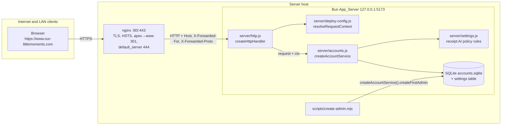

# Design Document: Publish Behind nginx

## Overview

This design makes the Bun account server safe and correct when nginx on the same host terminates TLS for `https://www.our-littlemoments.com` and proxies to `http://127.0.0.1:5173`. It also covers the operator decisions recorded in the requirements:

- Public registration is locked in Published_Mode: `POST /api/register` always returns 403, and `CAMPING_REGISTRATION=open` with `CAMPING_PUBLISHED=1` is a startup error. New people join through a trip invitation link, which can create the account and join the trip in one transaction. Local_Mode keeps `open`/`closed` with default `open`.
- Every trip member can create invitation links (`canInvite = manage || isMember`). Members who are not Trip_Managers hold at most 5 active links per trip; every trip holds at most 20.
- Invitation links are single-use in both modes. The first successful join or invite registration consumes the link in the same transaction as the membership insert.
- Each invite has a non-secret `id` (random UUID). `GET /api/trips/<tripId>/invites` lists the open links the caller may revoke (all of them for Trip_Managers, only their own for other members), and `POST /api/trips/<tripId>/invites/<inviteId>/revoke` revokes one. The trip invite dialog shows that list with a 撤銷 button per link. No site-wide per-account cap on invites or trips is added (operator decision).
- Signed-out visitors see a minimal preview (trip title, destination, dates, inviter display name) from a new public, rate-limited `GET /api/invites/<token>/preview`, above the registration form.
- The first administrator is created with a command-line script on the server. The web setup (`/setup`, `POST /api/setup`) does not exist in Published_Mode.
- The receipt AI policy (`all`, `admins`, `off`) is a runtime setting stored in SQLite and changed from the admin page. The default is `all` in both modes.
- LAN devices use the same public hostname through nginx. The app keeps binding `127.0.0.1` and has no LAN allowlist in Published_Mode.
- HSTS is `max-age=15552000` without `includeSubDomains` or `preload`.
- Only `www` is served. The apex redirects to `www`; unknown hostnames hit a `default_server` that returns 444.

The changes stay inside the existing structure. One new pure module (`server/deploy-config.js`) holds configuration parsing and per-request address/host/origin logic so that it can be property-tested without a network. One small pure module (`server/settings.js`) holds the receipt AI policy rules. `server/http.js` computes a request context and passes it to the account service, which already accepts an `info` object. Without new environment variables, the computed context reproduces today's values, so existing tests and the Docker setup keep their behavior.

### Key decisions

| Decision | Choice | Reason |
| --- | --- | --- |
| Where proxy logic lives | `server/deploy-config.js`, pure functions | Unit- and property-testable; `accounts.js` stays focused on accounts. |
| How config reaches the service | `createHttpHandler({ ..., config })` computes a per-request context; `createAccountService({ ..., deployment })` gets static policy | Request-dependent values (client address, origin, cookie flag) are computed once per request in one place. The service reads static flags (published, registration policy, AI seed). |
| `POST /api/setup` in Published_Mode | **404** with the standard `找不到這個 API。` | The route does not exist in this deployment, matching `/setup` returning 404. A 403 would suggest that a different Host, peer, or header could succeed, and it would be evaluated after the Origin check. Removing the route from the table answers 404 before any other check. |
| Published flag on the client | Runtime: the server injects `<meta name="camping-deployment" content="published">` into `index.html` and rewrites a `PUBLISHED` constant in `sw.js` | One build serves both modes, and the flag is available offline from the cached shell. `/api/session` is not used for this because the Local_Planner must start offline. |
| Local_Mode host allowlist | Loopback hosts + every IP literal + optional `CAMPING_LOCAL_EXTRA_HOSTS` | The README Docker LAN flow uses `http://<LAN-IPv4>:5182`. A loopback-only allowlist would break it. DNS rebinding needs a hostname, so IP literals are safe to accept. The extra-hosts setting covers LAN names. |
| Extra hosts in Published_Mode | Rejected at startup | LAN devices reach the site through nginx with the public hostname. A setting that would do nothing is an error, not a silent no-op. |
| Receipt AI seed | Read-time fallback (`stored ?? seed ?? 'all'`), never written at startup | Startup has no database side effects. The stored value always wins after the first admin change. The admin page can show where the value comes from. |
| Settings freshness | Read the `settings` row on every receipt AI request | One indexed primary-key lookup. There is no cache to invalidate, and a change made by another process takes effect at once. |
| Invitation preview | New `GET /api/invites/<token>/preview`, no sign-in, fields `title, destination, startDate, endDate, inviterName` | Visitors see what they sign up for. `GET /api/invites/<token>` keeps requiring sign-in (existing test expects 401). Every invalid case returns the same 404 body, so the endpoint does not reveal why a link fails. The `invitePreview` limit (60 per 15 minutes per Client_Address) bounds scraping. `Cache-Control: no-store` and `Referrer-Policy: no-referrer` are already in `json()` and `SECURITY_HEADERS`. |
| Registration in Published_Mode | Always `closed`; `open` is a `ConfigError` | Accounts on the public site come only from invitations. A setting that would silently reopen sign-up is rejected at startup. |
| Closed `POST /api/register` | 403 before the `register` limiter and before reading the body | The request does no work, so counting it would only let one client exhaust its own bucket for Invite_Registration. |
| Who can invite | `canInvite = manage \|\| isMember` | Matches "invitation from current members". Admins keep invite rights on every trip because `manage` includes them. |
| Per-creator limit | 5 Active_Invites per trip for creators who are not Trip_Managers; owners and admins keep only the 20-per-trip limit | Members invite a few friends. The limit keeps one member from using all 20 trip slots. Owners keep the current behavior, and the existing test that creates 20 owner invites still passes. |
| Creator loses rights | Use-time check in `inviteByHash` (creator is owner, admin, or Trip_Member) plus explicit revocation on deletion and admin demotion | The use-time check covers every path, including future "leave trip" actions. Explicit revocation also frees the slots counted by the limits. |
| Single-use storage | `invites.used_at`, `invites.used_by` (and the new `invites.id`), added by `migrateInviteColumns` with `PRAGMA table_info` + `ALTER TABLE ADD COLUMN` | Additive and safe for existing databases. It follows the existing `migrateCoverKinds` pattern of checking the schema first. |
| Already-joined account | Does not consume the link; a used link still reports `alreadyMember` to accounts in the trip | A reload after joining shows "already a member", and existing idempotent-join assertions stay true. Accounts outside the trip get the 404. |
| Invite identifier | New `invites.id` column, random UUID, unique index; `token_hash` stays the primary key | Tokens are stored hashed, so the list cannot show or re-derive them. A UUID is not secret and cannot join a trip, so it can appear in list responses and URLs. Token lookups stay unchanged. |
| Revoke route | Only `POST /api/trips/<tripId>/invites/<inviteId>/revoke`. The token-based `POST /api/invites/<token>/revoke` is not added. The create response becomes `{ id, token, urlPath, expiresAt }` | One revoke path means one set of permission rules, one audit point, and one set of tests. The just-created link is revoked through the same route because the dialog gets its `id` from the create response. The trip ID in the path lets the route reuse `tripAccess` + `requireInviter`, so outsiders get the usual trip 404. |
| Who sees which links | Trip_Managers: every Active_Invite of the trip. Other Inviters: only their own | Matches who may revoke. A member cannot see or revoke links other members sent. |
| Revoke check order | Inviter check (404 trip) → Active_Invite of this trip (404 invite) → creator or manager (403) | Outsiders learn nothing about the trip. A member learns only that an ID is active in a trip they belong to, which carries no secret. |
| Invite dialog flow | The invite button opens the dialog with the list and a `建立邀請連結` button, instead of creating a link on every click | A member at the 5-link limit must be able to open the dialog to revoke a link. Opening the dialog no longer uses up a slot. |
| Site-wide per-account cap | None | Operator decision. The per-trip limits of 20 and 5 are the only invitation limits. |
| XFF from nginx | `proxy_set_header X-Forwarded-For $remote_addr` (replace) | The app receives exactly one entry. The right-most-untrusted algorithm stays correct if the operator uses `$proxy_add_x_forwarded_for` instead. |

## Architecture



### Startup sequence

```mermaid
sequenceDiagram
  participant Env as process.env
  participant Serve as scripts/serve.mjs
  participant Cfg as deploy-config.parseDeploymentConfig
  participant Acc as createAccountService
  participant Bun as Bun.serve
  Serve->>Cfg: parse(env)
  alt ConfigError
    Cfg-->>Serve: throw ConfigError(setting, message)
    Serve->>Serve: console.error(message); exit(1)
  end
  Cfg-->>Serve: config (frozen)
  Serve->>Acc: { dbPath, receiptAi, allowLoopbackHostFromContainer, deployment: config }
  Serve->>Bun: { hostname: config.bindHost, port, fetch: createHttpHandler({ root, accounts, config }) }
  Serve->>Serve: log formatStartupLines(config, accounts.receiptAiPolicy())
  opt config.published and accounts.needsSetup()
    Serve->>Serve: log "Run `bun run create-admin` …"
  end
```

### Request pipeline in `createHttpHandler`

1. Parse `req.url`. Read the Direct_Peer from `server.requestIP(req)?.address`.
2. `resolveRequestContext({ url, headers, peer, config })`:
   1. Normalize the peer and decide `isDirectLocal`.
   2. **Host check.** If the hostname is not allowed, return 403 `Forbidden host` with `SECURITY_HEADERS`. This happens before the account service and static handling (Req 3.1).
   3. **Client address.** If the request is proxied and the selected `X-Forwarded-For` entry is invalid, return 400 `Bad forwarding header` (Req 6.4).
   4. Compute `expectedOrigin` and `secureCookie`.
3. `accounts.handle(req, ctx)`. API responses get `SECURITY_HEADERS` as today.
4. Static routes: in Published_Mode, `/demo`, `/demo/`, `/setup`, `/setup/` return 404 (Req 8.1, 9.1).
5. Shell and service worker: in Published_Mode, `index.html` gets the deployment meta tag, and `sw.js` gets `PUBLISHED=true` (Req 9.6).

The host check comes before the client-address check because the allowlist depends only on `isDirectLocal`, which needs the presence of forwarding headers, not their values.

## Components and Interfaces

### 1. `server/deploy-config.js` (new, pure)

```js
export class ConfigError extends Error { constructor(setting, message) { super(message); this.setting = setting; } }

export const ENV = {
  published: 'CAMPING_PUBLISHED',                 // Boolean_Setting
  publicOrigin: 'CAMPING_PUBLIC_ORIGIN',
  trustedProxies: 'CAMPING_TRUSTED_PROXIES',     // comma-separated IPs
  localExtraHosts: 'CAMPING_LOCAL_EXTRA_HOSTS',  // comma-separated hostnames, Local_Mode only
  allowNonLoopbackBind: 'CAMPING_ALLOW_NON_LOOPBACK_BIND', // Boolean_Setting
  registration: 'CAMPING_REGISTRATION',          // open | closed
  receiptAiPolicy: 'CAMPING_RECEIPT_AI_POLICY',  // all | admins | off (seed only)
  dockerLocalOnly: 'CAMPING_DOCKER_LOCAL_ONLY',  // existing, parsed as before (=== '1')
  host: 'HOST', port: 'PORT'
};

export function parseDeploymentConfig(env) → DeploymentConfig   // throws ConfigError
export const LOCAL_DEFAULTS: DeploymentConfig                   // parseDeploymentConfig({})
export function resolveDbPath(env, projectRoot) → string         // CAMPING_DB or <root>/data/accounts.sqlite
export function normalizeIp(value) → string | null               // canonical form or null if invalid
export function isLoopbackAddress(ip) → boolean
export function isIpLiteralHost(hostname) → boolean              // '1.2.3.4' or '[::1]' style
export function hasForwardingHeaders(headers) → boolean
export function selectClientAddress({ peer, xff, trusted }) → { address, proxied } | { error: 'invalid-forwarded-for' }
export function isHostAllowed(hostname, { config, isDirectLocal }) → boolean
export function resolveRequestContext({ url, headers, peer, config }) → { ok: true, ctx } | { ok: false, status, message }
export function formatStartupLines(config, receiptAiPolicy) → string[]
```

**Parsing rules (Req 2):**

- Boolean_Setting: `undefined`/`''`/`'0'` mean off, `'1'` means on, and anything else throws `ConfigError` naming the variable and listing `1, 0` (Req 2.10). `CAMPING_DOCKER_LOCAL_ONLY` keeps its current `=== '1'` parsing so that existing Docker setups are not affected.
- `CAMPING_PUBLIC_ORIGIN`: required when published (2.1). The raw string must not contain `?` or `#` (the URL parser drops an empty `?`). `new URL(raw)` must succeed with protocol `https:` when published (2.2), no `username`/`password`, and `pathname === '/'` (2.3). The normalized value is `url.origin`, which lowercases the host and drops the default port. When published is off and the origin is set, the shape rules still apply (2.3), but `https:` is not required.
- `HOST`: default `127.0.0.1`. Allowed without opt-in: `localhost`, or any address where `isLoopbackAddress(normalizeIp(host))` is true. Otherwise `CAMPING_ALLOW_NON_LOOPBACK_BIND=1` or `CAMPING_DOCKER_LOCAL_ONLY=1` is required (2.4).
- Published and Docker_Local_Only together throw (2.5).
- `CAMPING_TRUSTED_PROXIES`: split on `,`, trim, drop empty items, and `normalizeIp` each entry. An invalid entry throws with the entry text (2.6). The default is `['127.0.0.1', '::1']` when published and `[]` otherwise.
- `CAMPING_REGISTRATION`: `open | closed`. When published, `open` throws `ConfigError('CAMPING_REGISTRATION', 'CAMPING_REGISTRATION=open is not allowed with CAMPING_PUBLISHED=1: public registration is locked; people join through trip invitation links.')` (2.12), and unset or `closed` gives `closed` (10.4). Otherwise the default is `open` (10.5). `CAMPING_RECEIPT_AI_POLICY`: `all | admins | off | unset` (2.7).
- `CAMPING_LOCAL_EXTRA_HOSTS`: each entry is lowercased and must match the hostname rule `^(?=.{1,253}$)([a-z0-9](?:[a-z0-9-]{0,61}[a-z0-9])?)(\.[a-z0-9](?:[a-z0-9-]{0,61}[a-z0-9])?)*$` (2.8). Setting it in Published_Mode throws (2.9).
- The result is a frozen `DeploymentConfig` (2.11).

**`normalizeIp(value)`:** `net.isIP(value)` must be 4 or 6. Zone IDs (`%`) and brackets are rejected. IPv6 is lowercased and compressed with `new URL('http://[' + v + ']').hostname`. An IPv4-mapped IPv6 address (`::ffff:a.b.c.d`, and the hex form that `URL` produces, `::ffff:7f00:1`) is converted to dotted IPv4 (Req 6.5).

**`selectClientAddress`** (Req 6.1–6.4):

```text
peerN = normalizeIp(peer)
if peerN is null or peerN ∉ trusted or xff is null:
    return { address: peerN ?? undefined, proxied: false }       // headers ignored (6.2)
entries = xff.split(',').map(trim)
for i from last to first:
    if normalizeIp(entries[i]) ∈ trusted: continue
    return normalizeIp(entries[i]) ? { address: that, proxied: true }
                                   : { error: 'invalid-forwarded-for' }   // 6.4
first = normalizeIp(entries[0])                                    // all trusted (6.3)
return { address: first, proxied: true }
```

An empty or malformed entry is not in `trusted`, so it is selected and rejected. Multiple `X-Forwarded-For` header lines arrive joined by `, ` from `Headers.get`.

**`isHostAllowed(hostname, { config, isDirectLocal })`** (Req 3). `hostname` is `url.hostname`. The WHATWG URL parser already lowercases it and strips the port (3.3).

```text
loopback = hostname ∈ {'127.0.0.1','localhost','[::1]'}
if config.published:
    return hostname === config.publicHostname || (loopback && isDirectLocal)   // 3.4, 3.5
return loopback || isIpLiteralHost(hostname) || config.localExtraHosts.includes(hostname)  // 3.6, 3.7
```

**`isDirectLocal`:** the peer is a loopback address, the hostname is a loopback host, and `hasForwardingHeaders` is false. When the peer is unknown (in-process calls in tests where `server` is undefined), Local_Mode treats the peer as loopback to match today's `isLoopback`. Published_Mode treats an unknown peer as untrusted and not local.

**`resolveRequestContext` output (`ctx`):**

```js
{
  ip: peer,                 // raw Direct_Peer, unchanged meaning for existing isLoopback()
  clientAddress,            // normalized Client_Address or undefined
  isProxied, isDirectLocal,
  expectedOrigin,           // published && isProxied ? config.publicOrigin : url.origin
  secureCookie,             // published && isProxied ? true : url.protocol === 'https:'
  published: config.published
}
```

`X-Forwarded-Host` and `X-Forwarded-Proto` are never read (6.6). nginx sends `X-Forwarded-Proto` only for logs and future use.

### 2. `server/settings.js` (new, pure)

```js
export const RECEIPT_AI_POLICIES = ['all', 'admins', 'off'];
export const RECEIPT_AI_KEY = 'receiptAiPolicy';
export function resolveReceiptAiPolicy(stored, seed) → { value, source: 'stored' | 'seed' | 'default' }
  // stored valid → stored; stored invalid (manual DB edit) → { value: 'off', source: 'stored' } fail-closed;
  // else seed → seed; else 'all'
export function receiptAiDecision({ policy, role, canEdit, keyEnabled }) →
  'allow' | 'no-edit' (403) | 'admins-only' (403) | 'off' (503) | 'unconfigured' (503)
```

The decision order follows today's code. A missing edit permission gives `no-edit`. Then policy `off` gives `off`, policy `admins` with a non-admin role gives `admins-only`, a missing key gives `unconfigured`, and anything else gives `allow`.

### 3. `server/accounts.js` (changed)

**Factory signature:**

```js
createAccountService({ dbPath, now, receiptAi = null, allowLoopbackHostFromContainer = false,
                       deployment = { published: false, registrationPolicy: 'open', receiptAiPolicySeed: null } })
```

**New exports for reuse and tests:** `HttpError`, `RateLimiter`, `validateUsername`, `validateDisplayName`, `validatePassword`. The validators are unchanged and throw `HttpError(400, message)`.

**New service methods:**

```js
needsSetup() → boolean
receiptAiPolicy() → { value, source, updatedAt, updatedBy }
async createFirstAdmin({ username, displayName, password }, { auditAction = 'setup' }) → user row
  // validates with the shared validators, hashPassword, then tx: userCount === 0 else HttpError(409, '管理員已設定完成。'),
  // insertUser(role 'admin'), audit(username, auditAction, `user:${username}`)
```

`routes.setup` keeps its loopback check, calls `createFirstAdmin(body)`, and then starts a session. The CLI calls `createFirstAdmin(input, { auditAction: 'setup.cli' })`.

**Context use inside `handle(request, info)`:**

```js
const expectedOrigin = info.expectedOrigin ?? url.origin;            // Req 4
const secure = info.secureCookie ?? url.protocol === 'https:';       // Req 5
if (request.method !== 'GET' && request.headers.get('origin') !== expectedOrigin) fail(403, '請求來源不被允許。');
```

`cookieHeader(secure, token, maxAge)` replaces the `url` argument. `startSession(request, info, user, extra = {})` returns `{ user, needsSetup: false, ...extra }`. `clientKey(info)` becomes `info.clientAddress ?? info.ip ?? 'local'`, sliced to 64 characters (Req 7.1). Existing tests that pass `{ ip }` keep working because every new field falls back to today's derivation.

**Route table changes:**

- `/api/setup` is added to the table only when `deployment.published` is false. In Published_Mode every method falls through to `404 找不到這個 API。` before the Origin check (Req 8.2).
- New entries: `[/^\/api\/invites\/([^/]+)\/register$/, { POST: routes.inviteRegister }]`, `[/^\/api\/invites\/([^/]+)\/preview$/, { GET: routes.invitePreview }]`, `[/^\/api\/trips\/([^/]+)\/invites\/([^/]+)\/revoke$/, { POST: routes.revokeInvite }]`, and `[/^\/api\/admin\/settings$/, { GET: routes.adminSettings, PATCH: routes.adminPatchSettings }]`. The existing `/^\/api\/invites\/([^/]+)$/` entry does not match the new suffixes because `[^/]+` stops at `/`.
- The existing `/^\/api\/trips\/([^/]+)\/invites$/` entry gains `GET: routes.listInvites` next to `POST: routes.createInvite`. It does not match the revoke path because `$` follows `invites`.
- There is no `/api/invites/<token>/revoke` route; such a request gets the standard 404 `找不到這個 API。`.

#### Invitation rules (Req 15–19)

**Constants:** `MAX_ACTIVE_INVITES = 20` (unchanged, Trip_Invite_Limit), new `MAX_MEMBER_INVITES = 5` (Member_Invite_Limit), `INVITE_TTL = 7 days` (unchanged). `LIMITS.invitePreview = { max: 60, window: 15 * 60000 }`.

**Capabilities** (Req 16.1):

```js
const capabilities = (row, user, isMember) => {
  const manage = row.owner_id === user.id || user.role === 'admin';
  return { canEdit: manage || isMember, canDelete: manage, canInvite: manage || isMember, canManage: manage };
};
const requireInviter = access => { if (!access.canInvite) fail(404, '找不到這趟旅行。'); return access; };
```

`tripAccess` already returns 404 for accounts outside the trip, so `requireInviter` is a guard that never fires for a valid `access` today. It keeps the intent explicit (Req 16.3). `requireManager` had `createInvite` as its only caller and is removed.

**Queries** (all parameterized):

```sql
-- Active_Invites per trip and per creator (Req 16.6)
activeInvites:        SELECT COUNT(*) AS n FROM invites WHERE trip_id = ? AND revoked_at IS NULL AND used_at IS NULL AND expires_at > ?
activeInvitesByUser:  SELECT COUNT(*) AS n FROM invites WHERE trip_id = ? AND created_by = ? AND revoked_at IS NULL AND used_at IS NULL AND expires_at > ?
-- Usable token row, ignoring used_at; callers decide on used_at (Req 15.3, 17.3, 17.4)
inviteForUse: SELECT i.*, u.display_name AS inviter_name FROM invites i
  JOIN users u ON u.id = i.created_by JOIN trips t ON t.id = i.trip_id
  WHERE i.token_hash = ? AND i.revoked_at IS NULL AND i.expires_at > ? AND u.deleted_at IS NULL
    AND NOT EXISTS (SELECT 1 FROM trip_deletions d WHERE d.trip_id = i.trip_id)
    AND (t.owner_id = i.created_by OR u.role = 'admin'
         OR EXISTS (SELECT 1 FROM trip_members m WHERE m.trip_id = i.trip_id AND m.user_id = i.created_by))
consumeInvite:   UPDATE invites SET used_at = ?, used_by = ? WHERE token_hash = ? AND used_at IS NULL AND revoked_at IS NULL
-- Every new invite gets a random UUID id (Req 19.8)
insertInvite:    INSERT INTO invites (id, token_hash, trip_id, created_by, created_at, expires_at) VALUES (?, ?, ?, ?, ?, ?)
-- Invite_List (Req 19.1, 19.2, 19.3, 19.5); selects no token_hash and no account id or username
listTripInvites:   SELECT i.id, u.display_name AS creator_name, i.created_at, i.expires_at FROM invites i
  JOIN users u ON u.id = i.created_by
  WHERE i.trip_id = ? AND i.revoked_at IS NULL AND i.used_at IS NULL AND i.expires_at > ?
  ORDER BY i.created_at DESC, i.id
listTripInvitesBy: (same SELECT) ... AND i.created_by = ? ORDER BY i.created_at DESC, i.id
-- Active_Invite of this trip by id (Req 18.3)
activeInviteById: SELECT id, created_by FROM invites
  WHERE id = ? AND trip_id = ? AND revoked_at IS NULL AND used_at IS NULL AND expires_at > ?
revokeInviteById: UPDATE invites SET revoked_at = ? WHERE id = ? AND trip_id = ? AND revoked_at IS NULL AND used_at IS NULL
revokeTripInvitesBy:       UPDATE invites SET revoked_at = ? WHERE trip_id = ? AND created_by = ? AND revoked_at IS NULL AND used_at IS NULL
revokeInvitesWithoutRights: UPDATE invites SET revoked_at = ? WHERE created_by = ? AND revoked_at IS NULL AND used_at IS NULL
  AND trip_id NOT IN (SELECT id FROM trips WHERE owner_id = ?)
  AND trip_id NOT IN (SELECT trip_id FROM trip_members WHERE user_id = ?)
```

`inviteByHash` is replaced by `inviteForUse`. The existing `revokeTripInvites` (trip deletion) and `revokeInvitesBy` (account deletion, Req 16.8) stay.

**Token resolution:**

```js
// Returns { invite, row } for an unexpired, unrevoked token whose creator is still an Inviter and whose trip is live.
// Used tokens are returned too; callers check invite.used_at.
function resolveInvite(token) {
  const invite = TOKEN.test(token) ? q.inviteForUse.get(sha256(token), clock()) : null;
  const row = invite ? q.tripById.get(invite.trip_id) : null;
  if (!row) fail(404, '邀請連結無效或已過期。');
  return { invite, row };
}
const inTrip = (row, userId) => row.owner_id === userId || !!q.membership.get(row.id, userId);
function usableInvite(token) {                       // Valid_Invite: also unused
  const found = resolveInvite(token);
  if (found.invite.used_at !== null) fail(404, '邀請連結無效或已過期。');
  return found;
}
function consumeInTx(invite, userId) {               // Req 17.1, 17.5
  if (q.consumeInvite.run(clock(), userId, invite.token_hash).changes !== 1) fail(404, '邀請連結無效或已過期。');
}
```

Every failure path uses the same `fail(404, '邀請連結無效或已過期。')`, so status, body, and headers are identical (Req 15.3).

**`routes.createInvite`** (Req 16.2–16.6):

```text
tx:
  user = requireExpectedUser(...)
  access = requireInviter(tripAccess(user, tripId))
  activeInvites(tripId, at) >= 20 → 409 `每趟旅行最多 20 個有效邀請連結。`            // unchanged message
  !access.canManage && activeInvitesByUser(tripId, user.id, at) >= 5
      → 409 `每位旅伴在每趟旅行最多 5 個有效邀請連結。`
  id = randomUUID()                                                                   // Req 19.8
  insertInvite(id, sha256(token), tripId, user.id, at, expiresAt); audit(user.username, 'invite.create', `trip:${tripId}`)
json(201, { id, token, urlPath: `/invite/${token}`, expiresAt })                       // Req 16.2; `token` kept for existing callers
```

The response gains only `id`. Existing tests and e2e helpers that read `token` or `urlPath` keep working. The token is shown once here and never again, because only its hash is stored.

**`routes.listInvites(request, url, info, [tripId])`** (Req 19.1–19.7):

```text
user = requireUser(request)                                    // 401 (19.7)
access = requireInviter(tripAccess(user, tripId))              // 404 '找不到這趟旅行。' (19.6)
rows = access.canManage ? listTripInvites(tripId, clock())     // all Active_Invites (19.1)
                        : listTripInvitesBy(tripId, clock(), user.id)   // own only (19.2)
json(200, { invites: rows.map(r => ({ id: r.id, creatorName: r.creator_name,
                                      createdAt: iso(r.created_at), expiresAt: iso(r.expires_at) })) })   // 19.3
```

GET requests skip the Origin check in `handle`, as every GET does today. The response is built from an explicit field map over a query that does not select `token_hash`, `created_by`, or any username, so nothing secret can leak by adding a column later (19.4). The query conditions exclude used, revoked, and expired rows (19.5). Rows are ordered newest first.

**`routes.getInvite`** (signed-in, unchanged shape): `user = requireUser`; `{ invite, row } = resolveInvite(token)`; if `inTrip(row, user.id)` return `{ ..., alreadyMember: true }`; else if `invite.used_at !== null` → 404; else `alreadyMember: false` (Req 17.3, 17.4).

**`routes.joinInvite`** (Req 17.1–17.4):

```text
user = requireUser; body checks unchanged
tripId = tx(() => {
  user = requireUser(request)
  { invite, row } = resolveInvite(token)
  if inTrip(row, user.id): return row.id          // no consumption, response { tripId } unchanged
  if invite.used_at !== null: fail 404
  addMemberInTx(row, user.id, body.name, body.role ?? '')
  consumeInTx(invite, user.id)
  audit(user.username, 'invite.join', `trip:${row.id}`)
  return row.id
})
```

Any failure inside `tx` rolls back the membership, the participant, and the consumption (Req 17.2). `tx` uses `BEGIN IMMEDIATE`, so concurrent joins are serialized, and the `used_at IS NULL` guard in `consumeInvite` makes a second consumption fail even across processes (Req 17.5).

**`routes.invitePreview(request, url, info, [token])`** (Req 15):

```text
key = `invite-preview:${clientKey(info)}`
blocked(key, LIMITS.invitePreview) → 429 '查看邀請的次數太多，請稍後再試。'     // before lookup (15.5)
hit(key, LIMITS.invitePreview)                                                 // every request counts (15.4)
{ invite, row } = usableInvite(token)                                          // 404 for every invalid case (15.3)
json(200, { title: row.title, destination: row.destination, startDate: row.start_date,
            endDate: row.end_date, inviterName: invite.inviter_name })        // exactly these fields (15.1, 15.2)
```

No session is read, nothing is written (Req 15.7), and the `json()` helper already sets `Cache-Control: no-store`. `server/http.js` already copies `SECURITY_HEADERS`, which include `Referrer-Policy: no-referrer` and `Cache-Control: no-store`, onto every API response and the `/invite/<token>` shell. The published `shellResponse` must keep them (Req 15.6). A test pins both headers.

**`routes.revokeInvite(request, url, info, [tripId, inviteId])`** (Req 18):

```text
user = requireUser(request)                                    // 401 (18.5)
body = readJson(request)                                       // {} or { expectedUserId }
tx:
  user = requireExpectedUser(request, body.expectedUserId)
  access = requireInviter(tripAccess(user, tripId))            // 404 '找不到這趟旅行。' (18.4)
  invite = ID.test(inviteId) ? activeInviteById(inviteId, tripId, clock()) : null   // existing ID pattern
  !invite → 404 '邀請連結無效或已過期。'                         // malformed, unknown, other trip, used, expired, revoked (18.3)
  invite.created_by !== user.id && !access.canManage
      → 403 '只有建立連結的人、主辦人或管理員可以撤銷邀請。'      // 18.2
  revokeInviteById(clock(), inviteId, tripId)
  audit(user.username, 'invite.revoke', `trip:${tripId}`)
json(200, { revoked: true })                                   // 18.1
```

The Origin check in `handle` applies because the request is a POST (18.6). The target is the pair (trip ID, Invite_ID); no route accepts an Invite_Token as the revoke target (18.7). `access.canManage` is true for the trip owner and for admins, so it matches the Trip_Manager definition. A deleted trip fails `tripAccess` with the trip 404.

**Revocation when rights are lost** (Req 16.7–16.9):

- `revokeCreatorTripInvites(tripId, userId)` wraps `revokeTripInvitesBy`. Every code path that deletes a `trip_members` row must call it in the same transaction. Today the only such path is `adminDeleteUser`, which already calls `revokeInvitesBy` for all of the account's invites. There is no "leave trip" or "remove member" route, because bound participants cannot be removed from trip state (the existing 409 `已綁定帳號的旅伴不能在手冊中移除或更換…`).
- `adminPatchUser`: when `target.role === 'admin' && role === 'member'`, run `revokeInvitesWithoutRights(at, target.id, target.id, target.id)` in the same transaction, then audit as today.
- The use-time creator check in `inviteForUse` makes any missed path fail closed.

**Migration** (Req 17.7, 19.9), called after `migrateCoverKinds(db)`:

```js
function migrateInviteColumns(db) {
  const columns = new Set(db.query('PRAGMA table_info(invites)').all().map(c => c.name));
  const indexes = new Set(db.query('PRAGMA index_list(invites)').all().map(i => i.name));
  if (['used_at', 'used_by', 'id'].every(c => columns.has(c)) && indexes.has('invites_id')) return;
  db.exec('BEGIN IMMEDIATE;');
  try {
    if (!columns.has('used_at')) db.exec('ALTER TABLE invites ADD COLUMN used_at INTEGER');
    if (!columns.has('used_by')) db.exec('ALTER TABLE invites ADD COLUMN used_by TEXT REFERENCES users(id)');
    if (!columns.has('id')) db.exec('ALTER TABLE invites ADD COLUMN id TEXT');
    const setId = db.query('UPDATE invites SET id = ? WHERE token_hash = ?');
    for (const { token_hash } of db.query('SELECT token_hash FROM invites WHERE id IS NULL').all())
      setId.run(randomUUID(), token_hash);                                        // backfill (19.9)
    db.exec('CREATE UNIQUE INDEX IF NOT EXISTS invites_id ON invites(id)');
    db.exec('COMMIT;');
  } catch (error) { db.exec('ROLLBACK;'); throw error; }
}
```

The `SCHEMA` `CREATE TABLE IF NOT EXISTS invites` gains the three columns for new databases (`id TEXT NOT NULL`), so on a new database the migration only creates the `invites_id` index. The unique index is created here and not in `SCHEMA`, because on an old database `SCHEMA` runs before the `id` column exists and `CREATE INDEX … (id)` would fail. SQLite cannot add a `UNIQUE` or `NOT NULL` column with `ALTER TABLE`, so a migrated database has a nullable `id` column; the backfill and the unique index give every row a distinct `id`, and `insertInvite` always supplies one. `ALTER TABLE … ADD COLUMN` with a `NULL` default is allowed with foreign keys on and does not rewrite rows. Existing rows read `used_at = NULL`, so they are unused. Every step runs in one transaction, so a failure leaves the old schema in place.

**Shared join helper**, extracted from `joinInvite` and used by both join paths inside a transaction:

```js
function addMemberInTx(row, userId, name, role) {
  let added;
  try { added = addParticipant(JSON.parse(row.state_json), name, role); }
  catch (error) { fail(/已在小隊|額滿/.test(error.message) ? 409 : 400, error.message); }
  q.insertMember.run(row.id, userId, added.person.id, clock());
  pushEvent(added.state, `${added.person.name} 加入了小隊`, added.person.name);
  persist(row, added.state);
}
```

**`routes.register`:** first, `if (deployment.registrationPolicy === 'closed') fail(403, '目前不開放公開註冊，請使用旅行邀請連結建立帳號。')`. This runs before the `register` limiter and before `readJson`, so a closed request does no work and is not counted. In Published_Mode `registrationPolicy` is always `closed`, so every request that passes the Origin check gets this 403 (Req 10.2, 10.4, 10.7). The rest is unchanged (Req 10.1).

**`routes.inviteRegister(request, url, info, [token])`** (Req 14):

```text
key = `register:${clientKey(info)}`; blocked → 429 '註冊嘗試太多次，請稍後再試。'; hit(key)        // 14.9
needsSetup() → 409 '請先完成管理員設定。'                                                        // 14.11
body = readJson; username/displayName/password via shared validators                             // Account_Validation
name = body.name ?? displayName; role = body.role ?? ''; non-string → 400 '請填寫名字或暱稱。'
usableInvite(token)        // 404 '邀請連結無效或已過期。' (also for a Used_Invite) before the expensive hash  // 14.6
userByName(username) → 409 '這個帳號名稱已被使用。'                                              // 14.7
hash = await hashPassword(password)
{ user, tripId } = tx(() => {                                                                    // 14.3, 14.4
  userByName(username) → 409
  { invite, row } = usableInvite(token)           // re-check inside tx (expiry, use, or deletion during hashing)
  id = randomUUID(); insertUser(id, username, displayName, 'member', hash, now)
  addMemberInTx(row, id, name, role)              // 409 on name conflict or full trip → whole tx rolls back (14.8)
  consumeInTx(invite, id)                         // same transaction; rollback leaves the link unused (14.2–14.4)
  audit(username, 'register.invite', `user:${username}`); audit(username, 'invite.join', `trip:${row.id}`)  // 14.12
})
return startSession(request, info, user, { tripId })                                             // 14.2
```

The Registration_Policy is not checked, so this works under `open` and `closed` (14.5). The Origin check runs in `handle` because the request is a POST (14.10). Invite creation follows the invitation rules above (14.14).

**`routes.getSession`** (Req 10.6, 8.4):

```js
json(200, {
  user, needsSetup: needsSetup(),
  webSetup: !deployment.published,
  registrationOpen: deployment.registrationPolicy === 'open',
  inviteRegistration: !needsSetup()
})
```

**Receipt AI** (Req 11):

- `getReceiptAi` keeps the edit-permission 403. It then computes `decision = receiptAiDecision({ policy: receiptAiPolicy().value, role: user.role, canEdit: true, keyEnabled: receiptAi?.status?.enabled === true })`. For `allow` it returns `receiptAi.status`. Otherwise it returns `{ enabled: false, provider: 'OpenAI', modelId: '', maxImageBytes: AI_IMAGE_LIMIT, disabledReason: decision === 'unconfigured' ? 'unconfigured' : 'policy' }` (11.3, 11.4).
- `recognizeReceiptAi`: the existing `authorize()` closure also evaluates the policy. `off` fails with `503 'AI 辨識已由管理員關閉。'` and `admins-only` fails with `403 '目前只有管理員可以使用 AI 辨識。'`. Because `authorize()` runs before and after the upload, a change made mid-request is honored. The per-user, global daily, and concurrency limits are unchanged (11.13).
- `adminSettings`: `requireAdmin` returns `{ receiptAiPolicy: { ...receiptAiPolicy(), options: RECEIPT_AI_POLICIES } }`.
- `adminPatchSettings`: `requireAdmin` (403 for non-admins, 11.9), then `readJson`. If `body.receiptAiPolicy` is not in `RECEIPT_AI_POLICIES`, it fails with `400 '收據 AI 政策必須是 all、admins 或 off。'` (11.10). Then `tx(() => { requireAdmin; upsert; audit(admin.username, 'settings.receipt-ai', `receiptAiPolicy:${value}`) })` and the response has the same shape as the GET (11.8).

### 4. `server/http.js` (changed)

```js
export function createHttpHandler({ root, accounts, config = LOCAL_DEFAULTS }) {
  root = resolve(root);
  return async (req, server) => {
    const url = new URL(req.url);
    try {
      const context = resolveRequestContext({ url, headers: req.headers, peer: server?.requestIP?.(req)?.address, config });
      if (!context.ok) return new Response(context.message, { status: context.status, headers: SECURITY_HEADERS });
      const api = await accounts.handle(req, context.ctx);
      // ... existing method/path checks ...
      if (config.published && /^\/(?:demo|setup)\/?$/.test(pathname)) return notFound();
      // ... existing file resolution ...
      if (config.published && (route || pathname === '/index.html')) return shellResponse(file);   // inject meta
      if (config.published && pathname === '/sw.js') return swResponse(file);                       // PUBLISHED=true
      // ... existing file response ...
    } catch { /* unchanged 500 */ }
  };
}
```

- `shellResponse` reads `await file.text()`, inserts `<meta name="camping-deployment" content="published">` right after the `<head …>` tag, and keeps `Cache-Control: no-store` and the content type.
- `swResponse` replaces the first `const PUBLISHED=false;` with `const PUBLISHED=true;` and keeps `Cache-Control: no-cache`.
- In Local_Mode both files are returned as they are today, as `Bun.file` responses.

### 5. `scripts/serve.mjs` (changed)

- Parse the config with `parseDeploymentConfig(process.env)`. On `ConfigError`, print `Configuration error: <message>` and exit 1.
- Pass `config.bindHost`, `config.port`, and `config` into `Bun.serve` and `createHttpHandler`. Pass `deployment: config` and `allowLoopbackHostFromContainer: config.dockerLocalOnly` into the account service.
- Logs. The first line always starts with `Camping accounts ready:`, which `scripts/check-accounts.mjs` waits for:
  - Local_Mode: the two lines printed today, unchanged.
  - Published_Mode: `Camping accounts ready: https://www.our-littlemoments.com (app listening on http://127.0.0.1:5173)`, then `Registration: closed (trip invitation links only). Receipt AI policy: all (default).` (Req 1.4). `formatStartupLines` never touches the receipt AI key or env values other than config fields (1.5).
  - Published_Mode with `accounts.needsSetup()`: `No administrator exists yet. On this server, run: bun run create-admin (uses the same CAMPING_DB).` (Req 8.3).

### 6. `scripts/create-admin.mjs` (new) and `package.json`

`package.json` gains `"create-admin": "bun scripts/create-admin.mjs"` and the dev dependency `fast-check`.

```js
export async function runCreateAdmin({
  argv = process.argv.slice(2),
  env = process.env,
  projectRoot,
  isTTY = process.stdin.isTTY === true,
  prompt = askLine,            // (question) => Promise<string>, echoes input
  promptHidden = askHidden,    // (question) => Promise<string>, no echo
  out = console.log, err = console.error,
  openService = dbPath => createAccountService({ dbPath })
} = {}) → Promise<number /* exit code */>

if (import.meta.main) process.exitCode = await runCreateAdmin();
```

**Flow:**

1. `argv` is `['--help']`: print usage and return 0. Any other argument: print usage and return 2, before any prompt (Req 8.9). There is no flag or environment variable for the password (8.10). Only `CAMPING_DB` is read from `env`.
2. `!isTTY`: print `An interactive terminal is required; the password is never read from arguments, environment variables, or piped input.` and return 1 (8.11).
3. `dbPath = resolveDbPath(env, projectRoot)`. `:memory:` is refused with exit 1. `openService(dbPath)` reuses the account service, which applies the schema and migrations and enforces the private database path (8.6).
4. `service.needsSetup()` is false: print `Setup is already complete: this database already has accounts.` and return 1. The database is not changed (8.7).
5. Prompt for the username, then the display name, with `prompt`. Then prompt for the password and its confirmation with `promptHidden` (8.8). Each value is checked at once with the exported validator. On failure, print the validator's message and ask again, up to 5 attempts per field. After that, return 1 (8.12). A confirmation that does not match prints `兩次輸入的密碼不一致。` and re-asks for both password entries.
6. `await service.createFirstAdmin(input, { auditAction: 'setup.cli' })` (8.13). An `HttpError` 409 from a concurrent creation prints `Setup is already complete.` and returns 1 (8.14).
7. Print `Administrator <username> created. Sign in at <origin>/login.` The origin comes from `CAMPING_PUBLIC_ORIGIN` when set, otherwise `http://127.0.0.1:<PORT>`. The password is never printed or audited (8.15).
8. `service.close()` runs in a `finally` block.

**`askHidden`:** writes the question to stdout, calls `process.stdin.setRawMode(true)`, and collects bytes until `\r` or `\n`. It handles backspace (`\x7f`, `\b`). Ctrl+C (`\x03`) restores the mode and exits 130, and Ctrl+D on an empty buffer rejects. It writes no echo characters and prints a newline at the end. Raw mode is always restored in `finally`.

The injected `prompt`/`promptHidden` functions are a JavaScript API that only in-process tests can reach. They add no new way to pass a password from the command line or environment (8.16).

**Running next to the server:** the CLI and the server can share the WAL database. `createFirstAdmin` uses `BEGIN IMMEDIATE` with `busy_timeout = 5000`, so the count check and the insert are atomic across processes. The running server sees the new user on its next request. The Dockerfile does not copy the CLI, because Docker remains a Local_Mode deployment with web setup.

### 7. `scripts/build.mjs` (changed)

The generated `sw.js` starts with `const PUBLISHED=false;`. The cache name becomes `` `ggc-accounts-${hash}` + (PUBLISHED ? '-p' : '') `` so a mode change never reuses a shell cached in the other mode. The fetch handler gains one guard before `respondWith`:

```js
if (PUBLISHED && event.request.mode === 'navigate' && /^\/demo(?:\/|$)/.test(url.pathname)) return;
```

Without `respondWith`, the browser goes to the network and receives the server's 404. Offline, it shows its own offline error, never the cached shell (Req 9.3). The activate step already deletes `ggc-accounts-*` caches other than the current one.

### 8. Client changes

**`src/entry.js`** (Req 9.2, 9.5):

```js
const published = document.querySelector('meta[name="camping-deployment"]')?.content === 'published';
const demo = location.pathname === '/demo' || location.pathname.startsWith('/demo/');
if (demo && !published) await import('./app.js'); else await import('./accounts-ui.js');
```

**`src/accounts-ui.js`:**

- `main()`: the `/demo` shortcut also checks `!published`. Otherwise `parseRoute` returns `notfound` and the existing not-found page is shown.
- After the session loads, if `session.needsSetup` is true: with `!session.webSetup`, `messagePage(null, { title: '網站尚未完成設定', body: '管理員需要先在伺服器上執行建立管理員的指令。', actions: reload })` (Req 8.4); otherwise the existing redirect to `/setup`.
- `renderAuth(kind, session)`:
  - `register` with `!session.registrationOpen` shows the register page title with the message `目前不開放公開註冊。請向旅伴索取旅行邀請連結，從邀請頁建立帳號。` and a link to `/login` instead of the form (Req 10.3).
  - `login` with registration closed replaces the "還沒有帳號？註冊" link with `需要旅行邀請連結才能建立帳號。`.
- `renderInvite(user, route, session)` (Req 14.1, 14.13). When `!user`:
  - If `session.inviteRegistration` is false, keep today's redirect to `/login?next=…`.
  - Otherwise call `GET /api/invites/<token>/preview` first (Req 15). On 404 show the existing invalid-link page with `前往登入` (Req 15.9). On 429 show `查看邀請的次數太多，請稍後再試。` with a reload action.
  - On 200 render the invitation card: the same summary markup the signed-in page uses (`YOU'RE INVITED`, title, dates, destination, all through `e()`) plus `<p class="invite-date">${icon('people')}${e(inviterName)} 邀請你加入</p>`, then the registration form (Req 14.1). Fields: `帳號名稱（網址用）`, `顯示名稱`, `密碼`, `再次輸入密碼`, `你在這趟旅行的名字` (defaults to the display name when left empty), and `小隊角色（選填）`. The form also shows `已經有帳號？登入後加入` linking to `/login?next=/invite/<token>`. A note says `這個邀請連結只能使用一次。`.
  - Client validation reuses `validateAccount`. Submit calls `POST /api/invites/<token>/register` and then sets `location.href = tripPath(user, tripId)`. A 404 (for example, someone else used the link meanwhile) shows the existing invalid-link heading.
- When signed in, `renderInvite` keeps calling `GET /api/invites/<token>`. A 404 for a Used_Invite shows the existing invalid-link page. `alreadyMember: true` keeps today's "already a member" view.
- `ENDPOINTS` gains `adminSettings: '/api/admin/settings'`.

**`src/app.js` (account trip page)** (Req 16.10, 16.11, 19.10–19.13):

- The invite button already depends on `account.permissions.canInvite`, so members see it once the server reports `canInvite: true`. No visibility code changes.
- `allowAccountAction` and `createAccountInvite` change the denial text to `只有這趟旅行的成員或管理員可以發出邀請。`.
- New module state next to `accountInviteUrl`: `accountInviteId` (the `id` of the link created in this dialog session), `accountInvites` (the last loaded Invite_List), and `accountInviteError`.
- **Opening the dialog.** In account mode, `invite()` calls `openAccountInviteDialog()`. That function runs `assertAccountSession()`, loads `GET /api/trips/<tripId>/invites` into `accountInvites`, and calls `renderAccountInviteDialog()`. Opening the dialog does not create a link (see the key decision on the dialog flow).
- **`renderAccountInviteDialog()`** calls `showDialog('邀請旅伴，名字讓他自己填', …)` with, in order:
  1. When `accountInviteUrl` is set: the readonly link field, the copy button (`copy-invite`, unchanged), and the text `這個連結只能讓一位旅伴加入，有效期限：<expiry>。沒有帳號的人可以直接在邀請頁建立帳號。` plus `連結只會顯示這一次，請現在複製。` (Req 16.11).
  2. `accountInviteError`, when set, as a `.form-error` paragraph (Req 19.13).
  3. A `建立邀請連結` button with `data-action="create-invite"`.
  4. The heading `尚未使用的邀請連結` and a list. Each entry shows `e(creatorName)`, `建立於 <createdAt>`, `到期 <expiresAt>` (formatted with `toLocaleString('zh-TW')`), and a `撤銷` button with `data-action="revoke-invite"` and `data-id="<id>"`. The button's accessible name is `撤銷 <creatorName> 於 <createdAt> 建立的連結` so entries are distinguishable (Req 19.10).
  5. With an empty list: `<p class="dialog-note">目前沒有可撤銷的邀請連結。</p>` (Req 19.12).
  6. The notice `目前伺服器只開在這台電腦…`, only when the deployment meta tag is absent (Local_Mode).
  All server text goes through `e()`.
- **`create-invite`** calls `POST /api/trips/<tripId>/invites` with `{ expectedUserId }`. On success it sets `accountInviteUrl = location.origin + result.urlPath` and `accountInviteId = result.id`, clears `accountInviteError`, reloads the list, and re-renders. On a 409 it sets `accountInviteError = err.message`, keeps the list, and re-renders (Req 19.13). Other errors use `notify(err.message)`.
- **`revoke-invite`(id)** calls `POST /api/trips/<tripId>/invites/<id>/revoke` with `{ expectedUserId }`. On success it notifies `邀請連結已撤銷`; if `id === accountInviteId` it also clears `accountInviteUrl` and `accountInviteId`, so a revoked link is no longer offered for copying. It then reloads the list and re-renders (Req 19.11). On an error (for example a 404 because the link was used meanwhile) it notifies `err.message` and also reloads, so the list matches the server.
- `allowAccountAction` allows `create-invite` and `revoke-invite` under the same `canInvite` rule as `invite`. Closing the dialog clears `accountInviteUrl`, `accountInviteId`, and `accountInviteError`.

**Admin page (`renderAdmin`)** (Req 11.11): a new section `網站設定` comes after the stats. `load()` adds `api(ENDPOINTS.adminSettings)` to its `Promise.allSettled`. The section renders a form with `selectField` id `setting-receipt-ai`, options `all` = `所有可編輯旅行的帳號`, `admins` = `只限管理員`, `off` = `關閉`, and help text for the source:

- `default`: `目前使用預設值（all）。`
- `seed`: `目前使用伺服器環境變數 CAMPING_RECEIPT_AI_POLICY 的初始值。`
- `stored`: `由 <updatedBy> 於 <time> 設定。`

Submit sends `PATCH`, shows the toast `收據 AI 設定已更新`, and reloads. Errors use the existing `showFormError`.

**`src/receipt-ai-client.js` / `src/expenses-ui.js`:** `normalizeAiStatus` passes through `disabledReason` when it is `policy` or `unconfigured`. With `policy`, the expenses UI shows `管理員已限制 AI 收據辨識，請手動輸入。` instead of the API-key message.

### 9. Deployment guide (`docs/deploy-nginx.md`, new) and README

The README "GitHub and hosting" and "Network security" text gets a link to `docs/deploy-nginx.md` (Req 12.15). The guide has these sections:

1. **Overview and what is not published:** no `/demo/`, no web first-admin setup (12.13).
2. **Settings table:** every variable in `ENV` with its Local_Mode default, its Published_Mode default, and the example value (12.1).

   | Variable | Local_Mode default | Published_Mode default | Example |
   | --- | --- | --- | --- |
   | `CAMPING_PUBLISHED` | `0` | n/a | `1` |
   | `CAMPING_PUBLIC_ORIGIN` | unset | required | `https://www.our-littlemoments.com` |
   | `CAMPING_TRUSTED_PROXIES` | empty | `127.0.0.1,::1` | `127.0.0.1,::1` |
   | `CAMPING_LOCAL_EXTRA_HOSTS` | empty | must be unset | (unset) |
   | `CAMPING_ALLOW_NON_LOOPBACK_BIND` | `0` | `0` | `0` |
   | `CAMPING_REGISTRATION` | `open` | `closed` (fixed; `open` stops startup) | (unset) |
   | `CAMPING_RECEIPT_AI_POLICY` | unset → `all` | unset → `all` | `admins` (initial value only) |
   | `HOST` / `PORT` | `127.0.0.1` / `5173` | same | `127.0.0.1` / `5173` |
   | `CAMPING_DB` | `data/accounts.sqlite` | same | `/srv/little-moments/data/accounts.sqlite` |

3. **Steps in order** (12.10):
   1. `bun install --frozen-lockfile && bun run build`.
   2. Write `/etc/little-moments.env` with the settings above (mode `0600`).
   3. Start the app with a systemd unit: `User=littlemoments`, `EnvironmentFile=/etc/little-moments.env`, `ExecStart=/usr/local/bin/bun scripts/serve.mjs`, `WorkingDirectory=/srv/little-moments`, `Restart=on-failure`. Confirm the log line.
   4. As the same OS user and with the same `CAMPING_DB`: `sudo -u littlemoments --preserve-env=CAMPING_DB bun run create-admin`.
   5. Install the nginx config below, `nginx -t`, and reload.
   6. Open `https://www.our-littlemoments.com/login`, sign in, and confirm in the browser developer tools that the cookie has `Secure`.

   An optional note covers creating the administrator before the nginx site is enabled. No SSH tunnel is needed.
4. **Certificates:** one certificate whose names cover `our-littlemoments.com` and `www.our-littlemoments.com`, for example `certbot certonly --nginx -d our-littlemoments.com -d www.our-littlemoments.com` (12.7).
5. **HSTS:** the header is `max-age=15552000`. Add `includeSubDomains` only after every subdomain serves HTTPS. `preload` puts the domain into browser-shipped lists and takes months to undo, so leave it off until the HTTPS setup is final (12.8).
6. **Future subdomains:** each gets its own `server` block and must be on the certificate. Until then, unknown names reach `default_server` and get 444 (12.9).
7. **LAN access** (12.11): LAN devices (for example on `192.168.1.0/24` and `10.20.1.0/24`) must resolve `www.our-littlemoments.com` to the server's LAN IP (example `192.168.1.10`). Options: a split-DNS or router DNS entry, or a hosts-file line `192.168.1.10 www.our-littlemoments.com` on a single device. Hairpin NAT also works, but nginx may then see the router's address for every LAN device, so all LAN users share one rate-limit bucket. Split DNS is preferred. The other subnet must be routed to the server, and the host firewall allows TCP 80/443 from the LAN and the internet. The app port 5173 stays bound to `127.0.0.1` and is never opened in the firewall. The same certificate is valid because the name is the same.
8. **Registration and invitation links** (12.14): public sign-up is locked in Published_Mode. Every trip member can create links from the trip page. Each link adds one person, expires after 7 days, and stops working when its creator leaves the trip, loses admin rights without being in the trip, or is deleted. Anyone holding an unused link sees the trip title, destination, dates, and inviter display name, and can create an account with it, so share links privately. The invite dialog lists the trip's unused links: owners and admins see every link of the trip, other members see their own. Each entry has a 撤銷 button. A link itself is shown only once, right after it is created, because the server stores only a hash. Members hold at most 5 open links per trip, and a trip holds at most 20. There is no site-wide limit per account.
9. **Receipt AI policy:** set it from the admin page. `CAMPING_RECEIPT_AI_POLICY` only supplies the value until an admin saves one.
10. **Backup and restore** (12.12):
    - Back up while running with `sqlite3 /srv/little-moments/data/accounts.sqlite ".backup '/srv/backups/accounts-$(date +%F).sqlite'"`, or `VACUUM INTO '/srv/backups/…'`. Both produce one consistent file that includes committed WAL content, so `-wal` and `-shm` do not need to be copied.
    - Restore: stop the service, move the old `accounts.sqlite`, `accounts.sqlite-wal`, and `accounts.sqlite-shm` aside, copy the backup to `accounts.sqlite` with owner `littlemoments` and mode `0600`, then start the service.
    - Keep backups private.

### 10. Example_Nginx_Config (full text in the guide)

```nginx
# /etc/nginx/conf.d/little-moments.conf
# Requires nginx >= 1.25.1 for "http2 on;" (older versions: "listen 443 ssl http2;").

# Unknown hostnames over HTTP: close the connection.
server {
    listen 80 default_server;
    listen [::]:80 default_server;
    server_name _;
    return 444;
}

# Unknown hostnames over HTTPS: refuse the TLS handshake, then close.
server {
    listen 443 ssl default_server;
    listen [::]:443 ssl default_server;
    server_name _;
    ssl_reject_handshake on;   # nginx >= 1.19.4; no certificate needed for this block
    return 444;
}

# HTTP for apex and www: permanent redirect to the public origin.
server {
    listen 80;
    listen [::]:80;
    server_name our-littlemoments.com www.our-littlemoments.com;
    return 301 https://www.our-littlemoments.com$request_uri;
}

# HTTPS apex: permanent redirect to www.
server {
    listen 443 ssl;
    listen [::]:443 ssl;
    http2 on;
    server_name our-littlemoments.com;

    ssl_certificate     /etc/letsencrypt/live/our-littlemoments.com/fullchain.pem;
    ssl_certificate_key /etc/letsencrypt/live/our-littlemoments.com/privkey.pem;
    ssl_protocols TLSv1.2 TLSv1.3;

    add_header Strict-Transport-Security "max-age=15552000" always;
    return 301 https://www.our-littlemoments.com$request_uri;
}

# HTTPS www: the application.
server {
    listen 443 ssl;
    listen [::]:443 ssl;
    http2 on;
    server_name www.our-littlemoments.com;

    ssl_certificate     /etc/letsencrypt/live/our-littlemoments.com/fullchain.pem;
    ssl_certificate_key /etc/letsencrypt/live/our-littlemoments.com/privkey.pem;
    ssl_protocols TLSv1.2 TLSv1.3;
    ssl_session_cache shared:little_moments:10m;
    server_tokens off;

    # 180 days. Add includeSubDomains only when every subdomain serves HTTPS. Do not add preload yet.
    add_header Strict-Transport-Security "max-age=15552000" always;

    # Must not exceed the app limit of 4 MiB (maxRequestBodySize 4194304).
    client_max_body_size 4m;

    location / {
        proxy_pass http://127.0.0.1:5173;
        proxy_http_version 1.1;

        proxy_set_header Host              $host;
        proxy_set_header X-Forwarded-For   $remote_addr;   # replace any client-supplied value
        proxy_set_header X-Forwarded-Proto $scheme;
        proxy_set_header X-Forwarded-Host  "";
        proxy_set_header X-Real-IP         "";
        proxy_set_header Forwarded         "";

        # Receipt AI requests can take up to 70 s on the app side.
        proxy_read_timeout 90s;
        proxy_send_timeout 90s;
    }
}
```

Notes for the guide:

- The app sets its own security headers (CSP, `X-Frame-Options`, and others), so nginx adds only HSTS.
- `add_header` in a `server` block applies to every response because of `always`.
- Clearing `X-Forwarded-Host`, `X-Real-IP`, and `Forwarded` is defense in depth. The app ignores those values for origin and cookie decisions.

## Data Models

### `DeploymentConfig` (frozen object)

| Field | Type | Notes |
| --- | --- | --- |
| `published` | boolean | From `CAMPING_PUBLISHED`. |
| `publicOrigin` | string \| null | Normalized `url.origin`. Required when published. |
| `publicHostname` | string \| null | `new URL(publicOrigin).hostname`. |
| `bindHost` | string | `HOST`, default `127.0.0.1`. |
| `port` | number | `PORT`, default `5173`. |
| `trustedProxies` | string[] | Normalized IPs. |
| `localExtraHosts` | string[] | Lowercased. Always empty when published. |
| `nonLoopbackBindOptIn` | boolean | Explicit opt-in or Docker. |
| `dockerLocalOnly` | boolean | `CAMPING_DOCKER_LOCAL_ONLY === '1'`. |
| `registrationPolicy` | `'open' \| 'closed'` | Mode-dependent default. |
| `receiptAiPolicySeed` | `'all' \| 'admins' \| 'off' \| null` | Seed only. |

### Request context (`ctx`)

| Field | Type | Meaning |
| --- | --- | --- |
| `ip` | string \| undefined | Raw Direct_Peer (backward-compatible field). |
| `clientAddress` | string \| undefined | Client_Address for rate limiting. |
| `isProxied` | boolean | Direct_Peer trusted and `X-Forwarded-For` present. |
| `isDirectLocal` | boolean | Loopback peer, loopback Host, no forwarding headers. |
| `expectedOrigin` | string | Origin required on mutating requests. |
| `secureCookie` | boolean | Add `Secure` to `Set-Cookie`. |
| `published` | boolean | Copy of `config.published`. |

### SQLite schema addition

Appended to the existing `SCHEMA` string. `CREATE TABLE IF NOT EXISTS` is safe for existing databases and needs no data migration:

```sql
CREATE TABLE IF NOT EXISTS settings (
  key TEXT PRIMARY KEY,
  value TEXT NOT NULL,
  updated_at INTEGER NOT NULL,
  updated_by TEXT NOT NULL
);
```

**Queries:**

- `settingByKey`: `SELECT value, updated_at, updated_by FROM settings WHERE key = ?`
- `upsertSetting`: `INSERT INTO settings (key, value, updated_at, updated_by) VALUES (?, ?, ?, ?) ON CONFLICT(key) DO UPDATE SET value = excluded.value, updated_at = excluded.updated_at, updated_by = excluded.updated_by`

Only the key `receiptAiPolicy` is used. Values are validated on write. An unexpected stored value resolves to `off` (fail closed).

### `invites` table change

```sql
-- SCHEMA for new databases
CREATE TABLE IF NOT EXISTS invites (
  token_hash TEXT PRIMARY KEY, trip_id TEXT NOT NULL REFERENCES trips(id), created_by TEXT NOT NULL REFERENCES users(id),
  created_at INTEGER NOT NULL, expires_at INTEGER NOT NULL, revoked_at INTEGER,
  used_at INTEGER, used_by TEXT REFERENCES users(id),
  id TEXT NOT NULL
);
-- created by migrateInviteColumns for new and old databases alike
CREATE UNIQUE INDEX IF NOT EXISTS invites_id ON invites(id);
```

Existing databases get the three columns, the backfilled `id` values, and the unique index from `migrateInviteColumns`. `id` is a `randomUUID()` string. It is never derived from the token, so knowing an `id` reveals nothing about the token. State of a row:

| `revoked_at` | `used_at` | `expires_at` | State |
| --- | --- | --- | --- |
| NULL | NULL | > now | Active_Invite (Valid_Invite if the creator still has rights and the trip is live) |
| NULL | set | any | Used_Invite (consumed; still resolves for accounts already in the trip until expiry) |
| set | NULL | any | Revoked |
| any | any | ≤ now | Expired |

`consumeInvite` and `revokeInviteById` both require `used_at IS NULL AND revoked_at IS NULL`, so a row is never both used and revoked by these routes. Trip deletion and account deletion keep their existing `revoked_at IS NULL` updates, which can mark a used row as revoked. That is harmless because a used row is no longer usable.

**Audit actions added:** `setup.cli`, `register.invite`, `invite.join` (now also written by invite registration), `invite.revoke` (target `trip:<id>`), and `settings.receipt-ai` (target `receiptAiPolicy:<value>`). Consumption is recorded by the existing `invite.join` entry; demotion-triggered revocation is covered by the existing `user.update` entry.

### API shapes

| Method and path | Auth | Request body | Success response | Errors |
| --- | --- | --- | --- | --- |
| `GET /api/session` | none | — | `{ user, needsSetup, webSetup, registrationOpen, inviteRegistration }` | — |
| `POST /api/register` | none | unchanged | unchanged (Local_Mode with `open`) | **403** when `closed`, which is always the case in Published_Mode, before the limiter and body; existing 400/409/429 |
| `POST /api/setup` | none | unchanged | unchanged (Local_Mode) | **404** in Published_Mode |
| `POST /api/invites/{token}/register` | none | `{ username, displayName, password, name?, role? }` | 200 `{ user, needsSetup: false, tripId }` + `Set-Cookie`; consumes the link | 400 validation, 403 origin, 404 invite (incl. used), 409 username/name/full/no-setup, 429 rate limit |
| `GET /api/invites/{token}/preview` | none | — | 200 `{ title, destination, startDate, endDate, inviterName }` | 404 `邀請連結無效或已過期。` (all invalid cases), 429 `invitePreview` |
| `GET /api/invites/{token}` | session | — | unchanged `{ title, destination, startDate, endDate, alreadyMember }` | 401, 404 (incl. used, unless already in the trip) |
| `POST /api/invites/{token}/join` | session | unchanged | unchanged `{ tripId }`; consumes the link unless already in the trip | + 404 for a used link |
| `POST /api/trips/{id}/invites` | Inviter | unchanged | 201 `{ id, token, urlPath, expiresAt }` (adds `id`) | 404 outside the trip, 409 trip limit 20 or member limit 5 |
| `GET /api/trips/{id}/invites` | Inviter | — | 200 `{ invites: [{ id, creatorName, createdAt, expiresAt }] }`, newest first; all Active_Invites for Trip_Managers, own Active_Invites for other members | 401, 404 `找不到這趟旅行。` for non-inviters |
| `POST /api/trips/{id}/invites/{inviteId}/revoke` | Inviter | `{ expectedUserId? }` | 200 `{ revoked: true }` | 401, 403 not creator/manager or origin, 404 `找不到這趟旅行。` for non-inviters, 404 `邀請連結無效或已過期。` for a malformed, unknown, other-trip, used, expired, or revoked `inviteId`, 409 identity mismatch |
| `GET /api/admin/settings` | admin | — | `{ receiptAiPolicy: { value, source, updatedAt, updatedBy, options } }` | 401, 403 |
| `PATCH /api/admin/settings` | admin | `{ receiptAiPolicy: 'all' \| 'admins' \| 'off' }` | same as GET | 400, 401, 403 (non-admin or origin) |
| `GET /api/trips/{id}/receipt-ai` | edit permission | — | existing shape + optional `disabledReason: 'policy' \| 'unconfigured'` | existing |
| `POST /api/trips/{id}/receipt-ai` | edit permission | unchanged | unchanged | + 403 `admins-only`, 503 `off` |

`updatedAt` is an ISO string or `null`. `updatedBy` is a username or `null`. In the Invite_List, `createdAt` and `expiresAt` are ISO strings and `creatorName` is the creator's display name; no entry carries a token, a token hash, a user ID, or a username.

## Correctness Properties

*A property is a characteristic or behavior that should hold true across all valid executions of a system-essentially, a formal statement about what the system should do. Properties serve as the bridge between human-readable specifications and machine-verifiable correctness guarantees.*

These properties target the pure modules (`deploy-config.js`, `settings.js`), the exported `RateLimiter`, and the account service on an in-memory database.

### Property 1: Client address follows the trusted-proxy selection rule

*For any* set of trusted proxy addresses, any Direct_Peer, and any `X-Forwarded-For` value (including absent, empty items, and invalid entries), `selectClientAddress` returns the Direct_Peer with `proxied: false` when the peer is untrusted or the header is absent. Otherwise it returns the right-most entry not in the trusted set, or the left-most entry when every entry is trusted, with `proxied: true`. It returns `invalid-forwarded-for` exactly when the selected entry is not a valid IP address.

**Validates: Requirements 6.1, 6.2, 6.3, 6.4**

### Property 2: Prepended forwarding entries cannot change the client address

*For any* trusted set, trusted Direct_Peer, and `X-Forwarded-For` list that contains at least one untrusted valid entry, prepending any list of attacker-chosen strings to the left of the header leaves the selected Client_Address unchanged.

**Validates: Requirements 6.1, 6.2**

### Property 3: IPv4 and IPv4-mapped IPv6 are the same address

*For any* IPv4 address `a`, `normalizeIp('::ffff:' + a)` equals `normalizeIp(a)`, and `a` is trusted exactly when its mapped form is trusted, in both the trusted list and the peer position.

**Validates: Requirements 6.5**

### Property 4: Host allowlist matches the mode model

*For any* configuration (Local_Mode with random extra hosts, or Published_Mode with a random public hostname), any hostname drawn from loopback names, IPv4 and IPv6 literals, the public hostname, the apex, the extra hosts, and random domain names, with random letter case and an optional port, and any `isDirectLocal` value, the handler admits the request exactly when the model allows it. In Published_Mode the model allows the public hostname, or a loopback name with `isDirectLocal`. In Local_Mode it allows a loopback name, an IP literal, or an extra host. Every rejection is a 403 that never calls the account service.

**Validates: Requirements 3.1, 3.2, 3.3, 3.4, 3.5, 3.6, 3.7**

### Property 5: Expected origin and cookie security depend only on mode and proxy status

*For any* configuration, request URL, Direct_Peer, and forwarding headers (with random `X-Forwarded-Proto` and `X-Forwarded-Host` values), `resolveRequestContext` returns `expectedOrigin = publicOrigin` and `secureCookie = true` when Published_Mode is on and the request is proxied. Otherwise it returns `expectedOrigin = url.origin` and `secureCookie = (url.protocol === 'https:')`. Changing only the `X-Forwarded-Proto` or `X-Forwarded-Host` values never changes either output.

**Validates: Requirements 4.3, 4.4, 5.1, 5.3, 6.6**

### Property 6: Mutating requests pass the origin check exactly when Origin equals the expected origin

*For any* expected origin and any `Origin` header value (absent, equal, or differing by case, trailing slash, scheme, port, or arbitrary text), a `POST /api/logout` through `accounts.handle` with that context returns 200 when the header equals the expected origin as an exact string. In every other case it returns 403 with `請求來源不被允許。`.

**Validates: Requirements 4.1, 4.2, 4.5**

### Property 7: Invalid setting values stop startup with a named error

*For any* environment where exactly one setting is invalid, `parseDeploymentConfig` throws a `ConfigError` whose `setting` names that variable. Invalid cases: a Boolean_Setting outside `1`/`0`; a policy value outside its set; a trusted-proxy entry that is not an IP; an extra host that is not a hostname; a Public_Origin with a non-https scheme while published, or with a path, query, fragment, or credentials; a non-loopback `HOST` without opt-in; `CAMPING_REGISTRATION=open` while published.

**Validates: Requirements 2.2, 2.3, 2.4, 2.6, 2.7, 2.8, 2.10, 2.12**

### Property 8: Configuration normalization is idempotent

*For any* valid environment, converting the normalized `DeploymentConfig` back to environment variables and parsing again produces a configuration deep-equal to the first result. In particular, the normalized Public_Origin is a fixed point of normalization, and every valid published configuration has `registrationPolicy === 'closed'`.

**Validates: Requirements 2.11, 4.5, 10.4**

### Property 9: Rate-limit buckets are isolated per client address

*For any* sequence of `hit` calls over a set of distinct client keys with the `loginClient`, `register`, and `invitePreview` limits, `blocked(key)` for each key equals the result of replaying only that key's hits on a fresh limiter. One client reaching its limit never blocks another.

**Validates: Requirements 7.1, 7.2, 7.3, 15.4**

### Property 10: Receipt AI decision follows the policy table

*For any* policy in `all`/`admins`/`off`, role in `admin`/`member`, edit permission, and key state, `receiptAiDecision` returns:

- `no-edit` without edit permission;
- otherwise `off` under `off`;
- otherwise `admins-only` for a member under `admins`;
- otherwise `unconfigured` without a key;
- otherwise `allow`.

The status route reports `enabled: true` exactly for `allow`, and reports `disabledReason: 'policy'` exactly for `off` and `admins-only`.

**Validates: Requirements 11.1, 11.2, 11.3, 11.4**

### Property 11: Invite registration is atomic

*For any* sequence of one to three invite-registration attempts against an in-memory service with one trip and one Valid_Invite, the number of new users equals the number of 200 responses, and every new user is a member of the invite's trip. Attempts mix valid input, taken usernames, conflicting trip names, malformed fields, and invalid or expired tokens. No failed attempt leaves a user row or a trip membership behind, and the Invite_Token's `used_by` is the new user exactly when an attempt succeeded and is `NULL` otherwise.

**Validates: Requirements 14.2, 14.3, 14.4, 14.6, 14.7, 14.8**

### Property 12: The invitation preview returns exactly the public fields

*For any* trip card (title, destination, dates, including non-ASCII text and maximum lengths) and any inviter display name, `GET /api/invites/<token>/preview` for a Valid_Invite returns status 200 with a body whose key set is exactly `title, destination, startDate, endDate, inviterName` and whose values equal the stored values. Repeating the preview any number of times leaves the `invites` row unchanged.

**Validates: Requirements 15.1, 15.2, 15.7**

### Property 13: Unusable invitation links are indistinguishable

*For any* Invite_Token drawn from these kinds: malformed string, unknown well-formed token, expired, revoked, used, creator deleted, creator without rights (admin demoted while outside the trip), and trip deleted, the preview response has the same status (404), the same body (`{ error: '邀請連結無效或已過期。' }`), and the same set of header names as the response for a fresh unknown well-formed token. A signed-in account outside the trip gets the same 404 from `GET /api/invites/<token>` and `POST /api/invites/<token>/join`.

**Validates: Requirements 15.3, 17.3**

### Property 14: An invitation link adds at most one account

*For any* Valid_Invite and any sequence of two to six requests mixing Invite_Joins by distinct accounts outside the trip (valid names, conflicting names, malformed bodies), Invite_Registrations, and re-joins by the owner or by an account already in the trip, at most one account is added to the trip through the Invite_Token. The token is used exactly when one account was added, and `used_by` names that account. Every request after the consuming one from an account outside the trip gets 404. Requests from accounts already in the trip always get the trip ID and never change `used_at` or the trip's people.

**Validates: Requirements 17.1, 17.2, 17.3, 17.4, 14.2**

### Property 15: Invite creation follows the active-invite limits

*For any* sequence of operations on one trip (create by the owner, create by one of two Trip_Members, consume, revoke, and advance the clock past expiry), each create succeeds exactly when a reference model's counts allow it: the trip's Active_Invites are fewer than 20, and, for a creator who is not a Trip_Manager, that creator's Active_Invites are fewer than 5. Used, revoked, and expired invites are not counted. A rejected create returns 409 and adds no row.

**Validates: Requirements 16.4, 16.5, 16.6**

### Property 16: The invite list shows exactly the revocable Active_Invites and never exposes tokens

*For any* sequence of operations on one trip (create by the owner or by one of two Trip_Members, consume through a join, revoke by `id`, and advance the clock past expiry), `GET /api/trips/<tripId>/invites` returns, for the owner and for an admin outside the trip, exactly the `id`s of the reference model's Active_Invites of the trip, and, for each Trip_Member, exactly the `id`s of that member's own Active_Invites. Every entry's key set is exactly `id, creatorName, createdAt, expiresAt`, and `creatorName` equals the creator's display name. The serialized response body contains none of the tokens created in the run, none of their SHA-256 hashes, and no user ID or username.

**Validates: Requirements 19.1, 19.2, 19.3, 19.4, 19.5, 19.8**

### Property 17: Revoke by id follows the creator-or-manager rule

*For any* actor (creator, owner, admin outside the trip, another Trip_Member, account outside the trip), any invite state (active, used, expired, revoked), and any `inviteId` kind (the invite's own id, the id of an invite in another trip, a random unknown UUID, a malformed string), `POST /api/trips/<tripId>/invites/<inviteId>/revoke` returns the status a model predicts: 404 `找不到這趟旅行。` for an account outside the trip; otherwise 404 `邀請連結無效或已過期。` unless the id names an Active_Invite of this trip; otherwise 403 unless the actor is the creator or a Trip_Manager; otherwise 200. The `invites` table changes exactly when the status is 200, and then only that row's `revoked_at` changes and one `invite.revoke` audit entry is written.

**Validates: Requirements 18.1, 18.2, 18.3, 18.4**

## Error Handling

| Situation | Where | Result |
| --- | --- | --- |
| Invalid or unsafe configuration | `parseDeploymentConfig` → `serve.mjs` | `Configuration error: <message naming the variable>` on stderr, exit 1, no listener. |
| Host not allowed | `http.js` before the account service | 403 `Forbidden host`, `SECURITY_HEADERS`. |
| Selected `X-Forwarded-For` entry invalid | `http.js` | 400 `Bad forwarding header`, `SECURITY_HEADERS`. |
| Origin mismatch | `accounts.handle` | 403 `請求來源不被允許。` (unchanged message). |
| `/setup`, `/demo` in Published_Mode | `http.js` | 404 `Not found`, `SECURITY_HEADERS`. |
| `POST /api/setup` in Published_Mode | route table | 404 `找不到這個 API。`. |
| Open registration closed | `routes.register` | 403 `目前不開放公開註冊，請使用旅行邀請連結建立帳號。`. |
| Invite invalid, expired, revoked, used, creator without rights, or trip deleted (preview, join, register, revoke) | `resolveInvite` / `usableInvite` | 404 `邀請連結無效或已過期。`, identical in every case; transaction rolled back. Accounts already in the trip get `alreadyMember` / `{ tripId }` for a used link instead. |
| Second consumption racing the first | `consumeInTx` | `changes !== 1` → 404 and rollback, so the membership insert is undone. |
| Preview rate limit | `invitePreview` | 429 `查看邀請的次數太多，請稍後再試。`, before the lookup. |
| Revoke by an Inviter who is not the creator or a Trip_Manager | `revokeInvite` | 403 `只有建立連結的人、主辦人或管理員可以撤銷邀請。`; row unchanged. |
| Revoke with a malformed, unknown, other-trip, used, expired, or revoked `inviteId` | `revokeInvite` | 404 `邀請連結無效或已過期。`; no row changed. |
| List or revoke by an account that is not an Inviter for the trip | `requireInviter(tripAccess(...))` | 404 `找不到這趟旅行。`, same as other trip routes. |
| Revoke through the old token path `POST /api/invites/<token>/revoke` | route table | 404 `找不到這個 API。` (route does not exist). |
| List load or revoke fails in the dialog | `src/app.js` | `notify(err.message)` and the list is reloaded; a 409 on create is shown inside the dialog with the list kept. |
| Member reaches 5 active links | `createInvite` | 409 `每位旅伴在每趟旅行最多 5 個有效邀請連結。`. |
| `CAMPING_REGISTRATION=open` with `CAMPING_PUBLISHED=1` | `parseDeploymentConfig` | `Configuration error:` message naming `CAMPING_REGISTRATION`, exit 1. |
| Migration failure while adding invite columns, backfilling ids, or creating the unique index | `migrateInviteColumns` | `ROLLBACK`, error rethrown, service creation fails, and the server does not start. |
| Username taken / trip name conflict / trip full | `inviteRegister` | 409 with the existing message; transaction rolled back, no account. |
| Invite registration before any admin exists | `inviteRegister` | 409 `請先完成管理員設定。`. |
| Rate limit | `register`, `inviteRegister`, `login` | 429, existing messages, keyed on Client_Address. |
| Receipt AI policy `off` | `recognizeReceiptAi` | 503 `AI 辨識已由管理員關閉。`; status reports `disabledReason: 'policy'`. |
| Receipt AI policy `admins`, member caller | `recognizeReceiptAi` | 403 `目前只有管理員可以使用 AI 辨識。`. |
| Invalid policy value in PATCH | `adminPatchSettings` | 400; stored value unchanged. |
| Non-admin PATCH | `requireAdmin` | 403 `需要管理員權限。`. |
| Unexpected stored policy value | `resolveReceiptAiPolicy` | Treated as `off` (fail closed); the admin page shows it as stored. |
| CLI: extra arguments / no TTY / `:memory:` | `runCreateAdmin` | Usage or explanation, exit 2 / 1 / 1, nothing read or written. |
| CLI: accounts already exist or concurrent creation | `runCreateAdmin` | `Setup is already complete…`, exit 1, database unchanged. |
| CLI: validation failure | `runCreateAdmin` | Validator message, re-prompt up to 5 times, then exit 1. |
| CLI: Ctrl+C during the hidden prompt | `askHidden` | Raw mode restored, exit 130. |
| Unexpected exception | existing catch blocks | 500 with the existing generic message; error name only in logs. |

## Testing Strategy

The runner is `bun test` (`bun test tests/*.test.js`). In PowerShell the glob is not expanded and Bun receives it literally, so run `bun test tests` there; Bun's directory filter picks up every `*.test.js` and skips the `*.e2e.js` Playwright files. Property tests use **fast-check**, added as a dev dependency. Each property is one `test(...)` with `fc.assert(fc.property(...), { numRuns: 100 })` or more, plus a tag comment:

```js
// Feature: publish-behind-nginx, Property 1: Client address follows the trusted-proxy selection rule
```

Properties 11, 14, and 15 create accounts, and each account costs one scrypt hash (N=16384). They keep two to six requests and at most four accounts per run with 100 runs, about 10–30 s each. Property 15 consumes links through joins by pre-registered accounts. Properties 13, 16, and 17 register their accounts once in `beforeAll` and vary only tokens, invite states, operation sequences, and actors; Property 16 consumes links through joins by a pool of pre-registered accounts outside the trip. All run in the same suite.

### New test files

- **`tests/deploy-config.test.js`:**
  - Properties 1–5, 7, 8.
  - Examples: one valid Published_Mode config for `https://www.our-littlemoments.com` (13.2); each named rejection in Requirement 2, including missing origin, published with Docker, and published with extra hosts; `parseDeploymentConfig({})` equals the Local_Mode defaults (1.2); `formatStartupLines` content, with no key text when `CAMPING_OPENAI_API_KEY` is present (1.4, 1.5).
  - Address examples from 13.3: a trusted peer, an untrusted peer with spoofed headers, a multi-entry XFF, and an invalid selected entry.
- **`tests/settings.test.js`:** Property 10, and an exhaustive example table for `resolveReceiptAiPolicy` over stored × seed (11.5–11.7).
- **`tests/publish.test.js`** (account service and handler with a fake `server.requestIP`):
  - Proxied login with `Origin: https://www.our-littlemoments.com` succeeds, and `Set-Cookie` contains `Secure`, `HttpOnly`, `SameSite=Strict`, `Path=/`, `Max-Age` (13.5, 5.2).
  - `/setup` and `POST /api/setup` return 404 in Published_Mode for proxied and direct-local requests and for a bad Origin (13.6).
  - `/demo/` returns 404 in Published_Mode and 200 in Local_Mode. `/app.js` and a chunk return 200 in Published_Mode. Published `index.html` contains the meta tag, and published `sw.js` contains `const PUBLISHED=true;`; neither appears in Local_Mode, using the same `dist` (13.8, 9.4, 9.6).
  - Registration policy `open` → 200, `closed` → 403; session flags for each mode (13.9, 10.6).
  - Invite registration: success with cookie, trip membership, and audit entries; works under `closed`; invalid, expired (clock advanced past 7 days), and used token → 404; a failed registration leaves the link unused; taken username → 409; name conflict → 409 with no new user; rate limit shared with `/api/register` and keyed per Client_Address; bad Origin → 403; no users → 409 (13.10). Property 11 lives here.
  - Receipt AI: each policy through status and recognition with a fake `receiptAi` (existing pattern in `tests/receipt-ai.test.js`); the seed applies when nothing is stored; an admin PATCH applies to the next request without recreating the service and writes `settings.receipt-ai`; a member PATCH → 403; an invalid value → 400; a file-backed database in a temporary directory keeps the stored value after `close()` and a new service (11.12) (13.11).
  - Two proxied failed logins from different `X-Forwarded-For` values use separate `loginClient` buckets (13.12). Property 9 uses the exported `RateLimiter`.
  - `POST /api/register` in Published_Mode returns 403 for a valid body, a malformed body, and no body, and does not consume the `register` bucket (10.2, 10.7).
- **`tests/invites.test.js`** (account service on an in-memory database, Local_Mode unless stated):
  - Preview (13.14): Property 12 and Property 13; `Cache-Control: no-store` and `Referrer-Policy: no-referrer` through `createHttpHandler`; the 61st preview from one Client_Address → 429 while another address still gets 200; a preview followed by a join still consumes once; `GET /api/invites/<token>` without a session → 401.
  - Inviters (13.15): exhaustive capability table for owner, Trip_Member, admin outside the trip, and outsider; a Trip_Member creates a link (201, `invite.create` audit); the 6th active link from one member → 409 while the owner can still create; Property 15; account deletion and admin demotion revoke the creator's links, and a demoted admin's old link previews as 404.
  - Single use (13.16): Property 14; a second account gets 404 after an Invite_Join and after an Invite_Registration; the owner opening a used link gets `alreadyMember: true`; a join that fails with a name conflict leaves `used_at` NULL; two `Promise.all` joins by different accounts add one member; the same rules in Published_Mode.
  - Migration (13.16): a fixture database created with the old `invites` schema and one row upgrades in place, keeps the row values, gains `used_at`/`used_by` as NULL, and the old link can still be used once.
  - Revoke by id (13.17): the create response contains `id`, a UUID that differs from `token` and `sha256(token)`; creator 200 and `invite.revoke` audit; owner and admin 200; another Trip_Member 403; malformed, unknown, other-trip, used, expired, and revoked ids → 404 `邀請連結無效或已過期。`; an account outside the trip → 404 `找不到這趟旅行。`; no session → 401; foreign Origin → 403; a revoked link previews as 404; `POST /api/invites/<token>/revoke` → 404 `找不到這個 API。`.
- **`tests/invite-list.test.js`** (account service on an in-memory database; a separate file so it can run in parallel with `tests/invites.test.js`):
  - Listing scope (13.20): the owner and an admin outside the trip see every Active_Invite of the trip; a Trip_Member sees only their own; an account outside the trip gets 404 `找不到這趟旅行。`; no session → 401; GET needs no `Origin` header.
  - No secrets (13.20): for a trip with several invites, the serialized body contains no token, no `sha256(token)`, no user ID, and no username; each entry has exactly `id, creatorName, createdAt, expiresAt`.
  - Exclusion (13.20): used, expired (clock advanced), and revoked invites are absent; order is newest first.
  - Migration (13.20): a fixture database with the pre-feature `invites` schema (no `used_at`, `used_by`, or `id`) and three rows upgrades in place; every row gets a distinct non-null UUID `id`, other values are unchanged, the `invites_id` unique index exists (a duplicate `id` insert fails), reopening the database leaves the ids unchanged, and the old links still list and revoke by the new ids.
  - Property 16 and Property 17.
- **`tests/create-admin.test.js`:** calls `runCreateAdmin` with `isTTY: true`, scripted `prompt`/`promptHidden` queues, captured `out`/`err`, and a temporary file database (13.7). Cases:
  - Success: admin role, password verifies through login, audit `setup.cli`, password absent from output and audit.
  - Refusal when a user exists, with the database unchanged.
  - A validation retry: a bad username, then a good one.
  - A password mismatch, then a match.
  - `['--password', 'x']` → exit 2, and the prompt is never called.
  - `isTTY: false` → exit 1.
  - `CAMPING_ADMIN_PASSWORD` in `env` is ignored.
  - Two concurrent `createFirstAdmin` calls → one 409.

  `askHidden` gets a unit test with a fake stream that emits keystrokes and asserts that nothing is echoed and backspace works.

### Changed and existing tests

- `tests/http.test.js` runs unchanged. "unexpected hostname rejected even if DNS points to localhost" now passes through the Local_Mode allowlist (13.1). New cases cover an IP literal (`http://192.168.1.10:5182/`) accepted in Local_Mode and the apex rejected in Published_Mode (13.4).
- All existing suites run without the new environment variables and must keep passing (13.13). This includes the container setup test in `tests/accounts.test.js`, which covers Req 1.3 and 8.5.
- Existing tests that encode the old invitation rules are updated (13.19):
  - `tests/accounts.test.js` "members can edit and patch but not invite": expect `canInvite: true` and a 201 from `POST /api/trips/<id>/invites`; rename to "members can edit, patch and invite".
  - `tests/accounts.test.js` `MEMBER` constant: `canInvite: true`. In "list and envelope expose capabilities; forged permission fields are ignored", the member invite with a forged `canInvite` body now returns 201; the forged fields still do not change `permissions`.
  - `tests/accounts.test.js` "deleting a member of a full 100-person trip keeps the trip valid": the 101st account uses a new link from the owner, so the 409 still comes from the full trip and not from the used link.
  - `tests/accounts.e2e.js` "invited guest edits shared content but cannot delete trip, remove items or invite others": the guest now sees `邀請旅伴`, `canInvite` is true, and the guest's invite request returns 201; rename to "…but cannot delete trip or remove items".
- Existing tests that use one link once, or reopen a link as an account already in the trip, need no change: the idempotent-join test and the 7-day/20-link test in `tests/accounts.test.js`, `tests/ledger.test.js`, `tests/receipt-ai.test.js`, `tests/vehicle-departures.e2e.js`, `tests/trip-deletion.e2e.js`, and `tests/brand.e2e.js`. The `/demo/` invite tests in `tests/app.e2e.js` and `tests/recipes-invites.e2e.js` use the Local_Planner and are not affected.

### Optional browser checks

The isolated Playwright harness (`scripts/check-accounts.mjs`) stays in Local_Mode and accepts Playwright file arguments, for example `node scripts/check-accounts.mjs tests/accounts.e2e.js tests/invite-registration.e2e.js`. A new `tests/invite-registration.e2e.js` covers the signed-out invite page with the preview above the form, registration and landing on the trip, a used link showing the invalid-link page to a second visitor, and the closed register page in Local_Mode with `CAMPING_REGISTRATION=closed` if the harness supports per-test environment (otherwise that case stays API-only). A new `tests/invite-links.e2e.js` covers the Invitation_Dialog (13.20, Req 19.10–19.13): the owner opens the dialog with no links and sees `目前沒有可撤銷的邀請連結。`; `建立邀請連結` shows the link and adds one list entry; a Trip_Member's own link appears in the owner's list but the owner's link does not appear in the member's list; `撤銷` removes the entry after the reload and the revoked link shows the invalid-link page; a member at the 5-link limit sees the 409 message inside the dialog with the list still shown and can revoke one link and then create again. The not-set-up page and the admin settings section are covered by API tests, with browser checks optional.

### Why property tests fit here

Address selection, host allowlisting, origin and cookie decisions, configuration normalization, and the receipt AI decision table are pure functions with large input spaces. The invitation rules (single use, active-invite counting, indistinguishable 404s) are stateful logic in our own code where counting and ordering bugs are likely, so they get model-based properties on an in-memory database where boundary bugs are common (IPv4-mapped forms, case, ports, spoofed header prefixes). Documentation, nginx configuration, and UI rendering use example or smoke checks instead.
