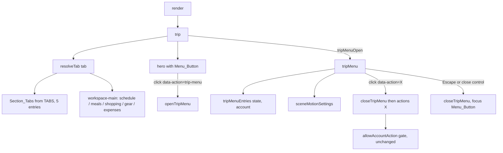

# Design Document

## Overview

The trip view drops the `crew` (旅伴與車輛) and `settings` (旅行設定) section tabs. Everything those two tabs rendered moves into a Trip_Menu, a drawer opened by a Menu_Button placed next to the trip title in the hero. The drawer reuses the existing `data-action` values, so every action still goes through the same click handler, the same `allowAccountAction` permission gate, and the same confirmation dialogs.

The change touches four places:

- `src/model.js`: `TABS` loses two entries, and a pure `resolveTab()` is added.
- `src/trip-menu.js` (new): a pure `tripMenuEntries(state, account)` that decides which entries the menu shows.
- `src/app.js`: `crew()` and `settings()` are removed, `tripMenu()` renders the drawer, `hero()` gets the Menu_Button, `trip()` resolves the tab before rendering, and new `trip-menu` / `close-trip-menu` actions plus an Escape handler manage the drawer.
- `src/styles.css`: drawer and title-row styles.

Stored data is untouched. `STORAGE_KEY`, the state schema, `readStorage`, and `save` do not change, and no migration runs.

### Finding: there is no tab-level swipe navigation

`src/mobile-swipe.js` only implements row swipes that reveal edit and delete buttons on `[data-swipe-row]` elements. It has no code that moves between section tabs, and no other module does either. The only source of tab order in the app is `TABS`. Requirement 5 therefore holds once `TABS` holds the Remaining_Tabs: any tab-order consumer, present or future, reads the five entries. `src/mobile-swipe.js` needs no change. The design keeps menu rows out of the row-swipe system (no `data-swipe-row`) so their buttons stay visible inside the drawer.

## Architecture



Tab state stays in the in-memory `tab` variable in `src/app.js`. It is never persisted, so "old links and saved state that point to a removed tab" can reach the app only through code that assigns `tab` (`data-tab`, `data-nav-tab`, `resolve-gear`, `confirm-reset`). `resolveTab()` runs at the top of `trip()` and normalizes whatever value arrived.

## Components and Interfaces

### `src/model.js`

```js
export const TABS = [
  ['schedule', '行程表'], ['meals', '料理菜單'], ['shopping', '採買清單'],
  ['gear', '裝備分工'], ['expenses', '分帳記帳']
];

/** The tab key to render: the value itself when it is a Remaining_Tab, otherwise 'schedule'. */
export function resolveTab(value) {
  return TABS.some(([key]) => key === value) ? value : 'schedule';
}
```

The tab numbering in `trip()` already derives from the index (`0${i+1}`), so it becomes 01 to 05 with no further change.

### `src/trip-menu.js` (new, pure, no DOM)

The menu's content rules live in a pure module so they can be unit tested under `bun test` without loading `src/app.js`, which touches `document` at import time.

```js
/**
 * Entries the Trip_Menu shows for this state and account.
 * account is null in the local (demo) build.
 */
export function tripMenuEntries(state, account) {
  const perms = account?.permissions;
  return {
    trip: { action: 'trip-settings' },
    people: state.people.map(p => ({
      id: p.id,
      isMe: p.id === state.currentUser,
      // Same rule crew() used: only account members with edit rights, for themselves or as managers.
      canEdit: !!(perms?.canEdit && (perms.canManage || p.id === perms.personId))
    })),
    addPerson: { action: 'person' },
    switchIdentity: { action: 'profile' },
    vehicles: state.vehicles.map(v => ({
      id: v.id,
      edit: { action: 'vehicle' },
      // Same rule crew() used.
      canDelete: !account || perms?.canDelete === true
    })),
    addVehicle: { action: 'vehicle' },
    data: ['export', 'import', 'print'],
    events: state.events.slice(0, 8),
    reset: { action: 'reset' }
  };
}
```

The `canDelete` expression keeps the existing truthiness: `crew()` used `!account || account.permissions.canDelete`, and `allowAccountAction` rejects anything other than `true`. Using `=== true` in the descriptor matches the gate, so a delete entry is never shown that the gate would refuse.

### `src/app.js`

**Module state.** One new variable: `let tripMenuOpen = false;`.

**`hero()`.** In the non-compact branch, the `<h1>` is wrapped in a title row with the Menu_Button:

```html
<div class="trip-title-row">
  <h1 id="trip-title">{title}</h1>
  <button type="button" class="icon-button trip-menu-button"
          data-action="trip-menu" data-focus="trip-menu-button"
          aria-label="旅行選單" aria-haspopup="dialog"
          aria-expanded="{tripMenuOpen}" {tripMenuOpen ? 'aria-controls="trip-menu"' : ''}>
    {icon('menu')}
  </button>
</div>
```

`aria-controls` is set only while the drawer exists in the DOM. `data-focus` lets `render()` restore focus to the button after a re-render, which is how focus survives the close path. `hero()` is shared with `home()` (`compact=true`); the button is rendered only in the non-compact branch. If `icon()` has no `menu` glyph, a three-line glyph is added to the icon set.

**`trip()`.**

1. `tab = resolveTab(tab);` as the first statement. This both picks the content and makes the `aria-current="page"` comparison mark schedule.
2. The content ternary drops the `crew` and `settings` branches; the final fallback becomes `schedule()`.
3. When `tripMenuOpen` is true, `tripMenu()` is appended inside `<main>` after the workspace.

**`tripMenu()`.** Renders `tripMenuEntries(state, account)` into a non-modal drawer:

```html
<div class="trip-menu-backdrop" data-action="close-trip-menu" aria-hidden="true"></div>
<aside id="trip-menu" class="trip-menu" role="dialog" aria-modal="false" aria-labelledby="trip-menu-title">
  <div class="trip-menu-heading">
    <h2 id="trip-menu-title" tabindex="-1">旅行選單</h2>
    <button class="icon-button" data-action="close-trip-menu" data-focus="trip-menu-close" aria-label="關閉旅行選單">×</button>
  </div>
  <section class="trip-menu-section" aria-labelledby="trip-menu-trip">   <!-- 旅行設定 -->
    <h3 id="trip-menu-trip">旅行設定</h3>
    <dl>title, dates, destination (mapLink), note, storage line</dl>
    button('編輯旅行','trip-settings')
  </section>
  <section ...>   <!-- 旅伴 -->
    <h3>旅伴</h3>
    identity note: 你現在是 {name} + button('切換身分','profile')
    .member-card per person: avatar, name (+我 tag), role, 行前準備 x / y,
      button('編輯旅伴','person', data-id) when canEdit
    button('新增旅伴','person')
  </section>
  <section ...>   <!-- 車輛 -->
    <h3>車輛</h3>
    .vehicle-card per vehicle: name, driver, seats, meeting mapLink, passengers,
      edit button (data-action="vehicle" data-id aria-label="編輯 {name}"),
      delete button (data-action="delete" data-kind="vehicle" data-id aria-label="移除 {name}") when canDelete
    button('新增車輛','vehicle')
  </section>
  {sceneMotionSettings()}
  <section class="data-tools">匯出備份 / 匯入備份 / 列印目前頁面</section>
  <section class="event-section"><h3>小隊最近的動態</h3><ul class="event-list">...</ul></section>
  <div class="reset-area">清除旅行資料 (data-action="reset", danger)</div>
</aside>
```

The member and vehicle card markup and class names (`member-card`, `vehicle-card`, `map-link`, `passenger-list`, `event-list`) are copied from the removed `crew()` and `settings()` so existing CSS and most test locators keep working. The cards drop `data-swipe-row`. All values pass through `e()` exactly as before.

**Open and close.**

```js
function openTripMenu() {
  tripMenuOpen = true;
  render();
  app.querySelector('#trip-menu-title')?.focus({ preventScroll: true });
}
function closeTripMenu() {
  if (!tripMenuOpen) return;
  tripMenuOpen = false;
  deferredFocus = 'trip-menu-button';
  render();   // render() restores focus through data-focus
}
actions['trip-menu'] = () => tripMenuOpen ? closeTripMenu() : openTripMenu();
actions['close-trip-menu'] = () => closeTripMenu();
```

Both actions are added to the `safe` list in `allowAccountAction` so they work in account mode while saving or read-only, the same as `theme` and `profile`.

**Entry activation.** In the main click handler, after the `allowAccountAction` check and before dispatch:

```js
if (tripMenuOpen && el.closest('#trip-menu') && el.dataset.action
    && !['close-trip-menu', 'trip-menu'].includes(el.dataset.action)) {
  closeTripMenu();
}
```

The menu closes first, so focus lands on the Menu_Button, and then the action runs. `showDialog()` records `document.activeElement` as `returnFocus`, so closing an edit dialog returns focus to the Menu_Button. Actions read `el.dataset` (for example `delete` reads `el.dataset.kind`); a detached element keeps its dataset, so they behave the same. When the gate blocks an action (for example `import` or `reset` in account mode), the handler returns before this point, the menu stays open, and the existing notice is shown. The scene motion toggle has no `data-action`, so using it leaves the menu open.

**Escape.** A separate keydown listener:

```js
document.addEventListener('keydown', event => {
  if (event.key !== 'Escape' || !tripMenuOpen || dialog.open) return;
  event.preventDefault();
  closeTripMenu();
});
```

When the shared `#dialog` is open, Escape stays with the dialog. The existing quantity-input Escape listener is not affected because the drawer has no quantity inputs.

**Leaving the trip view.** Clicking any `[data-tab]` and any route change sets `tripMenuOpen = false` before rendering, so the drawer never reappears on a different page or tab.

**Copy that names the removed tab.** Three strings tell users to go to 「旅伴與車輛」 and one to 旅行設定:

- `activityParticipationFields()`: 請先到「旅伴與車輛」新增車輛 becomes 請先在「旅行選單」新增車輛.
- `vehicleDepartureSection()`: 同步到「旅伴與車輛」 becomes 同步到「旅行選單」的車輛.
- vehicle `editForm` help: 也同步到旅伴與車輛 becomes 也同步到旅行選單.
- `privacy()`: 你可以從旅行設定匯出備份 becomes 你可以從旅行選單匯出備份.

### `src/styles.css`

- `.trip-title-row`: flex row, `align-items:center`, gap; the h1 keeps its current style.
- `.trip-menu`: fixed drawer on the right, `max-width:420px`, full height, scrollable, above the page and below `#dialog`. At `max-width:760px` it becomes a full-width bottom sheet with `max-height:85vh`.
- `.trip-menu-backdrop`: fixed full-screen translucent layer behind the drawer.
- `.trip-menu .member-card, .trip-menu .vehicle-card`: single-column layout inside the drawer.
- Rules that only targeted the removed tab panels (`.settings-panel` inside `.workspace-main`, `.member-grid`, `.vehicles`) are re-scoped to `.trip-menu` or removed if unused.
- `@media print` hides `.trip-menu` and `.trip-menu-backdrop`, next to the existing `.motion-settings` rule.

### `src/mobile-swipe.js`

No change. See the finding in the Overview.

## Data Models

No data model changes. The menu reads these existing fields:

| Source | Fields read |
|---|---|
| `state.trip` | `title`, `startDate`, `endDate`, `destination`, `note` |
| `state.people[]` | `id`, `name`, `role`; plus `readyCount` and `myGear` |
| `state.currentUser` | identity note and 我 tag |
| `state.vehicles[]` | `id`, `name`, `driver`, `seats`, `meeting`, `passengers` |
| `state.events[]` | first 8: `actor`, `text`, `at` |
| `account.permissions` | `canEdit`, `canManage`, `personId`, `canDelete` |

New in-memory UI state: `tripMenuOpen: boolean`, default `false`, never persisted.

## Error Handling

- **Unknown or removed tab value.** `resolveTab()` maps it to `schedule`. Nothing is written to storage, so no warning is needed.
- **Blocked actions in account mode.** Unchanged: `allowAccountAction` shows its notice and the action does not run. The menu stays open so the user sees where they were.
- **Vehicle delete with assigned activities.** Unchanged: the `delete` action shows its notice. The menu has already closed, so the toast is visible over the page.
- **Unsaved dialog edits.** Unchanged: `closeDialog()` still asks before discarding.
- **Unsaved expense draft.** The capture-phase click guard only reacts to `data-tab` and navigation links. Opening the menu re-renders but `expensePanel` is kept (`??=`) and re-appended, so a draft survives opening and closing the menu.
- **Detached Menu_Button.** If a later `commit()` re-renders while a dialog opened from the menu is showing, `returnFocus` may point at a detached button. This is the existing behavior for every dialog trigger; `data-focus="trip-menu-button"` plus `render()`'s focus restore covers the common path.

## Correctness Properties

*A property is a characteristic or behavior that should hold true across all valid executions of a system-essentially, a formal statement about what the system should do. Properties serve as the bridge between human-readable specifications and machine-verifiable correctness guarantees.*

Reflection on redundancy: 4.1 is the `crew`/`settings` special case of 4.2, so one property covers both. 3.3, 3.5, and 3.6 all describe how `tripMenuEntries` maps state lists to entries; 3.3 (people) and 3.5/3.6 (vehicles) stay separate because they have different permission rules and fail independently. 1.1 to 1.3 and 5.1 to 5.3 are fixed facts about one constant and are covered by example tests, not properties.

### Property 1: Tab resolution is identity on Remaining_Tabs and schedule elsewhere

For any string `v`, `resolveTab(v)` equals `v` when `v` is one of `schedule`, `meals`, `shopping`, `gear`, `expenses`, and equals `schedule` otherwise. The generator mixes the five keys, the removed keys `crew` and `settings`, near misses (case changes, padding, prefixes), the empty string, and arbitrary strings.

**Validates: Requirements 4.1, 4.2**

### Property 2: Every person gets an entry, with edit rights matching the old crew tab

For any state with any list of people and any account (null, or permissions with any combination of `canEdit`, `canManage`, `personId`), `tripMenuEntries(state, account).people` lists the people in the same order with the same ids, exactly one `isMe` entry when `currentUser` is among them, and `canEdit` true exactly when `account.permissions.canEdit` is truthy and either `canManage` is truthy or the person is `personId`.

**Validates: Requirements 3.3, 3.11**

### Property 3: Every vehicle gets an edit entry, and a delete entry exactly when deletion is allowed

For any state with any list of vehicles and any account, `tripMenuEntries(state, account).vehicles` lists the vehicles in the same order with the same ids, each with an edit entry whose action is `vehicle`, and each `canDelete` equals `account === null || account.permissions.canDelete === true`.

**Validates: Requirements 3.5, 3.6, 3.11**

### Property 4: The menu shows the most recent events in stored order

For any list of events, `tripMenuEntries(state, account).events` equals the first `min(8, events.length)` events of `state.events` in order.

**Validates: Requirements 6.2**

## Testing Strategy

### Unit tests (`bun test tests/*.test.js`)

New file `tests/trip-menu.test.js`. The project has no property testing library; it uses hand-rolled seeded generators (`mulberry32` and a `forAll` helper in `tests/mobile-swipe.test.js`). The new file follows the same pattern, importing or copying those helpers, with at least 100 iterations per property. Each property test carries a tag comment:

- `// Feature: remove-vehicle-travel-tabs, Property 1: Tab resolution is identity on Remaining_Tabs and schedule elsewhere`
- `// Feature: remove-vehicle-travel-tabs, Property 2: Every person gets an entry, with edit rights matching the old crew tab`
- `// Feature: remove-vehicle-travel-tabs, Property 3: Every vehicle gets an edit entry, and a delete entry exactly when deletion is allowed`
- `// Feature: remove-vehicle-travel-tabs, Property 4: The menu shows the most recent events in stored order`

Example tests in the same file:

- `TABS.map(([k]) => k)` equals `['schedule','meals','shopping','gear','expenses']` (1.1, 1.3, 5.1 to 5.3).
- `resolveTab('crew')` and `resolveTab('settings')` return `schedule` (4.1, 7.3).
- `tripMenuEntries` with `account = null` shows the fixed entries `trip-settings`, `person`, `profile`, `vehicle`, `export`, `import`, `print`, `reset` (3.1, 3.2, 3.4, 3.7, 3.8, 3.10).
- `STORAGE_KEY` keeps its current value (6.1).

### End-to-end tests (`playwright test`)

New cases, added to `tests/app.e2e.js`:

- The section tabs are exactly the five keys in order, numbered 01 to 05, with no `crew` or `settings` button (1.1, 1.2, 1.3, 7.2).
- The Menu_Button sits in `.trip-title-row` beside the h1, has accessible name 旅行選單, reports `aria-expanded="false"`, opens the drawer and reports `true`, and closes through the close control and through Escape with focus back on the button (2.1 to 2.5).
- A seeded pre-change state shows the same people, vehicles, trip details, and recent events in the drawer, and the localStorage value is byte-identical before and after opening and closing it (4.3, 6.1, 6.2).
- In account mode as a non-owner member, the drawer shows no vehicle delete buttons, and import and reset still show the 帳號版不提供這項本機操作 notice (3.6, 3.11).

A dedicated helper replaces `nav(page,'crew')` and `nav(page,'settings')`:

```js
const openTripMenu = page => page.getByRole('button', { name: '旅行選單', exact: true }).click();
```

Existing tests that reach a Relocated_Action through a removed tab switch to this helper (7.1):

| File | Change |
|---|---|
| `tests/app.e2e.js` | Reset, edit trip, import, add companion, and switch identity flows open the menu. The "all planning tabs" loop drops `crew` and `settings`; their headings are checked inside the drawer. The sticky-tabs test scrolls to the last remaining tab (`expenses`) instead of `settings`. The overflow loop drops `crew` and `settings` and adds one overflow check with the drawer open. |
| `tests/accounts.e2e.js`, `tests/account-identity.e2e.js` | 編輯旅行 is reached through the menu. |
| `tests/assignment-motion.e2e.js`, `tests/daily-life.e2e.js` | `.workspace-main .motion-settings` becomes `#trip-menu .motion-settings`; `nav(page,'settings')` becomes `openTripMenu(page)`; companion edit opens the menu first. |
| `tests/maps.e2e.js`, `tests/vehicle-departures.e2e.js` | `.vehicle-card` checks run inside the open drawer. |
| `tests/avatar-preview.e2e.js` | The tab loop drops `crew` and checks avatars inside the drawer. |
| `tests/ingredients.e2e.js`, `tests/schedule-bar.e2e.js` | Settings steps use the menu. |
| `tests/vehicle-itinerary.e2e.js` | Expected help text becomes 請先在「旅行選單」新增車輛. |
| `tests/mobile-swipe.e2e.js` | Only the comment that mentions the crew tab changes; no swipe rows existed there in demo mode. |

`tests/scene-motion.test.js` checks `sceneMotionSettings()` markup and CSS, which do not change. Its test title "toggle lives in the settings flow" stays accurate because the toggle still lives in the settings section of the drawer.
