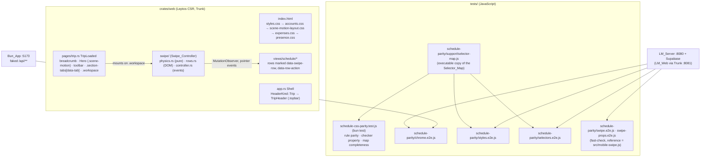

# Design Document: schedule-tab-css-parity

## Overview

LM_Web keeps its form-based planner as the Schedule_Tab body. This design makes LM_Web load the same CSS rules as Bun_App, emit Bun's element structure for the Page_Chrome, mark up the planner so Bun's selectors reach it, and port the left-swipe rows from `src/mobile-swipe.js` to Rust. Parity is checked by three automated checks: a stylesheet rule check, a selector check against the Selector_Map in this document, and two Playwright comparisons (Page_Chrome pixels, Planner_Body computed styles).

Most of the planner already uses Bun's class names. The Rust views were ported from the pre-studio Bun template (`git show 9dcac70^:src/app.js`, functions `schedule()` and `vehicleDepartureSection()`), and `src/styles.css` still carries the rules for that template. Analysis of the 169 Planner_Selectors found one restructure (the unassigned shopping row), two class-binding changes needed by the swipe controller, and the swipe markup itself. The Page_Chrome needs more change: the header, the toolbar, the hero wrapper and the section-tab attributes.

### Findings that shape the design

| Finding | Source | Consequence |
|---|---|---|
| Bun's account-mode Trip_Page header is `header.topbar` built by `accountHeader()` (theme button, menu toggle, `.header-collapse`), not the `.acct-topbar` that LM_Web's `Shell` renders. | `src/app.js` line 595; `crates/web/src/app.rs` `Header` | LM_Web gets a second header variant for the Trip_Page only. |
| Bun's toolbar has two buttons: `.button.quiet` 「匯出手冊」 and `.button.blue` 「邀請旅伴」. LM_Web has only the second. LM_Web has no export feature. | `src/app.js` `trip()` | LM_Web renders an export button for layout parity. See Decision D1. |
| Bun's section-tab buttons carry `data-tab`. Rules at Bun_Styles lines 369–373 select on it. | `src/styles.css` | LM_Web adds `data-tab`. |
| Bun's `.sync-status` sits between the toolbar and the tabs. In account mode it is `hidden` while the trip is saved and online. | `src/app.js` `applyAccountChrome()` | LM_Web does not render it. The structure check ignores `[hidden]` elements, and the chrome test waits for Bun's element to be hidden. |
| The Story_Studio editor starts collapsed for editors unless `localStorage['storybook-editor-hidden-v2']==='0'`. Collapsed state is `.story-studio-host[data-editor-hidden]`. | `src/storybook/app.js` lines 1374–1380 | The chrome test clears that key and waits for the attribute. |
| Bun's 「新增一站」 button in `.schedule-bar` was removed by trip-planning-workflow-enhance Requirement 1.6. | `tests/schedule-bar.e2e.js` header comment | `.schedule-bar>.button` is an Unreachable entry. LM_Web's 「＋自訂活動」 stays in the activities heading. |
| Bun account mode can be served entirely from a faked `/api/**`, as `tests/storybook-account.e2e.js` does. | that test | Bun_App needs no database for the comparison. LM_Web needs a running LM_Server and Supabase stack. |
| `ActivityCard`, `RouteCard` and `PlaceRow` set the row's `class` with `class=move \|\| "…"`, which rewrites the whole attribute. | `crates/web/src/views/schedule/{events,routes,places}.rs` | That would erase `swipe-row` and `swipe-open`. These rows switch to a static class plus `class:` toggles. |

### Decisions

- **D1: Export and theme buttons are placeholders (confirmed).** Requirement 2.1 requires Bun's toolbar and header structure. That structure contains 「匯出手冊」 and the theme button, but LM_Web has no export feature and the theme toggle is out of scope. LM_Web renders both with Bun's classes, icon and label. Activating either one shows a toast: 「這個版本還不能匯出手冊」 or 「這個版本還不能切換深色模式」. Requirement 2.1 states this behavior.
- **D2: Swipe copies are built in the DOM.** The Swipe_Controller ports `prepare()` by cloning Row_Actions into a panel, the same way Bun does. The other option was to render the panel declaratively in every row component. DOM cloning keeps one generic module, covers every row type, and matches Bun's markup exactly. A copy is activated by calling `click()` on its original, so the original's Leptos handler runs (Requirement 4.7).
- **D3: Row_Actions are marked with `data-row-action="edit"|"delete"`.** Bun finds Row_Actions through `data-action` values. LM_Web has no such attribute, and its place-rename label 「改名 …」 does not contain 「編輯」. The role attribute gives Requirement 4.3 an exact input.
- **D4: Unreachable Selector_Map entries (confirmed).** Some Planner_Selectors can never match in LM_Web. Examples are `.schedule-bar>.button` (button removed in Bun), `.departure-vehicle-top>.icon-button` (matches nothing in Bun's own template), and selectors for read-only shopping rows. The Selector_Map lists them in a separate Unreachable table with the reason. Requirement 3.4 requires Match entries to match their targets and Unreachable entries to match zero elements, so the selector check flags any future markup that would start matching them.
- **D5: Drag_Offset range in Requirements 5.4 and 5.5 (confirmed).** Bun's `trackOffset()` writes the overshoot of 5.5 into `--swipe-x`. Requirement 5.4 bounds the Drag_Offset to `[End_Stop − 48, 0]`, matching Bun, and the value equals End_Stop exactly when Reduced_Motion clamps it.
- **D6: Requirement 3.6 and `tests/schedule-bar.e2e.js` (confirmed).** That test exercises Bun_App's Itinerary_Editor (`.plan-days>.date-tabs`), not LM_Web. This feature renames no class it uses, so Requirement 3.6 keeps the file unchanged and requires it to pass. No LM_Web Playwright schedule tests exist today; the new tests in this design are the LM_Web schedule tests.

## Architecture



## Components and Interfaces

### 1. Stylesheets (Requirement 1)

| File | Change |
|---|---|
| `crates/web/styles/styles.css` | Replaced by a byte copy of `src/styles.css`. This restores Bun lines 47–64, the `.vehicle-swipe-actions` selector at line 65, the dark `.motion-settings` rules at line 210 and the `.trip-menu .motion-settings` selector at line 281. |
| `crates/web/styles/scene-motion-layout.css` (new) | The four Scene_Motion_Layout_Rules, copied verbatim and in Bun's order, with a comment naming the source lines. No other scene-motion rule. |
| `crates/web/index.html` | Link order: `styles.css`, `accounts.css`, `scene-motion-layout.css`, `expenses.css`, `presence.css`. The comment that says the page is always light is replaced by one that cites this feature's Requirement 6. No `data-theme` attribute is set. |

The link order mirrors Bun_Stylesheets: `styles.css`, `accounts.css`, `scene-motion.css`, then `expenses.css`. `presence.css` stays last; its rules only match `.editor-stack` elements, which are Masked_Areas and are excluded from Key_Elements.

`crates/web/styles/accounts.css` still differs from `src/accounts.css` in auth-page art rules and in `.acct-trip-card .acct-actions>[data-swipe-original]`. None of those selectors match a Schedule_Tab element, so they are out of scope. The style comparison would detect them if they did match.

### 2. Page chrome (Requirement 2)

#### 2.1 Header

`Shell` gains a `header` prop:

```rust
#[derive(Clone, Copy, Default, PartialEq, Eq)]
pub enum HeaderKind {
    /// `.acct-topbar` (Home_Page, Departure_Page, message pages): unchanged.
    #[default]
    Account,
    /// `.topbar` from Bun `accountHeader()`: Trip_Page only.
    Trip,
}

#[component]
pub fn Shell(
    #[prop(optional)] current: &'static str,
    #[prop(optional)] class: Option<&'static str>,
    #[prop(optional)] header: HeaderKind,
    #[prop(optional)] top: Option<Children>,
    children: Children,
) -> impl IntoView {
    view! {
        {match header {
            HeaderKind::Account => view! { <Header current /> }.into_any(),
            HeaderKind::Trip => view! { <TripHeader /> }.into_any(),
        }}
        {top.map(|top| top())}
        <main id="main" class=class.unwrap_or("acct-page") tabindex="-1">{children()}</main>
        <Footer />
    }
}
```

`TripHeader` emits Bun's `accountHeader()` element tree:

```rust
#[component]
fn TripHeader() -> impl IntoView {
    let auth = use_auth();
    let toasts = use_toasts();
    let user = auth.user();
    // Read once at mount; the Chrome_Comparison_Test sets data-theme before scripts run (Requirement 7.3).
    let dark = document()
        .document_element()
        .and_then(|root| root.get_attribute("data-theme"))
        .is_some_and(|theme| theme == "dark");
    let open = RwSignal::new(false);
    // Outside-click close: same listener as AccountMenu, with closest("#header-menu, .header-menu-toggle").
    view! {
        <header class="topbar">
            <div class="topbar-inner">
                <a class="brand" href=home>
                    {art::static_svg(art::LOGO)}
                    <span>"日子拾光 "<small>"LITTLE MOMENTS"</small><span class="visually-hidden">" 首頁"</span></span>
                </a>
                <div class="header-actions">
                    <button type="button" class="icon-button header-theme"
                        aria-label=if dark { "切換淺色模式" } else { "切換深色模式" }
                        on:click=move |_| toasts.show(THEME_UNAVAILABLE)>
                        {art::static_svg(if dark { icons::SUN } else { icons::MOON })}
                    </button>
                    <button type="button" class="icon-button header-menu-toggle"
                        aria-expanded=move || open.get().to_string() aria-controls="header-menu"
                        aria-label=label title=display_name on:click=move |_| open.update(|o| *o = !*o)>
                        <span class="header-avatar-mark" aria-hidden="true">{initial}</span>
                    </button>
                    <div class="header-collapse" class:open=move || open.get() id="header-menu">
                        <a class="text-link header-home" href=home>"我的首頁"</a>
                        <button type="button" class="text-button header-logout" on:click=logout>"登出"</button>
                    </div>
                </div>
            </div>
        </header>
    }
}
```

The `.header-admin` link is omitted: LM_Web has no `/admin` page (rust-supabase-rewrite Requirement 32.11), and the comparison user is not an admin, so Bun omits it too. `TripPage` passes `header=HeaderKind::Trip`. `icons.rs` gains `MOON`, `SUN` and `D_DOWNLOAD`, copied from the `icons` table in `src/app.js` lines 127–130.

#### 2.2 Trip_Page body (`pages/trip.rs`)

- **Hero**: `<div class="illustration">` becomes `<div class="scene-motion illustration scene-motion--camp">`. The camp SVG stays its first child and `.countdown` stays after it (Requirement 2.2).
- **Toolbar**: `.toolbar-actions` gets a first child `<button type="button" class="button quiet" aria-label="匯出手冊" title="匯出手冊">{D_DOWNLOAD}<span>"匯出手冊"</span></button>`, which shows the D1 toast, before the existing `.button.blue`.
- **Section tabs**: every tab button gets `data-tab=item.key()`. Labels, icons, the badge and `aria-current` are unchanged.
- **Workspace**: `<div class="workspace" node_ref=workspace>` mounts the Swipe_Controller (section 4). It remains the element directly after `.section-tabs` (Requirement 2.4). `main` already has class `page` through `Shell class="page"` (Requirement 2.3).

The breadcrumb, mode switch, invite button, countdown logic and tab navigation keep their handlers (Requirement 2.5).

### 3. Planner markup (Requirement 3)

| Location | Change | Reason |
|---|---|---|
| `schedule/shopping_plan.rs` `unassigned_row` | `div.shopping-row > span > (b, small)` becomes `div.shopping-row > label > span > (b, small.shopping-where.is-unrouted)`. The quantity span and the 已買 tag stay direct children. | `.shopping-row>label`, `.shopping-row>label>span` and `.shopping-row.done>label` target the name block (Bun `shopping()` markup). The label has no control; it only carries the layout role. |
| `schedule/events.rs` `ActivityCard` | `class=move \|\| …` becomes `class="activity-card" class:done=move \|\| done() && editing().is_none()`. Adds `data-swipe-row=move \|\| editing().is_none().then_some("")`. Edit button gets `data-row-action="edit"`, remove button `data-row-action="delete"`. | Keeps controller classes on the element (Finding table). Requirement 4.1. |
| `schedule/routes.rs` `RouteCard` | `class="departure-vehicle" class:wide=move \|\| editing().is_some()`, `data-swipe-row` while not editing, `data-row-action` on the edit and delete buttons. | Same. |
| `schedule/places.rs` `PlaceRow` | Same pattern as `RouteCard`. The rename button gets `data-row-action="edit"`. | Same. Requirement 4.3 labels it 「編輯」. |
| `views/vehicle_form.rs` `VehicleList`, `VehicleCard` | New prop `#[prop(optional)] swipe: bool`. When true, each `article.vehicle-card` has `data-swipe-row` while not editing, and its edit and remove buttons get `data-row-action`. `PlacesAndCars` passes `swipe=true`; the Trip_Menu does not. | Bun's Trip_Menu vehicle cards carry no `data-swipe-row` (`src/app.js` line 304 comment above `tripMenu()`). |

No class is renamed. Every other Planner_Selector already matches its target (see the Selector_Map). The new-item articles (「新增路線」, 「新增地點」, 「新增自訂活動」, 「新增車輛」) hold forms, not Row_Actions, so they are not Schedule_Rows.

### 4. Swipe_Controller (Requirements 4 and 5)

Module layout under `crates/web/src/swipe/`:

| File | Content |
|---|---|
| `mod.rs` | `pub use controller::SwipeController;` and the selector constants. |
| `physics.rs` | Pure functions ported line by line from `src/mobile-swipe.js`. No `web_sys`. |
| `rows.rs` | Preparing, refreshing and un-preparing rows in the DOM. |
| `controller.rs` | Event listeners, gesture state, frame writer, settle timers, teardown. |

#### 4.1 `physics.rs`

```rust
pub const ACTION_WIDTH: f64 = 68.0;
pub const AXIS_BIAS: f64 = 1.25;
pub const AXIS_DEADZONE: f64 = 8.0;
pub const FLICK_THRESHOLD: f64 = 0.35;   // px/ms
pub const VELOCITY_WINDOW: f64 = 100.0;  // ms
pub const RUBBER_RESIST: f64 = 0.3;
pub const RUBBER_MAX: f64 = 48.0;
pub const LEGACY_OPEN: f64 = 56.0;
pub const LEGACY_CLOSE: f64 = 42.0;
pub const CLICK_SUPPRESS_MS: f64 = 450.0;
pub const SETTLE_FALLBACK_MS: u32 = 320;

#[derive(Clone, Copy, Debug, PartialEq, Eq)]
pub enum Axis { Horizontal, Vertical }

#[derive(Clone, Copy, Debug, PartialEq)]
pub struct Sample { pub x: f64, pub t: f64 }

/// `resolveAxis`: sticky once `locked` is Some; horizontal wins an exact tie.
pub fn resolve_axis(dx: f64, dy: f64, locked: Option<Axis>) -> Option<Axis>;
/// `trackOffset`: closed clamp at 0, linear to `end_stop` (negative), then rubber band or hard clamp.
pub fn track_offset(start: f64, dx: f64, end_stop: f64, reduced: bool) -> f64;
/// `sampleVelocity`: None for fewer than two samples or a zero-length window.
pub fn sample_velocity(samples: &[Sample], window: f64) -> Option<f64>;
/// `releaseVelocity`: None only for an empty trace; otherwise the release counts as the last sample, and an
/// unmeasurable window reads as 0.
pub fn release_velocity(samples: &[Sample], release: Sample) -> Option<f64>;
/// `onPointerMove`'s prune: keep at most one entry older than the window.
pub fn prune_samples(samples: &mut Vec<Sample>);

pub struct Release { pub offset: f64, pub end_stop: f64, pub velocity: Option<f64>,
                     pub total_dx: f64, pub total_dy: f64, pub axis: Option<Axis>, pub was_open: bool }
/// `resolveRelease`: true = open.
pub fn resolve_release(release: &Release) -> bool;
/// `shouldSuppressClick`.
pub fn should_suppress_click(axis: Option<Axis>, total_dx: f64) -> bool;

#[derive(Clone, Copy, Debug, PartialEq, Eq)]
pub enum ActionRole { Edit, Delete, Other }
/// Requirement 4.3: Edit → 「編輯」; otherwise a label containing 「移除」 or 「刪除」 → 「刪除」; else 「操作」.
/// The Delete role does not change the label; every LM_Web delete label already contains 「移除」 or 「刪除」.
pub fn swipe_label(role: ActionRole, label: &str) -> &'static str;
/// Requirement 4.4: the original has class `danger`, or the swipe label is 「刪除」.
pub fn is_danger(has_danger_class: bool, swipe_label: &str) -> bool;
```

#### 4.2 `rows.rs`

Selectors:

```rust
pub const ROW: &str = "[data-swipe-row]";
pub const ROW_ACTION: &str = "[data-row-action]";
pub const INTERACTIVE: &str = "button,a,input,select,textarea,summary";
```

`reconcile(root: &Element)` is the only entry point and is idempotent. It writes an attribute or class only when the value differs, so a second pass produces no mutation records.

1. For each element in `root` with class `swipe-row` but without `data-swipe-row`, call `unprepare(row)`.
2. For each `[data-swipe-row]` element, collect its Row_Actions: `row.querySelectorAll("[data-row-action]")`, excluding elements inside `.swipe-actions`. Map each to an `ActionSpec { label, role, danger, disabled }`, where `label` is `aria-label`, or the trimmed text when there is no `aria-label`.
3. Zero Row_Actions: `unprepare(row)`.
4. Otherwise compute the wanted copies. If the row has no panel, or its panel's copies differ from the wanted specs in count, `aria-label`, `data-swipe-label`, `swipe-action-danger` or `disabled`, rebuild the panel's children (Requirement 4.9). Each copy is `original.cloneNode(true)` with only its `svg` children kept, and with `id`, `data-row-action` and `data-swipe-original` removed. It then gets `aria-label`, `data-swipe-label`, class `swipe-action`, `swipe-action-danger` when `is_danger`, `disabled` mirroring the original, and `data-swipe-index="{i}"`.
5. Ensure exactly one `.swipe-actions` child (`role="group"`, `aria-label="滑動操作"`, `aria-hidden` matching the open state) and one `.swipe-toggle` child (`type="button"`, `aria-label="顯示編輯與刪除操作"`, `aria-expanded` matching the open state, text 「‹」). Extra copies of either are removed (Requirement 4.8). Both are appended when missing.
6. Set `data-swipe-original="true"` on every Row_Action, `--swipe-count` to the copy count, class `swipe-row`, and `data-swipe-ready="true"` (Requirement 4.5).

`unprepare(row)` ends any settle, removes the panel, the toggle, `swipe-row`, `swipe-open`, `swipe-dragging`, `data-swipe-ready`, `--swipe-count`, `--swipe-x`, and `data-swipe-original` from the remaining Row_Actions.

`set_open(row, open)` toggles `swipe-open`, the panel's `aria-hidden` and the toggle's `aria-expanded` together (Requirement 5.10). `close_rows(root, except)` calls `set_open(row, false)` on every `.swipe-row` in `root` other than `except`. The set of rows is read from the DOM on each call, so there is no registry that can go stale.

Leptos compatibility: the panel and toggle are appended after the Leptos-managed children. Leptos mounts and unmounts dynamic children relative to its own marker nodes, so foreign trailing nodes survive re-renders. When a row's content switches to a form, its Row_Actions disappear and `reconcile` un-prepares the row. When the row leaves the document, its nodes go with it.

#### 4.3 `controller.rs`

```rust
pub struct SwipeController {
    root: web_sys::Element,
    state: Rc<RefCell<State>>,
    observer: web_sys::MutationObserver,
    listeners: Vec<Listener>,          // (target, type, closure, capture); removed in Drop
    touch_layout: web_sys::MediaQueryList, // "(max-width: 760px)"
}

struct State {
    gesture: Option<Gesture>,
    suppress_click_until: f64,
    settles: Vec<Settle>,              // at most one per row: { row, timer: gloo_timers::callback::Timeout, on_end }
}

struct Gesture {
    row: web_sys::HtmlElement, pointer_id: i32, x: f64, y: f64,
    start_offset: f64, end_stop: f64, was_open: bool, axis: Option<Axis>,
    offset: f64, samples: Vec<Sample>, dragging: bool, writer: FrameWriter,
}

/// `createFrameWriter`: one `--swipe-x` write per animation frame with the newest pushed value.
struct FrameWriter { pending: Rc<Cell<Option<f64>>>, handle: Option<i32>, frame: Closure<dyn FnMut()> }

impl SwipeController {
    pub fn mount(root: web_sys::Element) -> SwipeController;
}
impl Drop for SwipeController { fn drop(&mut self); }
```

`mount` runs `reconcile(root)`, then observes `root` with `{ childList: true, subtree: true, attributes: true, attributeFilter: ["data-swipe-row", "disabled", "aria-label"] }`. The observer callback calls `reconcile(root)` once per batch. It then registers these listeners:

| Target | Event | Options | Behavior |
|---|---|---|---|
| `root` | `pointerdown` | capture | Ignore when a gesture is in flight. Reset click suppression. Start a `Gesture` only when Touch_Layout matches, the pointer type is `touch` or `pen`, the target is inside a `[data-swipe-row].swipe-row`, and the target is not inside an `INTERACTIVE` element (Requirement 5.1). End_Stop is `−68 × --swipe-count`. The start offset is End_Stop if the row has `swipe-open`, else 0. |
| `document` | `pointermove` | capture, `passive: false` | Same pointer id only. Push a sample with `performance.now()` and prune. Resolve the axis (Requirement 5.2). On vertical, clear dragging, cancel the writer and stop (5.3). Add `swipe-dragging` on the first horizontal resolution, or on the first leftward pixel of a closed row. On horizontal, call `preventDefault`, compute `track_offset` with Reduced_Motion read fresh from `matchMedia('(prefers-reduced-motion: reduce)')`, and push the result to the writer (5.4–5.6). On the first horizontal resolution, close the other rows. |
| `document` | `pointerup` | capture | Compute `release_velocity` with the release as the last sample, then `resolve_release` (5.7–5.9). Cancel the writer, clear the gesture, run the settle batch, and set `suppress_click_until = now + 450` when `should_suppress_click` (5.12). |
| `document` | `pointercancel` | capture | Cancel the writer, clear the gesture, run the settle batch with `was_open`, and do not suppress clicks. |
| `root` | `click` | capture | On a `.swipe-toggle`: close the other rows, toggle this row, `preventDefault` and `stopImmediatePropagation` (5.13). Inside the suppression window: swallow the click once (5.12). On a `.swipe-action` copy: look up `data-swipe-index`, call `click()` on the row's Row_Action at that index if it is connected and enabled, and swallow the copy's own click (4.7). Otherwise, when the target is outside every `.swipe-actions`, close every row (5.14). |
| `touch_layout` | `change` | — | Abandon the gesture (cancel the writer, clear `gesture`), close every row, and for each row end the settle, remove `swipe-dragging` and the inline `--swipe-x` (5.15). |

Settle batch, the same order as Bun's `settleGesture`: skip a detached row; remove `swipe-dragging`; begin the settle (end any previous settle on the row, add `swipe-settling`, attach a `transitionend` listener that accepts only `propertyName == "transform"` on a direct child of the row, and start a 320 ms `Timeout`; whichever fires first ends the settle, per Requirement 5.11); close the other rows when opening; `set_open`; remove the inline `--swipe-x`.

`Drop` disconnects the observer, removes every listener, abandons the gesture, ends every settle, and removes `swipe-dragging` and `--swipe-x` from every row (Requirement 5.17). Rows keep `swipe-open` as resting state, matching Bun's disposer.

Desktop behavior (Requirement 5.16) needs no code. Bun_Styles line 63 hides the panel and toggle and shows the originals (which line 61 hides by default) at widths of 761 pixels and above.

Mounting in `TripLoaded`:

```rust
let workspace = NodeRef::<html::Div>::new();
let swipe = StoredValue::new_local(None::<SwipeController>);
Effect::new(move |_| {
    if let Some(element) = workspace.get() {
        if swipe.with_value(Option::is_none) {
            swipe.set_value(Some(SwipeController::mount(element.into())));
        }
    }
});
on_cleanup(move || swipe.update_value(|controller| drop(controller.take())));
```

`crates/web/Cargo.toml` adds these `web-sys` features: `AddEventListenerOptions`, `CssStyleDeclaration`, `DomTokenList`, `EventListenerOptions`, `HtmlButtonElement`, `MediaQueryList`, `MediaQueryListEvent`, `MouseEvent`, `MutationObserver`, `MutationObserverInit`, `MutationRecord`, `NodeList`, `Performance`, `PointerEvent`, `TransitionEvent`. Everything compiles on the native target, as the crate requires for `cargo clippy`.

### 5. Dark theme (Requirement 6)

With `styles.css` identical to Bun's, every `:root[data-theme=dark]` rule applies whenever the root has `data-theme="dark"`. LM_Web never writes `data-theme`, so a page without the attribute renders light (Requirement 6.3). `TripHeader` reads the attribute once at mount to choose the moon or sun icon (section 2.1).

### 6. Test harness

All tests are JavaScript. Files:

| File | Runner | Covers |
|---|---|---|
| `tests/schedule-css-parity.test.js` | `bun test` | Requirement 1 (rule parity and the checker), 3.1 (map completeness) |
| `tests/schedule-parity/support/css-rules.js` | — | Rule parser and checker: `parseRules(text, file)` returns `{file, index, media, selector, declarations}[]`; `checkParity(bunStyles, rustSheets)` returns `{kind: 'missing'\|'different'\|'out-of-order', rule}[]` |
| `tests/schedule-parity/support/selector-map.js` | — | Executable Selector_Map: `PLANNER_CLASSES`, `SHARED_CLASSES`, `STATES`, `ROLES`, `ENTRIES` |
| `tests/schedule-parity/support/fixture.js` | — | `comparisonFixture()`, `fakeBunAccount(page, state)`, `loadLmTrip(request, state)` |
| `tests/schedule-parity/support/capture.js` | — | `prepareCapture`, `chromeTree`, `chromeClip`, `plannerSnapshot`, `styleHarness` |
| `tests/schedule-parity/chrome.e2e.js` | Playwright | Requirements 2.1–2.5, 6.1, 7.1–7.7, 7.11 |
| `tests/schedule-parity/styles.e2e.js` | Playwright | Requirements 6.1–6.3, 7.8–7.10 |
| `tests/schedule-parity/selectors.e2e.js` | Playwright | Requirements 3.2–3.5, 4.1 |
| `tests/schedule-parity/swipe.e2e.js` | Playwright | Requirements 4.7 (real commands), 5.16, 5.17 |
| `tests/schedule-parity/swipe-props.e2e.js` | Playwright + fast-check | Properties 6–12 |

`playwright.config.js` adds `testIgnore: 'schedule-parity/**'` to the existing `desktop` and `mobile` projects and registers two projects (Requirement 7.12):

```js
{ name: 'parity-desktop', testDir: './tests/schedule-parity', testMatch: '**/*.e2e.js',
  use: { viewport: { width: 1280, height: 900 }, deviceScaleFactor: 1 } },
{ name: 'parity-mobile', testDir: './tests/schedule-parity', testMatch: '**/*.e2e.js',
  use: { viewport: { width: 390, height: 844 }, deviceScaleFactor: 1, hasTouch: true, isMobile: true } },
```

Both projects use `snapshotPathTemplate: 'test-results/schedule-parity-snapshots/{projectName}/{arg}{ext}'`, so the Bun captures never enter the source tree. `package.json` adds `"test:schedule-parity": "playwright test --project=parity-desktop --project=parity-mobile"`. The base URLs come from `BUN_BASE_URL` (default `http://127.0.0.1:5173`) and `LM_BASE_URL` (default `http://127.0.0.1:8081`). A `beforeAll` fetches both and fails with the unreachable URL in the message.

#### 6.1 Comparison_Fixture

`comparisonFixture()` returns `exampleTrip()` with these changes, so that each Selector_Map state has content:

| Change | Purpose |
|---|---|
| `trip.endDate = '2026-10-23'` (a fourth day with no activities, routes or meals) | `.empty` timeline (state S4) |
| `a1`: `done: true`, `location: '夕淞度日營區 A 區'`, `note: '先搭客廳帳，再搭睡帳。'` | `.activity-card.done`, `.done h3`, `.activity-card>p`, `.activity-location`, `.map-link`, `.map-link-icon` |
| One shared gear item 「營燈」 with no assignee | `.unassigned-link`, and the same `.tab-badge` in both apps |
| The last ingredient item (`s18`) purchased; every unassigned item has a non-empty quantity | `.shopping-row.done`, `.shopping-row .quantity` |

`fakeBunAccount(page, state)` follows `tests/storybook-account.e2e.js`. It routes `/api/session` to user `{id:'qa-user-id', username:'qa-user', displayName:'隔離測試', role:'member'}` and `GET /api/trips/qa-trip` to `{state, trip, permissions}` with owner capabilities. Every other `/api/**` request gets a JSON 404. The Bun URL is `/qa-user/trips/qa-trip?tab=schedule`.

`loadLmTrip(request, state)` uses LM_Server's API. It signs up a fresh account (username `parity-<random>`, display name `隔離測試`) with `POST /api/auth/signup` and creates the trip with `POST /api/trips`. It then posts `lm_core::command::Command` values (serde JSON) to `POST /api/trips/{id}/commands`: it renames and recolors the owner's Person to 小安 / coral, then adds the remaining people, vehicles, places, routes and stops, day settings, activities, meals, shopping items and the gear item in fixture order. Before returning, it reads `GET /api/trips/{id}/snapshot` and asserts the entity counts (8 people, 4 vehicles, 6 places, 8 routes, 10 activities, 5 meals, 1 unassigned gear item). A mismatch fails with the counts. It returns the Trip_Page path and the session, which the test stores in `localStorage['lm.session.v1']` through `addInitScript`.

#### 6.2 Chrome_Comparison_Test

For each project (Viewport_Profile) and each Theme, the test opens one Bun page and one LM page in separate contexts with identical options:

1. `addInitScript`: set `document.documentElement.dataset.theme`. For Bun, also set `localStorage['ggc-local-theme']` and remove `storybook-editor-hidden-v2`, because `src/app.js` line 117 overwrites the attribute from storage (Requirement 7.3). `page.emulateMedia({ reducedMotion: 'reduce' })` and `page.clock.setFixedTime('2026-10-01T09:00:00+08:00')`.
2. Navigate. Wait for `document.fonts.status === 'loaded'` after `document.fonts.ready` (7.4). For Bun, wait for `.story-studio-host[data-editor-hidden]:not([data-loading])` and `.sync-status[hidden]`, and fail with a message naming the missing state (7.5).
3. Structure: `chromeTree(page)` serializes `header`, `.breadcrumb`, `.hero`, `.trip-toolbar` and `.section-tabs`. Each node is `{tag, classes (sorted), children}`. The serializer skips `[hidden]` elements, `.editor-stack`, text and the inside of `svg` (only the `svg` element's class list is kept). The LM tree must deep-equal the Bun tree (Requirement 2.1). Assert `.hero-art>.scene-motion.illustration.scene-motion--camp>svg+.countdown`, `main#main.page` and `.section-tabs+.workspace` in LM (2.2–2.4).
4. Pixels: scroll to 0 and take `page.screenshot({ fullPage: true, clip: {x:0, y:0, width: viewport.width, height: ceil(sectionTabs.bottom)}, mask: [countdown strong, .sync-status, .editor-stack], maskColor: '#ff00ff', animations: 'disabled' })`. Write the Bun buffer to `testInfo.snapshotPath(name)` and run `expect(lmBuffer).toMatchSnapshot(name, { threshold: 0.2, maxDiffPixelRatio: 0.01 })`. Here `name` is `chrome-{project}-{theme}.png`. Playwright rejects differing dimensions and, on failure, writes the expected (Bun), actual (LM) and diff images to the test output directory and prints the differing-pixel ratio (7.6, 7.7). The test title carries the combination name.
5. Mobile only: one CDP touch swipe (`Input.dispatchTouchEvent`, 120 px leftward over 8 steps) on the first activity card. Assert `swipe-open` and that every `.swipe-action` in its panel is visible (7.11).

Requirement 2.5 checks run in the desktop project: each tab click updates `?tab=`, the breadcrumb link goes to the Home_Page, 「出發模式」 goes to `/go`, 「邀請旅伴」 opens the Trip_Menu, and the countdown shows 「距離出發」「19」「天」 under the fixed clock.

#### 6.3 Style_Comparison_Check

1. Open LM_Web at the fixture's schedule tab (state S0). `plannerSnapshot(page)` assigns `data-parity-id` to every element in `.workspace`, then returns `.workspace.outerHTML` with `<script>` elements removed. The snapshot includes the prepared swipe markup.
2. `styleHarness(page, sheets, html, theme)` serves `http://parity.test/` through `page.route`. `/bun/bun.css` is the concatenation of `src/styles.css`, `src/accounts.css` and `src/scene-motion.css` (the `scripts/build.mjs` order without `storybook-host.css`), and `/bun/expenses.css` is `src/expenses.css`. `/rust/*.css` serves the files linked by `crates/web/index.html`, in link order parsed from its `data-trunk rel="css"` tags. `/{bun,rust}/assets/fonts/*` serves `assets/fonts/`. Both pages are `<!doctype html><html lang="zh-Hant" data-theme?><head><meta name="viewport" …>{links}</head><body><div id="app"><main id="main" class="page">{snapshot}</main></div></body></html>` (Requirement 7.8).
3. After fonts load, Key_Elements are the elements in the Bun page matched by any Match entry's evaluated selector (section 6.4) in state S0, plus every `[data-swipe-row]`, `.swipe-actions` and `.swipe-toggle`, excluding the `.editor-stack` subtree.
4. For each Key_Element, read Compared_Properties in both pages by `data-parity-id`. The shorthands `margin`, `padding`, `border`, `border-radius` and `gap` are expanded into longhands, because `getComputedStyle` returns an empty shorthand when sides differ. Each difference is reported as `{combination, path, property, bun, rust}`, where `path` is the chain of `tag.class` names from `main` (Requirement 7.10). The test fails when the list is non-empty.
5. Examples: in dark, the `.swipe-action-danger` copies compute `background-color: rgb(157, 62, 50)` and `color: rgb(255, 255, 255)` (6.2). In the live LM page without an init script, the root has no `data-theme` and `:root` computes background `rgb(255, 252, 246)` (6.3).

#### 6.4 Selector check

`selectors.e2e.js` loads LM_Web with the fixture. For each state in `STATES`, it drives the state, then evaluates each entry assigned to that state inside `.workspace`.

- Evaluated selector: the Planner_Selector with user-action pseudo-classes (`:hover`, `:focus`, `:focus-visible`, `:active`) and pseudo-elements (`::after`, `:before`, `::-webkit-progress-value`) removed. Structural pseudo-classes (`:not()`, `:empty`, `:last-child`, `:disabled`) stay. Media conditions are ignored; the check runs in both projects.
- Match entry: `querySelectorAll` returns at least one element, and every element is in `ROLES[entry.role](root)`. Role queries locate elements by ARIA names, ids, headings, element types and text, never by the class under test.
- Unreachable entry: `querySelectorAll` returns no element.
- A failure reports `{state, selector, matched: n, outside: [paths]}`.

| State | Setup |
|---|---|
| S0 | Fixture loaded, 第 1 天 selected, no form open |
| S0d | S0 with `data-theme="dark"` |
| S1 | 「編輯 搭帳・營地佈置」 clicked (activity form open) |
| S2 | 「改名 出發地點 A」 clicked, name set to 「出發地點 B」, submitted (duplicate-name error shown) |
| S3 | 第 2 天 selected (no routes) |
| S4 | 第 4 天 selected (no activities) |
| S5 | Mobile project: the first activity card's `.swipe-toggle` clicked |
| S6 | Mobile project: synthetic touch `pointerdown` then a 30 px leftward `pointermove` on the first activity card, without release |
| S7 | Mobile project: S6 followed by `pointerup`, evaluated before 320 ms pass (clock paused) |

The same file covers Requirement 3.5 with one flow per behavior: switch days, edit and save a route, toggle 「完成」, change a meal time, add a place, read the unassigned list, check that the text version contains the Itinerary_Text, and press 「複製文字」. It also checks Requirement 4.1: every element of the roles `activity-card`, `route-card`, `place-row` and `schedule-vehicle-card` has `data-swipe-row`.

#### 6.5 Swipe tests

`swipe-props.e2e.js` runs in the mobile project. It installs `page.clock` before navigation, loads LM_Web, then pauses the clock for each generated case. It drives the controller with synthetic `PointerEvent`s and `MouseEvent`s dispatched in the page, and advances time with `page.clock.runFor`. Generated rows are injected into `.workspace` as `<article data-swipe-row>` elements with random buttons carrying `data-row-action`, random `aria-label`s, an optional `danger` class and an optional `disabled` attribute. The reference for gestures is the set of pure functions exported by `src/mobile-swipe.js` (`resolveAxis`, `trackOffset`, `releaseVelocity`, `resolveRelease`, `shouldSuppressClick`), imported directly in the test process. A `MutationObserver` installed by the test records every `--swipe-x` write on the row's `style` attribute.

`swipe.e2e.js` covers the examples: a copy of 「編輯」 on a route card opens the route form, and a copy of 「刪除」 removes the route (4.7). At 1280 px every original Row_Action is visible and every panel and toggle has `display: none` (5.16). After navigating to the Home_Page, an injected `[data-swipe-row]` element gets no panel and pointer events add no classes (5.17).

## Data Models

```js
// tests/schedule-parity/support/selector-map.js
export const PLANNER_CLASSES = [/* the specific classes listed under "Planner classes" below */];
export const SHARED_CLASSES = ['button','small','primary','full','icon-button','danger','text-button','help',
  'eyebrow','tag','coral','blue','green','selected','wide','done','icon'];
/** @typedef {{ selector: string, lines: string, role?: string, states: string[], status: 'match'|'unreachable', reason?: string }} Entry */
export const ENTRIES = [ /* one Entry per selector string in the Selector_Map tables */ ];
export const ROLES = { /* role id -> (root: Element) => Element[] */ };
export const STATES = { /* state id -> async (page) => void */ };
```

A selector string is a Planner_Selector when every class it names is in `PLANNER_CLASSES ∪ SHARED_CLASSES` and at least one is in `PLANNER_CLASSES`. Classes inside attribute selectors do not count. The completeness test applies this definition to every comma-separated selector of Bun_Styles, and asserts that each result has an entry in `ENTRIES`. Extra entries are allowed: `.button.full`, `.done h3`, `.tag`, `.tag.paper` and `.wide` use only shared classes but style planner elements, so they are listed too.

Rust data models are the `Gesture`, `State`, `FrameWriter`, `Sample`, `Release` and `ActionSpec` types in section 4.

### Planner classes

Specific Planner_Classes, which LM_Web renders in the Planner_Body: `workspace`, `workspace-main`, `sidebar`, `crew-panel`, `avatar-stack`, `avatar`, `progress-line`, `yellow-progress`, `unassigned-link`, `side-footnote`, `schedule-plan`, `section-title`, `schedule-bar`, `date-tabs`, `vehicle-departures`, `vehicle-departures-heading`, `departure-vehicle`, `departure-vehicles`, `departure-vehicles-empty`, `departure-vehicle-top`, `departure-vehicle-name`, `vehicle-swipe-actions`, `departure-vehicle-time`, `departure-vehicle-place`, `day-settings-form`, `route-form`, `route-stops`, `activity-form`, `activity-vehicle-choices`, `activity-card`, `timeline`, `empty`, `timeline-stamp`, `activity-top`, `activity-actions`, `activity-edit`, `activity-location`, `map-link`, `map-link-icon`, `activity-bottom`, `mini-check`, `event-list`, `shopping-list`, `shopping-category`, `shopping-row`, `shopping-where`, `is-unrouted`, `quantity`, `vehicle-card`, `vehicle-title`, `passenger-list`, `form-grid`, `field`, `form-actions`, `form-error`, `notice`, `editor-stack`, `editor-stack-row`, `editor-avatar`, `editor-avatar-more`, `swipe-row`, `swipe-actions`, `swipe-action`, `swipe-action-danger`, `swipe-toggle`, `swipe-open`, `swipe-dragging`, `swipe-settling`.

These have no Bun_Styles rule: `schedule-plan`, `day-settings-form`, `route-form`, `route-stops`, `activity-form`, `shopping-where` (alone), `editor-stack*` and `editor-avatar*` (styled by `presence.css`).

Bun selectors whose context class is never rendered in the Planner_Body are not Planner_Selectors. Examples are `.trip-menu .vehicle-card`, `.departure .notice`, `.departure-food .packing-item .shopping-where`, `.gear-row>.tag`, `.meal-illustration>.tag`, `.hero-destination .map-link` (Page_Chrome, covered by the chrome test), `.identity-option*`, `.invite-content .form-error:not(:empty)`, `.packing-item.done*`, `.profile-button>span:not(.avatar)`, `.template-controls>.field`, `.vehicle-schedule-filter>.field`, `.field select.assignee-select`, `.field select.gear-scope-select`, `.shopping-row>.assignee-select`, `.shopping-row>.quantity-editable` (and `:hover`) and `.shopping-row>.quantity-input`. Bun template elements with no LM_Web counterpart, such as `.departure-vehicle-count`, `.schedule-intro`, `.endnote` and `.vehicle-schedule-filter`, add no Planner_Selector either.

## Selector_Map

Lines are physical lines of `src/styles.css`. `@≤N` is `@media(max-width:Npx)`, `@≥N` is `@media(min-width:Npx)`, `@print` is print media, `@reduce` is `prefers-reduced-motion:reduce`, `@forced` is `forced-colors:active`. "Change" names the LM_Web change from section 3 or 4; "—" means the current markup already matches. States are defined in section 6.4.

### Match entries

| # | Planner_Selector | Bun lines | Target element in LM_Web (role) | State | Change |
|---|---|---|---|---|---|
| 1 | `.workspace` | 8, 16@≤1020, 17@≤760, 20@print, 34, 41@≤1020 | `div` directly after `nav[aria-label=旅行內容]` | S0 | Swipe root `node_ref` only |
| 2 | `.workspace-main` | 8 | `section[aria-label=行程表]` | S0 | — |
| 3 | `.sidebar` | 8, 17@≤760, 18@≤480, 20@print, 41@≤1020, 43@≤480 | `aside` in the workspace | S0 | — |
| 4 | `.crew-panel` | 8, 16@≤1020, 17@≤760, 18@≤480, 345@≤600 | First `section` of the sidebar | S0 | — |
| 5 | `.crew-panel .eyebrow` | 18@≤480, 33, 346@≤600 | 「OUR TRAVEL CREW」 | S0 | — |
| 6 | `.crew-panel h2` | 8, 16@≤1020, 18@≤480, 32, 43@≤480, 347@≤600 | 「小隊準備好了嗎？」 | S0 | — |
| 7 | `.crew-panel>p` | 8, 18@≤480, 35, 350@≤600 | 「8 位旅伴，一起收集回憶。」 | S0 | — |
| 8 | `.crew-panel>.button` | 8, 18@≤480, 35, 353@≤600 | Link 「看看我的行前清單」 | S0 | — |
| 9 | `.button.full` | 5 | Link 「看看我的行前清單」 | S0 | — |
| 10 | `.avatar` | 6 | Sidebar person avatars (`span[aria-label]` in the avatar row) | S0 | — |
| 11 | `.avatar-stack` | 8, 35, 348@≤600 | Avatar row of the crew panel | S0 | — |
| 12 | `.avatar-stack>.avatar` | 8, 16@≤1020, 17@≤760, 18@≤480, 349@≤600 | Each sidebar avatar | S0 | — |
| 13 | `.progress-line` | 8, 35, 351@≤600 | The 「食材採買」 and 「裝備準備」 label rows | S0 | — |
| 14 | `.progress-line b` | 8 | Their counts | S0 | — |
| 15 | `.progress-line b>span` | 8 | 「/ total」 spans | S0 | — |
| 16 | `.yellow-progress::-webkit-progress-value` | 8 | `progress[aria-label=裝備準備進度]` | S0 | — |
| 17 | `.unassigned-link` | 8, 352@≤600 | Button 「1 項裝備還在等主人」 | S0 | — |
| 18 | `.unassigned-link .icon` | 8 | Its info and arrow icons | S0 | — |
| 19 | `.unassigned-link .icon:last-child` | 8 | Its arrow icon | S0 | — |
| 20 | `.side-footnote` | 8, 17@≤760, 18@≤480, 357@≤600 | 「把垃圾帶走，把風景留下。」 | S0 | — |
| 21 | `.side-footnote .icon` | 8 | Its leaf icon | S0 | — |
| 22 | `.section-title` | 9, 18@≤480, 33, 43@≤480 | Title rows of 「規劃行程」 and 「文字版」 | S0 | — |
| 23 | `.section-title .eyebrow` | 18@≤480, 33 | Their eyebrows | S0 | — |
| 24 | `.section-title h2` | 9, 17@≤760, 18@≤480, 32, 42@≤760, 43@≤480 | `h2#schedule-plan-title`, `h2#itinerary-text-title` | S0 | — |
| 25 | `.section-title>.button` | 9, 18@≤480, 29, 43@≤480 | Button 「複製文字」 | S0 | — |
| 26 | `.schedule-bar` | 9, 17@≤760, 18@≤480, 43@≤480, 219@≤600 | Parent of the day-button group | S0 | — |
| 27 | `.date-tabs` | 9, 16@≤1020, 18@≤480, 43@≤480, 220@≤600 | `div[role=group][aria-label=選擇行程日期]` | S0 | — |
| 28 | `.date-tabs>button` | 9, 16@≤1020, 17@≤760, 18@≤480, 21@≤480, 43@≤480, 221@≤600 | Day buttons | S0 | — |
| 29 | `.date-tabs button.selected` | 9 | Day button with `aria-pressed=true` | S0 | — |
| 30 | `.date-tabs small` | 9, 31, 43@≤480 | 「第 N 天」 | S0 | — |
| 31 | `.date-tabs b` | 9, 16@≤1020, 43@≤480 | 「M/D」 | S0 | — |
| 32 | `.date-tabs span` | 9, 21@≤480, 31, 43@≤480 | 「週X」 | S0 | — |
| 33 | `.vehicle-departures` | 193, 212@print, 215 | Sections labelled by `#day-settings-title`, `#day-routes-title`, `#day-activities-title`, `#day-meals-title`, `#places-cars-title`, `#unassigned-shopping-title` | S0 | — |
| 34 | `.vehicle-departures-heading` | 194 | Heading row of each of those sections | S0 | — |
| 35 | `.vehicle-departures-heading>div` | 195 | Eyebrow-and-title block of each heading | S0 | — |
| 36 | `.vehicle-departures-heading .eyebrow` | 196, 211@≤600 | Section eyebrows | S0 | — |
| 37 | `.vehicle-departures-heading h2` | 197, 211@≤600 | Section `h2` elements | S0 | — |
| 38 | `.vehicle-departures-heading h2>span` | 197 | Count spans (「N 條路線」 and so on) | S0 | — |
| 39 | `.vehicle-departures-heading>.button` | 195, 211@≤600, 212@print | 「編輯」, 「新增路線」, 「＋自訂活動」, 「＋新增地點」 | S0 | — |
| 40 | `.vehicle-departures>.help` | 198 | Help paragraphs that are direct children of those sections | S0 | — |
| 41 | `.departure-vehicles` | 199, 211@≤600 | Route grid, place grid and schedule vehicle grid | S0 | — |
| 42 | `.departure-vehicles-empty` | 208 | 「這一天還沒有路線。」 | S3 | — |
| 43 | `.departure-vehicle` | 200, 211@≤600, 212@print | Route cards, place rows and the day-setting summary | S0 | `class:wide` binding (section 3) |
| 44 | `.departure-vehicle dl` | 206 | `dl` of the day-setting summary and of each route card | S0 | — |
| 45 | `.departure-vehicle dl>div` | 206 | Their term-and-value rows | S0 | — |
| 46 | `.departure-vehicle dt` | 206 | Their terms | S0 | — |
| 47 | `.departure-vehicle dd` | 206 | Their values | S0 | — |
| 48 | `.departure-vehicle-top` | 201 | Top row of route cards and place rows | S0 | — |
| 49 | `.departure-vehicle-name` | 202 | Name block (icon and `h3`) of route cards and place rows | S0 | — |
| 50 | `.departure-vehicle-name>.icon` | 202 | Car and pin icons of those blocks | S0 | — |
| 51 | `.departure-vehicle-name h3` | 203 | Vehicle and place names | S0 | — |
| 52 | `.vehicle-swipe-actions` | 65 | Row_Action containers of route cards and place rows | S0 | Restored rule (section 1); `data-row-action` on its buttons |
| 53 | `.departure-vehicle-time` | 204 | Departure-time row of route cards | S0 | — |
| 54 | `.departure-vehicle-time time` | 204 | `time` of the departure | S0 | — |
| 55 | `.departure-vehicle-time>span` | 204 | 「出發」 | S0 | — |
| 56 | `.departure-vehicle-place` | 205 | 「起點 → 終點」 paragraph | S0 | — |
| 57 | `.departure-vehicle-place>.icon` | 205 | Its pin icon | S0 | — |
| 58 | `.activity-vehicle-choices` | 260 | `fieldset` with legend 「常用活動」 | S0 | — |
| 59 | `.activity-vehicle-choices>label` | 262, 269@≤600 | Preset labels | S0 | — |
| 60 | `.activity-vehicle-choices input` | 263 | Preset checkboxes | S0 | — |
| 61 | `.activity-vehicle-choices label>span` | 264 | Preset text blocks | S0 | — |
| 62 | `.activity-vehicle-choices strong` | 265 | 「HH:MM 標題」 | S0 | — |
| 63 | `.activity-vehicle-choices small` | 266 | Kind label (and 「 · 已加入」) | S0 | — |
| 64 | `.form-actions` | 14, 18@≤480, 36, 43@≤480 | Preset action row (S0); form action rows (S1) | S0, S1 | — |
| 65 | `.form-actions>.button` | 18@≤480, 29, 36, 43@≤480 | 「加入 N 個活動」 (S0); 「取消」, 「儲存」 (S1) | S0, S1 | — |
| 66 | `.timeline` | 9, 18@≤480, 43@≤480 | Activity list container | S0 | — |
| 67 | `.timeline:before` | 9, 18@≤480 | Activity list container | S0 | — |
| 68 | `.activity-card` | 9, 16@≤1020, 18@≤480, 20@print, 43@≤480 | Activity articles | S0 | `class:done` binding; `data-swipe-row` |
| 69 | `.activity-card.done` | 9 | Article of 「搭帳・營地佈置」 | S0 | `class:done` binding |
| 70 | `.done h3` | 9 | Title of the done activity | S0 | — |
| 71 | `.activity-card h3` | 9, 16@≤1020, 17@≤760, 18@≤480, 32, 43@≤480 | Activity titles | S0 | — |
| 72 | `.activity-card>p` | 9, 18@≤480, 28, 43@≤480 | Note 「先搭客廳帳，再搭睡帳。」 | S0 | — |
| 73 | `.timeline-stamp` | 9, 18@≤480, 43@≤480 | Round kind stamps | S0 | — |
| 74 | `.timeline-stamp .icon` | 9, 18@≤480 | Their icons | S0 | — |
| 75 | `.activity-top` | 9, 17@≤760, 18@≤480, 43@≤480 | Time, tag and actions row | S0 | — |
| 76 | `.activity-top time` | 9, 18@≤480 | Activity time | S0 | — |
| 77 | `.tag` | 9 | Activity kind tags; 「已買」 tag | S0 | — |
| 78 | `.activity-actions` | 65 | Activity Row_Action containers | S0 | `data-row-action` on its buttons |
| 79 | `.activity-edit` | 9 | Buttons 「編輯 {標題}」 | S0 | — |
| 80 | `.activity-location` | 9, 18@≤480, 31, 43@≤480, 247 | Location row of the done activity | S0 | — |
| 81 | `.activity-location .icon` | 9 | Its pin icon | S0 | — |
| 82 | `.map-link`; `.map-link:hover` | 244, 248@print; 245 | Google Maps link 「夕淞度日營區 A 區」 | S0 | — |
| 83 | `.map-link-icon` | 245 | Its external-link icon | S0 | — |
| 84 | `.activity-bottom` | 9, 18@≤480 | Participants and 「完成」 row | S0 | — |
| 85 | `.activity-bottom .icon` | 9 | Participant icons | S0 | — |
| 86 | `.activity-bottom>span` | 9, 18@≤480, 31, 43@≤480, 267 | Participant block | S0 | — |
| 87 | `.activity-bottom>span>.icon` | 267 | Participant icon | S0 | — |
| 88 | `.activity-bottom>span>span` | 268 | 「全體旅伴」 text | S0 | — |
| 89 | `.mini-check` | 9, 18@≤480, 20@print, 31, 43@≤480 | 「完成」 labels | S0 | — |
| 90 | `.mini-check input` | 9, 18@≤480 | 「完成」 checkboxes | S0 | — |
| 91 | `.empty` | 11 | Empty-day block in the activity list | S4 | — |
| 92 | `.empty>.icon` | 11 | Its leaf icon | S4 | — |
| 93 | `.empty h3` | 11 | 「這一天，留給新的故事。」 | S4 | — |
| 94 | `.empty p` | 11 | Its hint paragraph | S4 | — |
| 95 | `.event-list` | 11 | Meal list `ul` | S0 | — |
| 96 | `.event-list li` | 11, 18@≤480 | Meal rows | S0 | — |
| 97 | `.event-list time` | 11 | Meal times | S0 | — |
| 98 | `.event-list b` | 11 | Meal titles | S0 | — |
| 99 | `.field` | 14, 28 | Meal-time labels (S0); form field labels (S1) | S0, S1 | — |
| 100 | `.field>span` | 30 | Field captions | S0, S1 | — |
| 101 | `.field input` | 14, 30 | Meal-time inputs (S0); text inputs (S1) | S0, S1 | — |
| 102 | `.form-grid` | 14, 18@≤480, 36, 42@≤760 | Activity form grid | S1 | — |
| 103 | `.field select`; `.field select:focus-visible`; `.field select:hover:not(:disabled)` | 14, 30, 76, 100@forced, 139@reduce; 85; 84 | Activity form selects (日期, 活動類型, 這一站誰參加) | S1 | — |
| 104 | `.field textarea` | 14, 30 | 「備註」 textarea | S1 | — |
| 105 | `.field.wide` | 14, 18@≤480 | Wide fields (活動名稱, 備註, 這一站誰參加) | S1 | — |
| 106 | `.wide` | 14, 18@≤480 | Wide fields of the activity form | S1 | — |
| 107 | `.form-actions>.text-button` | 14, 18@≤480 | Button 「移除項目」 | S1 | — |
| 108 | `.form-error` | 14, 31 | Place-row error paragraphs (S0); form error paragraphs (S1) | S0, S1 | — |
| 109 | `.form-error:not(:empty)` | 14 | Duplicate-name error under 「地點名稱」 | S2 | — |
| 110 | `.shopping-list` | 10 | Unassigned shopping list container | S0 | — |
| 111 | `.shopping-category h3` | 10, 32 | Category headings | S0 | — |
| 112 | `.shopping-category h3>span` | 10, 32 | Category counts | S0 | — |
| 113 | `.shopping-row` | 10, 18@≤480, 20@print, 35, 43@≤480, 70, 71@≤580, 98, 99@≤580, 275, 278@≤580 | Unassigned item rows | S0 | — |
| 114 | `.shopping-row+.shopping-row` | 10 | Every unassigned row after the first in its category | S0 | — |
| 115 | `.shopping-row>label` | 10, 18@≤480, 43@≤480, 70, 71@≤580 | Name block of each unassigned row | S0 | Restructure: `span` → `label > span` |
| 116 | `.shopping-row>label>span` | 23 | Inner name-and-reason span | S0 | Restructure |
| 117 | `.shopping-row b` | 10, 18@≤480, 32, 43@≤480 | Item names | S0 | — |
| 118 | `.shopping-row small` | 10, 31, 35 | Reasons | S0 | — |
| 119 | `.shopping-where.is-unrouted` | 380 | Reasons | S0 | — |
| 120 | `.shopping-row .quantity` | 10, 18@≤480, 31, 35, 43@≤480 | Quantities | S0 | — |
| 121 | `.shopping-row>.quantity` | 70, 71@≤580 | Quantities | S0 | — |
| 122 | `.shopping-row.done` | 10 | Row of the purchased item | S0 | — |
| 123 | `.shopping-row.done b` | 9 | Its name | S0 | — |
| 124 | `.shopping-row.done>label` | 10 | Its name block | S0 | Restructure |
| 125 | `.vehicle-card` | 11 | Vehicle cards under 「車輛」 in 地點與車 | S0 | `swipe` prop, `data-swipe-row` |
| 126 | `.vehicle-title` | 11 | Their title rows | S0 | — |
| 127 | `.vehicle-title h3` | 11 | Vehicle names | S0 | — |
| 128 | `.vehicle-title .icon-button` | 11 | 「編輯 {車名}」 and 「移除 {車名}」 | S0 | `data-row-action` |
| 129 | `.vehicle-card>p` | 11 | 「駕駛 … · n / m 人」 | S0 | — |
| 130 | `.vehicle-card>p span` | 11 | 「·」 | S0 | — |
| 131 | `.passenger-list` | 11 | Passenger chip rows | S0 | — |
| 132 | `.passenger-list>span` | 11 | Passenger chips | S0 | — |
| 133 | `.swipe-row` | 48, 56 | Every prepared Schedule_Row | S0 | Swipe_Controller |
| 134 | `.swipe-row>.swipe-actions` | 49, 58@≤760, 63@≥761, 64@reduce | Swipe_Panels | S0 | Swipe_Controller |
| 135 | `.swipe-row>.swipe-toggle` | 63@≥761 | Swipe_Toggles | S0 | Swipe_Controller |
| 136 | `.swipe-toggle` | 59, 62@≤760 | Swipe_Toggles | S0 | Swipe_Controller |
| 137 | `.swipe-row>:not(.swipe-actions):not(.swipe-toggle)` | 58@≤760, 64@reduce | Content children of prepared rows | S0 | — |
| 138 | `.swipe-actions>.swipe-action`; `.swipe-actions>.swipe-action:focus-visible`; `.swipe-actions>.swipe-action:hover:not(:disabled)` | 51; 58@≤760; 55 | Row_Action copies | S0 | Swipe_Controller |
| 139 | `.swipe-action::after` | 52 | Row_Action copies | S0 | Swipe_Controller |
| 140 | `.swipe-actions>.swipe-action-danger` | 53 | Copies of delete and remove actions | S0 | Swipe_Controller |
| 141 | `:root[data-theme=dark] .swipe-actions>.swipe-action-danger` | 54 | Copies of delete and remove actions | S0d | Swipe_Controller |
| 142 | `.swipe-row.swipe-open` | 57 | The opened activity card | S5 | Swipe_Controller |
| 143 | `.swipe-row.swipe-open>.swipe-actions` | 50, 58@≤760 | Its panel | S5 | Swipe_Controller |
| 144 | `.swipe-row.swipe-open>.swipe-toggle` | 60 | Its toggle | S5 | Swipe_Controller |
| 145 | `.swipe-row.swipe-dragging>:not(.swipe-actions):not(.swipe-toggle)` | 58@≤760 | Content children of the dragged card | S6 | Swipe_Controller |
| 146 | `.swipe-row.swipe-dragging>.swipe-actions` | 58@≤760 | Panel of the dragged card | S6 | Swipe_Controller |
| 147 | `.swipe-row.swipe-settling>:not(.swipe-actions):not(.swipe-toggle)` | 58@≤760 | Content children of the settling card | S7 | Swipe_Controller |

### Unreachable entries

The selector check asserts that each of these matches no element in the Planner_Body (Decision D4).

| # | Planner_Selector | Bun lines | Reason |
|---|---|---|---|
| U1 | `.schedule-bar>.button` | 9, 18@≤480, 21@≤480, 222@≤600 | Bun's 「新增一站」 was removed by trip-planning-workflow-enhance Requirement 1.6. LM_Web's 「＋自訂活動」 stays in the activities heading, where entry 39 styles it. |
| U2 | `.departure-vehicle-top>.icon-button` | 203 | Bun's own template puts these buttons inside `.vehicle-swipe-actions`, so this selector matches nothing in Bun either. |
| U3 | `.departure-vehicle-name[data-person-color=unassigned]>.icon` | 214 | LM_Web colors the icon with an inline `--assignee-color` from the vehicle color. There is no unassigned state. |
| U4 | `.activity-vehicle-choices[hidden]` | 261 | LM_Web removes the choices fieldset instead of hiding it. |
| U5 | `.avatar.small` | 6 | The Planner_Body has no small avatars. |
| U6 | `.tag.paper` | 9 | The Planner_Body has no paper tags. |
| U7 | `.section-title>.button .icon` | 18@≤480 | 「複製文字」 has no icon. Bun's template had no button there. |
| U8 | `.notice`; `.notice>.icon` | 10, 18@≤480, 31; 10 | Editing_Notice appears only while a second account edits the same item. The single-account fixture never shows it. |
| U9 | `.field select:disabled` | 95 | No planner select is ever disabled. |
| U10 | `.field select#gear-preset` | 253@forced | The `#gear-preset` select exists only in the gear form. |
| U11 | `.vehicle-card .help`; `.vehicle-card .help .map-link` | 11; 247 | LM_Web vehicle cards have no departure-line paragraph. Routes replaced the vehicle meeting point. |
| U12 | `.shopping-row .icon-button`; `.shopping-row>.icon-button`; `.shopping-row>label input`; `.shopping-row>[hidden]` | 35; 43@≤480, 71@≤580; 43@≤480; 70 | Unassigned rows are read-only. They have no buttons, no checkbox and no hidden children. |

## Error Handling

| Situation | Handling |
|---|---|
| A `web_sys` call in the Swipe_Controller returns `Err` (for example `closest` with an invalid selector, or a detached node) | Treated as "no match" or skipped for that row. The controller never panics. A gesture whose row detached mid-drag is dropped without settling, as in Bun. |
| `matchMedia` or `performance` is unavailable | `mount` returns a controller with no gesture listeners. Rows are still prepared, so the desktop layout and the toggle keep working. |
| The observer callback sees only the controller's own mutations | `reconcile` changes nothing, so no new records are queued and the loop ends. |
| A copy is activated while its original is disabled or gone | No click is forwarded. The next `reconcile` rebuilds or removes the panel. |
| The placeholder export or theme button is activated | A toast shows the D1 message. Nothing else changes. |
| Bun_App or LM_Web is unreachable | `beforeAll` fails with the URL that did not answer. |
| `loadLmTrip` gets a non-2xx response or wrong entity counts | The test fails with the command index, the response status and body, or the expected and actual counts. |
| The Bun Story_Studio editor is not collapsed, or `.sync-status` is not hidden | The chrome test fails with the attribute it waited for, before any capture. |
| Captures differ in size | `toMatchSnapshot` fails with both sizes. The images are kept. |
| A Key_Element is missing in the Rust page | The style check reports it as a difference with Rust value `<missing>`. |

## Correctness Properties

*A property is a characteristic or behavior that should hold true across all valid executions of a system-essentially, a formal statement about what the system should do. Properties serve as the bridge between human-readable specifications and machine-verifiable correctness guarantees.*


### Property 1: Stylesheet rule parity

For every rule at index i of Bun_Styles, the rule at index i of `crates/web/styles/styles.css` has the same media context, selector text and declarations, and the two files are byte-identical. For every Scene_Motion_Layout_Rule, the Rust_Stylesheets in link order contain an identical rule positioned after every rule of `styles.css` and `accounts.css`, with the four rules in Bun's relative order.

**Validates: Requirements 1.1, 1.2, 1.3, 1.4, 1.5, 1.6, 1.7**

### Property 2: The parity checker reports exactly the broken rules

For any non-empty set of mutations applied to the parsed Rust_Stylesheets (removing a rule, changing a declaration, changing a selector, swapping two rules, or moving a Scene_Motion_Layout_Rule before an `accounts.css` rule), `checkParity` returns a non-empty report that names every mutated rule with the matching kind (missing, different or out of order). For the unmutated sheets it returns an empty report.

**Validates: Requirements 1.8**

### Property 3: Page_Chrome structure equivalence

For each combination of Viewport_Profile and Theme, and for each of the site header, breadcrumb, hero, trip toolbar and `.section-tabs`, the serialized element tree of LM_Web (tag, class set, child order, skipping `[hidden]`, Masked_Areas, text and SVG internals) equals that of Bun_App for the Comparison_Fixture. The LM_Web hero contains `.hero-art>.scene-motion.illustration.scene-motion--camp>svg+.countdown`, `main#main` has class `page`, and the Planner_Body follows `.section-tabs` directly.

**Validates: Requirements 2.1, 2.2, 2.3, 2.4**

### Property 4: Selector_Map completeness

For every comma-separated selector of Bun_Styles whose class names all belong to the Planner_Classes or the shared classes, with at least one Planner_Class, the executable Selector_Map has an entry with that exact selector text.

**Validates: Requirements 3.1**

### Property 5: Selector_Map conformance

For every Match entry and each of its states, the evaluated selector run with `querySelectorAll` inside the Planner_Body returns at least one element, and every returned element belongs to the entry's role target set. For every Unreachable entry in every state, it returns no element.

**Validates: Requirements 3.2, 3.3, 3.4**

### Property 6: Swipe_Panel mirrors the Row_Actions

For any Schedule_Row and any sequence of changes to it (adding, removing, reordering, relabelling, enabling or disabling Row_Actions, re-rendering its content, toggling `data-swipe-row`), after the observer settles: a row with at least one Row_Action has exactly one `.swipe-actions` panel and one `.swipe-toggle`. The panel's `aria-hidden` and the toggle's `aria-expanded` match the open state, and the toggle has `type="button"`, `aria-label="顯示編輯與刪除操作"` and text 「‹」. The panel holds one `button.swipe-action` per Row_Action, in order, each with the original's `aria-label`, `data-swipe-label` given by `swipe_label`, class `swipe-action-danger` exactly when `is_danger`, and the original's disabled state. Every original has `data-swipe-original="true"`, `--swipe-count` equals the number of copies, and the row has class `swipe-row` and `data-swipe-ready="true"`. A row without Row_Actions or without `data-swipe-row` has no panel, no toggle and no `swipe-row` class.

**Validates: Requirements 4.2, 4.3, 4.4, 4.5, 4.6, 4.8, 4.9**

### Property 7: Copy activation delegates to the original

For any prepared Schedule_Row and any copy in its panel, activating the copy delivers exactly one click to the Row_Action at the same position when that Row_Action is enabled, and no click to any other Row_Action. A disabled copy delivers no click.

**Validates: Requirements 4.7**

### Property 8: Gesture outcome matches the reference controller

For any pointer trace on a prepared Schedule_Row in Touch_Layout (pointer type, start target, start open state, a sequence of timed moves, ending in release or cancel, and a Reduced_Motion flag), the LM_Web outcome equals the outcome computed with the functions of `src/mobile-swipe.js`. The compared outcome is: whether a gesture was tracked, whether `swipe-dragging` was added, the final open state, and whether a click dispatched after a generated delay is suppressed (suppressed exactly when `shouldSuppressClick` holds and the delay is under 450 ms).

**Validates: Requirements 5.1, 5.2, 5.3, 5.7, 5.8, 5.9, 5.12**

### Property 9: Drag offset writes

For any horizontal trace, the `--swipe-x` values written during the gesture number at most one per animation frame. Each equals `trackOffset(startOffset, dx, endStop, reduced)` for the newest move before that frame, and each lies in `[End_Stop − 48, 0]`. When Reduced_Motion applies and the pointer is past End_Stop, the value equals End_Stop.

**Validates: Requirements 5.4, 5.5, 5.6**

### Property 10: Open state stays consistent

For any sequence of operations on a set of prepared rows (gestures, toggle activations, copy activations, unsuppressed clicks outside every panel), after each operation every prepared row satisfies: it has class `swipe-open` exactly when its panel has `aria-hidden="false"` and exactly when its toggle has `aria-expanded="true"`. At most one row is open. A toggle activation on row R leaves R in the opposite state and every other row closed. An unsuppressed outside click leaves no row open.

**Validates: Requirements 5.10, 5.13, 5.14**

### Property 11: Settling ends within 320 ms

For any gesture that ends in release or cancel on a connected row, the row has class `swipe-settling` immediately after the release and does not have it 320 ms later. When Reduced_Motion applies, so that no transform transition runs, the class is still present after 319 ms and gone after 320 ms.

**Validates: Requirements 5.11**

### Property 12: Leaving or entering Touch_Layout resets every row

For any controller state (any rows open, a gesture in flight at any point of its trace, any rows settling), when the viewport crosses 760 CSS pixels in either direction, no row has `swipe-open`, `swipe-dragging` or `swipe-settling` afterwards, and no row has an inline `--swipe-x`. No further `--swipe-x` write happens for the abandoned gesture.

**Validates: Requirements 5.15**

### Property 13: Planner computed-style parity

For each combination of Viewport_Profile and Theme, for every Key_Element of the Planner_Snapshot and every Compared_Property (shorthands expanded to longhands), the computed value in the page that links Bun_Stylesheets equals the computed value in the page that links Rust_Stylesheets.

**Validates: Requirements 6.1, 7.9, 7.10**

### Property 14: Page_Chrome pixel parity

For each combination of Viewport_Profile and Theme, the Chrome_Region captures of Bun_App and LM_Web, with Masked_Areas filled, have equal pixel dimensions and a Pixel_Diff_Ratio of at most 0.01 at a per-pixel threshold of 0.2.

**Validates: Requirements 6.1, 7.2, 7.6**

## Testing Strategy

The properties above were reduced for redundancy. The requirement-level checks for 1.1–1.7 collapse into one rule-parity property, and the checker of 1.8 gets its own property. Requirements 4.2–4.6, 4.8 and 4.9 describe one panel-mirroring invariant and are merged. The release and axis rules (5.1–5.3, 5.7–5.9, 5.12) are one model comparison against `src/mobile-swipe.js`. The written-offset rules (5.4–5.6) form a separate property, because they need per-frame observation. Requirements 5.10, 5.13 and 5.14 are one open-state invariant over operation sequences. Requirements 2.5, 3.5, 3.6, 4.1, 5.16, 5.17, 6.2, 6.3, 7.11 and 7.12 are examples or smoke checks (section 6) and have no property.

### Property-based tests

fast-check 4.10.2, already a dev dependency, runs every generated property with at least 100 runs (`fc.assert(prop, { numRuns: 100 })`). Each test carries a tag comment in the form `// Feature: schedule-tab-css-parity, Property N: <title>`.

| Property | File | Generator |
|---|---|---|
| 2 | `tests/schedule-css-parity.test.js` | Index-based mutations of the parsed rule list of the real Rust_Stylesheets: `fc.array(fc.oneof(remove, alterDecl, alterSelector, swap, moveSceneRuleEarly), {minLength: 1, maxLength: 5})` |
| 6 | `tests/schedule-parity/swipe-props.e2e.js` | Rows with 0–4 Row_Actions (role, label drawn from strings with and without 「編輯」「移除」「刪除」, danger flag, disabled flag), then 1–8 changes (add, remove, reorder, relabel, toggle disabled, replace content, toggle `data-swipe-row`) |
| 7 | same | Prepared rows from the Property 6 generator, a copy index, and the enabled state |
| 8 | same | `pointerType ∈ {touch, pen, mouse}`, start target ∈ {row content, a button inside the row}, start open state, 0–20 moves with `dx, dy ∈ [−300, 300]` and time steps of 1–40 ms, an end of release or cancel, the Reduced_Motion flag, and a click delay of 0–900 ms |
| 9 | same | The Property 8 traces restricted to horizontal ones, with random `runFor(16)` frame boundaries between moves |
| 10 | same | Two to four prepared rows and a sequence of 1–15 operations (gesture via the Property 8 generator, toggle click, copy click, outside click) |
| 11 | same | Completed traces from the Property 8 generator, with and without Reduced_Motion |
| 12 | same | A prefix of operations from the Property 10 generator, optionally an unfinished gesture, then a viewport resize to 1280 px or back to 390 px |

The gesture properties use `src/mobile-swipe.js` as the reference model. That file is the specification the Rust port must reproduce, so a disagreement points at the port. Each case runs under a paused `page.clock`, so timestamps, animation frames and the 320 ms fallback are deterministic. Properties 6–12 run only in the `parity-mobile` project, except for the 1280 px leg of Property 12.

### Exhaustive and example checks

- **Property 1 and Property 4**: `bun test` over the fixed files. Property 4 reads `ENTRIES` from `selector-map.js` and the selectors from `src/styles.css`.
- **Property 3 and Property 14**: `chrome.e2e.js`, four combinations (two projects times two themes).
- **Property 5**: `selectors.e2e.js`, every entry in its listed states. A self-test adds one entry with a wrong role and expects it to fail, so the check cannot pass by matching nothing.
- **Property 13**: `styles.e2e.js`, four combinations.
- **Examples**: Requirement 2.5 (chrome navigation), 3.5 (schedule behavior flows), 4.1 (`data-swipe-row` on every row role), 4.7 (real edit and delete through copies), 5.16 (desktop originals), 5.17 (unmount), 6.2 (dark danger colors), 6.3 (light by default) and 7.11 (CDP swipe).
- **Smoke**: Requirement 3.6 runs `tests/schedule-bar.e2e.js` in its existing projects. Requirement 7.12 runs `npm run test:schedule-parity`.

### Commands

```sh
bun test tests/schedule-css-parity.test.js
CHROME_PATH=/path/to/chrome npm run test:schedule-parity
```

`npm run test:schedule-parity` expects Bun_App at `BUN_BASE_URL`, and LM_Web with LM_Server and the Supabase stack at `LM_BASE_URL`. Start these servers manually beforehand (`trunk serve --config crates/web/Trunk.toml`, `lm-server`, and the Bun dev server). The tests do not start them.

### Rust checks

`cargo clippy --workspace` and `cargo test --workspace` must pass after the change. `physics.rs` is pure, and may carry a few `#[cfg(test)]` example tests that pin Bun's constants. Its behavioral coverage comes from Properties 8–11 in Playwright, per the decision to write the tests in JavaScript.
