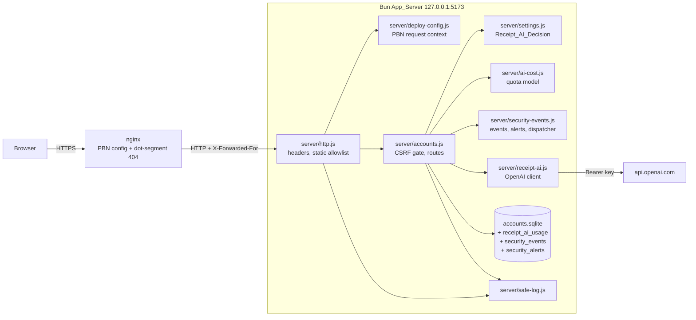

# Design Document: Security Hardening

## Overview

This design closes the gaps listed in the requirements and adds tests and documents for the controls that already exist. It builds on the implemented `publish-behind-nginx` (PBN) spec and keeps every behavior that spec defines: the Host allowlist, Client_Address from Trusted_Proxies, the Expected_Origin, the `Secure` cookie rule, the locked registration in Published_Mode, the Create_Admin_CLI, the Invite_Preview and invite registration, single-use invites with the Invite_List and revoke by Invite_ID, the Receipt_AI_Policy, the deployment meta tag in the shell, and the `sw.js` `PUBLISHED` rewrite.

The work falls into five groups:

1. **Request hardening in the App_Server:** stricter security headers and CSP, a `Sec-Fetch-Site` check, content-type checks that run before the session check, `OPTIONS` 405 for every `/api/` path, `Retry-After` on every Rate_Limiter 429, a safe log line for every uncaught error, and a stricter Accounts_DB path guard.
2. **Receipt AI cost control:** a validated AI_Cost_Config read at startup, persistent per-user, daily, and monthly counts in the Accounts_DB, one Receipt_AI_Usage_Record per OpenAI call, and an Admin_Page usage view next to the existing policy control.
3. **Failed-login logging and alerts:** a Security_Event_Store, threshold alerts created through one Alert_Dispatcher, and Admin_Page views with acknowledgment.
4. **Client fixes:** backtick escaping, a `next` allowlist for all Private_Pages, signed-out redirects with `next`, and a 1 MiB local import limit.
5. **Supply chain and documents:** removal of the browser OCR path, a Secret_Scanner script, a Dependency_Audit, `.dockerignore` and nginx example fixes, the Security_Review, and the Security_Report.

New pure modules hold the logic that has large input spaces, so property tests run without a network or a server: `server/ai-cost.js`, `server/security-events.js`, `server/safe-log.js`, `src/auth-paths.js`, and `scripts/secret-rules.mjs`.

### Key decisions

| Decision | Choice | Reason |
| --- | --- | --- |
| Where AI_Cost_Config is validated | New pure `parseAiCostConfig(env)` in `server/ai-cost.js` that throws the PBN `ConfigError`; `scripts/serve.mjs` calls it in the same `try` as `parseDeploymentConfig` | Same `Configuration error: <message>` output and exit code 1 as PBN 2. The frozen `DeploymentConfig` stays unchanged, so the existing `toEqual` tests in `tests/deploy-config.test.js` and PBN Property 8 keep passing. |
| Invalid `CAMPING_OPENAI_MODEL_ID` | Startup error from `parseAiCostConfig`; `createReceiptAi` keeps its own model check | Req 18.2 wants a typo to stop startup. The existing in-process check stays as defense for callers that skip the parser, which keeps the existing `tests/receipt-ai.test.js` case that expects `enabled: false`. |
| How receipt AI counts persist | Reserve-then-settle rows in a new `receipt_ai_usage` table: a `pending` row is inserted in the same `BEGIN IMMEDIATE` transaction as the quota check, then updated to `success`, `error`, or `timeout` | The check and the reservation are atomic, also across processes. A crash leaves a `pending` row that still counts, which fails toward lower spending. Each OpenAI call ends with exactly one row (Req 18.5). |
| AI limit order relative to the policy | `authorize()` with the Receipt_AI_Decision → key check → image type and size → concurrency → quota reservation → OpenAI → `authorize()` again | Keeps PBN 11.2, 11.3, 11.13 and the in-flight re-check. A request refused by the policy never reaches the quota (Req 18.12). |
| Token usage | `receiptAi.recognize(bytes, type, { signal, onUsage })`; the real client calls `onUsage(usage)` after parsing the envelope | The receipt result shape sent to the browser is unchanged, and existing fake providers that ignore `onUsage` record 0 tokens. |
| Content-type check order | A `requireJsonType(request)` call at the start of each JSON_Route handler, after only the route-specific checks that PBN defines first (closed registration 403, `register` limiter, setup loopback 403) | A table-level check before the handler would answer 415 before the closed-registration 403 and before the `register` limiter. That breaks the shipped tests that send a body-less `POST /api/register` and expect 403 in Published_Mode, and that count 415 attempts toward the `register` limit (PBN 10.2, 14.9). |
| `Sec-Fetch-Site` | Checked in `accounts.handle` right after the Origin check, for every Mutating_Request; only `cross-site` is rejected | Same place as the PBN Origin check, so no handler runs. Browsers that omit the header keep working. |
| `OPTIONS` for `/api/` | `accounts.handle` answers 405 before the route loop | Covers unknown paths too (Req 12.3). No handler runs and no cookie is set. |
| `Retry-After` | `RateLimiter.retryAfter(key)` returns whole seconds; `HttpError` carries optional headers | One source for the value. The 429 status and messages stay as shipped. |
| CSP | `default-src 'self'; script-src 'self'; style-src 'self' 'unsafe-inline'; img-src 'self' data: blob:; connect-src 'self'; worker-src 'self'; object-src 'none'; frame-ancestors 'none'; base-uri 'self'; form-action 'self'` | Removes `'wasm-unsafe-eval'` (OCR is removed) and blocks framing. The Published_Mode shell gains only a `<meta name>` tag, which CSP does not restrict, and `sw.js` stays a same-origin script. `'unsafe-inline'` stays in `style-src` because `src/art.js` and `src/dish-art.js` write `style` attributes into SVG markup; removing it is a separate change, and the Security_Report lists it (Req 11.7). |
| Failed-login storage | New `security_events` and `security_alerts` tables, separate from `audit` | The `audit` table keeps its 5000-row trim for account actions, and a flood of failed logins cannot push account actions out of it (Req 23.4). |
| Alert detection | Pure `evaluateAlerts` in `server/security-events.js` over the last 900 seconds of events read from the Accounts_DB | Testable against a reference model. Detection does not depend on the Rate_Limiter, which resets on restart. |
| Alert delivery | `createAlertDispatcher({ store, log, notifiers })`; notifiers run after the login response is decided, through `queueMicrotask`, each in its own `try`/`catch` | A future LINE notifier registers without touching detection. A slow or throwing notifier cannot change or delay the login response (Req 23.16, 23.17). |
| `safeNext` location | New pure `src/auth-paths.js` exporting `safeNext` and `loginPath(path)`; `src/accounts-ui.js` imports it | `src/accounts-ui.js` runs `await main()` on import, so it cannot be imported by unit tests. |
| Browser OCR | Removed. Image helpers move to `src/receipt-image.js` | The two importers (`server/receipt-ai.js`, `src/receipt-ai-client.js`) keep their functions, and the file name no longer suggests OCR. |
| Secret scanning | `scripts/scan-secrets.mjs` with rules in `scripts/secret-rules.mjs`, using `git` only when the directory is a repository | No new dependency. The rule and redaction functions are pure and property-tested. |

## Architecture



### Startup sequence

```mermaid
sequenceDiagram
  participant Serve as scripts/serve.mjs
  participant Cfg as parseDeploymentConfig
  participant Ai as parseAiCostConfig
  participant Acc as createAccountService
  Serve->>Cfg: parse(env)
  Serve->>Ai: parse(env)
  alt ConfigError from either
    Serve->>Serve: console.error("Configuration error: " + message); exit(1)
  end
  Serve->>Acc: { dbPath, publicRoots: [dist], receiptAi: createReceiptAi({ env, cost }), aiCost, deployment }
  alt DB path inside a public root
    Acc-->>Serve: throw PublicDbPathError
    Serve->>Serve: console.error(message); exit(1)
  end
  Serve->>Serve: Bun.serve(...) and log lines (PBN formatStartupLines unchanged)
```

### Request pipeline

Steps 1 to 3 are PBN behavior and stay unchanged.

1. `server/http.js` parses the URL and calls `resolveRequestContext` (Host allowlist 403, forwarding header 400).
2. `accounts.handle(request, ctx)` returns `null` for non-`/api/` paths.
3. Inside `accounts.handle`:
   1. `OPTIONS` → 405 `不支援這個操作。` with no `Allow` header (new, Req 12.3).
   2. Route match. No match → 404 `找不到這個 API。`. Method not in the entry → 405 with `Allow` (unchanged).
   3. Mutating_Request: Origin check against `ctx.expectedOrigin` → 403 `請求來源不被允許。` (PBN 4).
   4. Mutating_Request: `Sec-Fetch-Site: cross-site` → 403 `不接受跨站請求。` (new, Req 10.2).
   5. Handler. For JSON_Routes the handler calls `requireJsonType` before the session check (new, Req 10.3, 10.4).
   6. Errors: `HttpError`, `LedgerError`, `ReceiptAiError` → their status and message, plus any headers carried by the error (new: `Retry-After`). Anything else → 500 with the fixed message and one `safe-log` line (new, Req 19.3).
4. `server/http.js` copies `SECURITY_HEADERS` onto the API response (unchanged) or serves the static file with `SECURITY_HEADERS` (new values).

## Components and Interfaces

### 1. `server/http.js` (changed)

```js
export const SECURITY_HEADERS = {
  'Content-Security-Policy': "default-src 'self'; script-src 'self'; style-src 'self' 'unsafe-inline'; img-src 'self' data: blob:; connect-src 'self'; worker-src 'self'; object-src 'none'; frame-ancestors 'none'; base-uri 'self'; form-action 'self'",
  'X-Content-Type-Options': 'nosniff', 'Referrer-Policy': 'no-referrer', 'Cache-Control': 'no-store',
  'X-Frame-Options': 'DENY', 'Permissions-Policy': 'camera=(), microphone=(), geolocation=()',
  'Cross-Origin-Opener-Policy': 'same-origin', 'Cross-Origin-Resource-Policy': 'same-origin'
};
```

- `shellResponse`, `swResponse`, `notFound`, the host and forwarding errors, and the 405 and 400 responses already spread `SECURITY_HEADERS`, so they get the new values with no other change (Req 11.1). `swResponse` keeps `Cache-Control: no-cache`, and versioned assets keep `no-cache` (PBN 9.6). The shell and `/invite/{token}` keep `no-store` (PBN 15.6).
- The `catch` block calls `logRequestError({ method: req.method, url, error })` from `server/safe-log.js` instead of `console.error('Request failed:', name)`.
- The `assets/` allowlist pattern no longer needs `assets/ocr/` because the files are no longer built (Req 22.5). The pattern itself is unchanged.

### 2. `server/safe-log.js` (new, pure formatting)

```js
export const GENERIC_500 = '伺服器暫時無法處理，請稍後再試。';
export function formatErrorLine({ at, method, path, error }) → string
  // `${new Date(at).toISOString()} ${method} ${path} ${errorName}`; path has no query string;
  // errorName = /^[A-Za-z][A-Za-z0-9_]{0,63}$/.test(error?.name) ? error.name : 'Error'
export function logRequestError({ method, url, error, at = Date.now(), sink = console.error }) → void
```

Only the name of the error is written. Messages, stacks, bodies, cookies, query strings, and headers never reach the log line (Req 19.3, 19.8). `server/http.js` keeps its own generic 500 body `伺服器暫時無法完成要求。` for static errors; `accounts.handle` keeps `GENERIC_500`.

### 3. `server/accounts.js` (changed)

**`HttpError`** gains an optional third argument `headers` (array of `[name, value]`). `errorResponse(status, message, error.headers)` passes them through.

**`RateLimiter`** gains two methods. Existing callers and PBN Property 9 are unaffected:

```js
retryAfter(key) → number   // Math.max(1, Math.ceil((entry.reset - clock()) / 1000)); 1 when no entry
noteOnce(key) → boolean    // true the first time in the current window, then false until the window resets
```

**Rate-limit failures** go through one helper:

```js
const limited = (keys, message) => {
  const seconds = Math.max(...keys.map(k => limiter.retryAfter(k)));
  throw new HttpError(429, message, [['Retry-After', String(seconds)]]);
};
```

`login`, `register`, `inviteRegister`, and `invitePreview` call it in place of `fail(429, …)` (Req 4.5). For login, `keys` is the subset of `[userKey, clientLimitKey]` that is blocked.

**CSRF gate in `handle`** (Req 10.2, 12.3):

```js
if (request.method === 'OPTIONS') return errorResponse(405, '不支援這個操作。');          // before the route loop
...
if (request.method !== 'GET' && request.headers.get('origin') !== ctx.expectedOrigin) fail(403, '請求來源不被允許。');   // PBN
if (request.method !== 'GET' && request.headers.get('sec-fetch-site') === 'cross-site') fail(403, '不接受跨站請求。');
```

**`requireJsonType(request)`** checks only the media type and reads no body. `readJson` calls it too, so its 415 stays. Order per JSON_Route handler (Req 10.4):

| Handler | Order |
| --- | --- |
| `setup` | loopback 403 → `requireJsonType` → `needsSetup` 409 → `readJson` |
| `register` | closed 403 → `register` limiter → `requireJsonType` → `needsSetup` 409 → `readJson` |
| `inviteRegister` | `register` limiter → `requireJsonType` → `needsSetup` 409 → `readJson` |
| `login` | `readJson` first (unchanged; 415 already comes first) |
| Every handler that starts with `requireUser` or `requireAdmin` | `requireJsonType` → `requireUser`/`requireAdmin` → `readJson` |

The handlers in the last row are `createTrip`, `putTrip`, `patchTrip`, `checkTrip`, `createInvite`, `revokeInvite`, `joinInvite`, `putLedger`, `deleteTrip`, `adminDeleteTrip`, `adminPatchUser`, `adminDeleteUser`, `adminPatchSettings`, and the new `adminAcknowledgeAlert`. `logout` and `recognizeReceiptAi` are not JSON_Routes. The route inventory test (Req 1.7) carries a `json: true` flag per entry and checks each flagged route with no session and `text/plain`.

**Password helpers** are exported for property tests: `hashPassword`, `verifyPassword`. `verifyPassword` wraps the scrypt call in `try`/`catch` and returns `false` for a stored hash with impossible parameters, so a corrupt row cannot throw (Req 2.6).

**Accounts_DB path guard** (Req 20.9). `assertPrivateDbPath(dbPath, { publicRoots = [] })`:

```text
if dbPath === ':memory:': return it
full = resolve(dbPath)
real = realpath of the nearest existing ancestor of full, joined with the remaining segments
for candidate in [full, real]:
  if a segment of candidate is 'dist' or 'public' (case-insensitive): throw PublicDbPathError
  if candidate is inside realpath(root) for any root in publicRoots: throw PublicDbPathError
mkdir(dirname(full), 0o700); return full
```

The decision is the exported pure helper `isPublicDbPath(full, real, publicRoots)`, and the filesystem part (`realpath` of the nearest existing ancestor) stays in `assertPrivateDbPath`. `PublicDbPathError` has the message `Database path is publicly servable: <path>. Move CAMPING_DB outside the build output and any public directory.` The check runs before `new Database(...)`, so nothing is created or opened. `scripts/serve.mjs` passes `publicRoots: [resolve(project, process.env.CAMPING_DIST || 'dist')]`, catches the error, prints it, and exits 1 before `Bun.serve`. Tests call `createAccountService` directly with a temporary directory and a symlink.

**Receipt AI with AI_Cost_Config** (Req 18). New factory options: `aiCost = AI_COST_DEFAULTS`. In `recognizeReceiptAi`, the existing flow stays, and the in-memory `ai:<user>` and `ai:global` limiter calls are replaced:

```text
user = authorize({ policy: false }); consent check; checkPolicy(user)              // PBN, unchanged
key enabled check (503); content type (415); Content-Length (413)                  // unchanged
aiActive concurrency (429, Req 18.8)                                               // unchanged, in memory
bytes = readLimitedBytes(...); validateAiImage(bytes, type); authorize()           // unchanged
reservation = reserveAiCall(user.id, tripId)                                       // new, see below
  → 429 with Retry-After when the quota model refuses (Req 18.4)
  → 503 'AI 辨識服務暫時無法使用，請稍後再試。' when the database read or write throws (Req 18.9)
try:
  result = await receiptAi.recognize(bytes, type, { signal, onUsage: u => usage = u })
  settle(reservation, 'success', usage)
except error:
  settle(reservation, isTimeout(error) ? 'timeout' : 'error', usage)                // Req 18.5
  rethrow
authorize()   // PBN re-check; a refusal here keeps the settled row (Req 18.13)
```

`reserveAiCall` runs in `tx(...)`: it counts rows for the user since `now - 15 min`, rows since `utcDayStart(now)`, and rows since `utcMonthStart(now)`, asks `quotaDecision` from `server/ai-cost.js`, and on `ok` inserts a `pending` row with `model_id = aiCost.modelId`. It also deletes rows older than 400 days. `settle` updates the row's outcome and token counts; a failing update is logged with `logRequestError` and does not change the response, because the call already happened. `isTimeout(error)` is true for a `ReceiptAiError` with status 504 and for `AbortError`/`TimeoutError`.

**Admin usage route** (Req 18.6): `GET /api/admin/receipt-ai-usage` → `requireAdmin` → `{ day: { start, requests, promptTokens, completionTokens }, month: { … }, limits: { perUser, perUserWindowMinutes: 15, daily, monthly }, model: { id, imageDetail, maxCompletionTokens } }`. `pending` rows count as requests with their recorded tokens (0).

**Failed-login events in `routes.login`** (Req 23.1–23.5, 23.15). The handler is restructured so every exit path decides one reason:

```text
try body = readJson(request) catch HttpError e → record('invalid_input', rawUsername = null); throw e
username/password not strings → record('invalid_input', body.username); fail 400
blockedKeys = [userKey, clientKey].filter(blocked)
if blockedKeys.length:
  if blockedKeys.some(k => limiter.noteOnce(k)) → record('rate_limited', username)
  limited(blockedKeys, message)
... verify ...
failure: reason = (user && user.deleted_at !== null && ok) ? 'deleted_account' : 'bad_credentials'
         record(reason, username); hits; fail 401
```

`record(reason, rawUsername)` calls `securityEvents.recordFailedLogin({ at, client: clientKey(info), username: eventUsername(rawUsername), reason })` inside its own `try`/`catch`. A failed write is logged with `logRequestError` (error name only) and does not change the response (Req 23.15). The password is never passed to `record`.

**Security admin routes** (Req 23.8–23.14), all under `/api/admin/` and therefore Admin_API:

| Method and path | Body | Response |
| --- | --- | --- |
| `GET /api/admin/security` | — | `{ unacknowledged: n, alerts: [...newest first, unacknowledged only], events: [...200 newest] }` |
| `POST /api/admin/security/alerts/{id}/acknowledge` | `{}` (JSON) | 200 `{ acknowledged: true, unacknowledged: n }`; 404 `找不到這個警示，或已經確認過。` for an unknown, malformed, or already acknowledged ID |

Acknowledgment runs in `tx`: `UPDATE security_alerts SET acknowledged_at = ?, acknowledged_by = ? WHERE id = ? AND acknowledged_at IS NULL`; `changes === 1` → `audit(admin.username, 'security.alert.ack', 'alert:<id>')`, else 404 with no audit row (Req 23.10, 23.14).

**Route table additions:**

```js
[/^\/api\/admin\/security$/, { GET: routes.adminSecurity }],
[/^\/api\/admin\/security\/alerts\/([^/]+)\/acknowledge$/, { POST: routes.adminAcknowledgeAlert }],
[/^\/api\/admin\/receipt-ai-usage$/, { GET: routes.adminReceiptAiUsage }]
```

### 4. `server/ai-cost.js` (new, pure)

```js
import { ConfigError } from './deploy-config.js';
export const AI_ENV = Object.freeze({
  modelId: 'CAMPING_OPENAI_MODEL_ID', imageDetail: 'CAMPING_OPENAI_IMAGE_DETAIL',
  maxCompletionTokens: 'CAMPING_OPENAI_MAX_COMPLETION_TOKENS',
  perUser: 'CAMPING_RECEIPT_AI_USER_LIMIT', daily: 'CAMPING_RECEIPT_AI_DAILY_LIMIT', monthly: 'CAMPING_RECEIPT_AI_MONTHLY_LIMIT'
});
export const AI_COST_DEFAULTS;   // frozen { modelId: 'gpt-6-luna', imageDetail: 'high', maxCompletionTokens: 6000, perUser: 10, daily: 100, monthly: 1000 }
export function parseAiCostConfig(env) → AiCostConfig        // throws ConfigError(name, message with the allowed range)
export function utcDayStart(ms), utcMonthStart(ms), nextUtcDayStart(ms), nextUtcMonthStart(ms) → number
export function quotaDecision({ now, userTimes, dayCount, monthCount, config })
  → { ok: true } | { ok: false, retryAfter: number }
export function costEstimate({ config, pricePerMillion: { input, output }, imageInputTokens }) → { perRequest, perDay, perMonth }
```

**Parsing:** unset or empty → default. Integers must match `^[1-9][0-9]*$` and fall in range. Model `^gpt-[A-Za-z0-9._-]{1,80}$`. Detail `low|high|auto`. After each value, the order rule `perUser ≤ daily ≤ monthly` is checked, and a violation names the variable whose value broke it (the later one in that order). Messages follow PBN: `<NAME> must be an integer from 1 to 16000; got "<raw>".`

**`quotaDecision`:** `userTimes` is the sorted list of the user's call times in the last 15 minutes. A request fits when `userTimes.length < perUser`, `dayCount < daily`, and `monthCount < monthly`. Otherwise `retryAfter` is the largest of the waits for the exceeded limits: for the user limit, `userTimes[userTimes.length - perUser] + 15 min - now`; for the day, `nextUtcDayStart(now) - now`; for the month, `nextUtcMonthStart(now) - now`; each converted to whole seconds, rounded up, at least 1.

**`costEstimate`** is used by the Security_Report task to compute Req 18.10 from prices that the agent looks up at report time.

### 5. `server/receipt-ai.js` (changed)

- `createReceiptAi({ env, fetchImpl, timeoutMs, cost })`. With `cost` given, the request uses `cost.modelId`, `cost.imageDetail`, and `cost.maxCompletionTokens`; without it, the model comes from `env` as today and the other two keep `high` and `6000` (Req 18.14). The existing key and model checks stay.
- `recognize(bytes, type, { signal, onUsage })`: after parsing the envelope, calls `onUsage?.({ promptTokens, completionTokens })` with integers from `usage.prompt_tokens` and `usage.completion_tokens`, using 0 for absent or non-integer values. `onUsage` is called before shape validation, so a malformed reply still records its tokens.
- Imports move from `../src/receipt-ocr.js` to `../src/receipt-image.js`.

### 6. `server/security-events.js` (new)

Pure parts:

```js
export const EVENT_REASONS = ['invalid_input', 'rate_limited', 'deleted_account', 'bad_credentials'];
export const ALERT_RULES = { perUsername: { count: 5 }, global: { count: 20 }, windowMs: 900000, cooldownMs: 900000 };
export function eventUsername(raw) → string            // trimmed, lowercased; '(invalid)' unless /^[a-z][a-z0-9-]{2,31}$/
export function evaluateAlerts({ event, recent, lastAlertAt }) → Alert[]
  // recent: events in (event.at - 900 s, event.at], including `event`
  // per-username alert when event.username !== '(invalid)' and that username's count ≥ 5
  //   and lastAlertAt[`username:${name}`] is absent or ≤ event.at - 900 s
  // global alert when the total count ≥ 20 and lastAlertAt['global'] is absent or ≤ event.at - 900 s
export function createAlertDispatcher({ store, log, notifiers = [] }) → { dispatch(alert), register(notifier) }
```

`dispatch(alert)`:

1. `stored = store.insertAlert(alert)` (synchronous, inside the caller's error guard).
2. `log(formatAlertLine(stored))`: `security-alert type=<kind> username=<name|(all)> count=<n> window=<startISO>..<endISO>`. The username is already `eventUsername`-normalized, so no out-of-format text reaches the log (Req 23.7).
3. `queueMicrotask(() => for each notifier: try { Promise.resolve(notifier(stored)).catch(e => log(failLine(notifier, e))) } catch (e) { log(failLine(notifier, e)) })`. The login handler never awaits notifiers (Req 23.17). `failLine` holds the notifier's `name` (or `notifier#<index>`) and the error name.

Database part, `createSecurityEventStore(db, clock, { maxEvents = 5000, maxAlerts = 1000 } = {})`: prepared statements for insert, trim (keep newest 5000 events; keep newest 1000 alerts, deleting acknowledged alerts first and then the oldest unacknowledged), recent-window reads, `lastAlertAt` per key, list, and acknowledge. `recordFailedLogin(event)` runs in one `tx`: insert the event, read the window, call `evaluateAlerts`, then call `dispatch` for each alert, then trim. Notifier delivery happens after the transaction commits because it is queued as a microtask.

The service exposes `registerAlertNotifier(fn)` so a later LINE notifier can attach from `scripts/serve.mjs` (Req 23.16).

### 7. `src/auth-paths.js` (new, pure) and `src/accounts-ui.js` (changed)

```js
export const PRIVATE_PATH_RE = /^\/(?:admin|invite\/[0-9a-f]{64}|[a-z][a-z0-9-]{2,31}\/(?:home|trips\/[A-Za-z0-9-]{1,64}(?:\/go)?))$/;
export const safeNext = value => typeof value === 'string' && PRIVATE_PATH_RE.test(value) ? value : null;
export const loginPath = path => safeNext(path) ? `/login?next=${encodeURIComponent(path)}` : '/login';
```

`src/accounts-ui.js` re-exports `safeNext` from `src/auth-paths.js` so existing imports keep working.

- `renderHome`, `renderAdmin`, and the trip branch of `main()` use `go(loginPath(location.pathname))` for a signed-out visitor (Req 1.2, 5.8). The invite branch keeps PBN behavior (Req 1.12, 1.13).
- A new `expireToLogin()` sets `app.innerHTML = ''` and calls `go(loginPath(location.pathname))`. It replaces the `/login` links and `go('/login')` calls that handle a 401 while loading the home trip list, the trip envelope, the signed-in invite read, and the admin lists (Req 1.10). The trip editor's save path in `src/app.js` and the ledger editor in `src/expenses-ui.js` keep their current unsaved-edit messages.
- The Admin_Page gains two sections, rendered from `GET /api/admin/receipt-ai-usage` and `GET /api/admin/security` in the existing `Promise.allSettled`:
  - `收據 AI 用量` below `網站設定`: today and this month (UTC) with requests, prompt tokens, completion tokens, and the configured limits and model, read-only (Req 18.6).
  - `登入安全`: a banner `有 <n> 則尚未確認的登入警示` only when `unacknowledged > 0`, the alert list with creation time, username or `(all)`, Client_Address, count, and a `確認` button per alert, then the 200 most recent failed logins with time, username, Client_Address, and reason (Req 23.8, 23.9, 23.11). `確認` sends the acknowledge request, removes the row, and lowers or hides the banner without reloading (Req 23.10). All values go through `e()`.

### 8. `src/model.js` (changed)

`escape` adds `` ` `` → `&#96;` (Req 9.2). `null`/`undefined` → `''` and numbers and booleans → `String(value)` are already the behavior of `String(value ?? '')` (Req 9.3, 9.4).

`src/maps.js` is unchanged. `mapLink` is the only place that turns User_Content into an `href`, and it always builds a `https://www.google.com/maps/search/` URL with the location in the query string; Property 14 pins this (Req 9.7, 9.8).

### 9. `src/app.js` (changed)

- The local-handbook import checks `file.size > 1_048_576` before `file.text()` and shows `請選擇不超過 1 MiB 的備份檔。` (Req 17.9, 17.10).
- No other change. The account invite dialog from PBN already escapes `creatorName`; Req 9.6 adds an e2e check.

### 10. Browser OCR removal (Req 22.4, 22.5)

- `src/receipt-image.js` (new) holds `sniffImageType`, `readImageSize`, `validateReceiptBytes`, `MAX_RECEIPT_BYTES`, and `MAX_RECEIPT_PIXELS`, copied unchanged from `src/receipt-ocr.js`. `src/receipt-ocr.js` is deleted, together with `planOcrSize`, `recognizeReceipt`, `OCR_ASSETS`, `OCR_TIMEOUT_MS`, and the Tesseract worker code.
- `scripts/build.mjs`: the `pinned` versions, the OCR copy list, `NOTICE.txt`, and the OCR size log are removed. The generated `sw.js` keeps the exact first line `const PUBLISHED=false;`, the `-p` cache suffix, and the `/demo` navigation guard (PBN 9.3, 9.6).
- `package.json`: `tesseract.js`, `@tesseract.js-data/chi_tra`, and `@tesseract.js-data/eng` removed; `bun install` regenerates `bun.lock`, which drops `tesseract.js-core` and other transitive packages that only these needed.
- Tests: OCR-only cases in `tests/receipt-parser.test.js` are removed and the image helper cases move to import from `src/receipt-image.js`. `tests/ocr-assets.e2e.js` becomes a check that `/assets/ocr/worker.min.js` returns 404 and the CSP has no `'wasm-unsafe-eval'`. `tests/receipt-ocr.e2e.js` keeps its two tests; its `/assets/ocr/` request assertions stay valid (zero requests).
- `README.md`: the Tesseract licensing sentence is removed.
- `scripts/check-accounts.mjs`: the three `CAMPING_BEDROCK_*` entries are removed from the server environment (Req 22.6).

### 11. `scripts/scan-secrets.mjs` and `scripts/secret-rules.mjs` (new)

`secret-rules.mjs` (pure):

```js
export const RULES = [ { id: 'openai-key', re: /sk-(?:proj-)?[A-Za-z0-9_-]{20,}/g }, { id: 'aws-access-key', re: /\b(?:AKIA|ASIA)[A-Z0-9]{16}\b/g },
  { id: 'pem-private-key', re: /-----BEGIN (?:[A-Z ]+ )?PRIVATE KEY-----/g }, { id: 'bearer-token', re: /Bearer [A-Za-z0-9._~+/=-]{20,}/g },
  { id: 'url-credentials', re: /[a-z][a-z0-9+.-]*:\/\/[^\s:/@]+:[^\s@/]+@/gi }, { id: 'high-entropy-assignment', … } ];
export function shannonEntropy(text) → number
export function redact(value) → string      // first 4 + '…' + last 4 when length ≥ 16, else '[redacted]'
export function scanText(text, { path }) → Finding[]   // { path, line, rule, redacted }
export function parseAllowlist(json) → { entries } | throws AllowlistError (missing or empty reason)
```

`scan-secrets.mjs [--root <dir>] [--allowlist <file>]` walks every file outside `node_modules/`, including ignored ones, skips files over 50 MB with a listed notice, decodes binary files as latin1 so byte patterns still match, and, when `git rev-parse --is-inside-work-tree` succeeds, runs `git log --all -p --no-color` and scans added lines with the commit hash. Exit codes: 0 clean, 1 findings outside the allowlist, 2 incomplete scan or invalid allowlist (Req 15). It prints counts of files, commits, and allowlisted matches, and never the full value. The default allowlist `scripts/secret-allowlist.json` lists the Canary_Secret patterns used in tests, each with a reason.

### 12. Configuration files and documents

- `.dockerignore`: add `.kiro` (Req 20.5).
- `docs/deploy-nginx.md`: inside the `www` server block, before `location /`, add:

  ```nginx
  # Never pass dot-prefixed path segments (.env, .git, .secrets) to the app; ACME challenges stay reachable.
  location ~ /\.(?!well-known/) { return 404; }
  ```

  Nothing else in the PBN example changes (Req 20.8).
- `docs/security-review.md` (Req 7.4 evidence, 8.7, 9.9, 10.9, 14.1, 24) and `docs/security-report.md` (Req 26), linked from `README.md` (Req 26.12).
- `README.md`: recommend `CAMPING_OPENAI_API_KEY_FILE` and explain `docker inspect`, process listings, and `ARG` history (Req 14.8); list the new AI_Cost_Config variables.
- `docs/deploy-nginx.md` settings table gains the AI_Cost_Config variables with their defaults.

## Data Models

### SQLite schema additions (appended to `SCHEMA`; `CREATE … IF NOT EXISTS`, no migration needed)

```sql
CREATE TABLE IF NOT EXISTS receipt_ai_usage (
  id TEXT PRIMARY KEY, at INTEGER NOT NULL, user_id TEXT NOT NULL REFERENCES users(id), trip_id TEXT NOT NULL,
  model_id TEXT NOT NULL, prompt_tokens INTEGER NOT NULL DEFAULT 0, completion_tokens INTEGER NOT NULL DEFAULT 0,
  outcome TEXT NOT NULL CHECK (outcome IN ('pending','success','error','timeout'))
);
CREATE INDEX IF NOT EXISTS receipt_ai_usage_at ON receipt_ai_usage(at);
CREATE INDEX IF NOT EXISTS receipt_ai_usage_user_at ON receipt_ai_usage(user_id, at);
CREATE TABLE IF NOT EXISTS security_events (
  id INTEGER PRIMARY KEY AUTOINCREMENT, at INTEGER NOT NULL, client TEXT NOT NULL, username TEXT NOT NULL,
  reason TEXT NOT NULL CHECK (reason IN ('invalid_input','rate_limited','deleted_account','bad_credentials'))
);
CREATE INDEX IF NOT EXISTS security_events_at ON security_events(at);
CREATE INDEX IF NOT EXISTS security_events_user_at ON security_events(username, at);
CREATE TABLE IF NOT EXISTS security_alerts (
  id TEXT PRIMARY KEY, at INTEGER NOT NULL, kind TEXT NOT NULL CHECK (kind IN ('username','global')),
  username TEXT NOT NULL, client TEXT NOT NULL, count INTEGER NOT NULL,
  window_start INTEGER NOT NULL, window_end INTEGER NOT NULL, acknowledged_at INTEGER, acknowledged_by TEXT
);
CREATE INDEX IF NOT EXISTS security_alerts_open ON security_alerts(acknowledged_at, at);
```

`trip_id` in `receipt_ai_usage` has no foreign key so that usage history survives trip deletion. `client` holds the Client_Address text (at most 64 characters, from `clientKey`). `username` in `security_alerts` is `(all)` for the global kind.

### `AiCostConfig` (frozen object)

| Field | Type | Variable | Default | Range |
| --- | --- | --- | --- | --- |
| `modelId` | string | `CAMPING_OPENAI_MODEL_ID` | `gpt-6-luna` | `^gpt-[A-Za-z0-9._-]{1,80}$` |
| `imageDetail` | `'low' \| 'high' \| 'auto'` | `CAMPING_OPENAI_IMAGE_DETAIL` | `high` | listed values |
| `maxCompletionTokens` | integer | `CAMPING_OPENAI_MAX_COMPLETION_TOKENS` | 6000 | 1–16000 |
| `perUser` | integer (per rolling 15 minutes) | `CAMPING_RECEIPT_AI_USER_LIMIT` | 10 | 1–100 |
| `daily` | integer (per UTC day) | `CAMPING_RECEIPT_AI_DAILY_LIMIT` | 100 | 1–10000, ≥ `perUser` |
| `monthly` | integer (per UTC month) | `CAMPING_RECEIPT_AI_MONTHLY_LIMIT` | 1000 | 1–100000, ≥ `daily` |

### API shapes added

| Method and path | Class | Success | Errors |
| --- | --- | --- | --- |
| `GET /api/admin/receipt-ai-usage` | Admin_API | `{ day, month, limits, model }` | 401, 403 |
| `GET /api/admin/security` | Admin_API | `{ unacknowledged, alerts: [{ id, at, kind, username, client, count, windowStart, windowEnd }], events: [{ at, username, client, reason }] }` | 401, 403 |
| `POST /api/admin/security/alerts/{id}/acknowledge` | Admin_API, JSON_Route | `{ acknowledged: true, unacknowledged }` | 401, 403, 404, 415 |

### Responses changed

| Response | Change |
| --- | --- |
| Every 429 from `loginUser`, `loginClient`, `register`, `invitePreview`, and the receipt AI quota | Adds `Retry-After: <seconds>`; status and body unchanged |
| `POST /api/trips/{id}/receipt-ai` | 429 now also comes from the persistent daily or monthly quota; 503 `AI 辨識服務暫時無法使用，請稍後再試。` when the usage table cannot be read or written |
| `OPTIONS /api/...` | 405 for every path, including unknown paths (was 404) |
| Mutating_Request with `Sec-Fetch-Site: cross-site` | 403 `不接受跨站請求。` |
| JSON_Route without a session and with a non-JSON content type | 415 (was 401) |
| All responses | New CSP, `X-Frame-Options: DENY`, `Cross-Origin-Opener-Policy: same-origin`, `Cross-Origin-Resource-Policy: same-origin` |

### Route inventory (Req 1.7)

| Class | Method and path |
| --- | --- |
| Public_API | `GET /api/session`; `POST /api/login`; `POST /api/register`; `POST /api/logout`; `POST /api/setup` (Local_Mode only); `GET /api/invites/{token}/preview`; `POST /api/invites/{token}/register` |
| Protected_API | `GET`, `POST /api/trips`; `GET`, `PUT`, `PATCH /api/trips/{id}`; `POST /api/trips/{id}/check`; `GET`, `PUT /api/trips/{id}/ledger`; `GET`, `POST /api/trips/{id}/receipt-ai`; `GET`, `POST /api/trips/{id}/invites`; `POST /api/trips/{id}/invites/{inviteId}/revoke`; `POST /api/trips/{id}/delete`; `GET /api/invites/{token}`; `POST /api/invites/{token}/join` |
| Admin_API | `GET /api/admin/users`; `PATCH /api/admin/users/{id}`; `POST /api/admin/users/{id}/delete`; `POST /api/admin/trips/{id}/delete`; `GET /api/admin/audit`; `GET`, `PATCH /api/admin/settings`; `GET /api/admin/receipt-ai-usage`; `GET /api/admin/security`; `POST /api/admin/security/alerts/{id}/acknowledge` |

## Correctness Properties

*A property is a characteristic or behavior that should hold true across all valid executions of a system-essentially, a formal statement about what the system should do. Properties serve as the bridge between human-readable specifications and machine-verifiable correctness guarantees.*

These properties target the pure modules (`server/ai-cost.js`, `server/security-events.js`, `server/safe-log.js`, `src/auth-paths.js`, `src/model.js`, `src/maps.js`, `src/receipt-image.js`, `scripts/secret-rules.mjs`), the exported `RateLimiter` and password helpers, and the account service and HTTP handler on in-memory databases. Properties already proven by the PBN suite (client address, host allowlist, origin and cookie decisions, invite rules) are not repeated.

### Property 1: Every unusable session is rejected on every protected route

*For any* Protected_API route and method in the route inventory and any session cookie drawn from: none, empty, wrong length, non-hex characters, a well-formed token with no Session, an expired Session, and a Session of a soft-deleted user, the response status is 401, the body contains no user, trip, ledger, invite, or audit data, and every table except rate-limit state is unchanged.

**Validates: Requirements 1.1, 1.3, 1.4, 1.8, 3.11**

### Property 2: Login return paths are limited to Private_Page patterns

*For any* string, `safeNext` returns the string exactly when it matches one of the Private_Page patterns (home, trip, trip `/go`, `/invite/<64 hex>`, `/admin`), and returns `null` otherwise, including for generated variants with a `//` or `/\` prefix, a scheme, a query, a fragment, percent-encoded slashes, or surrounding whitespace. `loginPath(p)` contains a `next` parameter exactly when `safeNext(p)` is not `null`, and decoding that parameter returns `p`.

**Validates: Requirements 1.2, 1.9**

### Property 3: Password length rule is exact

*For any* value, `validatePassword` accepts it exactly when it is a string of 12 to 128 Unicode code points, counting astral characters once, and otherwise throws an `HttpError` with status 400 and the length or missing-password message.

**Validates: Requirements 2.2, 2.3**

### Property 4: Password hashing round trip with unique salts

*For any* two accepted passwords `p` and `q` (including non-ASCII and astral characters), `hashPassword(p)` matches `scrypt$N$8$1$<salt>$<hash>` with N ≥ 16384, a 16-byte salt, and a 64-byte hash; `verifyPassword(p, hashPassword(p))` is true; `verifyPassword(q, hashPassword(p))` is true exactly when `p === q`; and two hashes of `p` have different salt fields.

**Validates: Requirements 2.1, 2.4, 2.5**

### Property 5: Malformed stored hashes fail closed

*For any* stored hash string that does not split into 6 `$` fields, does not start with `scrypt`, has a non-integer or impossible N, r, or p, or has an empty hash field, `verifyPassword` returns `false` without throwing, and a login against a user with that stored hash returns the same 401 body as a wrong password.

**Validates: Requirements 2.6**

### Property 6: Retry-After matches the remaining window

*For any* limit from `LIMITS`, any sequence of `hit` calls on one or more keys, and any clock advances, whenever `blocked(key)` is true, `retryAfter(key)` equals `max(1, ceil((reset - now) / 1000))`; after the clock advances by that many seconds, `blocked(key)` is false; and `retryAfter` of one key never depends on hits of another key.

**Validates: Requirements 4.5**

### Property 7: Admin routes refuse Members and signed-out callers without side effects

*For any* Admin_API route and method in the route inventory, any path parameter (existing, unknown, or malformed ID), and any JSON body (valid, missing fields, wrong types, or extra fields), a Member session receives 403 and no session receives 401, the body contains no user, trip, audit, settings, usage, event, or alert data, and every table, including `settings`, `security_alerts`, and `receipt_ai_usage`, is unchanged.

**Validates: Requirements 5.1, 5.2, 5.7, 23.12, 23.13**

### Property 8: Members outside a trip cannot tell the trip exists

*For any* generated set of users and trips with at least one owner, one Trip_Member, and one Member outside each trip, and any Trip_Scoped_Route and method, a request from the outside Member with a valid JSON body returns 404 with the same status, body, and set of header names as the same request for a random nonexistent trip ID, and the trip row, `trip_members`, `invites`, and `trip_ledgers` are unchanged.

**Validates: Requirements 6.1, 6.2, 6.4, 6.10**

### Property 9: Trip lists match membership

*For any* generated set of users, trips, and `trip_members` rows, `GET /api/trips` for a Member returns exactly the IDs of the live trips where the Member is the owner or has a `trip_members` row, and for an Admin returns every live trip.

**Validates: Requirements 6.3**

### Property 10: User text is stored and returned unchanged

*For any* accepted trip title, destination, description, note, and ledger note, including the SQL payload set, NUL characters, non-BMP characters, and strings at the maximum length, saving the value and reading the trip or ledger back returns a byte-identical string, and every row other than the one the request writes is unchanged.

**Validates: Requirements 7.6, 7.9**

### Property 11: Mutating routes never fail with 5xx and reject atomically

*For any* mutating route in the route inventory and any generated JSON value as the body (objects with random keys and value types, arrays, primitives, deeply nested values, and oversize strings), with a Valid_Session of an account that may use the route, the status is below 500, and whenever the status is 400 or higher every table is unchanged.

**Validates: Requirements 8.1, 8.2, 8.3, 8.5**

### Property 12: Stored trip state keeps only schema fields

*For any* valid trip state with extra fields added at any nesting level, `cleanState` returns an object with no field outside the trip state schema, every schema field equal to the input, and applying `cleanState` again returns an equal object.

**Validates: Requirements 8.4**

### Property 13: Escaping round trip

*For any* string (including the XSS_Payload_Set, existing character references, and non-ASCII text), `escape(s)` contains no `<`, `>`, `"`, `'`, or `` ` ``; every `&` in it starts one of the six references `&amp;`, `&lt;`, `&gt;`, `&quot;`, `&#39;`, `&#96;`; decoding those six references returns `s`; and characters other than the six are unchanged. For `null` and `undefined` the result is `''`, and for numbers and booleans it equals `escape(String(value))`.

**Validates: Requirements 9.2, 9.3, 9.4, 9.5**

### Property 14: Map links never carry user-chosen schemes

*For any* location string, `mapLink(location)` either contains no `<a` element and equals the escaped text, or contains exactly one `href` whose decoded value starts with `https://www.google.com/maps/search/` and whose `query` parameter equals the trimmed location; the visible text is the escaped location.

**Validates: Requirements 9.7, 9.8**

### Property 15: The CSRF gate follows its decision table

*For any* mutating route in the route inventory, mode (Local_Mode or Published_Mode with Proxied_Requests), session state (none or valid), `Origin` variant (absent, `null`, equal, or differing in scheme, host, port, case, or trailing slash), `Sec-Fetch-Site` value (absent, `same-origin`, `same-site`, `none`, `cross-site`), and content type (JSON with random parameters and case, `text/plain`, form, multipart, absent), the response status equals the model: 403 origin when the Origin differs from the Expected_Origin; else 403 cross-site for `cross-site`; else, for JSON_Routes with a non-JSON type, the route's PBN pre-check status if it has one (closed registration 403, `register` 429, setup loopback 403) and otherwise 415; else the route proceeds. No response carries an `Access-Control-*` header, and every table is unchanged whenever the model says the gate refused.

**Validates: Requirements 10.1, 10.2, 10.3, 10.4, 10.5, 12.5**

### Property 16: GET and HEAD never change the database

*For any* GET route in the route inventory, with or without a Valid_Session, with random path parameters and query strings, sent as GET or HEAD, every table in the Accounts_DB is identical before and after the request.

**Validates: Requirements 10.6**

### Property 17: Every response carries the security headers exactly once

*For any* request drawn from: static allowlist paths, App_Shell routes, Published_Mode shell and `sw.js`, unknown paths, Public_API, Protected_API, and Admin_API routes with random methods, a disallowed Host, an invalid forwarding header, oversize and malformed bodies, rate-limited requests, and a handler forced to throw, the response contains each Security_Header exactly once with the required value, contains no `Access-Control-*` header, and every `/api/` response has `Cache-Control: no-store`; the shell and `/invite/{token}` keep `no-store` and `sw.js` keeps `no-cache`.

**Validates: Requirements 11.1, 11.5, 12.2**

### Property 18: OPTIONS on the API is always 405 and inert

*For any* `/api/` path (in the Route_Table or random), with or without `Origin`, `Access-Control-Request-Method`, and a session cookie, an `OPTIONS` request returns 405, has no `Access-Control-*` or `Set-Cookie` header, runs no handler, and leaves every table unchanged.

**Validates: Requirements 12.3, 12.4**

### Property 19: Planted secrets are found at their line

*For any* rule in `RULES`, any generated secret that matches the rule, and any surrounding text of random lines that contain no secret, `scanText` reports exactly one finding for the planted secret with that rule and the 1-based line where it was planted.

**Validates: Requirements 15.4**

### Property 20: Redaction never reveals a secret

*For any* string of length 16 or more, `redact(s)` equals the first 4 characters, `…`, and the last 4 characters, and for shorter strings equals `[redacted]`; for any secret, the full scanner output for a file containing it does not contain the secret.

**Validates: Requirements 15.5**

### Property 21: Receipt image validation accepts exactly complete images

*For any* generated complete JPEG or PNG within 3.5 MiB, 8000 px per side, and 20,000,000 px, `validateAiImage` accepts the bytes with the matching content type. *For any* empty array, valid signature followed by random bytes, complete image truncated at any offset, image with a mismatched content type, or image above a dimension limit, `validateAiImage` throws with status 400, 413, or 415.

**Validates: Requirements 17.1, 17.2, 17.4, 17.5**

### Property 22: Invalid AI settings stop startup with a named error

*For any* environment in which exactly one AI_Cost_Config variable is invalid (out of range, non-integer, wrong model format, unknown detail, or breaking `perUser ≤ daily ≤ monthly`), `parseAiCostConfig` throws a `ConfigError` whose `setting` names that variable and whose message states the allowed range. *For any* valid environment, the result is frozen, satisfies the ordering rule, and parsing the result written back as environment variables returns an equal object.

**Validates: Requirements 18.1, 18.2**

### Property 23: Receipt AI calls follow the persistent quota model

*For any* sequence of recognition requests by two users, clock advances (including across UTC day and month boundaries), and Receipt_AI_Policy changes, with a fake provider and a file-backed database, the provider is called exactly when the reference model allows the request (policy allows, per-user count in the last 15 minutes below the limit, UTC day and month counts below their limits); a refused request returns 429 with `Retry-After` equal to the model's wait, and a policy refusal returns the PBN status without changing any count.

**Validates: Requirements 18.3, 18.4, 18.12**

### Property 24: Each OpenAI call leaves exactly one usage record

*For any* sequence of provider outcomes (success with usage, success without usage, malformed usage, provider error, timeout), the number of `receipt_ai_usage` rows equals the number of provider calls, each row's outcome is `success`, `error`, or `timeout` as produced, and its token counts equal the reported integers or 0.

**Validates: Requirements 18.5**

### Property 25: Uncaught errors reveal nothing

*For any* error whose name, message, stack, and properties contain Canary_Secrets, thrown by a route handler or by static handling on a request whose body, cookie, and query string contain other Canary_Secrets, the response has a 5xx status and exactly the generic body, no Canary_Secret appears in any response header or body, and the single log line equals `formatErrorLine` of the time, method, query-free path, and a sanitized error name.

**Validates: Requirements 19.1, 19.3, 19.7, 19.8**

### Property 26: Traversal never escapes the Build_Output

*For any* path built from allowlisted prefixes and sequences of `../`, `%2e%2e/`, `..%2f`, `%252e%252e%252f`, backslashes, `%5c`, `%00`, and file names outside the Build_Output, the static handler returns 400, 403, or 404 and the body contains none of the bytes of the targeted file.

**Validates: Requirements 20.3**

### Property 27: The database path guard rejects public locations

*For any* generated path and symlink-resolved form, `isPublicDbPath(full, real, publicRoots)` is true exactly when the resolved path, or its symlink-resolved form, has a `dist` or `public` segment (any case) or lies inside one of the `publicRoots`, and `createAccountService` throws `PublicDbPathError` without creating a file exactly in those cases.

**Validates: Requirements 20.9**

### Property 28: Each failed login is classified once without secrets

*For any* sequence of `POST /api/login` requests mixing invalid JSON, non-string fields, unknown, deleted, and existing usernames, out-of-format usernames, wrong and correct passwords, and Canary_Secret passwords, from several Client_Addresses, the `security_events` table gains exactly the events a reference model predicts: one event per request that does not start a Session, with the model's reason and normalized username, except that `rate_limited` events appear at most once per blocked key per window; no Canary_Secret appears in the table; and the login responses equal those of a service with no event store.

**Validates: Requirements 23.1, 23.2, 23.3, 23.5**

### Property 29: Alerts follow thresholds and cooldowns

*For any* timeline of Failed_Login_Events over several usernames (including `(invalid)`), `evaluateAlerts` applied event by event produces exactly the alerts of a reference model: a per-username alert when one username other than `(invalid)` reaches 5 events in the 900 seconds ending at the event, a global alert when all events reach 20 in that span, and no repeat of the same kind and username within 15 minutes of the previous one.

**Validates: Requirements 23.6**

### Property 30: Notifiers cannot affect alert storage or each other

*For any* list of notifiers that each return normally, throw, reject, or never settle, dispatching an alert stores it exactly once, returns without awaiting any notifier, delivers it exactly once to every notifier, and writes one failure log line for each notifier that throws or rejects.

**Validates: Requirements 23.16, 23.17**

## Error Handling

| Situation | Where | Result |
| --- | --- | --- |
| Invalid AI_Cost_Config value | `parseAiCostConfig` → `serve.mjs` | `Configuration error: <NAME> must be …; got "<raw>".`, exit 1, no listener. |
| Accounts_DB path in a public location | `assertPrivateDbPath` → `serve.mjs` | `Database path is publicly servable: <path>…`, exit 1, no file created. |
| `OPTIONS` to `/api/` | `accounts.handle` | 405 `不支援這個操作。`, no handler, no cookie. |
| Mutating_Request with `Sec-Fetch-Site: cross-site` | `accounts.handle` | 403 `不接受跨站請求。`, no handler. |
| JSON_Route with a non-JSON content type | `requireJsonType` | 415 `請以 JSON 格式送出資料。` before the session check; after the PBN closed-registration 403, `register` limiter, and setup loopback 403. |
| Rate limit (`loginUser`, `loginClient`, `register`, `invitePreview`) | `limited()` | 429 with the existing message and `Retry-After`. |
| Receipt AI quota exceeded | `reserveAiCall` | 429 `AI 辨識次數已達上限，請稍後再試。` with `Retry-After`; no provider call, no row. |
| Receipt AI usage table unreadable or locked | `reserveAiCall` | 503 `AI 辨識服務暫時無法使用，請稍後再試。`; no provider call. |
| Usage row update fails after the call | `settle` | Log line with the error name; the recognition response is unchanged. |
| Policy refusal after the provider call | `authorize()` re-check | PBN status (403/503/401/409); the usage row stays. |
| Failed_Login_Event or Security_Alert write fails | `record()` | Log line with the error name; the login response is unchanged. |
| Alert notifier throws or rejects | `createAlertDispatcher` | One log line naming the notifier and the error name; other notifiers still run. |
| Acknowledge an unknown or acknowledged alert | `adminAcknowledgeAlert` | 404 `找不到這個警示，或已經確認過。`; no audit row. |
| Corrupt stored password hash | `verifyPassword` | `false`; login 401 `帳號或密碼不正確。`. |
| Uncaught error in a route or static handling | `accounts.handle`, `http.js` | 500 generic message; one `safe-log` line with time, method, path, error name. |
| Local import file over 1 MiB | `src/app.js` | `請選擇不超過 1 MiB 的備份檔。`; file not read, nothing sent. |
| Signed-out visit to home, trip, or admin | `src/accounts-ui.js` | Redirect to `/login?next=<path>`; nothing rendered. |
| 401 while loading a Private_Page | `expireToLogin()` | `#app` cleared, redirect with `next`. A 401 on a save keeps the existing export message. |
| Secret_Scanner finding / incomplete scan / bad allowlist | `scan-secrets.mjs` | Exit 1 / 2 / 2 with redacted output. |

## Testing Strategy

The runner is `bun test`. In PowerShell run `bun test tests` (the glob in `package.json` is not expanded there). Run the Unit_Suite with `CAMPING_DIST` unset so that the static tests use `dist/` from `bun run build`. Property tests use **fast-check** (already a dev dependency, 4.10.2). Each property is one `test(...)` with `fc.assert(fc.property(...), { numRuns: 100 })` or more (Property 13 uses `numRuns: 1000`, Req 9.5), tagged:

```js
// Feature: security-hardening, Property 1: Every unusable session is rejected on every protected route
```

Cost control: scrypt (N=16384) costs about 40–60 ms per hash. Properties 1, 7, 8, 11, 15, 16, and 18 create their accounts once in `beforeAll` and vary only requests. Property 4 hashes at most three passwords per run. Property 28 uses at most six logins per run against a pool of pre-registered users. Property 23 uses a fake provider and a clock injected through `now`. No test sends a request to an OpenAI host; tests that need a provider use a fake `receiptAi` or a fake `fetchImpl` (Req 25.8–25.10).

### New unit test files

- **`tests/security-auth.test.js`:** Properties 1, 3, 4, 5, 6, 7. Examples: route inventory in both modes with the classification of Req 1.7 and a fail-on-drift check (1.7, 5.9, 19.6); cookie attributes and expiry (3.1, 3.2); logout with and without a session (1.5, 1.6, 3.6, 3.7); session replacement on login, register, invite registration, and setup, and no change on failure (3.8, 3.9); raw token absent from the DB file and audit (3.10); demotion takes effect on the next admin request (5.3, 5.4); admin route matrix for Member, Admin, and no session (5.6); dummy hash for unknown users (2.10); Canary_Secret password absent from the DB file, WAL, audit, events, logs, and responses (2.7); hash format for each creation path including the Create_Admin_CLI with an injected prompt (2.1); `Retry-After` on each limiter's 429 (4.5); blocked login runs no hash (4.6).
- **`tests/security-access.test.js`:** Properties 8, 9, 10, 11, 12, 16. Examples: SQL payloads in login, invite tokens, and trip IDs (7.7, 7.8); Admin manage access on non-participant-only routes and 404 on Participant_Only_Routes (6.8, 6.11); ledger GET and PUT by an outsider with the stored ledger compared (6.10); boundary cases per mutating route (8.6).
- **`tests/security-csrf.test.js`:** Properties 15 and 18. Examples: the per-route matrix of Req 10.7 in both modes; the PBN orderings (closed `POST /api/register` with no content type → 403; 415 attempts counted toward `register`; setup loopback 403 before 415) (10.4); `OPTIONS` with a foreign `Origin` and `Access-Control-Request-Method` (12.8).
- **`tests/security-headers.test.js`:** Property 17. Examples: CSP directives parsed and compared (9.10, 9.11, 11.2, 11.3, 13.8), Permissions-Policy (11.4), every Security_Header on each response kind of Req 11.1 (11.8), no `Access-Control-*` across modes and route classes (12.7), document checks of `docs/deploy-nginx.md` (HSTS, `client_max_body_size` ≤ 4m, no `Access-Control-*` `add_header`, no `OPTIONS` handling, the dot-segment `location`) (11.6, 12.6, 17.11, 20.8).
- **`tests/security-client.test.js`:** Properties 2, 13, 14.
- **`tests/ai-cost.test.js`:** Property 22 and examples for defaults, UTC boundary helpers, `quotaDecision` waits, and `costEstimate`.
- **`tests/receipt-ai-cost.test.js`:** Properties 23 and 24. Examples: counts survive closing and reopening a file database (18.3); 503 when the usage table is dropped (18.9); policy `off` and `admins` refuse before the quota (18.12); a policy change during the call keeps the row (18.13); configured model, detail, and token cap in the OpenAI request body through a fake `fetchImpl` (18.14); `onUsage` receives the envelope's usage (18.5); admin usage route totals for day and month (18.6); one provider call per request (18.7).
- **`tests/security-events.test.js`:** Properties 28, 29, 30. Examples: retention with lowered caps passed to `createSecurityEventStore` (23.4); alert log line content (23.7); `GET /api/admin/security` shape and newest-first order (23.8, 23.11); acknowledge success with audit, unknown and repeated IDs (23.10, 23.14); event write failure keeps the login response (23.15); the throwing, never-resolving, and recording notifier case of Req 23.18.
- **`tests/secret-scan.test.js`:** Properties 19 and 20. Examples in temporary directories: planted key reported with file, line, rule, exit 1 (15.8); clean directory exit 0 with counts (15.10); allowlisted value exit 0 (15.7); entry without a reason exit 2 (15.12); unreadable file exit 2 (15.11); a git fixture with a key added and then deleted, when `git` is on PATH (15.2; skipped with a logged reason otherwise); non-repository notice (15.3); 50 MB skip notice using a sparse file (15.1).
- **`tests/security-files.test.js`:** Properties 21, 25, 26, 27. Examples: each sensitive path and case variant of Req 20.1; equal status for an existing and a missing non-allowlisted file (20.2); fresh build into a temporary `CAMPING_DIST` with no `.map` file, no `sourceMappingURL`, none of the forbidden files, no `assets/ocr/`, `sw.js` starting with `const PUBLISHED=false;`, and no Canary_Secret from the environment (13.3, 14.3, 14.4, 19.4, 19.9, 20.4, 22.5); startup refusal for a Build_Output path, a `public` path, and a symlink into the Build_Output (20.9); static SQL check over `server/` plus its two fixtures (7.4, 7.5); source checks for `maxRequestBodySize`, the `start` script and Dockerfile `CMD`, `.dockerignore`, `.gitignore`, Dockerfile runtime `COPY` lines, compose secrets, and `.env.example` when present (14.5–14.7, 14.9, 14.10, 17.7, 19.5, 20.5–20.7); no `CAMPING_BEDROCK` outside `.kiro/`, `node_modules/`, and the Build_Output (22.6); no `api.openai.com` or `CAMPING_OPENAI_API_KEY` in `src/` or the Build_Output (13.9); OpenAI key canary absent from every route response and from logs (13.2, 13.6); key file rotation on a new `createReceiptAi` (16.7).
- **`tests/receipt-image.test.js`:** the image helper cases moved from `tests/receipt-parser.test.js`.

### Changed tests

- `tests/receipt-parser.test.js`: OCR cases removed; parser cases stay.
- `tests/ocr-assets.e2e.js`: asserts that `/assets/ocr/worker.min.js` returns 404 and the CSP has no `'wasm-unsafe-eval'`.
- `tests/model.test.js`: one backtick example.
- PBN suites run unchanged. `tests/deploy-config.test.js` keeps its exact `toEqual` of the `DeploymentConfig`, which is why AI_Cost_Config has its own parser.

### E2E

`scripts/check-accounts.mjs` starts one Local_Mode server with an in-memory database for every file passed to it, so all files in one run share the `register` limit of 20 attempts per hour for `127.0.0.1` (setup does not count). The security e2e files create at most three accounts each, and the final checkpoint runs them in a separate invocation from the PBN e2e files.

- **`tests/security-xss.e2e.js`:** fills User_Content with each XSS_Payload_Set string through the API, then loads the home page, trip page, signed-in and signed-out invite pages, Invitation_Dialog, expenses view, and Admin_Page; listens for dialogs, `pageerror`, and `securitypolicyviolation`; checks a `window` sentinel and unexpected `script`, `img`, `svg`, and `iframe` elements; and checks that each payload appears as text (9.6, 11.9).
- **`tests/security-pages.e2e.js`:** signed-out home, trip, and admin redirect to `/login?next=…` and return there after login (1.2, 5.8); a Member at `/admin` sees the permission message (5.5); another user's home shows the permission message without a trip list request (6.7); a 401 injected with `page.route` while loading the home list clears it and redirects (1.10); the Admin_Page shows the usage section and, after five failed logins for one username, the alert banner, which `確認` lowers and hides (18.6, 23.8–23.10); the local import refuses a 1 MiB + 1 byte file (17.10).

### Why property tests fit here

Session parsing, path allowlists, escaping, the CSRF gate, header coverage, quota arithmetic across calendar boundaries, alert windows and cooldowns, secret detection, and traversal handling are logic in this repository with large input spaces and off-by-one risks. Documents, nginx text, Docker files, and the dependency audit are covered by source checks and examples instead.
