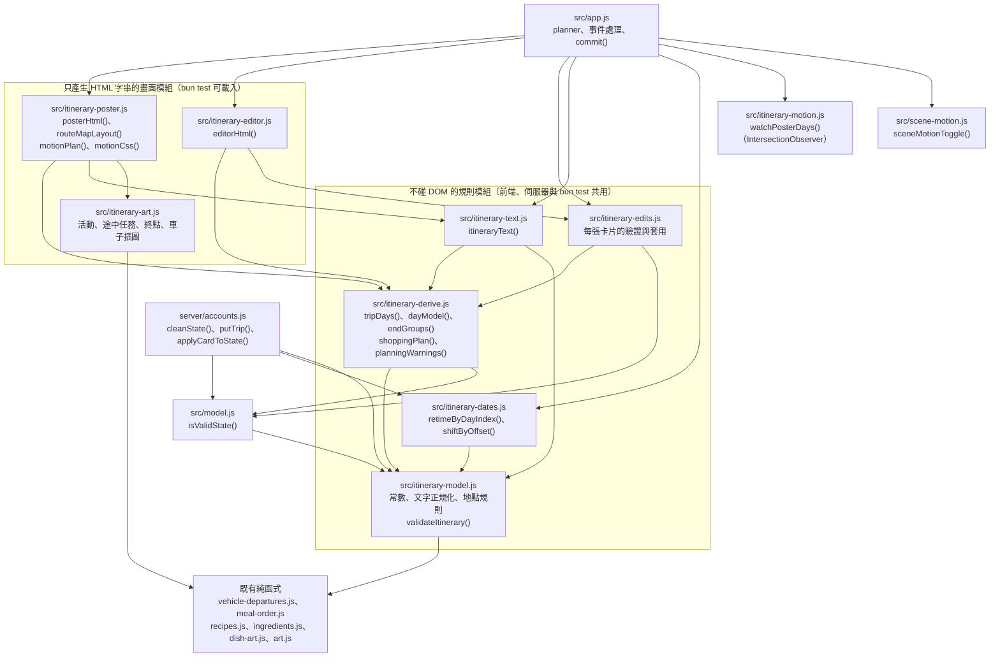
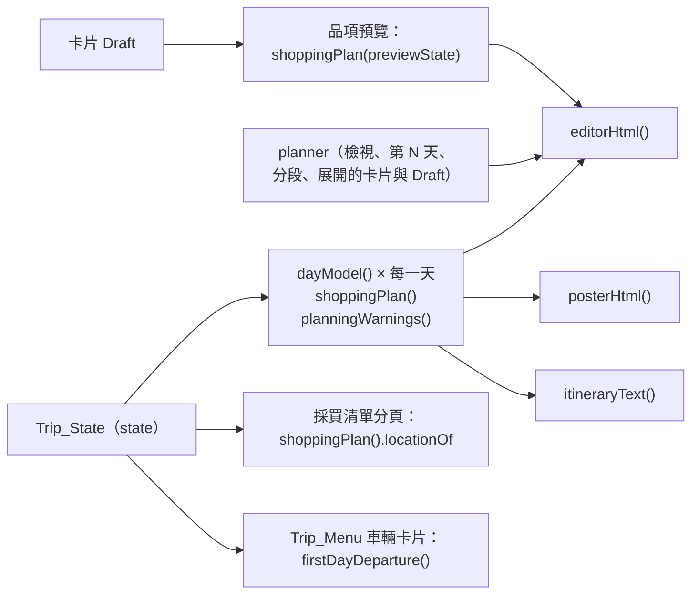
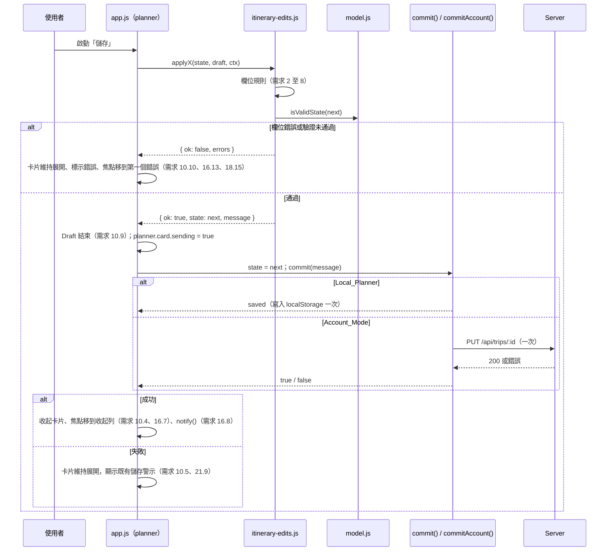

# Design Document：行程表改版（行程圖與規劃行程）

## Overview

本設計把行程表分頁（`src/app.js` 的 `schedule()`）改成兩種檢視：Itinerary_Poster「行程圖」與 Itinerary_Editor「規劃行程」，並在 Trip_State 新增四項選填資料：地點清單 `places`、路線 `routes`（含途中任務 `stops`）、每日設定 `daySettings`，以及餐點的時間 `meals[].time`。活動類型由六種擴充為十三種。

行程圖、文字版、規劃提醒、採買停靠點要買的品項，以及採買清單分頁的採買位置，都由同一組不碰 DOM 的純函式從 Trip_State 推導。前端、伺服器與測試共用這些函式，因此同一份資料在每個畫面、文字版與伺服器驗證中得到相同的結果。

設計分成七個部分：

1. **規則與推導（純函式）**：地點規則與資料驗證、每日模型（Arrival_Routes、Other_Routes、Day_Sequence、Meeting_Count、Day_Caption）、採買推導（Buyer_Car、First_Shopping_Stop、Stop_Items、Unassigned_Shopping、Shopping_Summary）、規劃提醒、Chinese_Numeral 與 Duration_Text、Itinerary_Text、旅行日期變更，以及每張卡片的驗證與套用。
2. **行程圖**：HTML 文字加上內嵌 SVG 插圖。路線圖以 CSS Grid 排版，760 CSS 像素以下由上往下、以上由左往右；同一個 Route_Block 中終點相同的路線匯入同一條道路，終點不同的路線各自有道路，不共用任何一段；車子動畫只用 CSS，依 `data-scene-motion` 與畫面是否可見暫停。下方是可複製的 Text_Panel。
3. **規劃行程**：Places_And_Cars、選日按鈕、摘要列、規劃提醒、「這一天的設定」、「路線」「活動」分段，以及可展開的卡片。Draft 保存在模組層的 `planner` 物件，`render()` 重建畫面時不會遺失。
4. **既有畫面的調整**：Trip_Menu 的車輛卡片、Vehicle_Dialog、Trip_Settings_Dialog、採買清單分頁與料理菜單分頁。
5. **伺服器**：`cleanState()` 保留新欄位、`PUT` 缺少的欄位以伺服器的值補回、`guardCollaborator()` 不再禁止移除活動、`applyCardToState()` 一併平移路線與每日設定，以及需求 2.10 的兩種錯誤。
6. **樣式、無障礙與安全**：新增 `src/itinerary.css`，沿用既有控制項樣式；所有使用者文字只經 `escape` 寫入文字內容或允許的屬性。
7. **測試與文件**：fast-check 屬性測試、範例測試、帳號 API 測試、Playwright 測試、修改的既有測試，以及 README。

### 現況盤點（已讀取的程式碼）

| 檔案 | 與本功能相關的現況 |
| --- | --- |
| `src/app.js` | `render()` 每次以 `app.innerHTML` 重建整個畫面，再依目前焦點元素的 `data-focus`（沒有時用 `deferredFocus`）還原焦點。`schedule()` 畫 Schedule_Bar、`vehicleDepartureSection()`、`vehicleScheduleFilter()` 與 `.timeline`。活動以 `editForm('activity')` 對話框新增與編輯。`commit()` 在本機版同步寫入 localStorage 一次；帳號版呼叫 `commitAccount()`，以 `PUT /api/trips/:id` 送出整份 Trip_State，失敗時 `saved=false`，由 `applyAccountChrome()` 顯示儲存警示（「匯出未存內容」「重試儲存」「重新載入伺服器版本」）。`allowAccountAction()` 以 `canDelete` 擋下 `delete` 與 `confirm-delete`，`!saved` 時擋下所有寫入動作。`render()` 只在 760 CSS 像素以下把選取的日期按鈕捲進可視範圍。 |
| `src/model.js` | `isValidState()` 以固定的 `specs` 檢查七個集合，活動類型只接受六種；`dateRange()` 以 UTC 計算，最多 31 天；`dateLabel()`、`weekday()` 使用 `toLocaleDateString`，結果依裝置語系；`assignShopping()` 是純函式。 |
| `src/vehicle-departures.js` | `parseVehicleMeeting()` 已是需求 19.7 的拆解規則；`formatVehicleMeeting()` 只服務 Vehicle_Dialog 的出發欄位；`vehicleDepartures()` 只在開始日回傳。 |
| `src/vehicle-itinerary.js` | `validActivityVehicles()`；`activityParticipantLabel()` 回傳全體旅伴、車名或旅伴名。 |
| `src/meal-order.js` | `MEAL_SLOTS`；`mealSlotRank()` 先 NFKC 正規化與去除前後空白，並把「早」「午」「晚」「宵夜」對應到早餐、午餐、晚餐、消夜，其他餐次排在最後。 |
| `src/recipes.js` | `inferDishKind()`：`imageKind` 有效時優先，否則依料理名稱、再依食材判斷，最後為 `custom`。 |
| `src/dish-art.js` | `dishIllustration(kind, className, random)`：通用餐盤以 `random()` 從七種圖案選一種；SVG 線條與填色寫死為淺色色票，並有紙色底。 |
| `src/ingredients.js` | `syncMealIngredients()` 新增的品項 `assignee` 為空字串（待分配）；`parseIngredients()` 會 NFKC 正規化並去重。 |
| `src/art.js` | 色票 paper `#fffcf6`、ink `#3e3a39`、coral `#efa28f`、yellow `#f6d27a`、sky `#b7dbe5`、green `#b9cda5`；`STROKE` 為 3px 圓頭圓角墨線；所有 SVG 都帶 `aria-hidden="true" focusable="false"`。 |
| `src/scene-motion.js`、`src/scene-motion.css` | `<html data-scene-motion>` 為 static、reduced、paused、running；插畫動畫只寫在 `@media (prefers-reduced-motion:no-preference)` 內，paused 以 `animation-play-state:paused` 停住；`syncSceneMotion()` 更新所有 `[data-scene-motion-toggle]` 的 `aria-label` 與 `[data-motion-reduced-note]` 的顯示；列印時停用動畫。 |
| `src/styles.css` | 全域 `@media (prefers-reduced-motion:reduce)` 把所有動畫與轉場設為 none；`.date-tabs` 未選取按鈕 `opacity:.75`，文字固定 `#3e3a39`，深色主題時與底色的對比不到 4.5:1；`.topbar` 黏在頂端，手機版 `.section-tabs` 也黏在頂端；`.visually-hidden` 定義在 `accounts.css`。 |
| `src/mobile-swipe.js` | `[data-swipe-row]` 列在 760 CSS 像素以下把原按鈕設為 `visibility:hidden`，改由 `.swipe-actions` 中的複本操作，`.swipe-toggle` 可展開這些複本。 |
| `scripts/build.mjs` | 只把 `styles.css`、`accounts.css`、`scene-motion.css`、`expenses.css` 依序串成 `dist/styles.css`。 |
| `server/http.js` | CSP 為 `default-src 'self'; script-src 'self'; style-src 'self' 'unsafe-inline'; img-src 'self' data: blob:; connect-src 'self'; …`。 |
| `server/accounts.js` | `cleanState()` 只保留已知欄位。`putTrip()` 依序做 `cleanState`、`isValidState`、綁定帳號旅伴的檢查（409）、`validateTripText`（會去除旅行欄位前後空白）、`guardCollaborator()`（只對受邀旅伴）、事件、`runSync`、`guardShoppingRemoval()`、`persist()`（寫入前再驗證一次）。`guardCollaborator()` 以 id 禁止移除 people、activities、meals、gear、vehicles，並禁止把手動品項改標為料理食材。`applyCardToState()` 以「新開始日 − 舊開始日」平移活動與餐點，放不下時回應 400。`tripAccess()` 只讓 `canEdit` 為 true 的帳號開啟旅行。 |
| `tests/` | `bun test` 搭配 `fast-check@4.10.2`；帳號 API 測試以 `createAccountService()` 與 `tests/support/pg.js` 的 Ephemeral_Database 執行；Playwright 由 `scripts/check-accounts.mjs` 啟動，desktop（1440×1000）與 mobile（390×844，只跑標記 `@critical` 的測試）兩個 project。 |

### 重要設計決策摘要

| 決策 | 選擇 | 理由 |
| --- | --- | --- |
| 推導集中在純函式 | `itinerary-model`（常數、地點規則、驗證）、`itinerary-derive`（每日模型、採買、提醒）、`itinerary-text`、`itinerary-dates`、`itinerary-edits` 都不碰 DOM | 行程圖、文字版、規劃行程、採買清單分頁與伺服器得到相同結果（需求 6.11、14.18）；`bun test` 直接以 fast-check 測試。 |
| 地點的引用 | 路線的起點、終點與途中任務存 Place 的 `id`；旅行目的地以固定值 `@destination` 引用；每日設定的地點只存 Place 的 `id`，選擇旅行目的地時不存 | 改名與修改目的地時不必逐一改寫（需求 2.4、2.6）；同一個意思只有一種存法（D17、需求 18.7）。 |
| 採買品項與停靠點 | 不儲存對應，每次由 `shoppingPlan(state)` 推導 | 需求 6.11 明訂不保存；換負責人、駕駛或乘客後自動更新（需求 6.12）。 |
| Draft 的位置 | 模組層的 `planner` 物件保存展開的卡片、欄位值與錯誤；`render()` 從 `planner` 重建欄位 | `render()` 會重建整個 `#app`，Draft 不能只存在 DOM。 |
| 時間欄位 | 文字輸入框；去除前後空白並以 NFKC 轉換全形數字與冒號後，必須是 24 小時制 `HH:MM` | 原生 `type="time"` 依瀏覽器語系可能顯示「上午／下午」，不符合「以 24 小時制填寫」（需求 5.3）；只填一部分時同樣視為無效（需求 4.9、5.10、8.11）。 |
| 路線圖版面 | CSS Grid。路線清單 `<ul>` 與每條路線的 `<li>` 是 subgrid，所有項目以程式產生的列號與欄號放進同一個格線；每個項目的「航點」固定在項目頂端往下 22（直式）或 26（橫式）CSS 像素；同一個 Route_Block 的路線依終點分組（終點組），每組有自己的道路，組內的線條匯入這條道路，道路通到該終點唯一的插畫；終點不同的路線不共用任何一段道路；線條、道路與車子是 `aria-hidden` 的格線項目 | 文字長度不影響線條位置，也不必用腳本量版面；終點組依第一次出現的順序排列，與 `dayModel()` 的 `ends` 及返程行的終點清單相同（需求 14.12）；Route_Block 只有一個終點時（例如 Example_Trip 的每一天）只有一條道路，所有線條都匯入它；直式與橫式的文字與插圖共用同一份 DOM，只換 CSS 位置，只有線條與車子的接力元素各有一組（需求 11.5、11.6、17.2、17.3、17.4、17.8）。 |
| 車子動畫 | 純 CSS。每台車由幾個「接力」元素組成，每個元素只在自己的格線區段內以 `transform` 移動；關鍵影格由純函式產生，放在行程圖內的 `<style>`，內容只有程式產生的名稱與數字 | 區段高度由內容決定，在區段內以百分比移動就會剛好停在航點；不需要腳本產生動畫（需求 12.9）；沿用既有 CSP 的 `style-src 'unsafe-inline'`，不新增指令（需求 22.4）。 |
| 動畫開關 | 沿用 `data-scene-motion`；畫面外的日子由 IntersectionObserver 加上 `data-offscreen` 而暫停 | 與封面插畫同一個設定（需求 13.3、13.4）；畫面外不播放（需求 12.7）。 |
| 列印 | 顯示規劃行程時，另外輸出一份只在列印時顯示的行程圖 | 不論顯示哪一種檢視都只印行程圖（需求 13.6），列印前不必重新繪製畫面，也不影響 Draft。 |
| 受邀旅伴刪除 | 行程表使用新的動作名稱 `plan-delete`、`plan-confirm-delete`，不經 `canDelete` 檢查；伺服器 `guardCollaborator()` 的比對清單移除 activities | 行程表開放受邀旅伴刪除（U11、D21），其他分頁與車輛仍沿用 `delete`、`confirm-delete`。 |
| 伺服器補回欄位 | `PUT` 的 Trip_State 沒有 `places`、`routes` 或 `daySettings` 鍵時，補回伺服器上的值，再驗證與檢查 | 尚未更新的頁面不會清除行程資料（需求 18.11）。 |
| 圖示 | 介面圖示仍留在 `src/app.js` 的 `icons`；純函式的畫面模組以參數接收 `icon()` | 需求 17.7 指定 `src/app.js` 的圖示集；畫面模組仍可在 `bun test` 中載入。 |
| 屬性測試 | 沿用 `fast-check@4.10.2`，每個屬性 `numRuns` 至少 100 | 已在 devDependencies；不自行實作 PBT。 |

### 需求解讀

需求已定稿。下列幾點的字面可以有不同讀法，本設計的實作與測試依下列讀法進行：

1. **「預計幾點抵達」是可展開的卡片。** 需求 10.1 與 16.4 把它列為以按鈕展開的卡片，需求 4.8 的時間欄位與「儲存」按鈕在卡片展開時顯示。收起時，按鈕顯示標籤與目前的值，例如「預計幾點抵達夕淞度日營區：12:00」或「預計幾點抵達夕淞度日營區：未填」。
2. **從其他頁面回到 Trip_View（需求 1.2）**時，檢視改為行程圖；規劃行程中仍有 Draft 時（需求 10.11），Draft 與展開狀態保留在 `planner`，使用者切回規劃行程就看到原本的卡片。這段期間需求 10.3 的離開確認仍然有效。
3. **地點名稱的控制字元檢查**對去除前後空白後的名稱進行（需求 2.1(c)、18.4）。前端存入的名稱本來就已去除前後空白，兩種讀法結果相同；匯入的資料若只是前後多了換行，視為合法。
4. **「全形與半形寫法視為相同」（需求 2.1(d)）**只轉換 U+3000 與 Halfwidth and Fullwidth Forms 區塊（U+FF01 至 U+FFEE）的字元（逐字套用 NFKC），之後整串套用 NFC，再把 A 到 Z 轉成小寫。不對整串套用 NFKC，以免「①」與「1」被視為同名。
5. **行程圖的每條路線**在清單項目中另外附上只給輔助技術的「，到 {終點}」；Last_Day 的返程行以只給輔助技術的文字放在返程區塊最後。這兩項讓無障礙樹的順序與 Itinerary_Text 相同（需求 16.1）。
6. **料理插圖在深色主題**沿用 `dishIllustration()` 自帶的紙色底。需求 17.5 的「底色」指段落與小卡的底色；插圖的紙色色塊與深色小卡底色的對比超過 3:1。
7. **「終點相同的線匯合成一條道路」（需求 11.5(c)、11.6）**讀作：同一個 Route_Block 的路線依終點的引用值分成終點組，每組恰有一條道路與一個終點插畫，組內每條線匯入這條道路，道路通到該終點的插畫；終點不同的路線不共用任何一段道路，只有一條路線的組也有自己的道路與插畫。組的順序是各終點在區塊路線行（依需求 5.2 排序）中第一次出現的順序，與需求 14.12 返程行的終點清單相同；Legacy_Departure 沒有終點，不屬於任何組。線條可以在進入道路之前與其他線條交叉，但不經過其他組的道路。

### 範圍外

依需求文件「範圍外」一節：不做貼上匯入、圖片或影片匯出、導航與時間估算、出發模式顯示路線、天氣與日出日落，也不新增或重排主分頁。little-moments-expansion 的「C 行程時間軸視圖」由本功能取代。需求文件「日後擴充功能（保留）」的 F1 至 F9 也不實作，預留的擴充點見「擴充點（日後功能）」。


## Architecture

### 模組與相依



`src/itinerary-model.js` 不匯入 `src/model.js`：`isValidState()` 先算好旅行的日期清單，再呼叫 `validateItinerary(state, dates)`，因此兩個模組之間沒有循環匯入。畫面模組不讀取 `document`，介面圖示由 `src/app.js` 以參數傳入 `icon()`（需求 17.7），地圖連結由參數傳入既有的 `mapLink()`（需求 11.17、22.3）。只有 `src/itinerary-motion.js` 與 `src/app.js` 使用 DOM。

### 新增與修改的檔案

| 檔案 | 類型 | 內容 |
| --- | --- | --- |
| `src/itinerary-model.js` | 新增，純函式 | `DESTINATION_REF`、`CAR_PALETTE`、13 個 Activity_Category、Activity_Preset、任務類型、上限；`trimWhite()`、`charCount()`、`hasControlChars()`、`placeKey()`、`placeNameError()`、`cleanText()`（需求 14.16）、`normalizeTimeInput()`；`chineseNumeral()`、`durationText()`、`monthDay()`、`weekdayChar()`、`dateText()`；`mealTime()`、`mealLabel()`、`mealTitle()`；`validateItinerary()`、`destinationConflict()`。 |
| `src/itinerary-derive.js` | 新增，純函式 | `tripDays()`、`placeLabel()`、`dayLocation()`、`sortedRoutes()`、`legacyDepartures()`、`dayModel()`、`endGroups()`、`shoppingPlan()`、`shoppingSummary()`、`planningWarnings()`、`firstDayDeparture()`、`placeUsages()`、`placeRouteCounts()`、`vehicleRouteDays()`、`carColorIndex()`。 |
| `src/itinerary-text.js` | 新增，純函式 | `itineraryText()`，以及行程圖共用的 `routeLineText()`、`stopText()`、`momentLines()`。 |
| `src/itinerary-dates.js` | 新增，純函式 | `retimeByDayIndex()`（Trip_Settings_Dialog）、`shiftByOffset()`（伺服器）。 |
| `src/itinerary-edits.js` | 新增，純函式 | 每張卡片與每個寫入操作的驗證與套用，以及從 `src/app.js` 抽出的 `saveVehicle()`、`saveMeal()`，見「Components and Interfaces」。 |
| `src/itinerary-art.js` | 新增，純函式 | 13 種活動插圖、4 種途中任務插圖、3 種終點插畫、車子圖示、空白提示插畫；全部沿用 `src/art.js` 的墨線與色票，只以 `artFor()` 一個入口查表輸出（見「擴充點（日後功能）」）。 |
| `src/itinerary-poster.js` | 新增，純函式 | `posterHtml()`、`routeMapLayout()`、`motionPlan()`、`motionCss()`。 |
| `src/itinerary-editor.js` | 新增，純函式 | `editorHtml()` 與各卡片的 HTML。 |
| `src/itinerary-motion.js` | 新增，DOM | `watchPosterDays(root)`：以 IntersectionObserver 為畫面外的日子加上 `data-offscreen`。 |
| `src/itinerary.css` | 新增 | 行程圖、規劃行程、Text_Panel、動畫與列印樣式。 |
| `src/app.js` | 修改 | 以 `scheduleTab()` 取代 `schedule()`；`planner` 狀態與事件；Draft 的離開確認；Vehicle_Dialog 移除出發欄位；刪除車輛前檢查路線；Trip_Settings_Dialog 改用 `retimeByDayIndex()` 並檢查同名地點；料理改餐次時清除自訂時間；採買清單顯示採買位置；Trip_Menu 車輛卡片的出發行；`allowAccountAction()` 與 `applyAccountChrome()` 的權限調整；新圖示。 |
| `src/model.js` | 修改 | `isValidState()` 改用 13 個活動類型、檢查 `meals[].time`，最後呼叫 `validateItinerary()`。 |
| `src/scene-motion.js` | 修改 | 匯出 `sceneMotionToggle()`，`sceneMotionSettings()` 改用它，行程圖與 Trip_Menu 的 Motion_Toggle 使用同一段標記。 |
| `src/styles.css` | 修改 | 未選取的 `.date-tabs` 按鈕改以文字顏色而非透明度表示，修正深色主題對比（需求 16.10）。 |
| `scripts/build.mjs` | 修改 | CSS 串接清單改為 `styles.css`、`accounts.css`、`scene-motion.css`、`itinerary.css`、`expenses.css`。 |
| `server/accounts.js` | 修改 | `cleanState()`、`putTrip()` 補回欄位、`guardCollaborator()`、`applyCardToState()`。 |
| `README.md` | 修改 | 需求 24。 |

### 資料流

畫面一律由已儲存的 Trip_State 推導，Draft 只影響正在展開的卡片：



每次 `render()` 以 `app.innerHTML` 重建畫面時，`scheduleTab()` 依 `planner` 與 `state` 重新產生行程表分頁。`planner` 是 `src/app.js` 模組層的物件，不寫入 Trip_State、localStorage 或伺服器，因此 Draft 與展開狀態不受重建影響（需求 10.11），重新載入頁面時回到初始值（需求 1.2、3.1、15.7）。

### 儲存一張卡片



`commit()` 目前不回傳結果。本設計讓 `commitAccount()` 回傳 `Promise<boolean>`（成功為 `true`），`commit()` 在本機版回傳 `saved`、在帳號版回傳 `commitAccount()` 的 Promise；既有的呼叫端忽略回傳值，行為不變。`commitAccount()` 在 `finally` 中先呼叫 `render()`，接著 Promise 才完成；規劃行程在同一個工作中收起卡片並再呼叫一次 `render()`，兩次重建之間沒有畫面更新，不會閃一下。

### 行程表分頁的組成

`scheduleTab()` 依序輸出：

1. Editor_User 才有的 View_Switch（需求 1.1）。
2. 顯示行程圖時：`posterHtml(state, { print: false })`、Text_Panel（包含在 `posterHtml()` 中，需求 15.1）與結尾小語「好日子，不用急。」（需求 11.18）。
3. 顯示規劃行程時：`editorHtml(state, planner, ctx)`，後面接一個只在列印時顯示的 `<div class="itinerary-print-copy">`，內容是 `posterHtml(state, { print: true })`（不含 Text_Panel 與 Motion_Toggle）與結尾小語。列印樣式只在 `body[data-print-scope="itinerary"]` 時生效；`render()` 在 Trip_View 顯示行程表分頁時設定這個屬性，其他分頁與頁面移除它，因此其他分頁的列印不受影響（需求 13.6）。

Viewer 只得到第 2 項（需求 1.5、21.1）。`planner.view` 只有 `poster` 與 `editor` 兩個值；Viewer 的 `planner.view` 不會被設成 `editor`，即使被設定，`scheduleTab()` 也依權限只輸出行程圖。

## Components and Interfaces

本節先說明不碰 DOM 的規則模組，再說明行程圖、規劃行程、既有畫面的調整、伺服器、樣式與安全。所有純函式都不修改傳入的 Trip_State；需要產生新狀態時先 `structuredClone()`。

### 1. `src/itinerary-model.js`（規則與驗證）

```js
export const DESTINATION_REF = '@destination';   // 代表 Destination_Place 的引用值
export const CAR_PALETTE = Object.freeze(['#efa28f', '#b7dbe5', '#b9cda5', '#f6d27a', '#d6c8df', '#f2cbb0', '#9fc9c0', '#e3a6bd']); // car-0 至 car-7（「插圖與顏色」）
export const CAR_COLOR_COUNT = CAR_PALETTE.length;
export const LIMITS = Object.freeze({
  places: 100, placeName: 50, stops: 6, stopNote: 100, dayTitle: 20,
  activityTitle: 100, activityLocation: 150, activityNote: 1000, activities: 1000
});

// 依前言「活動類別」表的順序（需求 7.9）；type 是 state.activities[].type 的值（需求 18.2）
export const ACTIVITY_CATEGORIES = Object.freeze([
  { type: 'meet', label: '集合' },   { type: 'market', label: '採買' }, { type: 'camp', label: '營地時光' },
  { type: 'meal', label: '用餐' },   { type: 'night', label: '夜晚' },  { type: 'travel', label: '移動' },
  { type: 'wake', label: '起床' },   { type: 'pitch', label: '搭帳' },  { type: 'free', label: '自由活動' },
  { type: 'tea', label: '下午茶／遊戲' }, { type: 'strike', label: '拆帳' }, { type: 'clean', label: '清潔' },
  { type: 'return', label: '返程' }
]);
export const ACTIVITY_TYPES;                       // 上表的 13 個 type
export function categoryLabel(type);               // 不在上表時回傳 ''（只有無效狀態才會發生）

export const ACTIVITY_PRESETS = Object.freeze({    // 前言「常用活動」表
  first:  [['pitch','13:00','搭帳・營地佈置'], ['night','20:00','星空夜聊・自由活動']],
  middle: [['wake','08:00','起床'], ['free','10:00','自由活動、拍照'], ['tea','14:00','下午茶、聊天、玩遊戲'], ['night','20:00','自由活動']],
  last:   [['wake','08:00','起床'], ['strike','10:00','拆帳、整理裝備'], ['clean','11:30','環境清潔、裝車'], ['return','12:00','集合、返程']]
});
export function presetsFor(dayKind);               // 'first'|'middle'|'last'|'single'；single 依序合併 first 與 last，
                                                   // 類別相同時保留表中較前面的一筆，最後依預設時間排序（需求 7.2）

export const STOP_KINDS = Object.freeze([
  { kind: 'shop', label: '採買' }, { kind: 'pickup', label: '接送' },
  { kind: 'gear', label: '取還裝備' }, { kind: 'other', label: '其他' }
]);
export const MEAL_DEFAULT_TIMES = Object.freeze(['08:30', '12:00', '15:00', '18:00', '21:00']); // 依 MEAL_SLOTS 的順序
```

**文字規則**

| 函式 | 規則 | 需求 |
| --- | --- | --- |
| `trimWhite(text)` | 去除前後的 `\p{White_Space}`（含全形空白、CR、LF、Tab、U+0085）。 | 詞彙表 Char_Count、2.1(a)、14.16 |
| `charCount(text)` | `[...text].length`（碼位數）。 | 詞彙表 Char_Count |
| `hasControlChars(text)` | 先把兩個 `\p{Extended_Pictographic}` 之間的 U+200D 移除，再測試 `/[\p{Cc}\p{Cf}]/u`；與 `addParticipant()` 使用相同的正規表示式。 | 2.1(c)、18.4 |
| `placeKey(name)` | `trimWhite()`；把 U+3000 與 U+FF01 至 U+FFEE 的字元逐字套用 NFKC；整串套用 NFC；A 到 Z 轉成小寫。兩個名稱的 `placeKey()` 相等即為同名。 | 2.1(d)、需求解讀 4 |
| `placeNameError(name, { places, destination, exceptId, pending })` | 依序檢查並回傳第一個不符合的原因：`'empty'`（`trimWhite()` 後為空）、`'long'`（超過 50 個字）、`'control'`、`'duplicate'`（與 `exceptId` 以外的 Place、非空白的旅行目的地，或 `pending` 中的名稱同名）；都符合時回傳 `null`。 | 2.1、2.2 |
| `cleanText(text, { multiline })` | 去除前後空白；`multiline` 為 false 時，把每一段含 CR、LF、U+000B、U+000C、U+0085、U+2028 或 U+2029 的連續 `\p{White_Space}` 換成一個半形空白。不做 HTML 跳脫、不截斷。 | 14.16 |
| `normalizeTimeInput(raw)` | `trimWhite()` 後為空時回傳 `{ value: '' }`；否則與 `placeKey()` 一樣只把 U+3000 與 U+FF01 至 U+FFEE 的字元逐字套用 NFKC（全形數字與「：」轉成半形，「①」等其他相容字元不轉換），符合 `/^(?:[01]\d\|2[0-3]):[0-5]\d$/` 時回傳 `{ value }`，其他（`8:00`、`0830`、`08:`、`24:00`）回傳 `{ error: 'invalid' }`。 | 4.8、4.9、5.10、7.10、8.11 |
| `chineseNumeral(n)` | 1 到 99 為中文數字，整個數值為 2 時寫作「兩」，其他位置寫作「二」（12 為「十二」、22 為「二十二」）；100 以上為不加千分位的阿拉伯數字。 | 詞彙表、D27 |
| `durationText(days)` | 1 天為「一日遊」，其他為 `${chineseNumeral(days)}天${chineseNumeral(days - 1)}夜`。 | 詞彙表 |
| `monthDay(date)`、`weekdayChar(date)`、`dateText(date)` | 由 `YYYY-MM-DD` 的數字以 `Date.UTC()` 計算星期，不使用 `toLocaleDateString()`；`dateText()` 為「10/20（週二）」。 | 4.1、11.2、14.5 |

錯誤原因對應的訊息：`empty`「請填寫地點名稱。」、`long`「地點名稱最多 50 個字。」、`control`「地點名稱不能包含換行、Tab 或隱藏的控制字元。」、`duplicate`「已有同名地點」。

**餐點**

- `mealTime(meal)`：`meal.time` 是有效的 HH:MM 時回傳它；否則依 `mealSlotRank(meal.slot)` 取 `MEAL_DEFAULT_TIMES`，排名為 5（其他舊餐次）時為 `12:00`（需求 8.2）。
- `mealLabel(meal)`：`inferDishKind(meal)` 為 `hotpot` 時為「火鍋」，`bbq` 時為「烤肉」，其他為 `cleanText(meal.slot)`（需求 8.6）。
- `mealTitle(meal)`：`cleanText(meal.title)` 為空字串或等於 `cleanText(meal.slot)` 時為餐次，否則為「{餐次}：{料理名稱}」（需求 8.5、14.13）。行程圖、規劃行程與文字版都用這個函式，因此三者一致。

**`validateItinerary(state, dates)`**

由 `isValidState()` 在既有檢查之後呼叫。`dates` 是 `dateRange(startDate, endDate)`。下列任一條件成立就回傳 `false`：

| 欄位 | 無效條件 | 需求 |
| --- | --- | --- |
| `places` | 存在但不是陣列；超過 100 個；項目不是物件；`id` 不是 1 到 5,000 字的字串、重複或等於 `@destination`；`name` 不是字串；`trimWhite(name)` 不是 1 到 50 個字；`hasControlChars(trimWhite(name))`；兩個 Place 的 `placeKey()` 相同；Place 與非空白的旅行目的地 `placeKey()` 相同。 | 18.3、18.4 |
| `routes` | 存在但不是陣列；`id` 不符合規則或重複；`date` 不在 `dates`；`vehicleId` 不是既有車輛；`date` 與 `vehicleId` 都與另一條相同；`from`／`to` 不是 Place 的 `id` 也不是 `@destination`；旅行目的地空白時使用 `@destination`；`time` 不是省略、`''` 或 HH:MM；`stops` 存在但不是陣列或超過 6 個。 | 18.5 |
| `routes[].stops` | `id` 不符合規則，或與任何一條路線中的另一個 Stop 相同；`place` 不符合 `from` 的規則；`kind` 不在 `STOP_KINDS`；`note` 存在但不是字串或超過 100 個字。 | 18.6 |
| `daySettings` | 存在但不是陣列；`date` 不在 `dates` 或重複；`title` 存在但不是字串或超過 20 個字；`place` 不是省略、`''` 或 Place 的 `id`（`@destination` 也無效）；`arrival` 不是省略、`''` 或 HH:MM。 | 18.7 |
| `meals[].time` | 鍵存在但不是 HH:MM（空字串也無效）。 | 18.8 |

`isValidState()` 的活動類型檢查改為 `ACTIVITY_TYPES.includes(a.type)`（需求 18.2）。所有新欄位都是選填，本功能之前有效的 Trip_State 沒有這些欄位，因此不經修改即通過（需求 18.12）。

**`destinationConflict(state, destination)`**：回傳 `{ type: 'duplicate', name }`（某個 Place 與新目的地同名）、`{ type: 'in-use' }`（新目的地空白，且仍有路線的起點、終點或 Stop 使用 `@destination`）或 `null`。Trip_Settings_Dialog（需求 2.9）與伺服器（需求 2.10）都用它。

### 2. `src/itinerary-derive.js`（每日模型、採買與提醒）

```js
export function tripDays(state);            // [{ date, n, kind }]，kind 為 'first'|'middle'|'last'|'single'
export function placeLabel(state, ref);     // Place 的名稱，或 ref 為 '@destination' 時的旅行目的地
export function dayLocation(state, date);   // { ref, name } | null（詞彙表 Day_Location、D17）
export function sortedRoutes(state, date);  // 依需求 5.2：出發時間、再依車輛順序，沒有時間的排最後
export function legacyDepartures(state);    // [{ vehicle, vehicleIndex, time, location }]（需求 19.3、19.4、19.7）
export function shoppingPlan(state);        // 見下文
export function shoppingSummary(items);     // 需求 6.9
export function dayModel(state, date, plan = shoppingPlan(state));
export function endGroups(lines);           // 終點組：[{ ref, lines: [i] }]，見下文（需求 11.5(c)、11.6、12.10）
export function planningWarnings(state, plan = shoppingPlan(state)); // Map<date, string[]>
export function firstDayDeparture(state, vehicleId); // Trip_Menu 車輛卡片（需求 3.8）
export function placeUsages(state, placeId);          // 需求 2.7
export function placeRouteCounts(state);              // Map<ref, 路線數>（需求 3.2）
export function vehicleRouteDays(state, vehicleId);   // [N]（需求 3.5、3.9）
export function carColorIndex(state, vehicleId);      // state.vehicles 中的位置 % 8（需求 11.12、22.6）
```

`legacyDepartures()` 只列出 `meeting` 去除前後空白後不為空、且在 First_Day 沒有路線的車輛，以 `parseVehicleMeeting()` 拆出時間與地點（需求 19.7），依舊出發時間由早到晚排序，時間相同時依車輛順序，沒有時間的排在最後並依車輛順序（需求 19.4）。

**`dayModel()` 的回傳值**

```js
{
  date, n, kind,
  title,                 // cleanText(Day_Title)，未設定時為 ''
  heading,               // title 或「第 {n} 天」
  location,              // dayLocation()
  arrival,               // Arrival_Time 或 ''
  arrivalRoutes, otherRoutes, legacy, meetingCount,
  blocks,                // Day_Sequence
  caption,               // Day_Caption
  showLocationLine       // 需求 11.2 的「地點：」行
}
// blocks 的元素
{ type: 'routes', kind: 'arrival' | 'other', sortTime, lines, arrivalLine, returnLine, ends }
{ type: 'moments', items }
// ends 的元素：每個終點組一項，順序與 endGroups(lines) 相同
{ ref, name, endKind, count, lines }   // endKind：'camp' | 'house' | 'landmark'（需求 11.6）；count：以它為終點的路線數；
                                       // lines：這些路線在 lines 中的索引，由小到大（count 等於 lines.length）
// lines 的元素
{ type: 'route', route, vehicle, vehicleIndex, time, from, to, stops }   // stops：{ stop, place, kind, label, note, items, summary }
{ type: 'legacy', vehicle, vehicleIndex, time, location }
// items 的元素
{ type: 'activity', activity, time, title, category, extras, done }       // extras：{ location, participants, note }，不適用時為 ''
{ type: 'meal', meal, time, title, label, ingredients, dishKind }
```

規則對照：

| 項目 | 規則 | 需求 |
| --- | --- | --- |
| Arrival_Routes／Other_Routes | 有 Day_Location 時，`to === location.ref` 且 `from !== location.ref` 的路線是 Arrival_Routes，其他是 Other_Routes；沒有 Day_Location 時全部是 Other_Routes。引用值相等即為同一地點（Place 不能與目的地同名）。 | 詞彙表 |
| 區塊內容 | Arrival 區塊包含 Arrival_Routes，First_Day 另外包含 `legacyDepartures()`；Other 區塊包含 Other_Routes；兩者都依需求 5.2 排序；空的區塊省略。 | 14.8(a)、14.15 |
| 排序時間 | 區塊中最早的出發時間（含舊出發時間），都沒有時為 `null`。 | 14.8(b) |
| Day_Sequence | 先依需求 14.13 排好當天的 Activity 與 Meal_Moment。有排序時間的區塊插在「時間小於等於排序時間的最後一個項目」之後；沒有排序時間的 Arrival 區塊插在最前面，Other 區塊插在最後面；插在同一位置的兩個區塊依排序時間排列，相同或其中一個為 `null` 時 Arrival 在前。區塊之間連續的項目組成一個 moments 區塊。 | 14.8(c)–(e) |
| 項目排序 | 時間由早到晚；時間相同時 Activity 在前；Activity 依 `state.activities` 的順序；Meal_Moment 依 `mealSlotRank()`，再依 `state.meals` 的順序。 | 8.2、14.13 |
| 到達行 | Arrival 區塊有路線時為「預計 {Arrival_Time} 抵達」或「預計抵達時間待定」；Meeting_Count（Arrival_Routes 數）大於等於 2 時接上「・{中文數字}車會合」。只有舊出發行時沒有到達行。 | 14.11 |
| 返程行 | 只在 Last_Day 的 Other 區塊：終點不是 Day_Location（沒有 Day_Location 時每個終點都算）的路線至少一條時為「平安返回{終點清單}・不預估返抵時間」，終點依路線順序去除重複後以「、」連接。 | 14.12 |
| 終點組（`ends`） | 由 `endGroups(lines)` 取得：區塊中終點引用值相同的路線為一組，依各終點在 `lines` 中第一次出現的順序排列；`endKind` 為 `camp`（終點是 Day_Location）、`house`（Last_Day 中不是 Day_Location 的終點）或 `landmark`（其他）；`count` 是組內的路線數。返程行的終點清單因此等於 `ends` 中 `house` 項目的名稱，順序相同。 | 11.5(c)、11.6、12.10、14.12 |
| Day_Caption | 當天有路線，或是 First_Day 且有舊出發資料時，以「・」連接「{中文數字}車出發」（路線數加上舊出發的車輛數）、「採買」（當天有 Shopping_Stop）、「會合」（Meeting_Count 大於等於 2）、「返程」（有返程行）；否則為「今天，留在{Day_Location}」或「今天，自由安排」。 | 11.3 |
| 「地點：」行 | 有 Day_Location、Day_Caption 不是「今天，留在{Day_Location}」，且沒有任何區塊的路線以 Day_Location 為終點（因此沒有營地插畫）時為 `true`。 | 11.2 |
| Activity 補充資訊 | `location`：地點不為空且 `placeKey()` 不同於 Day_Location 的名稱；`participants`：沒有指定車輛且旅伴名單為空或包含每位旅伴時為 ''，其他時沿用 `activityParticipantLabel()`；`note`：備註不為空。三者都經 `cleanText()`。 | 11.10、14.14、19.2 |

**`endGroups(lines)`**

輸入是一個路線區塊的 `lines`（已依需求 5.2 排序），輸出每個終點組 `{ ref, lines }`：`ref` 是 Route 的 `to`，`lines` 是組內路線在 `lines` 中的索引，由小到大。函式由前往後走一次 `lines`：遇到還沒有組的 `to` 就在最後新增一組，再把索引加入該組；`type: 'legacy'` 的行沒有終點，不屬於任何組。因此每條路線恰好屬於一組，每組至少一條路線，組的順序是各終點第一次出現的順序，組的第一個索引由小到大；結果只由 `lines` 決定，不讀取其他資料，也不修改輸入。`dayModel()` 以它組成 `ends`，行程圖的道路、終點插畫與停車位（「路線圖的格線」）也只依 `ends`，不另外分組。

**`shoppingPlan(state)`**

```js
{
  buyerCar,      // Map<personId, vehicleId>：依 state.vehicles 的順序，第一台駕駛或乘客包含該旅伴的車（D29）
  firstStop,     // Map<vehicleId, { route, stop, n }>：該車 Trip_Day 最早、Stop 順序最前的 Shopping_Stop（D28）
  stopItems,     // Map<stopId, item[]>：只有 First_Shopping_Stop 有值，依採買清單順序，含已買的品項
  unassigned,    // [{ item, code, reason }]，依採買清單順序
  locationOf     // Map<itemId, { n, placeName, vehicleName }>：採買清單分頁的「第 {N} 天在{地點}（{車名}）」
}
```

每個品項依需求 6.11 的順序判斷：`assignee` 為空字串時 `code` 為 `unassigned`、`reason` 為「待分配」；沒有 Buyer_Car 時為 `no-car`、「{旅伴}不在任何車上」；Buyer_Car 沒有 First_Shopping_Stop 時為 `no-stop`、「{車名}還沒有採買停靠點」；其他情況放進 Buyer_Car 的 First_Shopping_Stop。函式只讀取 `state`，不新增、移除或修改品項（需求 6.12）。

`shoppingSummary(items)` 依順序取 `cleanText(item.name)`，去除空字串與重複的名稱，以「、」連接（需求 6.9）。

**`planningWarnings(state, plan)`**

對每個 Trip_Day 依序產生下列提醒；同一條文產生的多則提醒依車輛順序，同一條路線的多個 Shopping_Stop 依 Stop 順序（需求 9.6）：

1. 當天至少一條路線時，每台當天沒有路線的車：「{車名}這一天還沒有路線」（需求 9.1）。
2. 有 Arrival_Time 時，Arrival_Routes 中出發時間晚於它的路線：「{車名} {HH:MM} 出發，晚於預計抵達 {HH:MM}」（需求 9.2）。
3. 有 Arrival_Routes 但沒有 Arrival_Time：「還沒填預計抵達時間」（需求 9.3）。
4. 沒有出發時間的路線：「{車名}的出發時間待定」（需求 9.4）。
5. 每個 Shopping_Stop：是所屬車輛的 First_Shopping_Stop 但沒有品項時為「{車名}在{地點}的採買沒有品項」；不是時為「{車名}在{地點}只標示採買，品項列在第 {N} 天的{第一個地點}」（需求 9.5）。

提醒只依已儲存的 Trip_State 產生，不寫入 Trip_State（需求 9.7、9.9）。

**其他**

- `firstDayDeparture(state, vehicleId)` 回傳 `{ kind: 'route', time, place }`、`{ kind: 'legacy', time, place }` 或 `{ kind: 'none' }`，`src/app.js` 依需求 3.8 的格式組成文字，地點以 `mapLink()` 呈現。
- `placeUsages(state, placeId)` 依 Trip_Day 的順序回傳 `[{ n, label }]`：同一天先列「這一天的地點」，再依車輛順序列出起點、終點或 Stop 使用該地點的車名，同一天同一台車只列一次（需求 2.7）。
- `placeRouteCounts(state)` 計算每個地點被多少條已儲存的路線使用（起點、終點或任一 Stop，同一條只計一次，需求 3.2）。

### 3. `src/itinerary-text.js`（文字版）

```js
export function itineraryText(state);        // 需求 14 的完整文字；行與行以 LF 分隔，最後沒有換行字元
export function routeLineText(line);         // 路線行或舊出發行（需求 14.9、14.15）
export function stopText(stopView);          // 需求 14.10
export function momentLines(item);           // 項目行與補充行（需求 14.13、14.14）
```

`itineraryText()` 把下列部分以 `'\n\n'` 連接，沒有內容的部分不放進陣列，因此不會產生多餘的空行（需求 14.1）：

1. 標題行：`cleanText(trip.title)` 不為空時為「{旅行名稱}｜{Duration_Text}」，否則只有 Duration_Text（需求 14.2）。
2. 旅行介紹：以 `/\r\n|[\r\n\u000B\u000C\u0085\u2028\u2029]/u` 分行，每行 `trimWhite()` 後捨棄空字串，每行一個部分（需求 14.3）。
3. 車輛行：有車時為「車輛：{車名、車名…}」（需求 14.4）。
4. 每個 `tripDays()` 的段落：第一行「第 {N} 天・{月}/{日}（週{星期}）｜{Day_Title}」（沒有標題時省略「｜…」）、有 Day_Location 時的「地點：{名稱}」，接著每個區塊前面加 `'\n\n'`（需求 14.5 至 14.7）：
   - 路線區塊：「路線」、每一行 `routeLineText()`，最後是到達行或返程行（需求 14.9、14.11、14.12）。
   - 活動區塊：「活動」，每個項目依序輸出 `momentLines()`；有補充行且不是區塊最後一個項目時，在補充行之後加一個空字串，連接後成為一個空行（需求 14.14）。

所有使用者文字都經 `cleanText()`（旅行介紹以外的文字使用 `multiline: false`），不做 HTML 跳脫（需求 14.16）。固定字元直接寫在原始碼的字串常數中（「｜」U+FF5C、「・」U+30FB、「：」U+FF1A、全形括號、「、」U+3001、前後各一個半形空白的「 → 」），並由測試逐一比對碼位（需求 14.19）。日期與星期只由 `monthDay()` 與 `weekdayChar()` 計算，結果與時區和語系無關（需求 14.5、14.18(b)）。

行程圖使用同一組 `routeLineText()`、`stopText()` 與 `momentLines()` 產生的片段（地點部分另外交給 `mapLink()`），因此行程圖與文字版的內容一致。

### 4. `src/itinerary-dates.js`（旅行日期變更）

```js
// Trip_Settings_Dialog：依第 N 天搬移（需求 20.1、20.2、20.6）
export function retimeByDayIndex(state, startDate, endDate);
// → { ok: true, state: next } | { ok: false, blocked: [{ n, date, routes: boolean, settings: boolean }] }

// 伺服器：依「新開始日 − 舊開始日」平移（需求 20.3、20.4）
export function shiftByOffset(state, startDate, endDate);
// → { ok: true, state: next } | { ok: false, categories: string[] }
```

| | `retimeByDayIndex()` | `shiftByOffset()` |
| --- | --- | --- |
| Activity 與 Meal | 維持第 N 天；N 大於新天數時改到新的 Last_Day（既有規則） | 平移；超出新範圍時加入「活動」或「餐點」類別 |
| Route | 第 N 天改到新開始日加 N − 1 天；N 大於新天數時列入 `blocked` | 平移；超出新範圍時加入「路線」 |
| Day_Settings | 同 Route；被移除的日子只有 Arrival_Time 時直接捨棄，有 Day_Title 或 Place 時列入 `blocked` | 平移；超出範圍且有 Day_Title 或 Place 時加入「每日設定」，只有 Arrival_Time 時捨棄 |
| 其他欄位 | 不變（識別碼、車輛、起點、出發時間、Stop、終點、Day_Title、Day_Location、Arrival_Time、`meeting`） | 同左 |
| 失敗時 | 回傳 `blocked`，不產生新狀態 | 回傳 `categories`，依「活動、餐點、路線、每日設定」排列 |

`retimeByDayIndex()` 也更新 `trip.startDate` 與 `trip.endDate`；`shiftByOffset()` 只改各項目的日期，旅行欄位由 `applyCardToState()` 設定。兩者都保持 Route 識別碼集合、每條 Route 的第 N 天與每個第 N 天的 Day_Settings 不變（需求 20.5），也不改動車輛與採買品項，因此 First_Shopping_Stop、Stop_Items 與採買清單分頁的日子都維持原本的第 N 天（需求 20.7）。

Trip_Settings_Dialog 被 `blocked` 拒絕時，對話框的錯誤訊息為「縮短天數前，請先處理：第 4 天（10/23）的路線、第 5 天（10/24）的路線與每日設定。刪除這些路線、清除這些每日設定後，才能縮短天數。」：依天數順序列出每一天的第 N 天與原本的日期，標明「路線」「每日設定」或「路線與每日設定」（需求 20.2）。伺服器的訊息為「新日期範圍放不下既有的{類別、類別}，請先調整行程或延長日期。」（需求 20.4）。

### 5. `src/itinerary-edits.js`（卡片的驗證與套用）

每個寫入操作都是一個純函式，`src/app.js` 與屬性測試使用同一組函式（需求 23.14）：

```js
// 成功：{ ok: true, state: next, message, focus }
// 失敗：{ ok: false, errors: [{ field, message }], formError, usages }
// ctx：{ uid }，測試可傳入可重現的識別碼產生器
export function savePlace(state, { id, name }, ctx);
export function deletePlace(state, placeId);
export function saveDaySettings(state, date, draft, ctx);   // draft：{ title, place, newPlaces }
export function saveArrival(state, date, { arrival });
export function saveRoute(state, draft, ctx);
export function deleteRoute(state, routeId);
export function saveActivity(state, draft, ctx);
export function addPresets(state, date, types, ctx);
export function deleteActivity(state, activityId);
export function setActivityDone(state, activityId, done);
export function saveMealTime(state, mealId, { time });
export function clearLegacy(state, vehicleId);
// Draft 的初始值與預覽
export function routeDraft(state, routeId);              // 既有 Route（需求 5.3）
export function newRouteDraft(state, date);              // 「＋新增路線」（需求 5.6）
export function legacyRouteDraft(state, vehicleId);      // 「轉成路線」（需求 19.11）
export function previewState(state, draft);              // 套用 Route Draft、不驗證，只供品項預覽（需求 6.6、D31）
```

Route Draft 的形狀：

```js
{
  routeId,             // 既有 Route 的 id；新 Route 為 null
  date, vehicleId,     // vehicleId 為 '' 表示未選擇
  from, to,            // Place 的 id、'@destination'、Draft 新地點的 'new:{k}'，或 ''（未選擇）
  time,                // 欄位的原始輸入
  stops: [{ stopId, key, place, kind, note }],   // stopId 為 null 表示 Draft 中新增；key 只在 Draft 中用來定位欄位
  newPlaces: [{ ref: 'new:1', name }],          // 以「＋新增地點」或「轉成路線」加入 Draft 的 Place
  legacyText           // 「轉成路線」無法選取起點時保留的舊出發地點原文，否則為 ''
}
```

各操作的規則：

| 操作 | 檢查（失敗時的 `field`） | 寫入 | 需求 |
| --- | --- | --- | --- |
| `savePlace` | `placeNameError()`（`name`）；新增時 Place 已有 100 個（`formError`「地點最多 100 個」） | 新增加到末端並以 `ctx.uid()` 產生 `id`；改名只改 `name`（去除前後空白），位置不變 | 2.1–2.3、2.8、3.4 |
| `deletePlace` | `placeUsages()` 不為空時回傳 `usages`，不寫入 | 移除該 Place | 2.7、10.7 |
| `saveDaySettings` | Day_Title 去除前後空白後超過 20 字（`title`）；Draft 新地點的名稱規則；新地點會讓 Place 超過 100 個（`formError`） | 寫入 `title`（有內容時）與 `place`（選取 Place 時）；選取 Destination_Place 或「不指定地點」時不寫 `place`；三項都未設定時移除該天的項目 | 4.5、4.9、4.10、4.13、D17 |
| `saveArrival` | `normalizeTimeInput()` 回傳 `error`（`arrival`） | 寫入 `arrival` 或移除；項目因此全部未設定時移除 | 4.8、4.9、4.13 |
| `saveRoute` | 「哪一台車」「從哪裡出發」「最後到哪裡」未選擇（`vehicle`／`from`／`to`）；起點與終點相同且沒有 Stop（`to`）；出發時間無效（`time`）；Stop 沒有地點（`stop-{key}-place`）；不是採買的 Stop 備註超過 100 字（`stop-{key}-note`）；該車當天已有另一條路線（`vehicle`）；新地點會讓 Place 超過 100 個（`formError`） | 保留 Route 與既有 Stop 的 `id`，新增的 Stop 以 `ctx.uid()` 產生；Stop 依 Draft 的順序；採買 Stop 不寫 `note`；只把仍被選取的 Draft 新地點依加入順序加到 Place_List 末端，並把 `new:{k}` 換成新的 `id`；路線在 First_Day 時把該車的 `meeting` 設為 `''` | 2.11、5.9–5.11、6.4、6.13、19.5 |
| `deleteRoute` | 無 | 移除 Route（連同 Stop），採買品項不變 | 10.7 |
| `saveActivity` | 標題去除前後空白後為空或超過 100 字（`title`）；時間空白或無效（`time`）；地點超過 150 字（`location`）；備註超過 1,000 字（`note`）；選擇「指定車輛」卻沒有勾選（`vehicles`）；新增會讓活動超過 1,000 筆（`formError`） | 寫入全部欄位，`done` 不變；「全體旅伴」寫 `people: []` 並移除 `vehicleIds`；「指定車輛」依車輛順序寫 `vehicleIds` 並寫 `people: []`；「保留原旅伴名單」不改 `people` | 7.5–7.7、7.10、7.12 |
| `addPresets` | 會讓活動超過 1,000 筆（`formError`） | 每個勾選的類別新增一筆：標題、時間與類別取自 Activity_Preset，`people: []`，地點與備註空白，`done: false` | 7.4 |
| `deleteActivity`、`setActivityDone`、`saveMealTime`、`clearLegacy` | `saveMealTime` 的時間無效（`time`） | 只改目標項目：刪除 Activity；改 `done`；寫入或移除 `meals[].time`；把 `meeting` 設為 `''` | 7.8、7.11、8.3、8.11、19.6 |

另外把 `src/app.js` 表單送出時對 Vehicle 與 Meal 的狀態修改抽成同一模組的 `saveVehicle(state, values, ctx)` 與 `saveMeal(state, values, ctx)`：前者包含既有的座位與乘客檢查、`meeting` 保持原值（需求 3.7）；後者包含既有欄位檢查、需求 8.4 的自訂時間規則與 `syncMealIngredients()`。表單的錯誤顯示仍留在 `src/app.js`。採買清單分頁改「誰負責買」沿用既有的 `assignShopping()`。如此 Property 9 的操作序列與畫面使用同一組函式（需求 23.14）。

每個成功的操作在回傳前都以 `isValidState(next)` 驗證，未通過時回傳 `formError`「資料驗證未通過，沒有儲存。請重新載入後再試。」，不回傳新狀態（需求 10.10、18.15）。操作只改動目標項目與上表列出的連帶變更，其他集合的每個項目以相同的 `id` 留在原位（需求 21.8），因此帳號版的 `PUT` 只包含伺服器允許受邀旅伴做的變更。

`message` 寫入 `notify()` 與「小隊最近的動態」，包含動作與對象（需求 16.8），例如「已儲存第三車・採買組第 1 天的路線」「已刪除地點「超市／賣場」」「已加入 4 個活動」「「搭帳・營地佈置」已完成」「已儲存「晚餐：烤肉派對」的時間」「已不使用山線小巴的舊出發資料」。

### 6. `src/itinerary-poster.js`（行程圖）

```js
export function posterHtml(state, { icon, mapLink, print = false, textOpen = false, canEdit = false });
export function routeMapLayout(block);      // 路線圖的格線位置、道路、匯流支線與停車位（「路線圖的格線」）
export function motionPlan(block, layout);   // layout：'h'（橫式）或 'v'（直式）
export function motionCss(models, plans);    // 產生行程圖內 <style> 的文字
```

**文件結構**（`print: false` 時；元素順序即無障礙樹與 Tab 順序，與 Itinerary_Text 相同，需求 11.4、16.1）

```html
<section class="itinerary-poster" aria-labelledby="poster-title">
  <h2 id="poster-title" class="visually-hidden">行程圖</h2>
  <header class="poster-print-cover">旅行名稱、頂端概要文字、旅行介紹段落</header>      <!-- 只在列印時顯示（需求 13.7） -->
  <div class="poster-summary">
    <p>三天兩夜・四台車・<time datetime="2026-10-20">10/20（週二）</time>至 <time datetime="2026-10-22">10/22（週四）</time></p>
    <!-- sceneMotionToggle()：Motion_Toggle 與減少動態的說明（需求 13.2、13.3） -->
  </div>
  <section class="poster-day day-tone-0" data-poster-day aria-labelledby="poster-day-1">
    <div class="poster-day-head">
      <span class="day-badge" aria-hidden="true">01</span>
      <h3 id="poster-day-1"><span class="visually-hidden">第 1 天・10/20（週二）・</span>向山裡出發</h3>
      <p class="day-meta"><time datetime="2026-10-20">10/20（週二）</time>・四車出發・採買・會合</p>
      <p class="day-location">地點：…</p>                       <!-- 需求 11.2，dayModel().showLocationLine -->
    </div>
    <div class="route-map">…</div>                               <!-- 每個路線區塊一個 -->
    <ul class="moment-list" aria-label="活動">…</ul>             <!-- 每個活動區塊一個 -->
  </section>
  …
  <p class="poster-closing">四台車，三天兩夜，一整頁的小小快樂。</p>   <!-- 需求 11.14 -->
  <p class="poster-disclaimer">路線僅為示意，非導航或即時位置；不預估返抵時間。</p>  <!-- 需求 11.15 -->
  <style>…</style>                                               <!-- motionCss()，只有程式產生的名稱與數字 -->
  <section class="itinerary-text-panel">…</section>              <!-- Text_Panel（需求 15） -->
</section>
```

- Day_Title 未設定時，標題為 `<h3>第 1 天<span class="visually-hidden">・10/20（週二）</span></h3>`，無障礙名稱仍依序包含第 N 天與日期（需求 16.2）。
- 天數徽章依 `(n - 1) % 3` 使用 `day-tone-0`（珊瑚）、`day-tone-1`（天空藍）、`day-tone-2`（草綠）（需求 11.2）。相鄰的 `.poster-day` 之間以 1.5 CSS 像素的虛線分隔（需求 11.1）。
- 沒有任何路線、舊出發資料、活動與餐點時，每日段落與結尾兩行改為 `<div class="poster-empty">`：空白提示插畫、「這趟旅行還沒有行程」，Editor_User 另有「開始規劃」按鈕（需求 1.8、1.9、11.19）。
- `print: true`（規劃行程畫面下方的列印副本）不輸出 Motion_Toggle、`<style>` 與 Text_Panel，`id` 一律加上 `print-` 前綴。
- 每個 `<time>` 的 `datetime` 是 `YYYY-MM-DD` 或 `HH:MM`；「出發時間待定」「時間待定」是一般文字（需求 16.2）。
- 每日標題、路線、舊出發標記、到達行、返程行、Activity 與 Meal_Moment 的元素帶 `data-line="day|route|legacy|arrival|return|activity|meal"` 與 `data-id`（識別碼經 `escape()`），供 Property 7、Property 8 與 Playwright 測試依文件順序取出；這兩個屬性不影響外觀與無障礙樹。

**路線圖的內容**（每個 `type: 'routes'` 區塊）

```html
<div class="route-map" style="--k:1;--t:4;--e:1;--cw:0;--lw:22;--mrows:7">
  <ul class="rm-list" aria-label="路線">
    <li class="rm-track car-2" style="--dr:3;--mr:3;--mspan:3;--g:1">  <!-- --g：所屬的終點組；直式時跨越出發列（第 3 列）到 Stop 列（第 5 列） -->
      <p class="rm-dep"><span class="rm-chip" aria-hidden="true"></span><time datetime="09:00">09:00</time> 第三車・採買組 <span>出發地點 C（地圖連結）</span></p>
      <span class="rm-stop-art" aria-hidden="true" style="--sj:1;--sr:3">（商店插圖）</span>
      <p class="rm-stop" style="--sj:1;--sr:3">超市／賣場（地圖連結）<span>採買：五花肉片、鮮蝦、…</span></p>
      <span class="visually-hidden">，到 夕淞度日營區</span>                  <!-- 需求解讀 5 -->
      <span class="rm-lane" aria-hidden="true">（線條與車子接力元素）</span>
    </li>
    <li class="rm-track rm-track--legacy car-0" …>舊出發資料（沒有線條、車子與終點組）</li>
  </ul>
  <span class="rm-road" aria-hidden="true" style="--g:1;--hr:1;--hspan:4;--vr:1;--vspan:6"></span>  <!-- 每個終點組一條道路 -->
  <div class="rm-ends">
    <div class="rm-end rm-end--camp" style="--g:1;--hr:1;--hspan:4;--vr:6">    <!-- 每個終點組一個，依 ends 的順序 -->
      <span class="rm-end-art" aria-hidden="true">（營地插畫）</span>
      <p class="rm-end-name">夕淞度日營區（地圖連結）</p>
      <p class="rm-arrival">預計 12:00 抵達・四車會合</p>                    <!-- 到達行 -->
      <span class="rm-park" aria-hidden="true">（4 個停車位）</span>
    </div>
    <p class="visually-hidden">平安返回台北・不預估返抵時間</p>             <!-- 返程行，只在 Last_Day 的 Other 區塊 -->
  </div>
  <p class="rm-caption">第三車・採買組先採買，其他三車直達</p>              <!-- 需求 11.8 -->
</div>
```

- 出發項目依區塊中各行的順序排列，內容為出發時間（沒有時為「出發時間待定」）、車名與起點；舊出發資料的項目沒有線條、接力元素、停車位，也不屬於任何終點組（需求 11.5、19.3、19.10）。
- 每個 Stop 的文字為地點名稱，加上「採買：{Shopping_Summary}」「{任務類型}：{備註}」或備註，規則與 `stopText()` 相同（需求 11.7）。
- 每個終點組（`ends` 的一項）各有一個 `.rm-road` 與一個 `.rm-end`，依 `ends` 的順序輸出，兩者以相同的 `--g` 對應。終點插畫只依 `endKind`：`camp` 為營地插畫並加上到達行；`house` 為房屋插畫，文字為「平安回到{終點}」，只有終點名稱是地圖連結；`landmark` 為地標插畫與終點名稱（需求 11.6、11.17）。只有一條路線的組也有自己的道路與終點插畫。
- 每條路線的線條只匯入自己那一組（`--g`）的道路，那條道路只通到那一組的終點插畫；不同組的道路互不相接，任何線條都不經過其他組的道路（需求 11.5(c)、需求解讀 7）。道路在兩種排列中的位置見「路線圖的格線」。
- 每個 `.rm-end` 的 `.rm-park` 停車位數等於該組的 `count`，第 i 個停車位屬於該組第 i 條路線（依 `lines` 的順序）；停車位在終點插畫旁並排，放不下時換行，彼此不重疊（需求 12.10）。
- 「先採買」說明的「其他{N}車直達」只在區塊沒有舊出發資料、且沒有 Shopping_Stop 的路線全部沒有 Stop 時加上（需求 11.8）。
- 行內 `style` 只放程式產生的整數（`--k`、`--t`、`--dr`、`--g`、`--cw`、`--lw` 等），顏色以 `car-0` 到 `car-7` 類別指定，不在任何屬性中放入使用者文字或識別碼（需求 22.5、22.6）。這些整數由不碰 DOM 的 `routeMapLayout(block)`（`src/itinerary-poster.js`，見下文）算出，`posterHtml()` 與 `motionPlan()` 共用同一份結果。

**路線圖的格線**

每個路線區塊是一個格線容器。`<ul>` 與每個 `<li>` 都設定 `grid-template-columns: subgrid; grid-template-rows: subgrid`，因此出發項目、Stop、線條與終點都對齊同一組格線。每個項目的航點固定在格子頂端往下 26（橫式）或 22（直式）CSS 像素，線條與車子都在航點的高度或位置，與文字的高度無關。

線條寬 6 CSS 像素（4 像素的 Car_Color，兩側各 1 像素的 `--ip-ink` 外框）。道路是米色（`--ip-road`）的帶狀元素，寬度與道路欄相同（橫式 28、直式 16 CSS 像素）；直式中橫向的道路高度也是 16 CSS 像素。

橫式（視窗寬度大於 760 CSS 像素，需求 17.3）。Example_Trip 第 1 天只有一個終點組：

```text
 欄：  出發 (9–13rem) │ Stop 1 … Stop K (各 1fr) │ 匯流 (--cw，這裡為 0) │ 道路 (28px) │ 終點 (9–13rem)
 列 1  08:00 第一車 A ●━━━━━━━━━━━━━━━━━━━━━━━━━━━┫▓▓┃━━ ⛺ 夕淞度日營區
 列 2  08:30 第二車 B ●━━━━━━━━━━━━━━━━━━━━━━━━━━━┫▓▓┃      預計 12:00 抵達・四車會合
 列 3  09:00 第三車 C ●━━━━━━━ 🏪 ━━━━━━━━━━━━━━━━┫▓▓┃      🚗🚗🚗🚗（停車位）
                             超市／賣場              ▓▓┃
                             採買：五花肉片、…       ▓▓┃
 列 4  09:30 第四車 D ●━━━━━━━━━━━━━━━━━━━━━━━━━━━┫▓▓┃
 列 5  第三車・採買組先採買，其他三車直達
```

假設 Last_Day 的區塊依序為第一車 12:00 往台北、第二車 12:00 往新竹、第三車 12:30 往台北（都從夕淞度日營區出發）。終點組依序為台北（第一車、第三車）與新竹（第二車）；第三車那一列落在新竹的列段，經匯流欄回到台北的道路（▓ 為台北的道路，▒ 為新竹的道路，兩者顏色相同，這裡只為了區分）：

```text
 欄：  出發 │ Stop 1 │ 匯流 (--cw) │ 道路 │ 終點
 列 1  12:00 第一車 夕淞度日營區 ●━━━━━━━━━━━━━━━━━━┫▓▓┃━━ 🏠 平安回到台北
                                           ┏━━━━━━┫▓▓┃      🚗🚗（2 個停車位）
                                           ┃
                                           ┃       （相鄰兩組的道路之間的 12 像素空隙）
 列 2  12:00 第二車 夕淞度日營區 ●━━━━━━━━━╂━━━━━━┫▒▒┃━━ 🏠 平安回到新竹
                                           ┃       ▒▒┃      🚗（1 個停車位）
 列 3  12:30 第三車 夕淞度日營區 ●━━━━━━━━━┛       ▒▒┃
```

- 欄數為 `2 + K + 3`：出發、K 個 Stop 欄、匯流、道路、終點。K 是該區塊中最多的 Stop 數，至少為 1（沒有任何 Stop 時仍保留一欄讓線條通過）。每條路線的第 j 個 Stop 放在第 j 個 Stop 欄；Stop 較少的路線在後面的欄只有線條。
- 每條路線與每筆舊出發資料占一列（`--dr`），列的順序就是文字版各行的順序；Stop 的插圖置中在線條上，文字在插圖下方（`padding-top` 讓文字從航點往下 26 CSS 像素之後開始），因此線條與車子不碰到文字。
- **列段**：每個終點組在道路欄與終點欄占一段連續的列。第 g 組的列段從該組第一條路線所在的列開始，到下一組第一條路線所在列的前一列為止；第 1 組從第 1 列開始，最後一組到最後一列為止。各組的第一條路線依組的順序由上往下，所以列段依 `ends` 的順序由上往下排列、互不重疊，並且涵蓋每一列。
- **道路**：第 g 組的 `.rm-road` 在道路欄跨越自己的列段。兩組相鄰時，兩條道路在列的交界各內縮 6 CSS 像素，中間留 12 CSS 像素的空隙，所以看起來是兩條道路；第 1 組的上端與最後一組的下端不內縮。只有一個終點組時，道路跨越全部的列。
- **終點**：第 g 組的 `.rm-end` 在終點欄跨越同一段列，內容由上往下為終點插畫、終點文字、到達行與停車位；道路在該組第一列的航點高度（列頂往下 26 CSS 像素）分出一小段，接到終點插畫。終點內容比列段高時，格線把這幾列撐高，其他項目跟著往下，不會重疊。
- **組內的線條**：路線所在的列屬於自己那一組的列段時，`.rm-lane` 跨越所有 Stop 欄，畫出 Car_Color 的線，在航點高度橫越匯流欄，匯入自己那一組的道路。
- **匯流**：路線所在的列屬於後面某一組的列段時（同一組的路線之間夾著其他組的路線，例如上圖的第三車），它是「繞回的線條」。繞回的線條走完 Stop 欄後在航點高度進入匯流欄中自己的匯流支線，沿支線往上，到自己那一組列段的最後一列，在那一列的「列頂往下 26 + 10 × k CSS 像素」處向右匯入道路；k 是它在同一組繞回線條中的順序（依列的順序，從 1 起算）。`routeMapLayout()` 為該列的出發項目設定 `min-height: 26 + 10 × m + 12` CSS 像素（m 為繞回這一組的線條數），讓這些匯入點都落在該列、該組道路的範圍內，並與該列航點的匯入點錯開。各組的列段從自己的第一條路線開始，所以繞回的線條只會往上，不會往下。
- 匯流欄的寬度 `--cw` 為 `12 + 10 × L` CSS 像素並以 92 為上限，L 是該區塊繞回的線條數；L 為 0 時寬度為 0，與沒有匯流欄相同。匯流支線依繞回線條所在列的順序，第一條最靠近道路。
- 線條只在自己那一組的列段進入道路欄，所以不經過其他組的道路；繞回的線條會與匯流欄中其他線條的橫向線段交叉（上圖的 ╂），這是線條與線條交叉，不是共用道路。只有一個終點組，或各組的路線在列的順序中彼此相連時，沒有繞回的線條，匯流欄寬度為 0。道路欄的寬度固定，不隨終點組數變寬。

直式（視窗寬度小於等於 760 CSS 像素，需求 17.2）。Example_Trip 第 1 天只有一個終點組：

```text
 欄： 道路 16px │ 支線 (--lw) │ 內容 1fr
 ▓▓━━━━━━━━━━●  08:00 第一車・出發地點 A        ← 出發列表：每個出發項目一列
 ▓▓━━━━━━━━━━●  08:30 第二車・出發地點 B
 ▓▓   ┏━━━━━━●  09:00 第三車・採買組・出發地點 C
 ▓▓━━━╋━━━━━━●  09:30 第四車・出發地點 D
 ▓▓   ┗━━━━🏪   超市／賣場                        ← 第三車的途中任務：每個 Stop 一列
 ▓▓        ┃    採買：五花肉片、鮮蝦、…
 ▓▓━━━━━━━━┛
 ▓▓━━━━━━━ ⛺   夕淞度日營區                      ← 終點：每個不同的終點一列
                預計 12:00 抵達・四車會合　🚗🚗🚗🚗
                第三車・採買組先採買，其他三車直達
```

與橫式相同的假設區塊（第一車與第三車往台北，第二車往新竹）。新竹是最後一組，使用左側道路（▒）；台北組的兩條線走自己的支線，在台北的終點列匯入台北的道路（▓）：

```text
 欄： 道路 16px │ 支線 (--lw) │ 內容 1fr
          ┏━━━━●  12:00 第一車・夕淞度日營區
 ▒▒━━━━━━━╂━━━━●  12:00 第二車・夕淞度日營區    ← 新竹（最後一組）的左側道路從這一列開始
 ▒▒     ┏━╂━━━━●  12:30 第三車・夕淞度日營區
 ▒▒     ┃ ┃
 ▒▒     ▓▓▓▓▓▓▓ 🏠 平安回到台北　🚗🚗          ← 台北的終點列：第一車與第三車從上方匯入台北的道路
 ▒▒━━━━━━━━━━━━ 🏠 平安回到新竹　🚗            ← 新竹的終點列：左側道路轉向終點插畫
```

- 列的順序：先是出發列表（每個出發項目一列，依文字版的順序），接著每條有 Stop 的路線依同樣順序各占「Stop 數」列，然後每個終點組一列（依 `ends` 的順序），最後一列是「先採買」說明。因此出發列表在最上方，每條路線的 Stop 由上往下，終點在最下方。
- **左側道路屬於最後一組**：`ends` 中最後一組的 `.rm-road` 在道路欄由上往下延伸到自己的終點列（也就是最後一個終點列），在航點高度（列頂往下 22 CSS 像素）轉向，接到終點插畫。只有一個終點組時，它從路線圖頂端開始，區塊中每條線都匯入它（如上方 Example_Trip 第 1 天的圖）；有兩組以上時，它從自己第一條路線的出發列頂端開始。最後一組直達的路線在自己的出發列，從航點橫向匯入左側道路；有 Stop 的路線在出發列橫向走到自己的支線，沿支線往下經過中間的列，在自己第一個 Stop 列的頂端轉到支線欄右側的「途中任務線」，依序經過置中在線上的每個 Stop 插圖，最後在最後一個 Stop 列的底邊橫向匯入左側道路。同一時間只有一條路線使用途中任務線，其他路線的支線在它左側經過。
- **其他組的道路在自己的終點列**：最後一組以外的每一組，組內每條線都有自己的支線。直達的線在出發列橫向走到支線，沿支線一路往下；有 Stop 的線照上一點走過途中任務線與每個 Stop，在最後一個 Stop 列的底邊橫向回到自己的支線，再往下。到了自己那一組的終點列，該組的 `.rm-road` 是一段在航點高度、高 16 CSS 像素的橫向道路，左端在組內最左側支線的中線，向右延伸到終點插畫；組內每條支線往下接到這段道路的上緣，匯入道路。
- **支線的順序**：支線由右（靠近內容欄）往左依序為第 1 組的線、第 2 組的線……最後一組前一組的線，最後是最後一組有 Stop 的路線；同一組內依文字版的順序。只有一個終點組時，支線只有有 Stop 的路線，文字版中越前面的路線越靠近途中任務線。
- **不共用道路**：第 g 組的橫向道路向右只經過第 1 到 g − 1 組支線的位置，這些支線在更上方的終點列就已結束；其他組的支線都在它左側，所以這段道路不碰到其他組的線。左側道路在最後一個終點列轉向時，所有支線都已結束；最後一組的線往左匯入左側道路時，只與其他線條的支線交叉（上圖的 ╂），不經過其他組的道路，因為那些道路只出現在各自的終點列。支線在支線欄左右各留 6 CSS 像素之後等距排列，所以左側道路與最左側的支線、橫向道路的左端與左側相鄰的其他組支線之間都至少相隔 3 CSS 像素，不會相接。
- 支線欄寬度 `--lw` 由 `routeMapLayout()` 計算為 `12 + 10 × N` CSS 像素並以 92 為上限，N 為支線數：最後一組有 Stop 的路線數，加上其他組的路線數。N 不超過 8 時支線間距為 10 CSS 像素；N 為 9 到 13 時間距縮小為 `80 ÷ N` CSS 像素，仍不小於線寬 6 CSS 像素，線條不重疊；N 達 14 以上時相鄰的支線會疊在一起，見「開放風險」。欄寬不再增加，所以不會產生水平捲動（需求 17.1）。只有一個終點組時 N 等於有 Stop 的路線數，例如 17.4 的 8 台車、每台 6 個 Stop 的區塊 N 為 8。
- 線條由每一列一段的 `aria-hidden` 元素（`.rm-seg`）組成：縱向線段以該列高度的百分比畫出，橫向線段在航點或列的上下邊，以程式產生的像素位置畫出，因此不需要知道列的實際高度。所有線段、Stop 插圖與車子（寬 24 CSS 像素）都在道路欄與支線欄內，出發項目的起點標記在支線欄右緣，車子不進入內容欄，所以不會蓋住文字（需求 12.6）。
- 每條路線的 `<li>` 跨越它的出發列到線條經過的最後一列：最後一組的路線到出發列或最後一個 Stop 列，其他組的路線到自己那一組的終點列。不同路線的 `<li>` 範圍可能重疊；`<li>` 本身設定 `pointer-events: none`，子元素恢復 `auto`，點擊只落在實際的文字與連結上。
- 每個終點組的 `.rm-end` 放在自己的終點列的內容欄：終點插畫在左，右側依序為終點文字、到達行與停車位，放不下時換行；該組的道路從左側接到終點插畫。
- 小卡（`ul.moment-list`）在直式每列兩張，橫式每列三張，視窗寬度至少 1280 CSS 像素時每列四張，依時間由左到右、由上到下排列（需求 17.2、17.3）。

**`routeMapLayout(block)`**

以 `dayModel()` 的路線區塊（`lines` 與 `ends`）為輸入，不碰 DOM，回傳兩種排列的整數位置，`posterHtml()` 把它們寫進行內 `style`，`motionPlan()` 依它決定每台車經過哪些格子：

```js
{
  k,                                   // Stop 欄數，至少 1
  cw, lw,                              // 匯流欄與支線欄的寬度（CSS 像素）
  ends: [{ g, h: { row, span }, v: { row, roadFrom } }],   // 依 ends 的順序：橫式的列段；直式的終點列，以及道路開始的列
                                       //（最後一組為左側道路的起點，其他組等於自己的終點列）
  lines: [{ g, h: { row, late, lane, entry }, v: { row, stopRows, lane, lastRow } }],
                                       // 依 lines 的順序；舊出發資料的 g 為 null。late 為 true 時，lane 是匯流支線的
                                       // 序號、entry 是匯入點在目標列的位置（26 + 10 × k）；直式的 lane 為 null 表示不用支線
  minHeight: [{ row, px }],            // 橫式中要撐高的列（有繞回線條匯入的列）
  vRows                                // 直式的總列數
}
```

結果只由輸入決定。橫式的列段、繞回的線條與匯流支線，以及直式的左側道路、支線與終點列，都依上面兩節的規則計算；Property 23 直接檢查這份結果。

兩種排列共用同一份 DOM：文字與插圖只有一份，`grid-row`、`grid-column` 取自不同的自訂屬性（例如 `.rm-road` 與 `.rm-end` 的 `--hr`、`--hspan` 用於橫式，`--vr`、`--vspan` 用於直式）；只有線條與車子的接力元素在橫式與直式各有一組 `aria-hidden` 元素（`.rm-h`、`.rm-v`），媒體查詢只顯示其中一組。跨越 760 CSS 像素時不重新繪製，焦點、Draft 與展開狀態都保留，只有新顯示的那組動畫從頭開始（需求 17.8）。文字一律 `overflow-wrap: anywhere`，在格子內換行，不截斷（需求 17.1、17.4）。不支援 subgrid 的瀏覽器由 `@supports not (grid-template-rows: subgrid)` 改用一般的上下排列：文字照常完整顯示，線條、道路與車子隱藏。

**活動小卡**

```html
<ul class="moment-list" aria-label="活動">
  <li class="moment-card">
    <span class="moment-art" aria-hidden="true">（活動插圖，或 dishIllustration()）</span>
    <p class="moment-time"><time datetime="08:30">08:30</time></p>
    <p class="moment-title">早餐</p>
    <p class="moment-tag">早餐</p>                         <!-- Activity_Category 或 Meal_Label -->
    <p class="moment-ingredients">培根、炒蛋、吐司、咖啡</p>  <!-- 只在有食材時 -->
    <p class="moment-extra">地點：…</p><p class="moment-extra">參加：…</p><p class="moment-extra">…（備註）</p>
    <p class="moment-done">（勾號圖示）已完成</p>              <!-- 只在完成時 -->
  </li>
</ul>
```

- Activity 的插圖為 `artFor('activity', type)`，13 種各不相同（需求 11.9）。Meal_Moment 的插圖為 `artFor('dish', dishKind, { className: 'moment-dish', seed: fixedRandom(meal.id) })`，`dishKind` 是 `dayModel()` 以 `inferDishKind(meal)` 算出的值，`artFor()` 再轉交 `dishIllustration()`：`fixedRandom(id)` 以 FNV-1a 32 位元雜湊 `meal.id`，回傳固定的 `[0, 1)` 數值，所以同一筆通用餐盤每次都畫同一種圖案，只有料理插圖類型改變時才換圖（需求 8.10、D19）。料理菜單分頁仍呼叫 `dishIllustration(kind)` 使用隨機圖案。
- 補充資訊與完成標示依 `dayModel()` 的 `extras` 與 `done`（需求 11.10、11.11），「地點：」之後的地點以 `mapLink()` 呈現（需求 11.17）。

### 7. 動畫（`motionPlan()`、`motionCss()`、`src/itinerary-motion.js`）

**車子的接力元素**

一台車由幾個「接力」元素組成。每個接力元素是一個與所屬路段同大小的包裝層，車子圖示在包裝層的起點；動畫只改變包裝層的 `transform` 與 `opacity`。長度隨內容變化的路段以 `translateX()` 或 `translateY()` 的百分比移動（百分比相對於包裝層本身，也就是路段長度），長度固定的橫向路段以程式產生的像素距離移動。任一時刻只有一個接力元素不透明，因此畫面上看起來是同一台車在移動（需求 12.1）。

| 排列 | 接力元素 | 路段與停留 |
| --- | --- | --- |
| 橫式 | `.rm-run`：跨越所有 Stop 欄的包裝層 | 由 `translateX(0)`（起點，車子整台在線條的左端、不碰出發項目的文字）移到第 j 個 Stop 欄的中央 `translateX(calc((j − 0.5) / K × 100% − 12px))`（車寬 24 CSS 像素），停留，再往下一個 Stop；最後到 `translateX(100%)`，也就是 Stop 欄的右緣。匯流欄寬度為 0 時，這裡就是自己那一組道路的左緣 |
| 橫式 | 組內的線條：匯流欄寬度大於 0 時，再一個橫向接力（航點高度，橫越匯流欄到道路）。繞回的線條：一個橫向接力（航點到自己的匯流支線）、自己這一列一個縱向接力（航點到列頂）、往上經過的每一列一個縱向接力（列底到列頂）、目標列一個縱向接力（列底到匯入點）、最後一個橫向接力（匯流支線到道路） | 縱向接力以 `translateY()` 的百分比或程式產生的像素位置移動，橫向接力以程式產生的像素距離移動 |
| 直式 | 最後一組直達的路線：出發列一個橫向接力（航點到左側道路）。最後一組有 Stop 的路線：出發列一個橫向接力（航點到支線）、經過的每一列一個縱向接力（列頂到列底）、轉到途中任務線一個橫向接力、每個 Stop 列兩個縱向接力（列頂到航點、航點到列底）、最後一個橫向接力匯入左側道路。其他組的路線：出發列一個橫向接力（航點到支線）；有 Stop 時同上經過途中任務線與每個 Stop，再一個橫向接力回到支線；經過的每一列一個縱向接力（列頂到列底）；自己那一組的終點列一個縱向接力（列頂到道路的上緣） | 縱向接力以 `translateY()` 的百分比移動，橫向接力以程式產生的像素距離移動；每個 Stop 在列頂到航點之後停留 |
| 兩者 | 自己那一組 `.rm-park` 中屬於這條路線的停車位（第 i 個） | 車子到達自己那一組的道路後淡出，該停車位中的同色車子淡入，停到這一輪結束 |

車子到達道路之後淡出，再出現在自己那一組的停車位，而不是沿道路開到終點插畫旁：同一組的車子從不同的列或支線匯入同一條道路，沿道路前進時會互相重疊或需要逐台錯開；淡出再淡入只需要每台車一個停車位接力元素，接力元素的數量與 `motionPlan()` 的時間規則都不變。同一組的停車位依組內路線的順序並排，所以到達畫面中終點相同的車子並排停在該終點插畫旁、互不重疊，車子數等於該組的路線數；不同組的車子停在各自的終點插畫旁（需求 12.10）。淡出與淡入在每一輪各發生一次，一輪至少 7 秒（L 至少 4 秒加上 3 秒的到達畫面），符合需求 12.8。

靜態畫面（Reduced_Motion、`data-scene-motion` 不存在、列印）不套用任何動畫：第一個接力元素不透明並停在起點，其他接力元素與停車位的車子為透明；每條線條完整顯示，從起點經過每個 Stop（橫式的繞回線條另外經過匯流支線），畫到自己那一組的道路，每條道路接到自己那一組的終點插畫（需求 13.1、13.8）。車子都停在各自線條的起點：橫式中每條路線的起點在不同的列，直式中在不同的出發列，所以車子互不重疊，也不蓋住文字。暫停期間才產生的行程圖停在第 0 個影格，也就是同一個靜態畫面（需求 13.5）。

**`motionPlan(block, layout)`**

輸入為一個路線區塊（各路線的出發時間、Stop 數與終點組）；函式內部以 `routeMapLayout(block)` 取得每台車在該排列中經過的格子。輸出每台車依序經過起點、每個 Stop、自己那一組的道路與停車位的時間（`waypoints`）、由 `waypoints` 換算的每個接力元素的開始、停留與結束時間（都以秒為單位）、整輪長度 `period` 與組間隔 `gap`：

1. 依出發時間分組：時間相同的路線為一組，由早到晚，沒有時間的路線為最後一組（需求 12.2）。組數為 G，第 g 組在 `g × gap` 開始移動，第 0 組在每一輪的 0 秒開始。
2. 基本時間：每個 Stop 停留 0.8 秒；橫式每經過一個 Stop 欄 0.9 秒；兩種排列中每個橫向接力 0.4 秒、經過一列 0.3 秒（橫式的匯流支線與直式的支線相同）；直式 Stop 列進 0.35 秒、出 0.45 秒；道路淡出 0.3 秒、到停車位 0.4 秒（這兩段也算移動時間）。`gap` 在 G 不超過 8 時為 0.6 秒，G 大於 8 時為 `min(0.6, 7.4 ÷ (G − 1))` 秒，一定大於 0。
3. 每台車的到達時間是「開始時間 + 停留總和 + 移動總和」，最後一台車停到停車位的時間為 L。L 小於 4 秒時，所有移動時間乘上同一個係數，使 L 為 4 秒。L 大於 12 秒時：G 不超過 8 時 `gap` 降到 0.4 秒，停留降到 0.6 秒，再以係數 `f = min(每台車的 (12 − 開始時間 − 停留總和) ÷ 移動總和)` 縮短所有移動時間，使 L 正好是 12 秒（需求 12.2、12.4）。
4. 到達畫面停留 3 秒，`period = L + 3`；`period` 結束時動畫自動進入下一輪，每台車回到起點，第 0 組立即開始移動（需求 12.4）。

每台車最多 6 個 Stop，停留總和不超過 3.6 秒；開始時間最晚為 G 不超過 8 時的 2.8 秒，或 G 大於 8 時的 7.4 秒，兩者相加都小於 12 秒，所以步驟 3 的係數一定大於 0，L 一定落在 4 到 12 秒之間，停留時間在 0.6 到 1 秒之間（需求 12.3）。移動時間可以縮得很短（例如直式的支線或橫式的繞回線條有很多列要經過時），車子仍沿線經過每一段。接力元素的數量隨經過的格子增加，但停留只發生在 Stop，所以上述範圍不受終點組的數量影響。

**`motionCss()`**

`motionCss()` 為每種接力時間表產生一個 `@keyframes`，影格百分比是 `時間 ÷ period`。名稱為 `ipm-{h|v}-{影格內容的 FNV-1a 雜湊}`，時間表相同的接力元素（例如同一組、Stop 數相同的路線）共用同一個名稱，長旅行不會產生大量重複的規則。動畫以同名的類別接到元素上：

```css
@media (prefers-reduced-motion: no-preference) and (min-width: 761px) {
  :root[data-scene-motion=running] .ipm-h-3f2a91c0,
  :root[data-scene-motion=paused] .ipm-h-3f2a91c0 { animation: ipm-h-3f2a91c0 9.6s linear infinite; }
}
@keyframes ipm-h-3f2a91c0 { 0%{transform:translateX(0);opacity:1} 12.5%{transform:translateX(0)} … }
```

整段文字只有程式產生的名稱與數字，不含 Trip_State 的任何值（需求 22.1）；`<style>` 元素在既有的 `style-src 'self' 'unsafe-inline'` 下載入，CSP 不變（需求 12.9、22.4）。橫式與直式的接力元素各自接上動畫的規則，分別寫在 `(min-width: 761px)` 與 `(max-width: 760px)` 的媒體查詢中；另一種排列的接力元素是 `display: none`，不會播放。

**裝飾動畫**

`src/itinerary-art.js` 為營火、蒸氣、星星、樹木與彩旗加上 `ip-flame`、`ip-steam`、`ip-star`、`ip-tree`、`ip-flag` 類別。`src/itinerary.css` 只在 `@media (prefers-reduced-motion: no-preference)` 與 `:root[data-scene-motion=running|paused]` 下為它們指定動畫：每個循環至少 2.4 秒、位移不超過 3 CSS 像素、旋轉不超過 4 度，元素位於自己的 SVG 內（內嵌 SVG 預設 `overflow: hidden`），透明度變化只在星星（3 秒一次）上，不會造成閃爍（需求 12.5、12.8）。文字、線條、天數徽章與小卡的位置與大小都沒有動畫（需求 12.6）。

**暫停與畫面外的日子**

```css
:root[data-scene-motion=paused] .itinerary-poster .ip-anim,
.poster-day[data-offscreen] .ip-anim { animation-play-state: paused; }
```

每個接力元素與裝飾元素都帶有 `ip-anim` 類別。`src/itinerary-motion.js` 的 `watchPosterDays(root)` 在每次 `render()` 之後（`syncSceneMotion()` 之後）重新觀察 `[data-poster-day]`：段落完全離開視窗時加上 `data-offscreen`，有任何部分進入視窗時移除；IntersectionObserver 的回呼在下一個畫面更新前執行，遠低於需求 12.7 的 1 秒。暫停使用 `animation-play-state`，因此繼續播放時從停住的影格接著播放（需求 12.7、13.4）。瀏覽器沒有 IntersectionObserver 時不加上屬性，所有段落照常播放。

**Motion_Toggle**

`src/scene-motion.js` 新增 `sceneMotionToggle()`，回傳既有 `sceneMotionSettings()` 中的按鈕與減少動態說明（`[data-scene-motion-toggle]`、`[data-motion-reduced-note]`）；`sceneMotionSettings()` 改用它。行程圖頂端概要列放一份，Trip_Menu 的「插畫動畫」仍是另一份；`setupSceneMotion()` 在文件層的點擊處理與 `syncSceneMotion()` 同時更新兩者的 `aria-label`、顯示文字與 `hidden`，不重新繪製畫面，焦點留在剛啟動的按鈕（需求 13.2 至 13.4）。

### 8. 插圖與顏色（`src/itinerary-art.js`、`src/itinerary.css`）

所有插圖都是程式產生的內嵌 SVG，帶 `aria-hidden="true" focusable="false"`，不含文字、點陣圖與外部圖片（需求 11.16、16.1）。外框沿用 `src/art.js` 的 3 CSS 像素圓頭圓角墨線；顏色以類別取得 CSS 自訂屬性，深色主題只換自訂屬性的值：

| 插圖 | 內容（原創，不描摹參考圖） |
| --- | --- |
| 活動（13 種） | 集合：兩個箭頭指向同一個圓點；採買：提籃；營地時光：小帳篷；用餐：碗與筷子；夜晚：月亮與星星；移動：小車與路；起床：升起的太陽；搭帳：帳篷與營釘；自由活動：相機；下午茶／遊戲：茶杯與紙牌；拆帳：捲起的帳篷；清潔：掃把與垃圾袋；返程：屋頂與箭頭 |
| 途中任務（4 種） | 採買：有遮雨棚的小商店；接送：小人；取還裝備：背包；其他：小旗 |
| 終點（3 種） | 營地：帳篷、彩旗與營火；房屋：小房子；地標：路標 |
| 其他 | 車子圖示（車身為 Car_Color）、空白提示插畫 |

Car_Color（需求 11.12、22.6）依 `carColorIndex()` 套用 `car-0` 到 `car-7`，兩種主題使用相同的 8 個值；線條、車子與出發項目的色塊都有 `--ip-ink` 的外框：

| 類別 | 顏色 | 來源 |
| --- | --- | --- |
| `car-0` | `#efa28f` | `src/art.js` coral |
| `car-1` | `#b7dbe5` | `src/art.js` sky |
| `car-2` | `#b9cda5` | `src/art.js` green |
| `car-3` | `#f6d27a` | `src/art.js` yellow |
| `car-4` | `#d6c8df` | `src/styles.css` `--lavender` |
| `car-5` | `#f2cbb0` | `src/styles.css` `--peach` |
| `car-6` | `#9fc9c0` | 新增 |
| `car-7` | `#e3a6bd` | 新增 |

行程圖的自訂屬性：

| 屬性 | 淺色 | 深色 | 用途 |
| --- | --- | --- | --- |
| `--ip-paper` | `#fffcf6` | `#252b28` | 行程圖底色：只畫在 `.itinerary-poster`，概要列、每日段落與結尾行不另外畫底色 |
| `--ip-card` | `#fffdf8` | `#2d332e` | 小卡、路線圖與 Text_Panel 底色 |
| `--ip-ink` | `#3e3a39` | `#f1ebdd` | 文字、墨線外框 |
| `--ip-muted` | `#766e63` | `#bdbbae` | 次要文字 |
| `--ip-road` | `#f8e2b0` | `#5c533f` | 道路 |
| `--ip-badge-ink` | `#3e3a39` | `#131915` | 天數徽章文字 |
| `--ip-tone-0/1/2` | `#efa28f`／`#b7dbe5`／`#b9cda5` | `#be7768`／`#6696a4`／`#809c68` | 天數徽章底色 |

對比（以 WCAG 相對亮度計算）：淺色的墨線與紙色約 10.9:1，徽章文字與三種徽章底色約 5.5、7.6、6.6:1；深色的文字與行程圖底色約 12:1、與小卡約 10.9:1，徽章文字 `#131915` 與三種深色徽章底色約 5.1、5.5、5.8:1；Car_Color 在深色小卡上至少約 6:1，墨線外框在兩種主題都至少 10:1（需求 16.10、17.5）。`tests/itinerary-css.test.js` 以同一組數值重新計算並斷言門檻，避免日後改色時降到門檻以下。料理插圖保留 `dishIllustration()` 自帶的紙色底（需求解讀 6）。

### 9. Text_Panel 與剪貼簿

```html
<section class="itinerary-text-panel" aria-labelledby="text-panel-title">
  <div class="text-panel-head">
    <h3 id="text-panel-title">文字版</h3>
    <button type="button" class="button small" data-text-panel="toggle" data-focus="text-panel-toggle"
            aria-expanded="true" aria-controls="text-panel-body">收起文字版</button>
    <button type="button" class="button small" data-text-panel="copy" data-focus="text-panel-copy">複製文字</button>
  </div>
  <pre id="text-panel-body" class="itinerary-text">（escape(itineraryText(state))）</pre>   <!-- 只在展開時輸出 -->
</section>
```

- 收起時按鈕為「展開文字版」、`aria-expanded="false"`，不輸出 `aria-controls` 與 `<pre>`（需求 15.1、16.4）。展開狀態存在 `planner.textOpen`，頁面載入時為 `false`，畫面更新、切換檢視或主分頁都不改變（需求 15.7）。
- `<pre>` 以 `white-space: pre-wrap; overflow-wrap: anywhere` 顯示，保留換行、空行與連續空白，長字串在區域內折行，不產生水平捲動；內容經 `escape()` 寫入文字，`<b>`、`&` 原樣顯示（需求 15.5）。
- 按鈕使用 `data-text-panel` 而不是 `data-action`，因此 `applyAccountChrome()` 不會在 Viewer、儲存中或儲存失敗時隱藏或停用它們（需求 15.4、21.1）。兩個操作都不呼叫 `commit()`，不寫入 Trip_State、localStorage 或伺服器（需求 15.8）。
- 「複製文字」：

```js
async function copyItinerary() {
  const text = itineraryText(state);                       // 由目前的 Trip_State 產生（需求 15.2、15.6）
  try {
    if (!navigator.clipboard?.writeText) throw new Error('unavailable');
    await navigator.clipboard.writeText(text);             // 只寫入 text/plain（需求 22.7）
    notify('已複製行程文字');
  } catch {
    planner.textOpen = true; render();                     // 展開 Text_Panel（需求 15.3）
    getSelection().selectAllChildren(app.querySelector('#text-panel-body'));
    notify('請手動複製已選取的文字');
  }
}
```

`notify()` 以 `textContent` 寫入 `#toasts`，焦點留在「複製文字」按鈕（需求 16.8、16.14(d)）。`selectAllChildren()` 只選取 `<pre>` 的文字節點，選取內容與 Itinerary_Text 逐字相同。

### 10. 列印

`render()` 在顯示行程表分頁時設定 `document.body.dataset.printScope = 'itinerary'`，其他情況移除。`src/itinerary.css` 的列印規則只在 `body[data-print-scope="itinerary"]` 下生效：

- 隱藏頁首、儲存警示、麵包屑、旅行封面、主分頁、側欄、頁尾、Trip_Menu、`#dialog`、`#toasts`、View_Switch、Itinerary_Editor、Text_Panel、Motion_Toggle、減少動態說明與所有按鈕（需求 13.6、15.9）。
- 顯示行程圖時列印它本身；顯示規劃行程時列印 `.itinerary-print-copy`。兩者都以目前的 Trip_State 產生，不含 Draft；列印不改變 `planner` 與 Trip_State（需求 13.6）。
- 顯示 `.poster-print-cover`（旅行名稱、頂端概要文字、旅行介紹的每個非空白行），隱藏 `.poster-summary`，所以概要文字在列印中只出現一次（需求 13.7）。
- `.itinerary-poster *` 一律 `animation: none !important`，接力元素回到靜態畫面（需求 13.8）。
- 在行程圖內把 `--ip-*` 設回淺色值，頁面背景為白色，不論 `<html data-theme>` 為何（需求 13.8、17.9）。
- `.poster-print-cover` 與 `.poster-day` 為 `break-inside: avoid`；`.poster-day-head` 為 `break-after: avoid`；`.route-map` 與 `.moment-card` 為 `break-inside: avoid`；段落 `orphans: 2; widows: 2`。超過一頁的段落由瀏覽器在區塊之間換頁，標題列與第一個區塊在同一頁（需求 13.9）。

Trip_Menu 的「列印目前頁面」仍呼叫 `window.print()`，列印副本已在 DOM 中，所以以 `emulateMedia({ media: 'print' })` 測試時也得到相同結果。

### 11. 規劃行程（`src/itinerary-editor.js` 與 `src/app.js` 的 `planner`）

**`planner` 狀態**（`src/app.js` 模組層，不持久化）

```js
const planner = {
  view: 'poster',        // 'poster' | 'editor'（需求 1.2、1.3）
  shown: false,          // 這次頁面載入是否顯示過規劃行程（需求 4.2、4.12）
  dayIndex: 0,           // 正在編輯的第 N 天減 1（D15）
  segment: 'routes',     // 'routes' | 'activities'（需求 4.7）
  placesOpen: false,     // Places_And_Cars（需求 3.1）
  unassignedOpen: false, // 未分配採買清單（需求 6.8）
  textOpen: false,       // Text_Panel（需求 15.7）
  presets: new Set(),    // 尚未加入的常用活動勾選，不屬於 Draft（需求 10.9）
  card: null,            // { key, draft, dirty, errors, formError, inlinePlace, sending }
  notice: null,          // { key, text }：例如地點的使用處（需求 2.7）
  focus: ''              // 下一次 render() 要聚焦的 data-focus
};
```

`card.key` 決定展開的是哪一張卡片：`place:new`、`place:{id}`、`day`、`arrival`、`route:new`、`route:{id}`、`route:legacy:{vehicleId}`、`activity:new`、`activity:{id}`、`meal:{id}`。同一時間只有一個 `card`，展開另一張就取代它（需求 10.1）。

`render()` 的焦點還原順序改為 `planner.focus`（用完清空）、目前焦點元素的 `data-focus`、`deferredFocus`。`render()` 把 `.date-tabs` 中選取的按鈕捲進可視範圍時，不再限制只在 760 CSS 像素以下（需求 4.3）。

**畫面順序**（DOM 順序即 Tab 順序，需求 16.3）

| 順序 | 區塊 | 收起時 | 展開時 | 需求 |
| --- | --- | --- | --- | --- |
| 1 | Places_And_Cars | 「地點與車」與「{P} 個地點・{V} 台車」 | 旅行目的地列（「在編輯旅行修改」，空白時為「還沒有旅行目的地」）；每個 Place 一列：名稱、「{N} 條路線」、「改名」、「刪除」；「＋新增地點」；每台車一列：車名、駕駛或「待分配」、「{人數} / {座位} 人」、有路線的日子或「還沒有路線」、「編輯 {車名}」；「新增車輛」 | 3.1–3.5、3.11、3.12 |
| 2 | 選日按鈕 | 可見標籤「編輯哪一天」的 `role="group"`；每天一個 `.date-tabs` 按鈕：「第 N 天」「月/日」「週X」與提醒數，提醒數後接只給輔助技術的「則提醒」 | — | 4.1、4.3、9.8 |
| 3 | 摘要列 | 「{標題}・{R} 條路線 / {A} 個活動」 | — | 4.4 |
| 4 | 規劃提醒 | `<ul aria-label="規劃提醒">`，沒有提醒時不輸出 | — | 9.6 |
| 5 | 這一天的設定 | 「這一天的設定」 | 「第 N 天・M/D（週X）」、「標題」、「地點」與「＋新增地點」、「調整旅行日期與天數」、「儲存」 | 4.5、4.6 |
| 6 | 分段 | 「路線」「活動」，`aria-pressed` | — | 4.7 |
| 7 | 路線分段 | 說明「每台車可安排 6 個停靠點，時間可稍後填。」；路線收起列；First_Day 的「舊的出發資料」列；「＋新增路線」與停用原因；「預計幾點抵達」卡片；「未分配採買清單」 | 見下表 | 4.8、5、6.8、19.4 |
| 7 | 活動分段 | 活動與餐點的收起列，或「這一天還沒有活動」；「常用活動」；「加入 N 個活動」；「＋自訂活動」與自訂活動卡片 | 見下表 | 7、8 |

| 卡片 | 收起列 | 展開後的欄位與按鈕 | 需求 |
| --- | --- | --- | --- |
| Route | 「{時間或時間待定} {車名} / {起點} → {終點}・{直達或 N 個停靠點}」，依需求 5.2 排序 | 「哪一台車」、「從哪裡出發」與「＋新增地點」、「最後到哪裡」與「＋新增地點」、「幾點出發」；舊出發資料的說明（需求 19.9）；途中任務清單或「途中任務（無）」；每個 Stop：「停在哪裡」與「＋新增地點」、「要做什麼」、「備註」或「要買的品項」預覽與「到採買清單調整負責人」、「上移」「下移」、移除按鈕；「新增途中任務」與「每台車最多 6 個停靠點」；已儲存時的「刪除這條路線」；「儲存」 | 5.1–5.11、6.1–6.7、6.13、6.14 |
| 舊的出發資料 | 車名、舊出發時間或「時間待定」、舊出發地點或「出發地點待定」、「轉成路線 {車名}」、「不使用舊資料」 | 「轉成路線」建立 `route:legacy:{vehicleId}` 的 Route Draft | 19.4、19.10、19.11 |
| 預計幾點抵達 | 「預計幾點抵達{Day_Location}：{HH:MM 或未填}」 | 時間欄位、「儲存」 | 4.8、需求解讀 1 |
| 未分配採買清單 | 「未分配採買清單・N 項」與說明；N 為 0 時不能展開 | 依 `SHOPPING_CATEGORIES` 分組，品項名稱、原因與「已買」 | 6.8 |
| Activity | 時間、標題、類別、「完成」核取方塊（無障礙名稱「{標題}已完成」） | 「標題」「日期」「時間」「類別」、參加方式（「全體旅伴」「指定車輛」、舊名單時「保留原旅伴名單」）、「地點」「備註」、「刪除這個活動」、「儲存」 | 7.1、7.5–7.12 |
| Meal_Moment | Meal_Time、標題、Meal_Label、「來自料理菜單」 | 「時間」、食材、「到料理菜單編輯」、「儲存」 | 8.7、8.8、8.12 |
| 地點 | Places_And_Cars 中的地點列 | 「地點名稱」、「儲存」；仍被使用的地點按「刪除」時，在該列下方列出使用處 | 2.2、2.7、3.4 |

「常用活動」是 `<fieldset>`，`<legend>` 為「常用活動」，依需求 7.2 列出當天的 Activity_Preset；已有相同類別的活動時為已勾選、停用並標示「已加入」（需求 7.3）。參加方式與指定的車輛也各是一個 `<fieldset>`（需求 16.5）。

**控制項與屬性**

| 種類 | 標記方式 | 理由 |
| --- | --- | --- |
| 會寫入 Trip_State 的按鈕 | `data-action="plan-save"`、`plan-delete`、`plan-confirm-delete`、`plan-add-presets`、`plan-clear-legacy`、`plan-confirm-clear-legacy`；「完成」核取方塊沿用 `data-activity-check` | 經過 `allowAccountAction()`：儲存中或儲存失敗時被擋下，儲存中由 `applyAccountChrome()` 停用（需求 10.5、10.6）。`plan-delete` 與 `plan-confirm-delete` 不在 `canDelete` 的檢查清單中（需求 21.2）。 |
| 不寫入的導覽 | `data-plan-nav`，值為 `view`、`day`、`segment`、`meal`、`shopping` | 儲存失敗後仍能換日、換檢視；儲存中由 `editorHtml()` 依 `accountSaving` 停用（需求 10.6）。 |
| 展開與收起 | `data-plan-toggle="{key}"`，`aria-expanded`，展開時 `aria-controls` | 同上（需求 16.4）。 |
| Draft 中的操作 | `data-plan-op`，值為 `add-stop`、`remove-stop`、`stop-up`、`stop-down`、`add-place`、`confirm-place`、`cancel-place` | 只改 Draft，不寫入（需求 6.5、6.14、10.8）。 |

`aria-controls`、`aria-describedby`、`id` 與 `for` 的值由 `editorHtml()` 內的計數器產生（`plan-1`、`plan-2`…），`data-focus` 與 `data-id` 才放識別碼（需求 22.5）。每個欄位都有可見的 `<label>`；錯誤欄位設定 `aria-invalid="true"` 與 `aria-describedby`，指向欄位旁的錯誤文字（需求 16.5、16.13）。時間欄位是 `type="text"`，`autocomplete="off"`，`placeholder` 為「例如 08:30」。

**Draft**

- 卡片展開時，`planner.card.draft` 由已儲存的值建立（`routeDraft()`、`newRouteDraft()`、`legacyRouteDraft()`，或活動、餐點、地點、每日設定的對應值），焦點移到第一個欄位（需求 16.6）。
- `form[data-plan-card]` 中的 `input` 與 `change` 事件把欄位值寫回 `draft`，並設定 `dirty = true`；之後改回原值仍是 Draft（需求 10.9）。只有會改變預覽或欄位組成的變更（「哪一台車」、Stop 的地點與任務類型、新增地點）才呼叫 `render()`，預覽因此在同一個事件中更新（需求 6.6）；文字輸入不重新繪製。
- `data-plan-op` 改變 Stop 的數量或順序、新增地點，也設定 `dirty` 並重新繪製；焦點依需求 16.14(a)(b)(d)：新增 Stop 後到新 Stop 的地點選單，移除後到相鄰 Stop 的地點選單或「新增途中任務」，上移或下移後留在按鈕，按鈕停用時移到同一個 Stop 的另一個按鈕。
- 「＋新增地點」在卡片中展開一列「地點名稱」輸入框與「確認」「取消」：確認時以 `placeNameError()` 比對 Place_List、旅行目的地與 `draft.newPlaces`，通過後加入 `draft.newPlaces`、在該選單選取新地點、焦點移到該選單；不通過時保留輸入並顯示原因；取消時焦點回到「＋新增地點」（需求 2.2、2.5、16.14(a)）。Place_List 與 Draft 中仍被選取的新地點合計達 100 個時，所有「＋新增地點」停用並顯示「地點最多 100 個」（需求 2.8）。
- 品項預覽以 `shoppingPlan(previewState(state, draft))` 計算；`previewState()` 允許未選地點的 Stop，所以 First_Shopping_Stop 尚未選地點時能顯示「第 {M} 個途中任務」（需求 6.6）。
- 規劃提醒、摘要列、選日按鈕的提醒數與「未分配採買清單」都只用已儲存的 `state`（需求 9.9）。

**離開確認**（需求 10.2、10.3、10.11）

`src/app.js` 在既有分帳草稿的捕獲階段點擊處理中，加入 `planner.card?.dirty` 的檢查：被點擊的按鈕或連結屬於下表時，以 `window.confirm('尚有未儲存的修改。確定放棄？')` 詢問；取消時 `preventDefault()` 與 `stopImmediatePropagation()`，畫面完全不變；確認時先清除 `planner.card`（Draft 中新增的地點因此不加入 Place_List），再讓原本的操作繼續。

| 會詢問 | 不詢問 |
| --- | --- |
| 其他卡片的 `data-plan-toggle`、目前卡片的收起按鈕、包含目前卡片的 Places_And_Cars 標題 | 目前卡片表單中的欄位、`data-plan-op` 與「儲存」 |
| 「＋新增路線」「轉成路線」「＋自訂活動」、Places_And_Cars 的「＋新增地點」與「改名」 | 不包含目前卡片的 Places_And_Cars、「未分配採買清單」的標題 |
| 另一個項目的刪除按鈕 | 目前卡片自己的刪除按鈕（改由移除確認視窗處理，需求 10.7） |
| 未選取的選日按鈕、分段與 View_Switch 選項；「到料理菜單編輯」「到採買清單調整負責人」（`data-plan-nav` 為 `meal`、`shopping`） | 已選取的選日按鈕、分段與 View_Switch 選項（需求 1.10） |
| 主分頁（`data-tab`、`data-nav-tab`）、`trip-menu`、`vehicle`、`trip-settings`、`account-reload`、`account-logout` | 主題切換、「完成」核取方塊、「加入 N 個活動」、Motion_Toggle |
| 同一分頁開啟的連結（出發模式、我的旅行、麵包屑） | `target="_blank"` 的地圖連結 |

`beforeunload` 的條件加上 `planner.card?.dirty`（需求 10.3）。本機版的 `storage` 事件把有 Draft 視為對話框開啟中：不套用另一分頁的版本，改為 `pendingRemote`、`storageLocked` 並顯示既有提示（需求 10.11）。以瀏覽器的上一頁、下一頁離開再回到 Trip_View 時，`hashchange` 只重新繪製，`planner.card` 保留；從其他頁面進入 Trip_View 時把 `planner.view` 設為 `poster`（需求 1.2、需求解讀 2）。

**儲存與刪除**

1. 「儲存」呼叫對應的 `itinerary-edits.js` 函式。失敗時寫入 `card.errors` 或 `card.formError`、重新繪製，焦點移到第一個錯誤欄位，沒有欄位時移到錯誤訊息（需求 10.10、16.13）。
2. 成功時：`card.dirty = false`（Draft 結束，需求 10.9）、`card.sending = true`、`state = next`，呼叫 `commit(message)`。帳號版在回應前停用卡片欄位與所有寫入、展開與收起的控制項，同步狀態顯示「正在儲存…」（需求 10.6）。
3. 寫入成功後清除 `planner.card`，`planner.focus` 設為該項目收起列的展開按鈕（新項目的列、排序改變後的新位置；一次加入多個常用活動時為排在最前面的一筆；活動改到其他日子時依需求 7.12 移到相鄰項目或「＋自訂活動」），並由 `commit()` 的 `notify()` 顯示結果（需求 10.4、16.7、16.8）。
4. 寫入失敗時保留 `planner.card`（`sending = false`），卡片顯示剛才送出的值；既有的儲存警示提供「匯出未存內容」「重試儲存」（本機版為「匯出目前內容」「處理儲存問題」），這些操作使用已包含這次修改的 `state`。之後任何一次儲存成功時，若 `planner.card` 仍是這張卡片且沒有新的 Draft，就收起它（需求 10.5、21.9）。
5. 刪除 Route、Activity 或 Place：`plan-delete` 先做 `deletePlace()` 的使用檢查（仍被使用時把使用處寫入 `planner.notice`，不開啟視窗，需求 2.7），再以既有的 `showDialog('移除這個項目？', …)` 顯示既有說明與「取消」「確認移除」；`plan-confirm-delete` 清除該卡片的 Draft 並寫入一次。焦點依需求 16.14(b) 移到同一清單的下一個、上一個項目，或清單的新增按鈕（需求 10.7）。
6. 「不使用舊資料」以 `showDialog('不使用舊的出發資料？', …)` 顯示「取消」「確認」，確認後呼叫 `clearLegacy()`（需求 19.6）。
7. 「加入 N 個活動」與「完成」核取方塊直接寫入，不讀取也不清除 `planner.card`（需求 7.4、7.8）。

**檢視、日子與分段的切換**

- View_Switch 的兩個選項是 `data-plan-nav="view"` 的按鈕，`aria-pressed` 標示目前檢視；切換後焦點留在被選取的選項（需求 1.4、1.10）。「開始規劃」切換到規劃行程，焦點移到 View_Switch 的「規劃行程」（需求 1.9、16.14(c)）。
- 第一次顯示規劃行程時 `dayIndex = 0`、`segment` 為第 1 天的預設分段，`shown = true`；之後沿用（需求 4.2）。切換日子時收起卡片、`segment` 改為該天的預設分段，焦點留在選日按鈕（需求 4.11）。
- 旅行日期改變後（Trip_Settings_Dialog、帳號版卡片、另一分頁或伺服器版本），`render()` 前把 `dayIndex` 限制在新的天數內；被限制時 `segment` 改為 Last_Day 的預設分段（需求 4.12）。
- 切換主分頁時清除 `planner.card`，回到行程表時所有卡片都是收起的；`view`、`dayIndex`、`segment`、`placesOpen`、`unassignedOpen` 與 `textOpen` 不變（需求 1.3）。

**權限**

| 使用者 | `scheduleTab()` | 刪除車輛 |
| --- | --- | --- |
| Local_Planner | View_Switch、行程圖、規劃行程 | 是 |
| Trip_Manager（`canDelete`） | 同上 | 是 |
| Collaborator（`canEdit` 且非 `canDelete`） | 同上，刪除地點、路線、Stop 與活動的按鈕都顯示 | 否：Vehicle_Dialog 與 Trip_Menu 依既有規則不顯示 |
| Viewer（`canEdit` 不為 true） | 只有行程圖、Text_Panel 與 Motion_Toggle | 否 |

`applyAccountChrome()` 的權限說明改為「協作編輯模式，不能刪除旅伴、料理、採買品項、裝備與車輛」（需求 21.10）。`allowAccountAction()` 保留 `delete` 與 `confirm-delete` 的 `canDelete` 檢查，所以其他分頁與車輛的刪除規則不變（需求 21.6）。

### 12. 既有畫面的調整（`src/app.js`）

| 畫面 | 變更 | 需求 |
| --- | --- | --- |
| Trip_Menu 車輛卡片 | `vehicleCards()` 以 `firstDayDeparture()` 取代原本的出發地點行：「第 1 天・{HH:MM} 出發：{起點}」「第 1 天・出發時間待定：{起點}」；只有舊出發資料時同樣格式並在最後加「（舊的出發資料）」，沒有地點時為「出發地點待定」；都沒有時為「第 1 天還沒有路線」。地點以 `mapLink()` 呈現。 | 3.8、2.4、2.6 |
| Vehicle_Dialog | 欄位只剩「車輛暱稱」（必填、最多 50 字、不能只有空白）、「駕駛」、「座位數（含駕駛）」與乘客的 `<fieldset>`；移除「出發時間（選填）」「出發地點」與「各車出發」說明，改為「每天的出發時間與地點，請在規劃行程的路線填寫。」。儲存既有車輛時 `meeting` 保持原值，新增的車輛 `meeting: ''`。驗證沿用既有規則。 | 3.7 |
| 刪除車輛 | `delete`（`data-kind="vehicle"`）在開啟移除確認視窗之前檢查：`vehicleRouteDays()` 不為空時顯示「這台車在第 1 天、第 3 天還有路線，請先刪除這些路線，或改派給其他車。」（Vehicle_Dialog 開啟時寫入對話框的 `.form-error`，否則以 `notify()` 顯示）；仍被活動指定時沿用既有的「這台車仍有指定行程，請先重新安排。」與 `notify()`。任一條件成立就不開啟確認視窗，兩者都成立時兩則都顯示。`confirm-delete` 中既有的活動檢查保留作為最後防線。 | 3.9、3.10 |
| Trip_Settings_Dialog | 儲存時依序：既有的必填與日期檢查；`destinationConflict()` 為 `duplicate` 時顯示「已有同名地點：{名稱}。請先在「地點與車」把這個地點改名。」；`retimeByDayIndex()` 被拒絕時顯示需求 20.2 的訊息；套用其他欄位後以 `isValidState()` 驗證。任何一步失敗都不改變 `state`，對話框保留輸入。原本先改 `state` 再驗證的寫法改為先在副本上計算，因此拒絕時資料完全不變。 | 2.9、20.1、20.2、20.6 |
| 料理菜單 | 儲存 Meal 時，`old.slot !== values.slot` 就刪除 `time`，否則保留（包括套用料理範本）。每張料理卡片的「編輯 {料理名稱}」按鈕加上 `data-focus="meal-edit-{id}"`；「到料理菜單編輯」切換主分頁後，`render()` 聚焦該按鈕並以 `scrollIntoView({ block: 'center' })` 捲到可視範圍。 | 8.4、8.12 |
| 採買清單 | 每個屬於某個 Shopping_Stop 的品項列加上 `<small class="shopping-where">第 1 天在超市／賣場（第三車・採買組）</small>`，取自 `shoppingPlan(state).locationOf`，Viewer 也看得到；不產生連結。 | 6.10 |
| 「完成」核取方塊 | 既有的 `[data-activity-check]` 改呼叫 `setActivityDone()`，再 `commit()`；帳號版儲存中由 `applyAccountChrome()` 停用。 | 7.8 |
| 移除的介面 | `schedule()` 中的 Schedule_Bar、`vehicleDepartureSection()`、`vehicleScheduleFilter()`、`.schedule-intro`、`.timeline` 與 `scheduleVehicle`；活動對話框（`editForm('activity')`）不再有入口，一併移除。出發模式（`#/go`）不變。 | 1.6、D8、D13 |
| 圖示 | `icons` 新增 `up`、`down`、`copy`、`route`、`stop`、`warning`，沿用 24×24、1.7 線寬的畫法；`icon()` 找不到名稱時仍退回帳篷，但測試確認本功能用到的每個名稱都有定義。 | 17.7 |

### 13. 伺服器（`server/accounts.js`）

1. **`cleanState()`**：輸入有 `places`、`routes`、`daySettings` 鍵時才輸出對應的鍵，因此缺少的鍵維持缺少；`places` 保留 `id`、`name`；`routes` 保留 `id`、`date`、`vehicleId`、`from`、`to`，選填 `time`、`stops`，每個 Stop 保留 `id`、`place`、`kind`，選填 `note`；`daySettings` 保留 `date`，選填 `title`、`place`、`arrival`；`meals` 的選填欄位加上 `time`。其他未定義的欄位被丟棄（需求 18.9）。
2. **`putTrip()`**：在 `cleanState()` 之後、`isValidState()` 之前，對 `places`、`routes`、`daySettings` 中 `body.state` 沒有的鍵，以 `structuredClone(stored[key])` 補回（伺服器上也沒有時維持缺少）；`null` 與空陣列不算缺少（需求 18.11）。之後的驗證、`guardCollaborator()` 與寫入都使用補回後的 Trip_State。
3. **`guardCollaborator()`**：以識別碼比對移除的集合改為 `['people', 'meals', 'gear', 'vehicles']`；其他檢查與 `guardShoppingRemoval()` 不變（需求 21.3、21.7）。
4. **`applyCardToState()`**：`PATCH /api/trips/:id` 與 `POST /api/trips` 的匯入都經過這裡。依序：`destinationConflict(state, card.destination)` 為 `duplicate` 時回應 400「旅行目的地與地點清單中的地點同名，請先把該地點改名。」，為 `in-use` 時回應 400「仍有路線或停靠點使用旅行目的地，不能把目的地清空。」（需求 2.10）；接著 `shiftByOffset()`，失敗時回應 400「新日期範圍放不下既有的{類別}，請先調整行程或延長日期。」（需求 20.3、20.4）；最後才設定 `state.trip`。這三種錯誤都在 `isValidState()` 之前，所以回應的是上述訊息，而不是格式錯誤訊息；交易中途失敗時不寫入任何資料，`PATCH` 的旅行維持原本的日期、內容與版本號，`POST` 不建立旅行。
5. 其他寫入旅行的 API（勾選採買、裝備、出發，加入旅行）讀取 `state_json` 後只改動自己的欄位再 `persist()`，新欄位原樣保留（需求 18.9）。`tripAccess()`、Origin、CSRF 與 Content-Type 檢查不變（需求 21.5）。伺服器的錯誤訊息不含使用者文字。

### 14. 安全

| 規則 | 實作 | 需求 |
| --- | --- | --- |
| 輸出跳脫 | 所有從 Trip_State、Draft 或頁面元素讀出的值（使用者文字、識別碼、日期與時間）在寫進 HTML 字串前經 `e()` 恰好一次，只放在元素文字或以引號包住的 `aria-label`、`title`、`placeholder`、`value` 與 `data-*` 屬性中。傳給 `mapLink()` 的是原始值，由它自己跳脫。 | 22.1、22.5 |
| 不放使用者值的位置 | `id`、`for`、`name`、`class`、`style`、`aria-controls`、`aria-labelledby`、`aria-describedby`、SVG 的座標與路徑都只用程式產生的計數器、固定表格的值或數字。Activity 類別的插圖以 `ACTIVITY_CATEGORIES` 查表取得，不把 `type` 拼進類別名稱。 | 22.5 |
| `<style>` 與 SVG | 動畫的 `<style>` 只含程式產生的名稱與數字；SVG 中沒有文字、`<foreignObject>` 或連結。 | 22.1、22.3 |
| 連結 | 只有 `mapLink()` 產生的 Google Maps 連結，放在 HTML 內容中；Text_Panel 不產生連結。 | 11.17、22.3 |
| Car_Color | 只依車輛在 `state.vehicles` 中的位置選 `car-0` 到 `car-7`。 | 22.6 |
| 不經 HTML 的輸出 | `notify()` 以 `textContent` 寫入原始值；剪貼簿只用 `navigator.clipboard.writeText()`。 | 22.1、22.7 |
| CSP 與外部請求 | 不新增或放寬任何 CSP 指令；不載入外部字型、圖片或腳本。 | 22.4 |
| 權限 | 帳號版的寫入仍由伺服器檢查；前端隱藏按鈕只是介面，不取代 `guardCollaborator()`。 | 21.3–21.7 |

## Data Models

### Trip_State 的新欄位

四項新資料都是選填（需求 18.1）。以 Example_Trip 的一部分為例：

```json
{
  "places": [
    { "id": "pl-a", "name": "出發地點 A" },
    { "id": "pl-shop", "name": "超市／賣場" },
    { "id": "pl-taipei", "name": "台北" }
  ],
  "routes": [
    { "id": "rt-1-v1", "date": "2026-10-20", "vehicleId": "v1", "from": "pl-a", "to": "@destination", "time": "08:00", "stops": [] },
    { "id": "rt-1-v3", "date": "2026-10-20", "vehicleId": "v3", "from": "pl-c", "to": "@destination", "time": "09:00",
      "stops": [ { "id": "st-1", "place": "pl-shop", "kind": "shop" } ] },
    { "id": "rt-3-v1", "date": "2026-10-22", "vehicleId": "v1", "from": "@destination", "to": "pl-taipei", "time": "12:00", "stops": [] }
  ],
  "daySettings": [
    { "date": "2026-10-20", "title": "向山裡出發", "arrival": "12:00" },
    { "date": "2026-10-21", "title": "住進慢慢的日子" },
    { "date": "2026-10-22", "title": "把快樂一起帶回家" }
  ]
}
```

Example_Trip 的餐點都使用餐次的預設時間，因此沒有 `time`。在規劃行程把晚餐「烤肉派對」改到 18:30 並儲存後，該筆 Meal 成為 `{ "id": "m1", "date": "2026-10-20", "slot": "晚餐", "title": "烤肉派對", …, "time": "18:30" }`。

| 欄位 | 型別 | 規則（State_Validator） | 規劃行程寫入的形式 |
| --- | --- | --- | --- |
| `places[]` | `{ id, name }` | 最多 100 個；`id` 為 1 到 5,000 字、不重複、不是 `@destination`；`name` 去除前後空白後 1 到 50 字、不含控制字元、與其他 Place 及旅行目的地不同名（需求 18.4） | `name` 已去除前後空白；新 Place 加在末端 |
| `routes[]` | `{ id, date, vehicleId, from, to, time?, stops? }` | `date` 是 Trip_Day；`vehicleId` 是既有車輛；同一天同一台車最多一條；`from`、`to` 是 Place 的 `id` 或 `@destination`（旅行目的地空白時不能用）；`time` 省略、`''` 或 HH:MM；`stops` 最多 6 個（需求 18.5） | 一律寫 `time`（沒有時為 `''`）與 `stops`（可為空陣列） |
| `routes[].stops[]` | `{ id, place, kind, note? }` | `id` 在所有路線中不重複；`place` 規則同 `from`；`kind` 為 `shop`、`pickup`、`gear`、`other`；`note` 省略或最多 100 字的字串（需求 18.6） | `shop` 不寫 `note`；其他任務類型只在備註不為空時寫入去除前後空白的 `note` |
| `daySettings[]` | `{ date, title?, place?, arrival? }` | `date` 是 Trip_Day 且不重複；`title` 最多 20 字；`place` 省略、`''` 或 Place 的 `id`，不能是 `@destination`；`arrival` 省略、`''` 或 HH:MM（需求 18.7） | 只寫有值的鍵；三者都未設定時移除整筆（需求 4.10） |
| `meals[].time` | `'HH:MM'` | 鍵存在時必須是 HH:MM（需求 18.8） | 有自訂時間時才有這個鍵 |
| `activities[].type` | 字串 | 13 個 `ACTIVITY_TYPES` 之一（需求 18.2） | 新類別為 `wake`、`pitch`、`free`、`tea`、`strike`、`clean`、`return` |
| `vehicles[].meeting` | 字串 | 不變（需求 18.12） | 只會被清成 `''`（需求 19.5、19.6） |

新的識別碼由既有的 `uid()`（`crypto.randomUUID()`）產生。`@destination` 是固定的引用值，Place 的 `id` 不能與它相同，因此引用值永遠能分辨是 Place 還是旅行目的地。

### 不儲存、每次推導的值

| 值 | 推導函式 | 需求 |
| --- | --- | --- |
| Day_Location（未設定時為旅行目的地） | `dayLocation()` | D17、4.10 |
| Arrival_Routes、Other_Routes、Meeting_Count、Day_Sequence、Day_Caption、到達行、返程行 | `dayModel()` | 11.3、14.8、14.11、14.12 |
| Buyer_Car、First_Shopping_Stop、Stop_Items、Unassigned_Shopping、Shopping_Summary、採買清單的採買位置 | `shoppingPlan()`、`shoppingSummary()` | 6.9–6.12、18.1 |
| Planning_Warning 與選日按鈕的提醒數 | `planningWarnings()` | 9 |
| Legacy_Departure | `legacyDepartures()`（`parseVehicleMeeting()`） | 19.3、19.7 |
| Car_Color | `carColorIndex()` | 11.12、22.6 |
| Meal_Time、Meal_Label、Meal_Moment 標題 | `mealTime()`、`mealLabel()`、`mealTitle()` | 8.2、8.5、8.6 |

### 舊資料相容

- 本功能之前的 Trip_State 沒有新欄位，`validateItinerary()` 視為沒有地點、路線與每日設定；六種舊活動類型仍有效；`meeting` 仍是字串。`seed()`、`emptyState()`、舊的 JSON 備份與伺服器上的旅行都不經轉換即通過驗證，不需要資料庫遷移（需求 18.12、19.8）。
- 開啟舊旅行不寫入任何資料；只有使用者完成儲存操作時才寫入，而且只改動該操作涉及的項目（需求 19.1）。
- 本機版以既有的 `save()`（`JSON.stringify(state)`）寫入 localStorage，匯出與匯入沿用既有流程，新欄位自然包含在內（需求 18.13、18.14）。
- 帳號版尚未更新的頁面送出的 `PUT` 沒有新欄位時，由伺服器補回（需求 18.11）。尚未更新的頁面以舊的 `isValidState()` 檢查含新活動類型或 `meals[].time` 的旅行時會判定無效，因此不會送出儲存，畫面顯示既有的驗證錯誤，重新載入後即使用新版程式。

### Example_Trip 固定資料

`tests/fixtures/example-trip.js` 匯出 `exampleTrip()` 與 `EXAMPLE_TEXT`：

- 旅伴 `p1` 到 `p8` 依序為小安、阿哲、小雨、阿森、米米、大海、阿凱、小芸；車輛 `v1` 到 `v4` 依前言的駕駛與乘客，每台 4 個座位，`meeting` 都是 `''`。
- 地點 `pl-a`、`pl-b`、`pl-c`、`pl-d`、`pl-shop`、`pl-taipei`；第 1 天四條路線、第 3 天四條返程路線；三天的 `daySettings` 只有標題，第 1 天另有 `arrival: '12:00'`。
- 活動與餐點依前言；八個手動採買品項的 `assignee` 為 `p3`（前三項）與 `p6`（後五項）。
- 產生時先對基本資料執行一次 `syncMealIngredients()`，讓料理食材品項（待分配）已在採買清單中；本機版載入時的食材同步因此不改變資料，測試「開啟時不寫入」才能成立。

`tests/local-planner-fixture.js` 新增寫入 `exampleTrip()` 的輔助函式，Playwright 測試與 `bun test` 使用同一份資料。

### 介面狀態

`planner`（見「規劃行程」）與 `body[data-print-scope]` 只存在記憶體與 DOM，不寫入 Trip_State、localStorage 或伺服器（需求 15.8、19.1）。Motion_Toggle 的設定沿用 `ggc-scene-motion`（需求 13.3）。

## Correctness Properties

*A property is a characteristic or behavior that should hold true across all valid executions of a system-essentially, a formal statement about what the system should do. Properties serve as the bridge between human-readable specifications and machine-verifiable correctness guarantees.*

屬性只涵蓋不碰 DOM 的純函式（`src/itinerary-*.js` 的規則、推導、文字、日期、編輯、路線圖的格線位置、動畫時間表與 HTML 產生）。版面、焦點、鍵盤、對比、動畫實際播放、列印、儲存請求次數、角色權限與伺服器 API 的行為依賴瀏覽器或資料庫，結果不隨輸入大幅變化，或每次執行成本高，改由「Testing Strategy」中的範例測試、Playwright 測試與帳號 API 測試驗證（需求 1、3 至 5 的畫面條款、10、12.1、12.5 至 12.9、13、15、16.3 至 16.14、17、18.9 至 18.11、19.1、21、22.4、22.7、24）。

### Property 1: 產生的 Trip_State 通過驗證，JSON 往返不變

*For any* 由產生器 `itineraryState()` 產生的 Trip_State（1 到 31 天、0 到 8 台車、0 到 100 個地點、每台車每天最多一條路線且每條 0 到 6 個 Stop、有與沒有出發時間的路線、舊出發資料、有與沒有 Day_Settings 及 Arrival_Time 的日子、13 種活動類別、5 種餐次與舊餐次、有與沒有 `meals[].time`、「誰負責買」為待分配、是某台車的駕駛或乘客、或不在任何車上的品項），`isValidState(s)` 為真，且 `JSON.parse(JSON.stringify(s))` 與 s 深度相等並同樣通過驗證。

**Validates: Requirements 18.1, 18.2, 18.3, 18.4, 18.5, 18.6, 18.7, 18.8, 18.13, 23.3**

### Property 2: 本功能之前的 Trip_State 仍然有效

*For any* 以 `seed()` 或 `emptyState()` 為起點、只含本功能之前已有欄位並符合本功能之前驗證規則的隨機修改（六種 Legacy_Activity_Type；全體旅伴、指定車輛與舊旅伴名單三種參加方式；「HH:MM · 地點」、只有時間、無法分出時間的自由文字與空字串四種 `meeting`），`isValidState()` 為真，且 `itineraryText()`、`posterHtml()` 與 `editorHtml()` 都不擲出例外。

**Validates: Requirements 18.1, 18.12, 19.8, 23.4**

### Property 3: 單一錯誤一定被驗證拒絕

*For any* Property 1 產生的 Trip_State，只加入下列任一種錯誤後 `isValidState()` 為假：Place 名稱去除前後空白後為空、超過 50 字或含控制字元，兩個 Place 同名，Place 與旅行目的地同名，101 個 Place；Route 的日期不在範圍內、車輛不存在、同一天同一台車重複、起點或終點不是 Place 或 `@destination`、旅行目的地空白時使用 `@destination`、出發時間不是空白也不是 HH:MM、7 個 Stop；Stop 的地點不存在、旅行目的地空白時使用 `@destination`、任務類型無效、備註 101 字；Day_Settings 的日期不在範圍內或重複、標題 21 字、地點不是 Place（含 `@destination`）、抵達時間不是空白也不是 HH:MM；`meals[].time` 不是 HH:MM；活動類型不是 13 個類別的值之一。

**Validates: Requirements 2.1, 6.1, 18.2, 18.3, 18.4, 18.5, 18.6, 18.7, 18.8, 23.4**

### Property 4: 文字版的項目行與資料一一對應

*For any* 通過驗證的 Trip_State，`itineraryText()` 中每條 Route 恰有一個路線行，每台在 First_Day 沒有路線且有舊出發資料的車恰有一個舊出發行，每筆 Activity 與每筆 Meal 恰有一個項目行；這些行只出現在各自日期的段落（舊出發行只在 First_Day），段落中沒有其他路線行、舊出發行或項目行。路線行的車名、出發時間與地點串，舊出發行的時間與地點（與 `parseVehicleMeeting()` 相同，缺少時為「出發時間待定」「出發地點待定」），項目行的時間（Meal 為 `mealTime()`）、Activity_Category 或 Meal_Label，以及 Meal 的食材行（`parseIngredients()` 的名稱與順序）都與資料相符。

**Validates: Requirements 8.1, 8.2, 8.7, 14.9, 14.13, 14.15, 14.18, 19.2, 19.3, 19.7, 19.10, 23.3**

### Property 5: 文字版的格式固定，且只由資料決定

*For any* 通過驗證的 Trip_State s，`itineraryText(s)` 只以 LF 分行、第一行與最後一行都不是空行、最後沒有換行字元、沒有連續兩個空行，除了旅行介紹的段落外每一行都不含換行類字元；第一行是標題行，Duration_Text 依天數；旅行介紹的每個非空白行各成一段；有車時有車輛行；每個段落第一行的星期與以公曆公式獨立算出的星期相同；到達行只在有 Arrival_Routes 時出現，「{N}車會合」的 N 等於 Arrival_Routes 數；返程行只在 Last_Day。並且 `itineraryText(s)` 與 `itineraryText(structuredClone(s))` 各執行兩次的結果逐字相同，在 `Etc/UTC`、`Asia/Taipei` 與 `America/Los_Angeles` 時區下也相同。

**Validates: Requirements 14.1, 14.2, 14.3, 14.4, 14.5, 14.6, 14.7, 14.11, 14.12, 14.14, 14.16, 14.18, 23.1, 23.3**

### Property 6: Day_Sequence 的排列規則

*For any* 通過驗證的 Trip_State 與其中任一 Trip_Day，`dayModel()` 的 `blocks` 滿足：(a) 路線區塊內依出發時間、再依車輛順序排列，沒有時間的在最後；(b) 活動區塊依時間排列，時間相同時 Activity 在前，Activity 依 `state.activities` 的順序，Meal 依 `mealSlotRank()` 再依 `state.meals` 的順序；(c) 有排序時間 T 的路線區塊，前面每個項目的時間都小於等於 T，後面每個項目的時間都大於 T；沒有排序時間的 Arrival 區塊前面沒有項目，Other 區塊後面沒有項目；(d) 相鄰的兩個路線區塊依排序時間排列，相同或其中一個沒有排序時間時 Arrival 在前；(e) 沒有空的區塊，也沒有相鄰的兩個活動區塊。

**Validates: Requirements 5.2, 7.1, 8.2, 11.4, 14.8, 14.13**

### Property 7: 行程圖與文字版的內容與順序一致

*For any* 通過驗證的 Trip_State，`posterHtml()` 中帶 `data-line` 的元素（每日標題、路線、舊出發標記、到達行、返程行、Activity、Meal_Moment）依文件順序排列的結果，與 `itineraryText()` 中對應各行的順序相同；每個元素去除 `aria-hidden` 子樹後的文字，包含對應行的每一項資訊：日期、Day_Title、Day_Location、時間、車名、地點、任務類型、Shopping_Summary、備註、活動標題、Activity_Category、餐次、料理名稱、Meal_Label、食材與參加者。

**Validates: Requirements 8.1, 11.4, 11.5, 11.7, 11.9, 11.10, 16.1**

### Property 8: 行程圖的結構與資料相符

*For any* 通過驗證的 Trip_State：沒有任何 Route、Legacy_Departure、Activity 與 Meal 時，`posterHtml()` 有「這趟旅行還沒有行程」提示且沒有每日段落；否則每個 Trip_Day 恰有一個 `[data-poster-day]` 段落與一個第 3 層標題，天數徽章是補零的兩位數、色調類別為 `day-tone-{(n − 1) % 3}`，「地點：」行只在 `showLocationLine` 時出現，Day_Caption 等於需求 11.3 的規則；每條路線恰有一組線條與接力元素而舊出發標記沒有（道路、終點插畫與停車位依終點組的規則見 Property 23）；「路線僅為示意…」只在有路線或舊出發資料時出現；每個路線區塊與活動區塊各是無障礙名稱為「路線」「活動」的清單。

**Validates: Requirements 1.8, 11.1, 11.2, 11.3, 11.5, 11.15, 11.19, 16.2**

### Property 9: 採買推導的分割與摘要

*For any* 需求 23.14 的 Trip_State（另含同一位旅伴是兩台以上車輛的駕駛或乘客、駕駛待分配的車、沒有 Shopping_Stop 的車、同一天或不同天有多個 Shopping_Stop 的車），以及依序套用的 1 到 10 個操作（改「誰負責買」、改駕駛或乘客、新增或刪除 Shopping_Stop、把 Shopping_Stop 改成其他任務類型、調整 Stop 順序、刪除 Route、刪除採買品項、新增刪除或修改 Meal 而觸發 `syncMealIngredients()`），在起始狀態與每個操作之後：`isValidState()` 為真；每個品項恰好屬於一個 Shopping_Stop 的 Stop_Items 或 Unassigned_Shopping；Buyer_Car 有 Shopping_Stop 的品項在 Buyer_Car 的 First_Shopping_Stop，其他品項的原因符合需求 6.11 的 (a)(b)(c)；不是 First_Shopping_Stop 的 Shopping_Stop 沒有品項；`locationOf` 與 `stopItems` 一致；每個 Shopping_Summary 等於需求 6.9 的規則；同一狀態與其深拷貝各推導兩次的結果相同，推導不改變輸入。

**Validates: Requirements 6.9, 6.10, 6.11, 6.12, 23.14**

### Property 10: 品項預覽與儲存後的結果相同

*For any* 通過驗證的 Trip_State 與任一會通過 `saveRoute()` 驗證的 Route Draft，`shoppingPlan(previewState(state, draft))` 為 Draft 中第 i 個 Stop 推導的品項與說明，等於 `shoppingPlan(saveRoute(state, draft).state)` 為儲存後第 i 個 Stop 推導的結果；`previewState()` 不改變 `state`。

**Validates: Requirements 6.6**

### Property 11: 編輯操作只改變目標並維持有效

*For any* 通過驗證的 Trip_State 與一個隨機的編輯操作（`savePlace`、`deletePlace`、`saveDaySettings`、`saveArrival`、`saveRoute`、`deleteRoute`、`saveActivity`、`addPresets`、`deleteActivity`、`setActivityDone`、`saveMealTime`、`clearLegacy`，輸入可能有效也可能無效），結果是下列兩者之一：(a) `ok: false`，沒有新狀態，輸入狀態不變；(b) `ok: true`，新狀態通過 `isValidState()`，旅伴、料理、採買品項、裝備與車輛都以相同的 `id` 與順序保留，除了 First_Day 路線清除該車 `meeting` 的連帶變更外只有目標項目改變，修改既有 Route 時保留 Route 與既有 Stop 的 `id`，`daySettings` 不含 `@destination` 也沒有三項都未設定的項目，採買 Stop 沒有 `note`，只有仍被選取的 Draft 新地點依加入順序加入 Place_List。`deletePlace` 成功若且唯若該地點沒有任何使用處。

**Validates: Requirements 2.7, 2.11, 4.10, 4.13, 5.9, 5.10, 5.11, 6.4, 6.13, 7.4, 7.7, 7.10, 7.12, 8.3, 10.10, 18.15, 19.5, 21.8**

### Property 12: 規劃提醒依規則產生

*For any* 通過驗證的 Trip_State，`planningWarnings()` 為每個 Trip_Day 產生的清單，與測試中依需求 9.1 至 9.5 直接寫成的參考實作產生的清單文字與順序都相同；沒有任何路線的日子沒有「這一天還沒有路線」，出發時間等於 Arrival_Time 的路線不產生「晚於預計抵達」。

**Validates: Requirements 9.1, 9.2, 9.3, 9.4, 9.5, 9.6**

### Property 13: Trip_Settings_Dialog 的日期變更維持第 N 天

*For any* 通過驗證的 Trip_State 與新的開始、結束日期（新旅行 1 到 31 天），`retimeByDayIndex()` 在被移除的日子有 Route、Day_Title 或 Place 時回傳 `ok: false`，`blocked` 恰為這些日子；否則新狀態通過驗證，Route 識別碼集合不變，每條 Route 與每筆 Day_Settings（被移除日子中只有 Arrival_Time 的除外）都在原本的第 N 天，Activity 與 Meal 在第 `min(N, 新天數)` 天，`meeting` 不變，每台車的 First_Shopping_Stop 是同一個 Stop，Stop_Items 與採買位置的第 N 天不變。

**Validates: Requirements 20.1, 20.2, 20.5, 20.6, 20.7, 23.5**

### Property 14: 伺服器的日期平移一致

*For any* 通過驗證的 Trip_State 與新的開始、結束日期，`shiftByOffset()` 在平移後有 Activity、Meal、Route，或有 Day_Title 或 Place 的 Day_Settings 落在新範圍外時回傳 `ok: false`，`categories` 恰為這些類別；否則所有日期平移相同的天數，Route 識別碼集合與每條 Route 的第 N 天不變，只有 Arrival_Time 且落在範圍外的 Day_Settings 被捨棄，其他欄位與 `meeting` 不變，套用新日期後的狀態通過驗證。

**Validates: Requirements 20.3, 20.4, 20.5, 20.7, 23.5**

### Property 15: 地點名稱的同名比較與錯誤原因

*For any* 字串 s，`placeKey()` 對 s 的全形與半形寫法（U+FF01 至 U+FF5E 與對應的 ASCII 字元、U+3000 與半形空白）以及 A 到 Z 的大小寫變化得到相同結果，重複套用不改變結果；含 `①`、`²` 等不在 U+3000 與 U+FF01 至 U+FFEE 範圍的相容字元時，與其 NFKC 結果不同。*For any* 名稱與地點清單，`placeNameError()` 回傳依「空白、超過 50 字、含控制字元、同名」順序的第一個不符合原因，全部符合時回傳 `null`。

**Validates: Requirements 2.1, 2.2**

### Property 16: 時間欄位的正規化

*For any* 字串 s，`normalizeTimeInput(s)` 回傳空值、HH:MM 或錯誤三者之一：s 去除前後空白後為空時為空值；s 是一個 00:00 到 23:59 的 HH:MM（可加上前後空白，數字與冒號可以是全形）時為該 HH:MM；其他情況（只有時或分、一位數的時、`24:00`、含秒數、其他文字）為錯誤。

**Validates: Requirements 4.9, 5.10, 7.10, 8.11, 18.3**

### Property 17: 中文數字與天數文字

*For any* 1 到 99 的整數 n，以測試中獨立撰寫的解析函式解析 `chineseNumeral(n)` 得到 n，且結果含「兩」若且唯若 n 為 2；*for any* 100 以上的整數 n，`chineseNumeral(n)` 等於 `String(n)`；*for any* 1 到 31 的天數 d，`durationText(d)` 在 d 為 1 時是「一日遊」，否則是 `${chineseNumeral(d)}天${chineseNumeral(d - 1)}夜`。

**Validates: Requirements 3.13, 11.13, 14.2**

### Property 18: 動畫時間表符合範圍

*For any* 路線區塊（1 到 200 條路線、每條 0 到 6 個 Stop、出發時間形成 1 到 200 組，含沒有出發時間的組，終點形成 1 到 4 個以任意順序交錯的終點組）與兩種排列，`motionPlan()` 的第 0 組在 0 秒開始；組數不超過 8 時相鄰兩組的開始時間相差 0.4 到 0.8 秒，超過 8 時相差大於 0；每次在 Stop 停留 0.6 到 1 秒；最後一台車停到停車位的時間 L 在 4 到 12 秒之間；到達畫面停留 2 到 4 秒，`period` 等於 L 加上停留時間；每台車的接力元素時間首尾相接、不重疊，任何時刻最多一個不透明。

**Validates: Requirements 12.2, 12.3, 12.4**

### Property 19: Car_Color 只由車輛位置決定

*For any* 車輛清單，以及改名、改駕駛、改識別碼的變化，`carColorIndex()` 是車輛在 `state.vehicles` 中的位置除以 8 的餘數，`posterHtml()` 為該車輸出的顏色類別都是 `car-{index}`，變化前後相同。

**Validates: Requirements 11.12, 22.6**

### Property 20: 產生的 HTML 只在允許的位置放使用者值

*For any* 使用者文字含 HTML 標記、字元參照、引號、反引號、`javascript:` 網址、`]]>`、CSS 文字與 XSS_Payload_Set 字串的 Trip_State，以及展開各種卡片的 `planner`，以 Bun 的 `HTMLRewriter` 解析 `posterHtml()`、`posterHtml({ print: true })` 與 `editorHtml()`：沒有 `script`、`iframe`、`frame`、`object`、`embed`、`img` 元素，沒有名稱以 `on` 開頭的屬性與 `javascript:` 網址；每個 `<a>` 都等於 `mapLink()` 對某個地點名稱的輸出，且不在 `<svg>` 內；每個 `<svg>` 都有 `aria-hidden="true"`，其中沒有文字節點與可取得焦點的元素；使用者文字只出現在文字節點與 `aria-label`、`title`、`placeholder`、`value`、`data-*` 的值中，`id`、`for`、`name`、`class`、`style` 與 `<style>` 的內容不含任何使用者文字；每個 `aria-controls`、`aria-describedby` 與 `for` 都指向同一份 HTML 中存在的 `id`；Text_Panel 的 `<pre>` 文字解碼後與 `itineraryText()` 逐字相同。

**Validates: Requirements 11.17, 15.5, 16.1, 16.4, 22.1, 22.2, 22.3, 22.5**

### Property 21: 通用餐盤的圖案固定

*For any* Meal，行程圖為它輸出的 `data-dish-variation` 只由 `meal.id` 與料理插圖類型決定：重複產生、深拷貝，或改變日期、時間、主廚、份數與料理筆記時都相同，值是 `dishIllustration()` 的通用圖案之一。

**Validates: Requirements 8.10**

### Property 22: 終點組的推導

*For any* 通過驗證的 Trip_State、其中任一 Trip_Day 與 `dayModel()` 的任一路線區塊，`endGroups(block.lines)` 滿足：(a) 區塊中每個不同的終點引用值恰有一組，每條路線恰好屬於一組，舊出發資料不屬於任何組；同一組的路線終點相同，不同組的終點不同；(b) 組依各終點在 `lines` 中第一次出現的順序排列，組內的索引由小到大；(c) `block.ends` 與它一一對應且順序相同，每項的 `count` 等於組內的路線數、`lines` 等於組內的索引，`endKind` 依需求 11.6；Last_Day 的 Other 區塊中 `endKind` 為 `house` 的項目名稱依序等於返程行的終點清單；(d) 對同一個 `lines` 與它的深拷貝各執行兩次，結果相同，輸入不變。

**Validates: Requirements 11.5, 11.6, 12.10, 14.12**

### Property 23: 終點不同的路線不共用道路

*For any* 含一個路線區塊的 Trip_State（該區塊有 1 到 12 條路線，以任意順序交錯的 1 到 4 個終點，每條 0 到 6 個 Stop，First_Day 時可含舊出發資料），以 `dayModel()` 取得該區塊：(a) `posterHtml()` 在該區塊的路線圖中為每個終點組輸出恰好一個 `.rm-road` 與一個 `.rm-end`，兩者的 `--g` 一一對應，每個 `.rm-end` 的停車位數等於該組的 `count`，第 i 個停車位的顏色類別是該組第 i 條路線的 `car-{carColorIndex}`；每條路線的 `--g` 是它所屬的組，舊出發資料沒有 `--g`。(b) `routeMapLayout()` 的橫式結果中，各組的列段依組的順序相連、互不重疊並涵蓋每一列；路線所在的列不在自己那一組的列段時，它是繞回的線條，目標列在自己那一組列段的最後一列、位於所在列之上；繞回線條的匯流支線序號互不相同，同一列中的匯入點互不相同，也不等於該列航點的高度；每條路線只在自己那一組的列段進入道路欄；只有一組，或每一組的路線在列的順序中彼此相連時，沒有繞回的線條且 `cw` 為 0。(c) 直式結果中，左側道路屬於最後一組；其他組的每條路線都有支線，並延伸到自己那一組的終點列；支線序號互不相同，由右往左依組的順序排列，因此第 g 組的橫向道路左端右側沒有第 g 組以後的支線；只有一組時，支線恰為有 Stop 的路線。(d) 對同一個區塊執行兩次，結果相同。

**Validates: Requirements 11.5, 11.6, 12.10, 13.1, 17.2, 17.3**

## Error Handling

| 情況 | 發生位置 | 結果 | 需求 |
| --- | --- | --- | --- |
| 卡片欄位未通過檢查 | `itinerary-edits.js` | 回傳 `errors`；卡片維持展開並保留 Draft，每個錯誤欄位 `aria-invalid="true"`、`aria-describedby` 指向欄位旁的原因，焦點移到第一個錯誤欄位；不寫入 | 2.2、4.9、5.9、5.10、6.13、7.10、8.11、10.10、16.13 |
| 套用卡片後 Trip_State 未通過 State_Validator | `itinerary-edits.js` | `formError`「資料驗證未通過，沒有儲存。請重新載入後再試。」顯示在卡片的錯誤訊息區，焦點移到該訊息；不寫入 | 10.10、18.15 |
| 「＋新增地點」的名稱不合規 | 卡片中的地點名稱列 | 保留輸入並顯示第一個不符合的原因；下拉選單維持原本的選擇 | 2.2 |
| 地點達 100 個 | 規劃行程 | 停用所有「＋新增地點」與 Places_And_Cars 的新增按鈕並顯示「地點最多 100 個」；「轉成路線」需要新增地點時，儲存回傳 `formError` 並保留 Draft | 2.8 |
| 刪除仍被使用的地點 | `deletePlace()` | 不開啟確認視窗，在地點列下方依天數列出使用處，並提示先改成其他地點 | 2.7 |
| 刪除仍有路線或被活動指定的車 | `delete`（車輛） | 不開啟確認視窗；路線提示寫入 Vehicle_Dialog 的錯誤區或 `notify()`，活動提示沿用既有文字與 `notify()` | 3.9、3.10 |
| 本機版寫入 localStorage 失敗或被另一分頁鎖定 | `commit()` | `saved = false`，顯示既有的「資料尚未儲存…」警示；卡片維持展開，警示的匯出與「處理儲存問題」使用已含這次修改的 `state` | 10.5 |
| 帳號版 409（版本衝突） | `commitAccount()` | 顯示既有的「其他人已更新這趟旅行。你的修改仍留在畫面…」；卡片維持展開；伺服器資料不被覆寫；重新儲存或重新載入前不接受其他儲存 | 10.5、23.7 |
| 帳號版 401、400、網路錯誤 | `commitAccount()` | 沿用既有訊息與「匯出未存內容」「重試儲存」「重新載入伺服器版本」 | 10.5 |
| 帳號版 403（受邀旅伴） | `commitAccount()` | 儲存警示顯示伺服器的訊息（例如需求 21.3 的訊息）；Draft 與畫面保留，刪除時畫面維持刪除後的內容 | 21.9、10.7 |
| 有 Draft 時收到另一分頁的本機更新 | `storage` 事件 | 不套用；設定 `pendingRemote`、`storageLocked` 並顯示既有提示 | 10.11 |
| 沒有 Draft 但展開中的卡片目標已不存在（例如套用了另一分頁的版本） | `render()` 前 | 收起該卡片；`dayIndex` 超出新天數時改為 Last_Day | 4.12 |
| Trip_Settings_Dialog：目的地與地點同名，或縮短天數會移除內容 | 對話框送出 | 對話框保持開啟、保留輸入並顯示原因；`state` 不變 | 2.9、20.2 |
| 伺服器 `PATCH`／`POST`：目的地衝突、日期範圍放不下 | `applyCardToState()` | 回應 400 與對應訊息；交易回復，不寫入 | 2.10、20.4 |
| 伺服器 `PUT`：缺少新欄位的鍵 | `putTrip()` | 補回伺服器上的值後再驗證 | 18.11 |
| 伺服器 `PUT`：未通過 State_Validator | `putTrip()` | 回應 400 與既有的格式錯誤訊息；`revision` 與 `state` 不變 | 18.10 |
| 剪貼簿不存在、被拒絕或失敗 | `copyItinerary()` | 展開 Text_Panel、選取全部文字、顯示「請手動複製已選取的文字」 | 15.3 |
| 瀏覽器沒有 IntersectionObserver | `watchPosterDays()` | 不加上 `data-offscreen`，所有段落照常播放或暫停 | 12.7 |
| 瀏覽器不支援 subgrid | `src/itinerary.css` | 改用上下排列，文字完整、線條與車子隱藏 | 17.1 |
| 載入的 Trip_State 含未知活動類型等無效資料 | 既有的 `readStorage()`／帳號版 `commitAccount()` | 本機版進入既有的資料修復流程；帳號版拒絕送出並顯示「內容驗證未通過…」 | 18.14 |

## Testing Strategy

### 單元與屬性測試（`bun test`）

執行方式沿用 README：`bun run build` 之後執行 `bun test tests/*.test.js`，PowerShell 為 `bun test ./tests/`（需求 23.12）。屬性測試使用既有的 **fast-check 4.10.2**，不自行實作；每個屬性是一個 `test(...)`，以 `fc.assert(fc.property(...), { numRuns: 100 })` 執行（Property 9 與 Property 11 的操作序列使用 `numRuns: 200`），並以註解標記：

```js
// Feature: trip-planning-workflow-enhance, Property 4: 文字版的項目行與資料一一對應
```

**產生器**（`tests/support/itinerary-arb.js`）

- `itineraryState()`：1 到 31 天；0 到 8 台車，駕駛可以是待分配，同一位旅伴可在多台車；0 到 12 個地點（另一個變體到 100 個）；每天隨機一部分車輛有路線，起點、終點與 Stop 隨機取自地點與 `@destination`；0 到 6 個 Stop、四種任務類型、空白與 100 字的備註；有與沒有出發時間；舊出發資料使用 `parseVehicleMeeting()` 的四類文字；Day_Settings 隨機設定標題、地點與抵達時間；13 種活動類別、三種參加方式；5 種餐次與舊餐次（「早」「宵夜」與自訂餐次）、有與沒有 `time` 與食材；採買品項的「誰負責買」為待分配、車上的旅伴或不在車上的旅伴。車名、活動標題與料理名稱彼此不同（需求 23.3）。
- `legacyState()`：`seed()` 或 `emptyState()` 加上只用舊欄位的隨機修改（需求 23.4）。
- `faultyState()`：在 `itineraryState()` 的結果上加入需求 23.4 列出的一種錯誤。
- `markupText()`：XSS_Payload_Set、`]]>`、`red;background:url(https://example.com/x.png)`、`A&B`、`<b>` 與帶唯一標記碼的文字，依欄位上限截斷，供 Property 20 判斷使用者文字出現在哪裡。
- `editOp()` 與 `shoppingOp()`：Property 11 與 Property 9 的隨機操作，直接呼叫 `itinerary-edits.js`、`assignShopping()` 與 `syncMealIngredients()`。
- `blockShape()`：Property 18 的路線區塊形狀，含 1 到 4 個以任意順序交錯的終點組。
- `endMixState()`：Property 22 與 23 用的 Trip_State，至少一天的同一個路線區塊有 1 到 12 條路線，終點從 1 到 4 個地點中隨機選取，因此常出現同一組的路線之間夾著其他組的路線（例如台北、新竹、台北），也包含只有一條路線的組、全部同一組、各組彼此相連，以及 First_Day 的舊出發資料。
- `itineraryState()` 的路線本來就隨機選取終點，所以 Property 1 至 8 與 20 也會遇到同一區塊有多個終點組的資料。

**測試檔與涵蓋範圍**

| 檔案 | 屬性 | 範例測試 |
| --- | --- | --- |
| `tests/itinerary-model.test.js` | 1、2、3、15、16、17 | 13 個類別與標籤、四種日子的常用活動、`mealTime()`／`mealLabel()`／`mealTitle()` 的範例、`hasControlChars()` 與 `addParticipant()` 對同一組字串的結果相同、`destinationConflict()` |
| `tests/itinerary-text.test.js` | 4、5 | Example_Trip 在三個時區與 Example_Text 逐字相同（需求 23.1）；需求 23.2 的兩種修改；需求 14.10 的 Stop 文字組合；需求 14.19 的固定字元碼位；需求 19.10 的舊出發行 |
| `tests/itinerary-derive.test.js` | 6、9、12、19、22 | Example_Trip 的 Day_Caption、「地點：」行、`placeRouteCounts()`（8／4／1）、`placeUsages()` 的格式、`firstDayDeparture()` 的三種格式、需求 9.1 與 9.5 的範例提醒；Example_Trip 每個路線區塊都只有一個終點組（第 1 天為夕淞度日營區的 4 條路線，第 3 天為台北的 4 條路線）；台北、新竹、台北的區塊依序得到台北（第 1、3 條）與新竹（第 2 條） |
| `tests/itinerary-edits.test.js` | 10、11 | 每種錯誤的欄位與訊息、`legacyRouteDraft()`（地點相同、新地點、名稱不合規、已有 100 個地點）、`saveMeal()` 改餐次清除時間、`saveVehicle()` 保留 `meeting` |
| `tests/itinerary-dates.test.js` | 13、14 | 需求 20.2 與 20.4 的錯誤訊息 |
| `tests/itinerary-poster.test.js` | 7、8、20、21、23 | Example_Trip 行程圖的文字（需求 11.2 至 11.15 的範例）、空白提示與「開始規劃」、列印副本沒有 Motion_Toggle、`<style>` 與 Text_Panel；Example_Trip 第 1 天與第 3 天的路線圖各只有一個 `.rm-road`、`cw` 為 0，直式的支線只有第三車・採買組一條（第 1 天）或沒有（第 3 天）；台北、新竹、台北的區塊在橫式有兩條道路、一條繞回的線條，在直式中新竹使用左側道路、台北的兩條線各有支線 |
| `tests/itinerary-motion.test.js` | 18 | `motionCss()` 的輸出只含程式產生的名稱與數字，且只在 `prefers-reduced-motion: no-preference` 與 `data-scene-motion` 為 running／paused 時接上動畫 |
| `tests/itinerary-css.test.js` | — | `src/itinerary.css` 的動畫只在上述範圍內、列印規則、subgrid 的替代排列；`--ip-*` 與 Car_Color 的對比門檻（需求 16.10）；`scripts/build.mjs` 的串接清單包含 `itinerary.css`；本功能用到的圖示名稱都在 `icons` 中（需求 17.7） |
| `tests/itinerary-accounts.test.js` | — | 以 `createAccountService()` 與 Ephemeral_Database：需求 23.13 的保存新欄位、無效資料 400、缺少欄位補回、日期平移與 400；需求 2.10 的兩種錯誤；需求 23.8 的受邀旅伴移除 Activity、Place、Route、Stop 回應 200，移除旅伴、料理、裝備、車輛或採買品項與改標料理食材回應 403，修改 Day_Settings、負責人、駕駛乘客與清除 `meeting` 回應 200，非成員 404 |

`tests/itinerary-text.test.js` 以 `process.env.TZ` 依序切換三個時區，並先確認 `new Date(0).getTimezoneOffset()` 確實改變；若執行環境不支援執行中切換，改為以三個子行程（`Bun.spawn`，設定不同的 `TZ`）執行同一段檢查。

### Playwright 測試（`node scripts/check-accounts.mjs`）

| 檔案 | 內容 | 需求 |
| --- | --- | --- |
| `tests/itinerary.e2e.js` | Example_Trip 的 Local_Planner：320、390、1440 CSS 像素（`page.setViewportSize`）與淺色、深色的每種組合下的版面、行程圖文字與順序、壓力資料的文字邊界框兩兩不相交；另以一個有 8 條路線、3 個交錯終點組的區塊確認沒有頁面層級的水平捲動、文字邊界框兩兩不相交，且不同組的 `.rm-road` 邊界框互不相交，每組的停車位都在該組的 `.rm-end` 內、彼此不相交；常用活動、含採買 Stop 的路線（預覽、上移下移、改時間、到採買清單改負責人）、新增與改名地點、刪除使用中的地點、改餐點時間、需求 10.2 的每一種操作、`beforeunload`、匯出再匯入；複製文字與剪貼簿失敗、減少動態、Motion_Toggle 同步、列印 | 23.6、23.7、23.15 |
| `tests/itinerary-accounts.e2e.js` | 版本衝突時 Draft 保留；Trip_Manager、Collaborator 與模擬的 Viewer 看到的控制項；Collaborator 刪除路線後重新載入不再出現；權限說明文字；以 `legacyState` 建立的 `seed()` 旅行開啟、換日、切換檢視時不送出 `PUT`／`PATCH` | 23.7、23.8、23.10 |
| `tests/itinerary-legacy.e2e.js` | Local_Planner 的 `seed()`：不寫入 localStorage、10 筆活動、舊出發資料只在第 1 天、自由文字、匯入舊備份 | 23.10 |
| `tests/security-xss.e2e.js` | 新增 TC-XSS-00x：以 API 把 XSS_Payload_Set 存入需求 23.9 的欄位，檢查行程圖、展開的 Text_Panel 與規劃行程的各卡片 | 23.9 |

實作要點：

- 去除 `aria-hidden` 子樹後的文字：在頁面中複製行程圖節點，移除 `[aria-hidden="true"]` 後讀取 `textContent`。
- 動畫：以 `element.getAnimations({ subtree: true })` 取得行程圖的動畫與 `playState`；減少動態以 `page.emulateMedia({ reducedMotion: 'reduce' })`；畫面外暫停以捲動後等待 1 秒再檢查。
- 剪貼簿：`context.grantPermissions(['clipboard-read', 'clipboard-write'])` 後讀回 `navigator.clipboard.readText()`；失敗情境以 `page.addInitScript()` 讓 `navigator.clipboard.writeText` 回傳被拒絕的 Promise。
- 列印：`page.emulateMedia({ media: 'print' })` 後檢查可見性、動畫與 `break-inside` 的計算值。
- 無障礙範例：`aria-expanded`／`aria-controls`、焦點位置（需求 16.6、16.7、16.14）、點擊範圍 44 CSS 像素（`getBoundingClientRect()`）、字級至少 12 CSS 像素、深色主題的計算後顏色對比。
- mobile project（390×844）只執行標記 `@critical` 的測試：行程圖文字、路線卡片儲存、複製文字、減少動態。

### 修改的既有測試（需求 23.11）

每個修改的檔案開頭加上「// trip-planning-workflow-enhance：…」說明原因：

| 檔案 | 修改 |
| --- | --- |
| `tests/schedule-bar.e2e.js` | TC-SCHED-001 改量規劃行程的選日按鈕，保留原寬度與 3、8、15 天的 mobile-smooth-swipe 需求 7.3 至 7.6 檢查；移除「新增一站」位置規則的檢查 |
| `tests/app.e2e.js` | TC-DEMO-002 改為確認「這趟旅行還沒有行程」；TC-DEMO-001 與日期變更改計行程圖每天的活動數；TC-SWIPE-001 改用料理卡片；TC-DEMO-003 與響應式版面改量選日按鈕；以「新增一站」開啟對話框的測試改用自訂活動或仍存在的對話框；新增車輛移除「出發地點」欄位的步驟 |
| `tests/mobile-swipe.e2e.js` | 左滑範例與重新繪製改用料理卡片，確認規劃行程中沒有 `[data-swipe-row]`；TC-SWIPE-024 改點料理菜單中左滑面板外、點擊沒有作用的元素 |
| `tests/vehicle-itinerary.e2e.js` | 參加方式改在規劃行程的 Activity 卡片驗證；刪除仍被指定的車改從 Places_And_Cars 或 Trip_Menu。`tests/vehicle-itinerary.test.js` 的帳號 API 測試（受邀旅伴不能刪除車輛）行為不變，預期維持原樣 |
| `tests/vehicle-departures.e2e.js` | 改測舊出發資料的顯示、「轉成路線」與「不使用舊資料」 |
| `tests/maps.e2e.js` | 從行程圖的 Activity 地點（不同於目的地）與舊出發地點檢查地圖連結 |
| `tests/security-xss.e2e.js` | TC-XSS-003 改在行程圖與展開的 Text_Panel 檢查 |
| `tests/accounts.test.js` | 「members cannot remove existing items through whole-state PUT; owners can」中 `s.activities = []` 改為預期成功並保存；其他移除仍預期 403 |
| `tests/accounts.e2e.js` | 不需修改：TC-INVITE-001 以移除採買品項驗證 403，這項規則不變；只有在執行後因本功能失敗時才依相同規則修改 |
| `tests/model.test.js`、`tests/scene-motion.test.js`、`tests/readme.test.js`、`tests/local-planner-fixture.js` | 13 種活動類型與新欄位；`sceneMotionToggle()`；README 的新段落與禁用片語；寫入 Example_Trip 的輔助函式 |

完成後，`tests/` 只在確認元素不存在的斷言中使用 `.timeline`、`.activity-card`、`.schedule-bar`、`.schedule-intro`、`.vehicle-departures`、`.departure-vehicle`、`[data-vehicle-departure]`、`#schedule-vehicle`、「新增一站」與以「出發時間（選填）」「出發地點」取得的欄位。不新增 `skip`、`only`、`todo` 或 `fixme`（需求 23.12）。`qa/inventory.json` 與 `qa/tc-map.md` 依既有格式加入新的測試案例編號。

### 文件（需求 24）

README 依需求 24.1 至 24.6 改寫 `## Features` 的 `**Itinerary:**` 與 `**Invitations and permissions:**` 項目，以及 `## Plan a trip` 的第 2、3、8 步；`tests/readme.test.js` 檢查必要的介面名稱、英文說明與禁用片語。

## 擴充點（日後功能）

需求文件「日後擴充功能（保留）」列出使用者日後要追加的 F1 至 F9（U14），本功能不實作。本節說明每項功能日後接在目前設計的哪個模組、函式、資料形狀或 DOM 結構，本功能現在預留什麼，以及留給該功能的工作。現在預留的內容沒有畫面或行為上的差異，也不增加需求、驗收條件或正確性屬性。需求文件表中「日後會調整的目前規則」在該功能實作之前照常適用。

### 預留的原則

- 只預留現在順手就能做、日後不必重寫的部分，並沿用既有結構，不另加一層抽象：`src/art.js` 的 `illustration()` 與 `src/dish-art.js` 的 `dishIllustration()` 已是「以固定鍵查表，找不到時用預設圖案」；`src/itinerary-edits.js` 已是規劃行程所有寫入的唯一路徑；`motionPlan()` 已是不碰 DOM 的時間表。
- 日後新增的儲存欄位比照 `meals[].imageKind`：選填，由 `isValidState()` 驗證，由 `cleanState()` 列為選填欄位保留；值只能是固定清單中的鍵、色票索引或數字，不是任意文字。旅行層級的新欄位還要讓 `applyCardToState()` 保留，它目前以旅行卡片的六個欄位重建 `state.trip`。舊版頁面重建物件時可能丟掉不認得的巢狀欄位，日後比照需求 18.11 的補回方式評估。
- 安全規則不變：使用者文字不進入網址、`src`、`class`、`style` 或需求 22.5 清單以外的屬性；圖片只來自隨 App 提供的同源固定清單；瀏覽器不連到其他來源（需求 22.4）。

### 共用的預留

- **插圖查表**（F1、F4、F7、F8、F9）：
  - `src/itinerary-art.js` 只匯出 `artFor(kind, key, { seed, className })` 與 `fixedRandom()`，各插圖函式不匯出，行程圖只經 `artFor()` 取得插圖。規劃行程目前沒有插圖，日後的選圖畫面也經 `artFor()` 顯示候選。介面圖示仍在 `src/app.js` 的 `icons`（需求 17.7），不經 `artFor()`。
  - `kind` 與 `key` 都取自固定表：`activity`（`ACTIVITY_TYPES`）、`dish`（`DISH_KINDS`，轉交 `dishIllustration()`，`seed` 為 `fixedRandom(meal.id)`）、`stop`（`STOP_KINDS`）、`end`（`camp`、`house`、`landmark`）、`car`（顏色來自外層的 `car-{index}`）與 `empty`。不在表中的鍵改用該種類的預設圖案；`key` 只用來查表，不寫進標記。
  - 回傳的 `<svg>` 帶 `xmlns`、`aria-hidden="true"` 與 `focusable="false"`，不含外部資源，可以單獨成為 SVG 文件。營火、蒸氣、星星、樹木與彩旗屬於各自的插圖，不另設鍵。
- **插圖的鍵由推導層決定**（F5 至 F8）：`dayModel()` 已提供 Activity 的 `category`、Meal_Moment 的 `dishKind`（`inferDishKind()`）與 Stop 的 `kind`；`ends` 的每一項是一個終點組（`endGroups()`），另外帶 `endKind`（`camp`、`house`、`landmark`，依需求 11.6）、`count`（以它為終點的路線數）與 `lines`（組內路線的索引）。行程圖與日後的匯出器都不必自己判斷終點種類，也不必自己分組。
- **卡片的 Draft**（F2、F3）：除了既有的 `routeDraft()`，`src/itinerary-edits.js` 另外匯出 `activityDraft(state, activityId)`，回傳與 Activity 卡片相同的 Draft（標題、日期、時間、類別、參加方式與車輛、地點、備註），展開 Activity 卡片時使用。各卡片的 HTML 只依 `(state, card, ctx)` 產生，不依所在的清單。
- **車輛色票**（F3、F5、F6）：`src/itinerary-model.js` 匯出 `CAR_PALETTE`（「插圖與顏色」的 8 個色碼），`CAR_COLOR_COUNT` 等於它的長度。`carColorIndex()` 是唯一決定 Car_Color 的函式，輸出只用 `car-{index}` 類別；`src/itinerary.css` 的 `car-0` 至 `car-7` 與 `CAR_PALETTE` 相同，由 `tests/itinerary-css.test.js` 檢查。
- **單一背景層**（F4）：行程圖的紙色（`--ip-paper`）只畫在 `.itinerary-poster`，概要列、每日段落與結尾行不另外畫底色；路線圖、小卡與 Text_Panel 仍用 `--ip-card`。深色主題與列印（需求 13.8、17.5）只覆寫這一條規則，畫面與原本的設計相同。
- **動畫時間表**（F5、F6）：`motionPlan()` 先算出每台車依序經過起點、每個 Stop、道路與停車位的時間（`waypoints`，秒），再由它換算接力元素的時間，兩者都回傳；`motionCss()` 只把接力元素的時間換成影格。

### F1：圖庫（關鍵字搜尋，多為 PNG 與 GIF）

- **接點**：`artFor()`。圖庫是一份隨 App 提供的純資料清單（例如 `src/art-library.js`，每項有 `id`、`kind`、關鍵字、靜態圖路徑、選填的動態圖路徑、寬高與授權來源；圖片必須是原創或已取得授權），圖檔放在 `assets/art/`。`scripts/build.mjs` 已把整個 `assets/` 複製到 `dist/`，`server/http.js` 已提供 `/assets/` 下的檔案，`sw.js` 也會快取它們，所以不必改伺服器或 CSP（`img-src 'self'`）。
- **現在預留**：插圖查表。`placeKey()` 的全形半形與大小寫正規化可以直接用於關鍵字比對。
- **日後要做**：
  - `artFor()` 接受圖庫的 `id`：`id` 在清單中且種類相符時輸出 ``，否則用程式產生的 SVG。儲存的選擇只存 `id`（例如 `^[a-z0-9-]{1,64}$`），`isValidState()` 檢查它在清單中，所以清單模組由前端與伺服器共用。檔名只用 `server/http.js` 靜態路徑規則允許的英數字、`_`、`-` 與 `.`。
  - 關鍵字搜尋在瀏覽器內比對清單，不送出請求；中文以子字串比對。
  - 圖片中不放文字（需求 16.1）。點陣圖不能隨主題或 Car_Color 換色：深色主題需要深色版本或淺色底板（需求 17.5）；車子若改用圖庫，每種 Car_Color 都要一張，否則維持程式產生的 SVG。
  - CSS 無法讓 GIF 停在目前的影格，所以每張 GIF 都要有靜態圖：`data-scene-motion` 不是 running、段落在畫面外（`data-offscreen`）與列印時顯示靜態圖。閃爍仍受需求 12.8 限制。
  - 圖庫大時，把 `assets/art/` 排除在 `sw.js` 安裝時的預先快取之外。
  - 需求表列出要調整的規則：需求 11.16、12.9（只用內嵌 SVG 與 CSS）、22.2（`img` 的 `src` 以 `blob:` 開頭）；圖庫放在其他來源時另含 22.4。另外，GIF 暫停後再播放會從頭開始，與需求 13.4、13.5 的「停在暫停當下、從停住的畫面繼續」不同；Property 20 的「沒有 `img` 元素」要改為「`img` 的 `src` 是清單中的路徑」。

### F2：拖拉調整行程

- **接點**：規劃行程的收起列（Route、Stop、Activity、Meal_Moment），以及行程圖帶 `data-line`、`data-id` 的元素。寫入一律經 `src/itinerary-edits.js`。
- **現在預留**：`activityDraft()` 與既有的 `routeDraft()`。規劃行程不使用 `[data-swipe-row]`（D9），日後的拖曳不會與 `src/mobile-swipe.js` 的左滑衝突。
- **日後要做**：
  - 每種放開的結果都對應既有的寫入。Stop 換位置等同「上移」「下移」：以 `routeDraft()` 調整 `stops` 後 `saveRoute()`。Route 換車或換日：以 `routeDraft()` 改 `vehicleId` 或 `date` 後 `saveRoute()`，識別碼保留（需求 5.11），同一天同一台車只能有一條，由既有驗證擋下。Activity 換日或換時間：以 `activityDraft()` 改 `date`、`time` 後 `saveActivity()`。Meal_Moment 只能改時間（`saveMealTime()`），日期仍在料理菜單修改（需求 8.8）。
  - 拖曳中的狀態比照 Draft 放在 `planner`，`render()` 重建 `#app` 時不會遺失；拖曳中收到另一分頁的本機更新時，比照有 Draft 時不套用（需求 10.11）。
  - 需求表列出要調整的規則：D9、需求 16.3（任何操作都不需要拖曳）、6.5（以「上移」「下移」排序）。需求表的條件照常適用：保留不需拖曳的操作方式（WCAG 2.2 SC 2.5.7）；路線與活動依時間排序（需求 5.2、14.13），不儲存拖拉的位置，放開後以 F3 的視窗決定時間。

### F3：拖拉後編輯時間與顏色的視窗

- **接點**：卡片的 Draft（`planner.card`）、`normalizeTimeInput()`、`saveVehicle()` 與 `carColorIndex()`。
- **現在預留**：卡片的 HTML 不依所在的清單，同一張卡片可以放進既有的 `#dialog`；`CAR_PALETTE` 與 `carColorIndex()` 是顏色的唯一來源。
- **日後要做**：
  - 視窗就是一張卡片：沿用 `planner.card` 的 Draft、離開確認（需求 10.1 至 10.3）與一次寫入（需求 10.4）。畫面上同時最多一個彈出視窗（little-moments-expansion 需求 1.4）。
  - 建議把顏色存成色票索引，例如 `vehicles[].color`（`0` 到 `CAR_PALETTE.length − 1`），由 `saveVehicle()` 與 `isValidState()` 驗證、由 `cleanState()` 保留；`carColorIndex()` 有有效的選擇時回傳它，否則依車輛順序。輸出仍是 `car-{index}`，所以需求 22.6「只寫入固定色票中的值」的保證不變，只要把「依車輛位置」改為「依車輛位置或使用者選的色票項目」。其他項目要有顏色時比照同一方式。
  - 若照需求表的條件改用任意 `#RRGGBB`，色碼要以固定格式驗證、只寫進 `style` 中的 CSS 自訂屬性，並逐色檢查需求 11.12 的可辨識度與需求 16.10 的對比；需求 22.5 也要允許這個值出現在 `style`。
  - 需求表列出要調整的規則：需求 11.12、11.16、22.6 與 D9。

### F4：背景圖

- **接點**：`.itinerary-poster` 的單一背景層，以及日後新增的 `artFor('background', key)`。
- **現在預留**：單一背景層。目前只有預設的紙色背景，`posterHtml()` 不輸出背景元素。
- **日後要做**：
  - 背景以固定清單中的主題鍵選擇（預設為紙色），存成旅行層級的選填欄位。`posterHtml()` 在 `.itinerary-poster` 加上 `data-poster-bg="{主題鍵}"`；圖片背景以 `artFor('background', key)` 放在根元素內最底層的 `aria-hidden` 元素，網址只來自圖庫清單。
  - 直接放在背景上的文字（概要列、每日標題列與結尾行）在對比最低處仍要達到 4.5:1（需求 16.10），需要底板或半透明遮罩。
  - 需求表列出要調整的規則：需求 11.16、17.5（深色主題的底色只用深色色票）、13.8（列印使用白色頁面背景）。

### F5：完成編輯後產生 PNG 或 GIF

- **接點**：已儲存的 Trip_State、`dayModel()`、`motionPlan()`、`artFor()` 與 `posterHtml(state, { print: true })`。行程圖的版面由 CSS 格線決定（見「路線圖的格線」）：`routeMapLayout()` 只算出列號、欄號、支線序號與終點組，文字與插圖的實際座標仍由瀏覽器排版決定；內容、格線位置與動畫時間都是不碰 DOM 的資料。
- **現在預留**：`motionPlan()` 的 `waypoints`、`dayModel()` 的 `endKind`、`CAR_PALETTE`，以及 `artFor()` 可以單獨成為 SVG 文件的 `<svg>`。
- **日後要做**：
  - 匯出器在畫面外以固定寬度與淺色主題放入 `posterHtml(state, { print: true })`（沒有 Motion_Toggle、`<style>` 與 Text_Panel），量測文字與插圖的位置後畫到 canvas；或從 `dayModel()` 以自己的版面直接畫。插圖字串加上以淺色值寫成的 `<style>`（「插圖與顏色」的顏色類別與 `--ip-*`）後轉成 `blob:` 圖片再畫，文字使用網站既有的字型（`assets/fonts/`）。GIF 每個影格中車子的位置由 `waypoints` 與航點的位置內插。要在支援的瀏覽器確認畫入 SVG 圖片後的 canvas 仍能匯出。
  - CSP 已允許 `img-src blob:` 與 `worker-src 'self'`。PNG 用 `canvas.toBlob()`，不需要另外的編碼器。GIF 需要隨 App 提供的編碼器（`script-src 'self'`，不能從 CDN 載入），可以放在 Web Worker；Worker 檔要在 `scripts/build.mjs` 另外建置，並放在 `server/http.js` 靜態路徑規則允許的位置（例如 `chunks/`）。編碼器是新的相依套件或自行實作的程式，需要另外審查。
  - 預覽以 `` 顯示，符合需求 22.2 現在的規則。下載檔名使用固定文字或以 DOM 屬性設定，不把旅行名稱寫進 HTML 字串的 `download` 屬性（需求 22.5 未列這個屬性）。產生圖檔不寫入 Trip_State、localStorage 或伺服器（比照需求 15.8）。頁面上的動態預覽在 Reduced_Motion 或暫停時改顯示 PNG（需求 13.1、13.5）。
  - 「完成編輯」可以是新的按鈕，或沿用從規劃行程切回行程圖的操作（需求 1.10）。兩者都先依需求 10.2 處理 Draft，所以只用已儲存的 Trip_State 產生圖檔，需求 10.4 的每張卡片各自儲存不變。
  - 需求表列出要調整的規則：範圍外的「不把行程圖匯出成 GIF、影片或圖片檔」。

### F6：行程進程的 GIF

- **接點**：`tripDays()` 與每一天的 `dayModel()`。`blocks` 已依 Day_Sequence 排序，每條路線依序列出起點、Stop（含任務類型 `gear`，即取還裝備）與終點，`ends[].endKind` 分出營地、房屋與地標；`motionPlan()` 提供每個 Route_Block 內的時間。
- **現在預留**：與 F5 相同（`waypoints`、`endKind`、`CAR_PALETTE`）。
- **日後要做**：
  - 新的純函式依日期與 Day_Sequence，把各 Route_Block 的 `waypoints` 接成整趟旅行的時間軸，例如第 1 天各車開到營區，Last_Day 從營區回家或去還裝備；GIF 編碼沿用 F5。在頁面上播放時，`motionCss()` 可以用同一條時間軸產生影格（每個區塊加上開始時間的偏移與共同的週期），接力元素的結構不變，並沿用 `data-scene-motion`、`ip-anim` 與 `data-offscreen` 遵守需求 12.7 與需求 13。
  - 「還裝備」若要畫成終點，需要調整需求 11.6；終點種類只在 `dayModel()` 推導，只改一處。
  - 需求表列出要調整的規則：範圍外（不匯出 GIF）、需求 12.9（只用 CSS 與內嵌 SVG）、12.4（車子動畫在每個 Route_Block 內各自循環）。

### F7：裝備插圖

- **接點**：取還裝備的途中任務插圖 `artFor('stop', 'gear')`（需求 11.7），以及日後新增的 `gear` 種類。候選圖案的關鍵字可以取自 `src/gear-presets.js` 的裝備名稱與 `state.gear[].name`。
- **現在預留**：插圖查表。沒有選擇時的預設圖案就是目前的背包插圖。
- **日後要做**：
  - 依裝備名稱或 Stop 備註比對圖庫關鍵字，列出幾個候選；使用者的選擇存成圖庫 `id`（例如 `gear[].art`），沒有選擇或 `id` 無效時用預設圖案。
  - Stop 目前只有備註，沒有連到 `state.gear`；若要依 Stop 取還的裝備選圖，需要新的 Stop 欄位（需求 18.6）。
  - 需求表列出要調整的規則：需求 11.16、11.7。

### F8：料理插圖自動挑選

- **接點**：`dayModel()` 的 `dishKind`（`inferDishKind()`：先看 `imageKind`，再看料理名稱，最後看食材），以及 `artFor('dish', …)` 的 `seed`（`fixedRandom(meal.id)`）。
- **現在預留**：插圖查表。行程圖的料理插圖已只由 Trip_State 決定（需求 8.10、D19）。
- **日後要做**：
  - 新的比對函式沿用 `inferDishKind()` 的順序與 `parseIngredients()`，為圖庫中與行程圖風格相同的料理圖案計分，料理名稱的權重高於食材；同分時依清單順序，再以 `fixedRandom(meal.id)` 決定，讓相同的 Trip_State 選出相同的圖案。使用者自己選的圖案比照 `imageKind` 存成圖庫 `id`。
  - 料理菜單分頁目前直接呼叫 `dishIllustration()` 並使用隨機圖案（需求 8.10）；要讓兩處一致時再改用 `artFor()`。
  - 需求表列出要調整的規則：需求 11.16、8.10 與 D19。

### F9：天氣

- **接點**：每一天的 `dayModel()` 已有 `location`（Day_Location 的 `{ ref, name }`）與 `arrival`（Arrival_Time）；畫面接在 `.poster-day-head`。
- **現在預留**：`.poster-day-head` 不以固定列數排版（天數徽章跨越全部列，或以換行排列），在最後（「地點：」行之後）多一行不必調整其他元素；目前不輸出任何天氣元素。天氣圖案日後以 `artFor('weather', code)` 取得，`code` 取自固定的天氣代碼表。
- **日後要做**：
  - 座標：Place 目前只有 `id` 與 `name`（需求 18.4），旅行目的地也只有文字。要為 Place 與旅行目的地加上選填的緯度與經度（只接受範圍內的數字），加入 `validateItinerary()`、`isValidState()` 與 `cleanState()`。`Permissions-Policy` 已關閉 `geolocation`，地圖底圖也受 `img-src` 限制，所以座標以數字輸入，或由伺服器以地點名稱查詢；後者會把名稱送到第三方，要在隱私說明寫明。
  - 伺服器代理：比照 `server/receipt-ai.js` 的 `createReceiptAi()`（固定網址、`redirect: 'error'`、逾時、回應大小上限、以環境變數設定）。例如 `GET /api/trips/:id/weather` 沿用讀取旅行的既有檢查（`tripAccess()`，需求 21.5），由伺服器讀取該旅行已儲存的座標與 Arrival_Time 查詢預報，不接受瀏覽器指定的任意座標；回應只含天氣代碼與數字，並在伺服器快取。瀏覽器只連同源（`connect-src 'self'`），需求 22.4 不變。本機版沒有帳號，是否提供天氣由 F9 決定。
  - 時間：目標時間是該天的 Arrival_Time 減 60 分鐘，以營區當地的時區計算（例如請預報服務依地點的時區回傳），不使用裝置的時區；Arrival_Time 早於 01:00 時會落到前一天。沒有 Arrival_Time、沒有 Day_Location 或超出預報範圍的日子不顯示，或由 F9 另訂規則。
  - 天氣是隨時間改變的外部資料，不寫入 Trip_State，以另一個參數交給 `posterHtml()`；也不放進 `itineraryText()`，以維持需求 14.1、14.18 與 Example_Text。列印是否包含天氣由 F9 決定（需求 13.6）。徽章要有文字（例如「晴・24°C」），圖案為 `aria-hidden`（需求 16.1）；伺服器回傳的值同樣經 Escape_Function 寫入（需求 22.1）。
  - 需求表列出要調整的規則：範圍外的「天氣與日出日落」（little-moments-expansion 的 B）。

### 對前面章節的調整

檢查後，沒有現有的設計決定會阻擋 F1 至 F9，所以不推翻既有設計；下列章節只寫入上述預留：

- 「Overview」的「範圍外」：加上本節的連結。
- 「新增與修改的檔案」：`src/itinerary-model.js` 加上 `CAR_PALETTE`；`src/itinerary-art.js` 只以 `artFor()` 輸出。
- Components and Interfaces 第 1 節：`CAR_PALETTE` 與 `CAR_COLOR_COUNT = CAR_PALETTE.length`。
- 第 2 節：`dayModel()` 的 `ends` 每項帶 `endKind` 與 `count`（終點組另外帶 `lines`，見第 2 節的 `endGroups()`）。
- 第 6 節：Activity 與 Meal_Moment 的插圖經 `artFor()` 取得。
- 第 7 節：`motionPlan()` 的回傳值包含 `waypoints`。
- 第 8 節：`--ip-paper` 只畫在 `.itinerary-poster`。

正確性屬性不變：`artFor()` 的輸出仍由 Property 8、20、21 檢查；`waypoints` 是接力元素時間的來源，由 Property 18 間接檢查；`carColorIndex()` 仍由 Property 19 檢查，`CAR_PALETTE` 的色碼由 `tests/itinerary-css.test.js` 檢查。

### 需要調整的任務

| 任務 | 調整 |
| --- | --- |
| 1.1、15.2 | 1.1 匯出 `CAR_PALETTE`，`CAR_COLOR_COUNT` 為它的長度；15.2 檢查 `car-0` 至 `car-7` 的色碼與 `CAR_PALETTE` 相同。 |
| 2.2 | `dayModel()` 的 `ends` 每項帶 `endKind` 與 `count`。 |
| 5.3、9.6 | 5.3 匯出 `activityDraft()`；9.6 展開 Activity 卡片時改用它建立 Draft。 |
| 11.1、11.2、11.4 | 11.1 只匯出 `artFor()` 與 `fixedRandom()`，每個 `<svg>` 帶 `xmlns`；11.2、11.4 只經 `artFor()` 取得插圖，終點插圖依 `ends[].endKind`。 |
| 11.7 | `--ip-paper` 只畫在 `.itinerary-poster`；`.poster-day-head` 不依固定列數排版。 |
| 11.9 | `motionPlan()` 先算出 `waypoints`，再由它換算接力元素的時間。 |

## 開放風險

| 風險 | 影響 | 處理方式 |
| --- | --- | --- |
| 路線圖依賴 CSS subgrid（Chrome 117、Firefox 71、Safari 16 起支援） | 較舊的瀏覽器無法對齊線條與文字 | `@supports not (grid-template-rows: subgrid)` 的替代排列保留完整文字；線條、道路與車子隱藏。 |
| 路線圖的支線數有上限 | 支線欄（直式）與匯流欄（橫式）的寬度以 92 CSS 像素為上限。同一個區塊需要支線的線條達 14 條以上時，相鄰的支線間距小於 6 CSS 像素的線寬，線條會疊在一起，車子沿支線移動時也會互相遮住。直式需要支線的線條是最後一個終點組有 Stop 的路線，加上其他終點組的全部路線；橫式只有繞回的線條需要匯流支線 | 只有一個終點組時，直式的支線數與有 Stop 的路線數相同，橫式沒有匯流支線；需求 17.4 的 8 台車區塊不論終點怎麼分組，直式最多 8 條支線、橫式最多 7 條匯流支線，間距都維持 10 CSS 像素。9 到 13 條時間距縮小但不重疊。欄寬不再增加，所以不會產生水平捲動，文字與插圖也不受影響；Car_Color 在第 9 台車起重複，這種區塊本來就靠出發項目的車名辨認路線（需求 11.12）。 |
| `render()` 每次重建 `#app` | 動畫在播放中重新繪製時從頭開始（例如開啟 Trip_Menu、儲存其他分頁的資料） | 暫停狀態下重建得到靜態畫面（需求 13.5）；切換 Motion_Toggle 不重建畫面，所以「從停住的畫面繼續」成立（需求 13.4）。 |
| 長旅行與大量車輛的動畫規則與 DOM | 31 天、每天多台車時 `<style>` 與接力元素變多 | 時間表相同的接力元素共用 `@keyframes`；只有一種排列的接力元素顯示；畫面外的日子暫停。`scheduleTab()` 每次繪製只計算一次 `shoppingPlan()` 與每天的 `dayModel()`，再傳給行程圖、規劃行程與 Text_Panel。 |
| 時間欄位改用文字輸入 | 手機的數字鍵盤可能沒有冒號 | 不設定 `inputmode`，使用一般鍵盤；接受全形數字與全形冒號；`placeholder` 提示「例如 08:30」。 |
| 帳號版仍在使用舊版頁面的旅伴 | 舊頁面以舊的 `isValidState()` 檢查含新活動類型的旅行時判定無效，因此不能儲存；沒有新活動類型時舊頁面可以儲存，但不認得 `places`、`routes`、`daySettings`，在料理菜單改餐次時也不會清除自訂時間（需求 8.4） | 送出的 `PUT` 缺少新欄位的鍵時由伺服器補回（需求 18.11）；`meals[].time` 隨原本的餐點物件一起送出，伺服器的 `cleanState()` 保留它；舊頁面重新載入後即取得新版程式。 |
| `bun test` 中切換 `process.env.TZ` | 若執行環境不支援執行中切換時區，Property 5 與需求 23.1 的時區檢查會失效 | 測試先確認時區確實改變，否則改以三個子行程執行。 |
| 列印分頁由瀏覽器決定 | 不同瀏覽器的換頁位置可能不同 | 只以 `break-inside`、`break-after`、`orphans`、`widows` 表達需求 13.9；自動化測試檢查計算後的樣式值，實際列印由人工抽查。 |
| `window.confirm()` 作為放棄 Draft 的確認 | 某些嵌入式瀏覽器可能封鎖對話框 | 與既有對話框的「尚有未儲存的修改。確定放棄？」行為一致；封鎖時 `confirm()` 回傳 `false`，操作不執行、Draft 保留。 |
